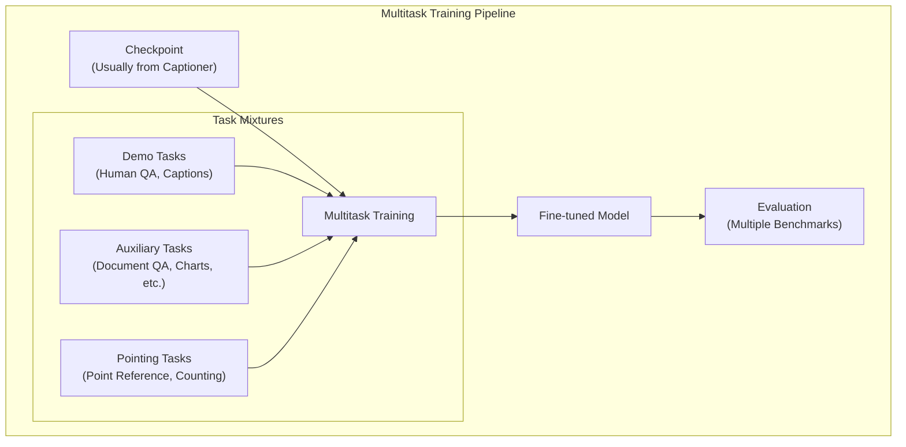
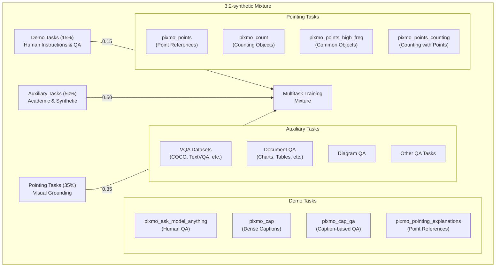
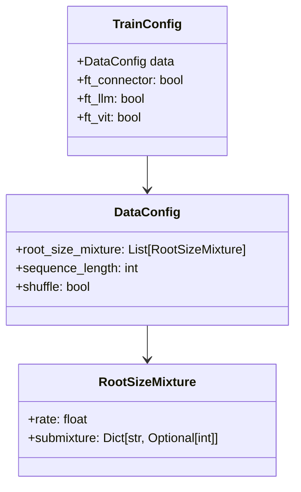
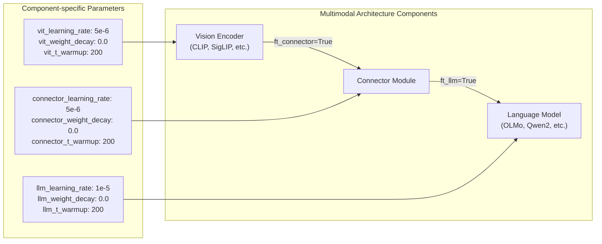
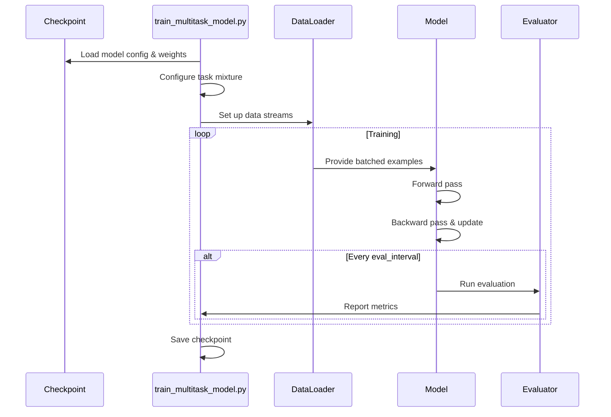

<!-- source: DeepWiki mcp.deepwiki.com · repo allenai/molmo · page 3.2 Multitask Training · fetched 2026-10-26 -->

# Multitask Training

<details>
<summary>Relevant source files</summary>

The following files were used as context for generating this wiki page:

- [README.md](README.md)
- [launch_scripts/train_multitask_model.py](launch_scripts/train_multitask_model.py)

</details>


This document explains how to configure and run multitask training for Molmo multimodal models. Multitask training allows a single model to learn multiple capabilities simultaneously by training on a mixture of diverse tasks. For information about single-task captioning models, see [Captioner Training](#3.1).

## Overview of Multitask Training

Multitask training in Molmo combines multiple dataset types with different weights to create a balanced training regimen that teaches the model various capabilities simultaneously. This approach differs from single-task training by allowing a model to develop competency across numerous tasks rather than optimizing for just one objective.



Sources: [launch_scripts/train_multitask_model.py:114-143](), [README.md:278-294]()

## Training Mixtures

Molmo supports several predefined training mixtures for different use cases:

| Mixture Name | Description | Main Tasks |
|--------------|-------------|------------|
| `single_*` | Single-task training | Specified task only |
| `debug` | Small mixture for debugging | Chart QA, Doc QA |
| `small1` | Small training mixture | Chart QA, Doc QA |
| `small2` | Expanded small mixture | Chart QA, Doc QA, Info QA |
| `3.2-synthetic` | Production mixture | Multiple task groups with varied weights |

The `3.2-synthetic` mixture is the primary production-ready mixture, composed of three task groups:



Sources: [launch_scripts/train_multitask_model.py:114-143]()

## Task Weighting System

The multitask training system uses a hierarchical weighting approach:

1. **Group-level weighting**: The main mixture assigns weights to task groups (e.g., Demo tasks 15%, Auxiliary tasks 50%, Pointing tasks 35%)
2. **Task-level weighting**: Within each group, individual tasks can be weighted by:
   - Equal weighting (default)
   - Fixed size limiting (e.g., `pixmo_cap` limited to 50,000 examples)

The weighting system is implemented through the `RootSizeMixture` configuration in the training setup.



Sources: [launch_scripts/train_multitask_model.py:192-195](), [launch_scripts/train_multitask_model.py:60-69]()

## Component-wise Fine-tuning

Multitask training allows fine-tuning different components of the multimodal architecture:

| Component | Parameter | Default | Description |
|-----------|-----------|---------|------------|
| Vision Encoder | `ft_vit` | `True` | Fine-tune the vision transformer |
| Connector | `ft_connector` | `True` | Fine-tune the vision-language connector |
| Language Model | `ft_llm` | `True` | Fine-tune the language model |

Each component has its own learning rate, weight decay, and training parameters:



Sources: [launch_scripts/train_multitask_model.py:239-265]()

## Training Setup

### Launch Configuration

To launch a multitask training job:

```bash
torchrun --nproc-per-node=8 launch_scripts/train_multitask_model.py 3.2-synthetic /path/to/checkpoint \
--wandb.name=run_name --wandb.entity=entity --wandb.project=project \
--save_folder=/path/to/save/folder
```

Key parameters:
- First argument: Mixture name (`3.2-synthetic`, `debug`, etc.)
- Second argument: Path to checkpoint to start from (typically a captioner model)
- `--save_folder`: Directory to save checkpoints
- `--wandb.*`: Weights & Biases logging configuration

Sources: [README.md:278-284]()

### Sequence Length and Batch Size

Multitask training allows configuring various sequence length and batch size parameters:

| Parameter | Default | Description |
|-----------|---------|------------|
| `--seq_len` | 2304 | Maximum sequence length for training |
| `--inf_seq_len` | 1792 | Sequence length for inference evaluation |
| `--global_batch_size` | 256 | Total batch size across all GPUs |
| `--device_train_batch_size` | 4 | Per-GPU batch size for training |
| `--device_eval_batch_size` | 4 | Per-GPU batch size for evaluation |
| `--device_inf_batch_size` | 4 | Per-GPU batch size for inference |

Sources: [launch_scripts/train_multitask_model.py:92-97]()

## Training Process

The training process involves:

1. Loading a starting checkpoint (typically from captioner training)
2. Configuring the task mixture and training parameters
3. Setting up evaluation tasks for periodic assessment
4. Running distributed training with FSDP (Fully Sharded Data Parallel)



Sources: [launch_scripts/train_multitask_model.py:175-181](), [launch_scripts/train_multitask_model.py:209-296]()

## Debug vs. Production Settings

For debugging purposes, a special configuration is provided:

| Setting | Debug | Production |
|---------|-------|------------|
| Global batch size | 8 | 256 |
| Evaluation interval | 20 steps | 2000 steps |
| Log interval | 5 steps | 20 steps |
| Max duration | 1000 steps | 30000 steps |
| Evaluation examples | 16 | 2048 |
| Model architecture | Small debug model | Full-scale model |

Sources: [launch_scripts/train_multitask_model.py:157-181]()

## Evaluation During Training

Multitask training incorporates periodic evaluation on various downstream tasks to monitor progress:

| Parameter | Description |
|-----------|-------------|
| `eval_interval` | Steps between evaluation runs |
| `inf_eval_interval` | Steps between inference evaluations |
| `max_inf_examples` | Maximum examples to evaluate per task |

Key evaluation tasks for the `3.2-synthetic` mixture include:
- Chart QA
- Info QA
- Doc QA
- Diagram QA
- COCO VQA
- Android Control
- Pointing evaluation
- Counting benchmark

Sources: [launch_scripts/train_multitask_model.py:117-126](), [launch_scripts/train_multitask_model.py:197-207]()

## Related Features

The multitask training setup includes several advanced features:

1. **Activation checkpointing**: Conserves memory by not storing all activations
2. **Auxiliary loss**: Additional softmax loss for improved stability
3. **Distributed training**: FSDP for efficient multi-GPU training
4. **Warm-up scheduling**: Separate warm-up periods for different components

Sources: [launch_scripts/train_multitask_model.py:266-270](), [launch_scripts/train_multitask_model.py:288-290]()

---

