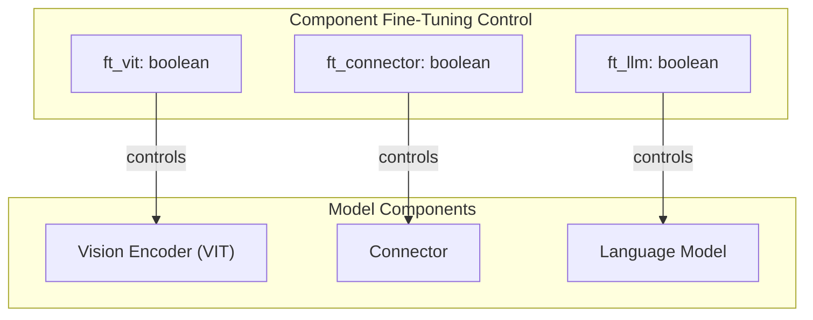
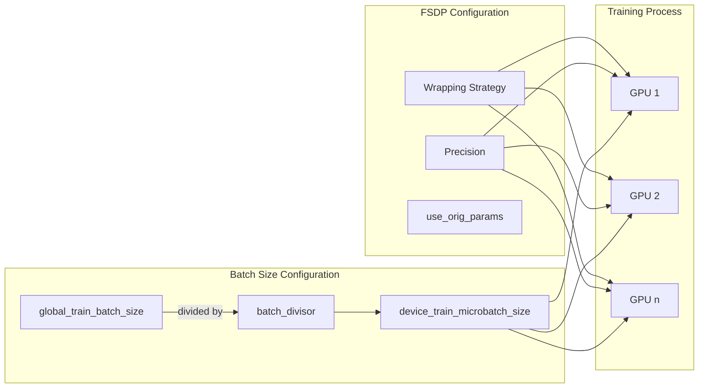
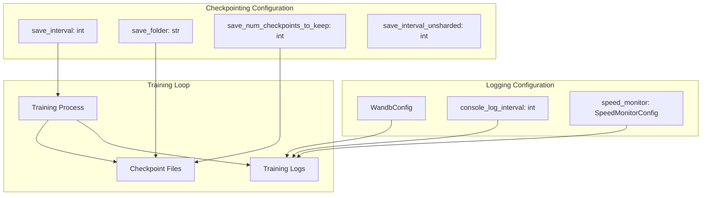
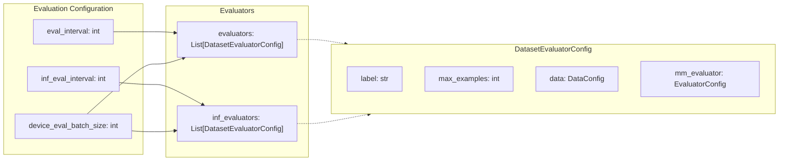

<!-- source: DeepWiki mcp.deepwiki.com · repo allenai/molmo · page 3.3 Training Configuration · fetched 2026-10-26 -->

# Training Configuration

<details>
<summary>Relevant source files</summary>

The following files were used as context for generating this wiki page:

- [launch_scripts/train_captioner.py](launch_scripts/train_captioner.py)
- [launch_scripts/train_multitask_model.py](launch_scripts/train_multitask_model.py)
- [launch_scripts/utils.py](launch_scripts/utils.py)

</details>


This page provides a detailed explanation of the configuration options available for training Molmo multimodal models. It covers the structure and parameters of the training configuration system, which is used to control model architecture, data processing, optimization, distributed training, and evaluation. For information on specific training workflows, see [Captioner Training](#3.1) and [Multitask Training](#3.2).

## Configuration Overview

Molmo uses a hierarchical configuration system to manage the complex settings required for training multimodal models. The `TrainConfig` class serves as the top-level configuration object, which contains nested configuration objects for different aspects of the training process.

```mermaid
classDiagram
    class "TrainConfig" {
        +ModelConfig model
        +DataConfig data
        +OptimizerConfig optimizer
        +SchedulerConfig scheduler
        +FSDPConfig fsdp
        +WandbConfig wandb
        +bool ft_connector
        +bool ft_llm
        +bool ft_vit
        +int global_train_batch_size
        +int device_train_microbatch_size
        +int device_eval_batch_size
        +int max_duration
        +str precision
        +str save_folder
        +int save_interval
        +List evaluators
    }
```

Sources: [launch_scripts/train_captioner.py:110-203](), [launch_scripts/train_multitask_model.py:209-295]()

## Model Configuration

The `ModelConfig` defines the architecture of the Molmo multimodal model, including the vision encoder, language model, and connector components.

```mermaid
classDiagram
    class "ModelConfig" {
        +VisionBackboneConfig vision_backbone
        +TokenizerConfig tokenizer
        +int d_model
        +int n_heads
        +int n_layers
        +int vocab_size
        +int max_sequence_length
        +bool rope
        +str crop_mode
        +int max_crops
        +List vit_layers
    }
    class "VisionBackboneConfig" {
        +str image_model_type
        +Tuple image_default_input_size
        +int image_patch_size
        +int image_emb_dim
        +int image_num_heads
        +int image_num_layers
    }
    class "TokenizerConfig" {
        +str identifier
    }
    ModelConfig --> VisionBackboneConfig
    ModelConfig --> TokenizerConfig
```

Sources: [launch_scripts/utils.py:13-31](), [launch_scripts/utils.py:146-229](), [launch_scripts/utils.py:233-287](), [launch_scripts/utils.py:290-332](), [launch_scripts/utils.py:334-391]()

### Supported Vision Encoders

Molmo supports multiple vision encoders, each with different architectures and capabilities:

| Vision Encoder | Type | Input Size | Features |
|---------------|------|------------|----------|
| CLIP (OpenAI) | `openai` | 336×336 | 1024-dim embeddings, 23 layers |
| SigLIP | `siglip` | 378×378 | 1152-dim embeddings, 27 layers |
| DINOv2 | `dino` | 336×336 | 1024-dim embeddings, 24 layers |
| MetaCLIP | `metaclip` | 336×336 | 1024-dim embeddings, 24 layers |

Sources: [launch_scripts/utils.py:146-229](), [launch_scripts/utils.py:406-411]()

### Supported Language Models

Molmo can be integrated with several language models:

| Language Model | Parameters | Architecture | Tokenizer |
|---------------|------------|--------------|-----------|
| OLMoE | 1B (MoE) | 2048-dim, 16 layers, 64 experts | `allenai/OLMoE-1B-7B-0924` |
| OLMo | 7B | 4096-dim, 32 layers | `allenai/dolma2-tokenizer` |
| Qwen2-7B | 7B | 3584-dim, 28 layers | `Qwen/Qwen2-7B` |
| Qwen2-72B | 72B | 8192-dim, 80 layers | `Qwen/Qwen2-72B` |

Sources: [launch_scripts/utils.py:233-287](), [launch_scripts/utils.py:290-332](), [launch_scripts/utils.py:334-391](), [launch_scripts/utils.py:414-419]()

## Data Configuration

The `DataConfig` controls how data is loaded, processed, and fed to the model during training. It supports both single dataset training and multi-dataset training with weighted mixtures.

```mermaid
classDiagram
    class "DataConfig" {
        +str dataset
        +List root_size_mixture
        +int sequence_length
        +bool for_inference
        +bool shuffle
        +str split
        +bool drop_last
        +int num_workers
        +str pad
        +bool shuffle_messages
        +bool pin_memory
    }
    class "RootSizeMixture" {
        +float rate
        +Dict submixture
    }
    DataConfig --> RootSizeMixture
```

Sources: [launch_scripts/train_captioner.py:93-107](), [launch_scripts/train_captioner.py:124-136](), [launch_scripts/train_multitask_model.py:226-238]()

### Dataset Mixture Configuration

For multitask training, Molmo uses a weighted mixture of datasets. Each mixture is defined by:

1. A weight (rate) determining how frequently it's sampled
2. A list of datasets in the mixture, optionally with size limits

Example of dataset mixture configuration:

```
[
    ["demo", ["pixmo_ask_model_anything", ("pixmo_cap", 50000)], 0.15],
    ["aux", ["chart_qa", "doc_qa", "info_qa"], 0.50],
    ["pointing", ["pixmo_points", "pixmo_count"], 0.35]
]
```

Sources: [launch_scripts/train_multitask_model.py:28-57](), [launch_scripts/train_multitask_model.py:97-143](), [launch_scripts/train_multitask_model.py:194-196]()

## Optimizer and Scheduler Configuration

Molmo uses separate learning rates and optimization parameters for different components of the model (vision encoder, language model, and connector).

```mermaid
classDiagram
    class "OptimizerConfig" {
        +OptimizerType name
        +float connector_learning_rate
        +float vit_learning_rate
        +float llm_learning_rate
        +float connector_weight_decay
        +float vit_weight_decay
        +float llm_weight_decay
        +List connector_betas
        +List vit_betas
        +List llm_betas
    }
    class "SchedulerConfig" {
        +SchedulerType name
        +int connector_t_warmup
        +int vit_t_warmup
        +int llm_t_warmup
        +float alpha_f
        +float warmup_min_lr
    }
```

Sources: [launch_scripts/train_captioner.py:140-155](), [launch_scripts/train_captioner.py:156-163](), [launch_scripts/train_multitask_model.py:242-257](), [launch_scripts/train_multitask_model.py:258-265]()

### Learning Rate Configuration

The learning rates for different components can be configured separately:

| Component | Parameter | Typical Range | Description |
|-----------|-----------|---------------|-------------|
| Connector | `connector_learning_rate` | 2e-4 to 5e-6 | Controls learning rate for the connector module |
| Vision Encoder | `vit_learning_rate` | 6e-6 to 5e-6 | Controls learning rate for the vision encoder |
| Language Model | `llm_learning_rate` | 2e-5 to 1e-5 | Controls learning rate for the language model |

Sources: [launch_scripts/train_captioner.py:142-144](), [launch_scripts/train_multitask_model.py:244-246]()

### Component-Wise Fine-Tuning

Molmo allows for selectively fine-tuning specific components of the multimodal architecture:



Sources: [launch_scripts/train_captioner.py:137-139](), [launch_scripts/train_multitask_model.py:239-241]()

## Distributed Training Configuration

Molmo uses Fully Sharded Data Parallel (FSDP) for distributed training across multiple GPUs.



Sources: [launch_scripts/train_captioner.py:164-168](), [launch_scripts/train_captioner.py:176-178](), [launch_scripts/train_multitask_model.py:266-270](), [launch_scripts/train_multitask_model.py:276-279]()

### Batch Size Configuration

The batch size configuration involves several parameters:

| Parameter | Description |
|-----------|-------------|
| `global_train_batch_size` | Total batch size across all GPUs |
| `device_train_microbatch_size` | Batch size per GPU per forward/backward pass |
| `device_eval_batch_size` | Batch size per GPU during evaluation |
| `batch_divisor` | How to divide the global batch (by global batch or by gradient accumulation) |

Sources: [launch_scripts/train_captioner.py:176-178](), [launch_scripts/train_multitask_model.py:276-279]()

## Checkpointing and Logging

Molmo provides extensive configuration options for model checkpointing and training progress logging.



Sources: [launch_scripts/train_captioner.py:116-122](), [launch_scripts/train_captioner.py:169-176](), [launch_scripts/train_multitask_model.py:215-221](), [launch_scripts/train_multitask_model.py:272-275]()

### WandB Configuration

The `WandbConfig` allows configuring Weights & Biases logging:

| Parameter | Description |
|-----------|-------------|
| `name` | Run name in WandB |
| `project` | Project name in WandB |
| `entity` | Team/user name in WandB |
| `log_interval` | How often to log metrics |
| `group` | Optional group name for related runs |

Sources: [launch_scripts/train_captioner.py:116-122](), [launch_scripts/train_multitask_model.py:215-221]()

## Evaluation Configuration

Molmo supports periodic evaluation during training, with configuration for both loss evaluation and inference-based evaluation.



Sources: [launch_scripts/train_captioner.py:190-202](), [launch_scripts/train_multitask_model.py:292-295](), [launch_scripts/utils.py:77-143]()

### Task-Specific Evaluators

Molmo provides task-specific evaluators for different multimodal tasks:

| Task | Evaluator | Metrics |
|------|-----------|---------|
| VQA | `vqa_eval` | VQA score, accuracy |
| Pointing | `pointing_eval` | Pointing accuracy |
| Counting | `count_eval`, `point_count_eval` | Counting accuracy |
| Clocks | `clock_eval` | Clock reading accuracy |
| Charts | `vqa_eval="relaxed_correctness,em"` | Relaxed correctness, exact match |
| Document QA | `vqa_eval="ansl,em"` | Answer similarity, exact match |
| Math | `math_vista_eval` | Mathematical accuracy |

Sources: [launch_scripts/utils.py:33-74]()

## Example Configurations

Below are example configurations for common training scenarios in Molmo:

### Captioner Training Configuration

Key parameters for training a captioner model (simplified):

```
TrainConfig:
  model: Qwen2-7B with CLIP vision encoder
  data: pixmo_cap_with_transcripts dataset
  ft_connector: True
  ft_llm: True
  ft_vit: True
  optimizer:
    connector_learning_rate: 2e-4
    vit_learning_rate: 6e-6
    llm_learning_rate: 2e-5
  scheduler:
    connector_t_warmup: 200
    vit_t_warmup: 2000
    llm_t_warmup: 2000
  global_train_batch_size: 128
  device_train_microbatch_size: 4
  device_eval_batch_size: 4
  precision: "amp_bf16"
```

Sources: [launch_scripts/train_captioner.py:110-203]()

### Multitask Training Configuration

Key parameters for multitask training (simplified):

```
TrainConfig:
  model: (loaded from checkpoint)
  data:
    root_size_mixture:
      - rate: 0.15
        submixture: [pixmo_ask_model_anything, pixmo_cap, pixmo_cap_qa]
      - rate: 0.50
        submixture: [chart_qa, doc_qa, info_qa, ...]
      - rate: 0.35
        submixture: [pixmo_points, pixmo_count, ...]
  ft_connector: True
  ft_llm: True
  ft_vit: True
  optimizer:
    connector_learning_rate: 5e-6
    vit_learning_rate: 5e-6
    llm_learning_rate: 1e-5
  scheduler:
    connector_t_warmup: 200
    vit_t_warmup: 200
    llm_t_warmup: 200
  global_train_batch_size: 256
  device_train_microbatch_size: 4
  precision: "amp_bf16"
```

Sources: [launch_scripts/train_multitask_model.py:209-295]()

---

