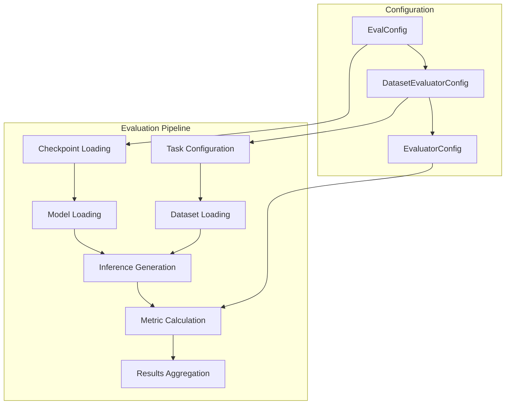
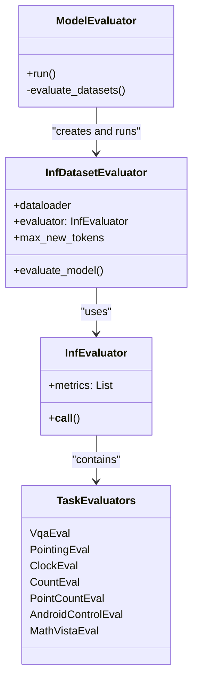
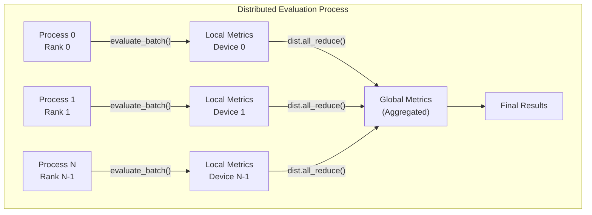
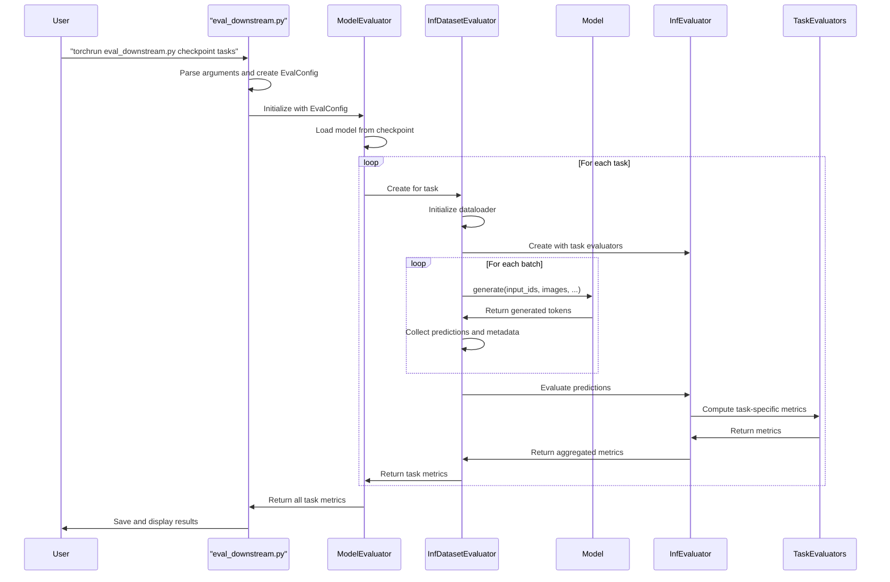

<!-- source: DeepWiki mcp.deepwiki.com · repo allenai/molmo · page 4 Evaluation · fetched 2026-10-26 -->

# Evaluation

<details>
<summary>Relevant source files</summary>

The following files were used as context for generating this wiki page:

- [README.md](README.md)
- [launch_scripts/eval_downstream.py](launch_scripts/eval_downstream.py)
- [olmo/eval/inf_evaluator.py](olmo/eval/inf_evaluator.py)

</details>


This document provides a comprehensive overview of the evaluation framework used to assess the performance of Molmo multimodal language models. It covers the evaluation pipeline architecture, available task-specific evaluators, and instructions for running evaluations. For information about training models, see [Training](#3).

## Evaluation Framework Overview

The Molmo evaluation system is designed to enable systematic assessment of multimodal language models across a diverse range of tasks, from visual question answering to counting and pointing tasks. The framework supports both low-resolution and high-resolution evaluation settings, with configurable batch sizes and distributed processing capabilities to handle large models efficiently.



Sources: [launch_scripts/eval_downstream.py:169-188](), [olmo/eval/inf_evaluator.py:30-71]()

## Evaluation Components

The evaluation system comprises several key components that work together to provide comprehensive assessment of model capabilities:



Sources: [olmo/eval/inf_evaluator.py:30-71](), [olmo/eval/inf_evaluator.py:109-198]()

### ModelEvaluator

The top-level component that orchestrates the evaluation process. It's initialized with an `EvalConfig` and responsible for:
- Loading the model checkpoint
- Setting up task-specific evaluators
- Running evaluation across multiple datasets
- Aggregating and reporting results

### InfDatasetEvaluator

Handles evaluation of a model on a specific dataset:
- Manages the dataloader for the task
- Processes batches and passes them to the model
- Collects model predictions for evaluation
- Supports distributed evaluation and progress reporting

### InfEvaluator

Evaluates the text outputs from a model on a specific task:
- Contains a list of task-specific evaluators (metrics)
- Calls each evaluator to compute metrics on the model predictions
- Handles aggregation of metrics across distributed processes
- Reports final metrics for the task

### Task-Specific Evaluators

The system includes several specialized evaluators for different multimodal tasks:

| Evaluator | Purpose | Metrics |
|-----------|---------|---------|
| VqaEval | Visual Question Answering | Accuracy |
| PointingEval | Pointing to objects in images | Accuracy |
| ClockEval | Reading time from clock images | Accuracy |
| CountEval | Counting objects in images | Per-category accuracy, average |
| PointCountEval | Counting with pointing | Accuracy |
| AndroidControlEval | Android UI control tasks | Success rate |
| MathVistaEval | Math reasoning with visual context | Accuracy |

Sources: [olmo/eval/inf_evaluator.py:15-18](), [olmo/eval/inf_evaluator.py:74-106]()

## Running Evaluations

The primary interface for running evaluations is the `eval_downstream.py` script, which can be used to evaluate a model checkpoint on one or more tasks.

### Basic Usage

To evaluate a model on a single task:

```bash
torchrun --nproc-per-node 8 launch_scripts/eval_downstream.py [checkpoint] [task] --save_to_checkpoint_dir
```

Where:
- `[checkpoint]` is the path to the model checkpoint
- `[task]` is the name of the task to evaluate (e.g., `text_vqa`, `chart_qa`)

### Predefined Task Sets

The evaluation system includes predefined sets of tasks that can be evaluated together:

1. **Low-resolution tasks** (`low-res`):
   - `android_control_ll`
   - `countbench_qa:huggingface`
   - `pixmo_count_counting:validation`

2. **High-resolution tasks** (`high-res`):
   - `coco_2014_vqa_multi`
   - `text_vqa`
   - `okvqa`
   - `chart_qa`
   - `doc_qa`
   - `info_qa`
   - `science_qa_img`
   - `ai2_diagram_v2_mix_transparent`
   - `a_okvqa_mc`
   - `a_okvqa_da`
   - `mmmu_test`
   - `real_world_qa_no_instruction:test`
   - `math_vista_v2`

To run evaluation on these predefined sets:

```bash
# For low-resolution tasks
torchrun --nproc-per-node 8 launch_scripts/eval_downstream.py [checkpoint] low-res --save_to_checkpoint_dir

# For high-resolution tasks (with FSDP and reduced batch size)
torchrun --nproc-per-node 8 launch_scripts/eval_downstream.py [checkpoint] high-res --save_to_checkpoint_dir --high_res --fsdp --device_batch_size=2
```

Sources: [launch_scripts/eval_downstream.py:74-128](), [README.md:202-229]()

### Configuration Options

The evaluation script supports several configuration options:

| Option | Description | Default |
|--------|-------------|---------|
| `--high_res` | Use high-resolution settings (36 crops, 4096 seq len) | False |
| `--max_examples` | Maximum number of examples to evaluate | -1 (all) |
| `--max_crops` | Override model's default number of crops | None |
| `--seq_len` | Maximum sequence length to use | 1536 |
| `--device_batch_size` | Batch size per GPU | 4 |
| `--save_dir` | Directory to save evaluation results | None |
| `--save_to_checkpoint_dir` | Save results to checkpoint directory | False |
| `--eval_name` | Prefix for saved results | None |
| `--pbar` | Show progress bar during evaluation | False |
| `--overwrite` | Overwrite cached metrics | False |
| `--fsdp` | Use Fully Sharded Data Parallel for memory efficiency | False |
| `--max_new_tokens` | Maximum number of tokens to generate | Task-specific |

Sources: [launch_scripts/eval_downstream.py:25-53]()

## Distributed Evaluation

The evaluation framework is designed to take advantage of multiple GPUs for efficient evaluation of large models and datasets. The system uses PyTorch's Distributed Data Parallel (DDP) for standard evaluations and Fully Sharded Data Parallel (FSDP) for memory-intensive evaluations.



Sources: [olmo/eval/inf_evaluator.py:37-71](), [launch_scripts/eval_downstream.py:49-50](), [launch_scripts/eval_downstream.py:177-180]()

### Fully Sharded Data Parallel (FSDP)

For high-resolution evaluation or very large models (e.g., Molmo-72B), FSDP is used to shard model parameters across multiple GPUs, reducing per-GPU memory requirements. This is enabled with the `--fsdp` flag:

```bash
torchrun --nproc-per-node 8 launch_scripts/eval_downstream.py [checkpoint] [task] --fsdp --device_batch_size=2
```

The FSDP configuration is specified in the `EvalConfig` object:

```python
fsdp=FSDPConfig(
    wrapping_strategy=FSDPWrapStrategy.by_block_and_size,
    precision=FSDPPrecision.float,
)
```

For the 72B model, multi-node evaluation is often necessary:

```bash
# Run on multiple nodes with appropriate arguments
torchrun --nnodes=N --node_rank=RANK --master_addr=MASTER_IP --master_port=PORT --nproc-per-node=GPUS_PER_NODE launch_scripts/eval_downstream.py Molmo-72B-0924 high-res --save_to_checkpoint_dir --high_res --fsdp --device_batch_size=1
```

Sources: [launch_scripts/eval_downstream.py:177-180](), [README.md:231-237]()

## Evaluation Workflow

The diagram below illustrates the complete evaluation workflow, from configuration to result reporting:



Sources: [launch_scripts/eval_downstream.py:188](), [olmo/eval/inf_evaluator.py:120-197]()

## Caching Evaluation Results

The evaluation system includes a caching mechanism to avoid redundant evaluations. When evaluations are run, the metrics and predictions are saved to the specified directory (either the checkpoint directory with `--save_to_checkpoint_dir` or a custom directory with `--save_dir`).

Future evaluations will check for cached metrics and reuse them unless the `--overwrite` flag is used:

```bash
# Overwrite cached metrics
torchrun --nproc-per-node 8 launch_scripts/eval_downstream.py [checkpoint] [task] --save_to_checkpoint_dir --overwrite
```

This is particularly useful when running multiple evaluations on the same model, as it allows for incremental testing and result collection.

Sources: [README.md:235-237](), [launch_scripts/eval_downstream.py:151]()

## Evaluation Result Format

After evaluation completes, the results are saved in the specified directory with the following structure:

```
[save_dir]/
├── [eval_name]_[task]_metrics.json  # Task-specific metrics
├── [eval_name]_[task]_predictions.json  # Model predictions
└── [eval_name]_[task]_examples.json  # Example inputs and outputs
```

These files can be analyzed to understand model performance and behavior on specific tasks, and they serve as inputs for more detailed error analysis or model comparison.

Sources: [olmo/eval/inf_evaluator.py:76-86]()

---

