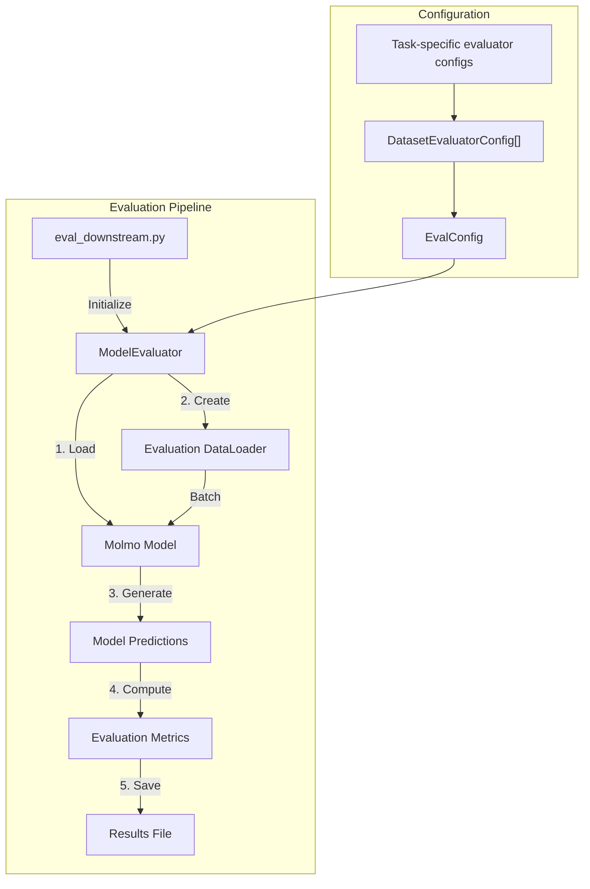
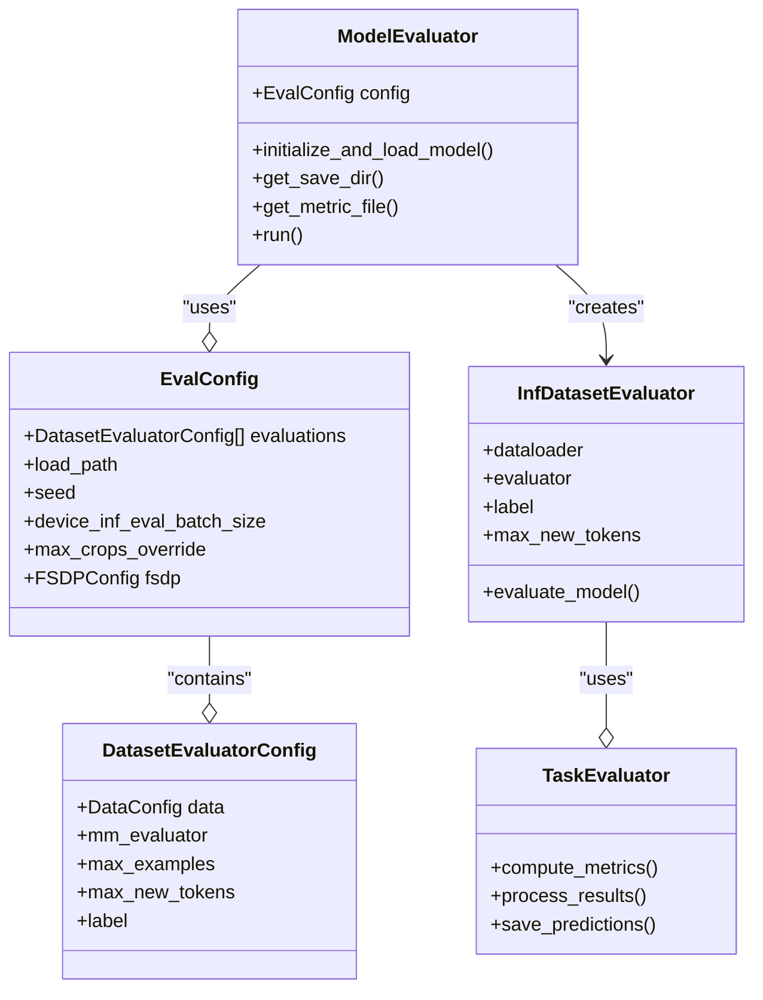
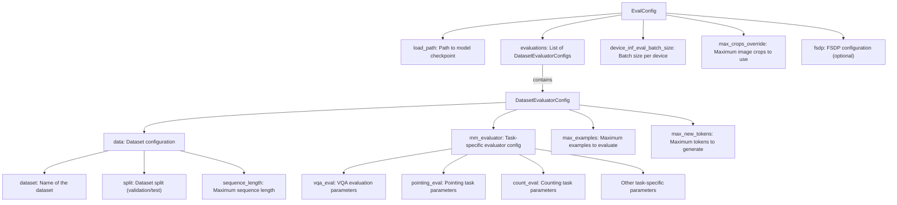
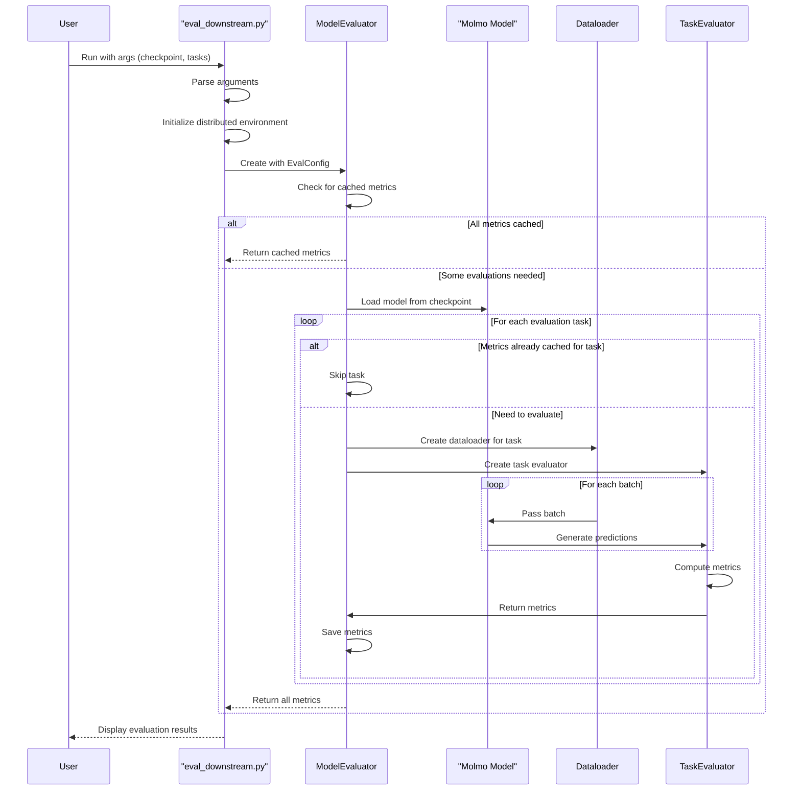
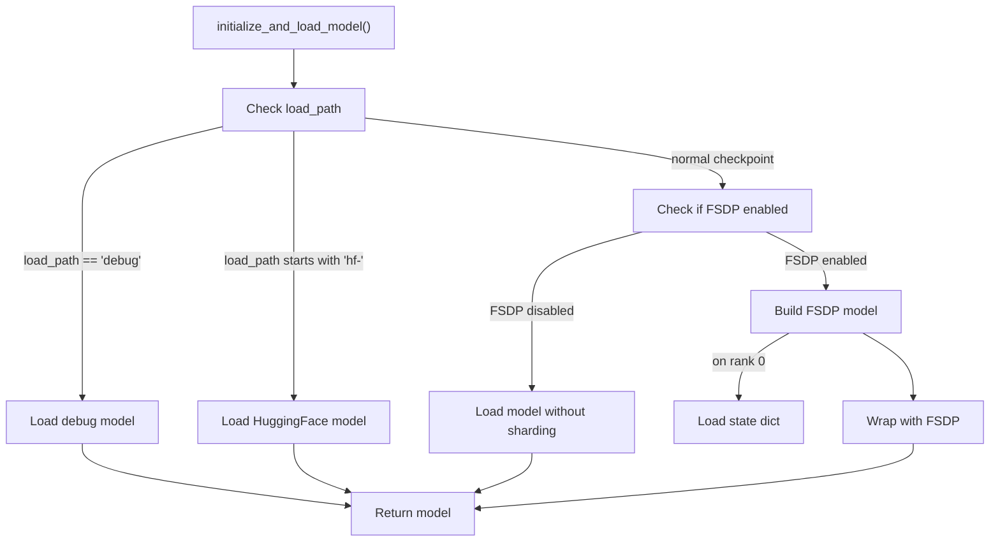

<!-- source: DeepWiki mcp.deepwiki.com · repo allenai/molmo · page 4.1 Evaluation Pipeline · fetched 2026-10-26 -->

# Evaluation Pipeline

<details>
<summary>Relevant source files</summary>

The following files were used as context for generating this wiki page:

- [README.md](README.md)
- [launch_scripts/eval_downstream.py](launch_scripts/eval_downstream.py)
- [scripts/mm_eval.py](scripts/mm_eval.py)

</details>


The Evaluation Pipeline in Molmo provides a robust framework for assessing the performance of multimodal models across a variety of tasks. This document explains how to run evaluations on trained Molmo models, how the evaluation system works internally, and how to interpret and store evaluation results.

For information about specific task evaluators used within this pipeline, see [Task-Specific Evaluators](#4.2).

## Overview

The Molmo evaluation pipeline allows users to test trained models on diverse multimodal tasks, from visual question answering to document understanding to counting. The pipeline supports:

- Distributed evaluation across multiple GPUs
- High-resolution image processing
- Metric computation and reporting
- Result caching to avoid redundant evaluations
- Configurable evaluation parameters



Sources: [launch_scripts/eval_downstream.py:1-192](), [scripts/mm_eval.py:1-356]()

## Core Components

The evaluation pipeline consists of these key components:

| Component | Purpose | Key Classes |
|-----------|---------|-------------|
| Entry Point | Command-line interface for evaluation | `eval_downstream.py` |
| Evaluator | Core evaluation logic | `ModelEvaluator` |
| Dataset Evaluator | Task-specific evaluation | `InfDatasetEvaluator` |
| Metrics Processor | Compute and save metrics | Task-specific evaluators |
| Configuration | Define evaluation parameters | `EvalConfig`, `DatasetEvaluatorConfig` |

Sources: [launch_scripts/eval_downstream.py:25-188](), [scripts/mm_eval.py:69-331]()

### Internal Architecture



Sources: [scripts/mm_eval.py:69-108](), [scripts/mm_eval.py:109-208](), [scripts/mm_eval.py:210-331]()

## Evaluation Configuration

Evaluations are configured through a hierarchical configuration system, centered around the `EvalConfig` class. This configuration specifies which model to evaluate, which tasks to evaluate on, and various parameters controlling the evaluation process.

### Configuration Structure



Sources: [launch_scripts/eval_downstream.py:169-181](), [scripts/mm_eval.py:22-24]()

## Running Evaluations

### Command-Line Interface

The primary entry point for running evaluations is the `eval_downstream.py` script, which should be executed with `torchrun` for distributed evaluation:

```
torchrun --nproc-per-node [NUM_GPUS] launch_scripts/eval_downstream.py [CHECKPOINT] [TASKS] [OPTIONS]
```

Key parameters:

- `CHECKPOINT`: Path to the model checkpoint to evaluate
- `TASKS`: Names of tasks to evaluate on (can be individual tasks or predefined task groups)
- `--high_res`: Use high-resolution settings (max_crops=36, seq_len=4096)
- `--fsdp`: Use Fully Sharded Data Parallel for reduced memory usage
- `--save_to_checkpoint_dir`: Save results to the checkpoint directory
- `--max_examples`: Maximum number of examples to evaluate
- `--device_batch_size`: Batch size per GPU device

Sources: [launch_scripts/eval_downstream.py:26-53](), [README.md:202-236]()

### Task Selection

The system supports evaluating on individual tasks or predefined task groups:

- `low-res`: Standard resolution validation tasks (android_control, countbench, pixmo_count)
- `high-res`: High resolution validation tasks (VQA, TextVQA, ChartQA, DocQA, etc.)
- `test-low-res`: Standard resolution test tasks
- `test-high-res`: High resolution test tasks
- Individual task names: `text_vqa`, `chart_qa`, `doc_qa`, etc.

Sources: [launch_scripts/eval_downstream.py:72-129]()

### Example Commands

For standard resolution evaluation on a single task:

```
torchrun --nproc-per-node 8 launch_scripts/eval_downstream.py Molmo-7B-D-0924 text_vqa --save_to_checkpoint_dir
```

For high resolution evaluation (requires more memory):

```
torchrun --nproc-per-node 8 launch_scripts/eval_downstream.py Molmo-7B-D-0924 text_vqa --save_to_checkpoint_dir --high_res --fsdp --device_batch_size=2
```

For running full benchmark evaluation:

```
torchrun --nproc-per-node 8 launch_scripts/eval_downstream.py Molmo-7B-D-0924 low-res --save_to_checkpoint_dir
torchrun --nproc-per-node 8 launch_scripts/eval_downstream.py Molmo-7B-D-0924 high-res --save_to_checkpoint_dir --high_res --fsdp --device_batch_size=2
```

Sources: [README.md:211-229]()

## Evaluation Process Flow

The evaluation pipeline follows these steps when executed:



Sources: [scripts/mm_eval.py:210-331]()

## Model Loading

The evaluation pipeline can load models in different ways depending on the configuration:

1. **Regular Loading**: Loads the entire model on a single GPU
2. **FSDP Loading**: Uses Fully Sharded Data Parallel to distribute the model across multiple GPUs, reducing per-GPU memory requirements
3. **Debug Mode**: Loads a small debug model for testing the pipeline

The `ModelEvaluator.initialize_and_load_model()` method handles model loading based on the configuration:



Sources: [scripts/mm_eval.py:109-208]()

## Result Processing and Storage

The evaluation pipeline saves several types of results:

1. **Metrics**: Quantitative evaluation metrics in JSON format
2. **Predictions**: Model predictions for each example
3. **Visualizations**: HTML visualizations of model outputs (if enabled)

Results are saved to either:
- A specified save directory (`--save_dir`)
- The checkpoint directory (`--save_to_checkpoint_dir`)

The `get_save_dir()` and `get_metric_file()` methods determine where to save results based on the configuration.

Sources: [scripts/mm_eval.py:74-108]()

### Metrics Caching

To avoid redundant evaluations, the pipeline supports metrics caching:

1. When evaluating, metrics are saved to a `metrics.json` file
2. When running future evaluations, if `skip_if_metrics_cached=True` and a metrics file exists, the pipeline will load the cached metrics instead of re-evaluating

This is useful for:
- Evaluating a model on different task subsets without duplicating work
- Combining results from different evaluation runs
- Resuming evaluation after an interruption

Sources: [scripts/mm_eval.py:214-236]()

## Distributed Evaluation

The evaluation pipeline uses PyTorch's distributed training framework to enable evaluation across multiple GPUs:

1. The `torchrun` command initializes the distributed process group
2. Each process gets a unique rank and handles a slice of the evaluation data
3. For large models, FSDP (Fully Sharded Data Parallel) can be used to shard the model across GPUs

When using FSDP:
- Only rank 0 loads the model weights initially
- The model parameters are sharded across all GPUs
- This reduces the per-GPU memory requirement, enabling evaluation of larger models

Sources: [launch_scripts/eval_downstream.py:61-67](), [scripts/mm_eval.py:334-343]()

## Key Considerations

When using the evaluation pipeline, keep in mind:

1. **Memory Usage**: High-resolution evaluations require more memory. Use `--fsdp` and adjust `--device_batch_size` if needed.
2. **Speed vs. Quality**: High-resolution evaluations produce better results but are slower.
3. **Result Consistency**: Use the same settings (resolution, crops) for fair comparisons between models.
4. **Test Submissions**: Some test set evaluations require submitting results to external evaluation servers.
5. **Multi-Node Evaluation**: For very large models (72B+), multi-node evaluation may be necessary.

Sources: [README.md:232-236]()

---

