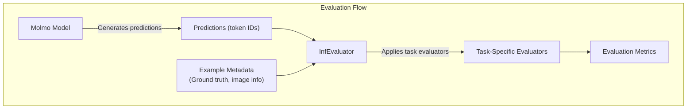
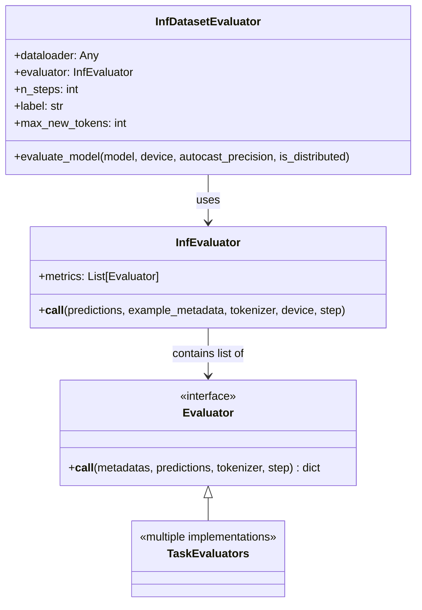
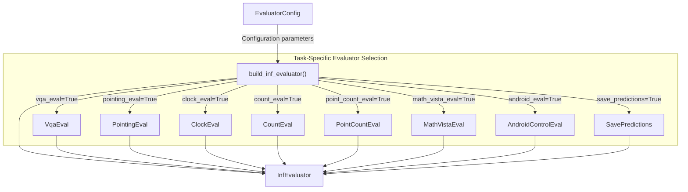
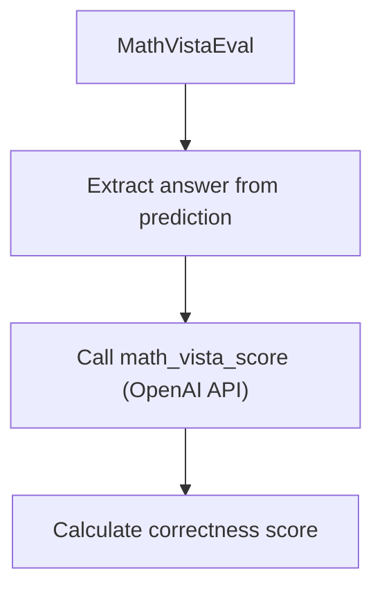
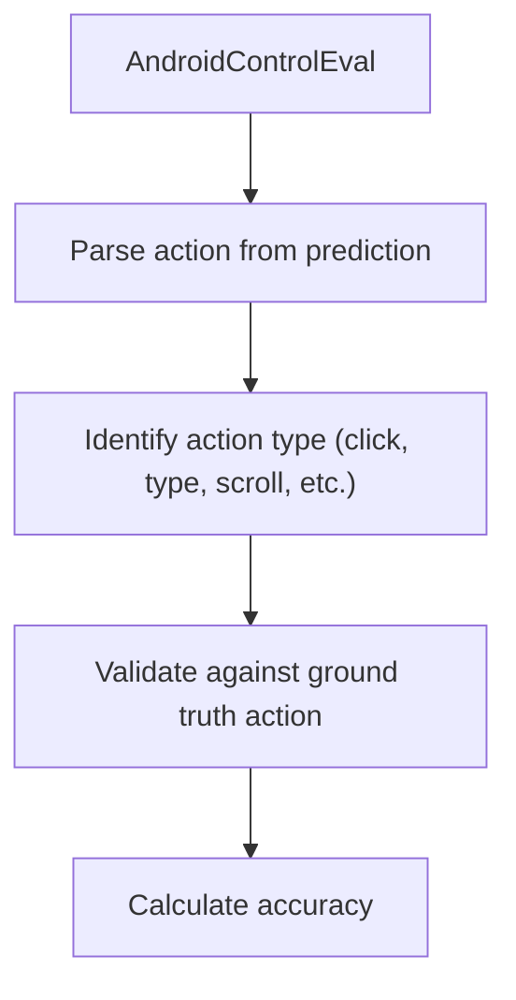
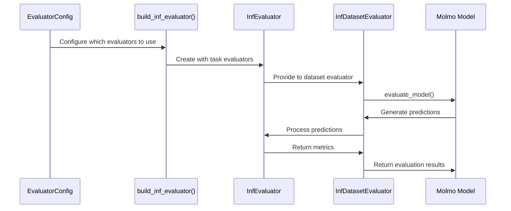

<!-- source: DeepWiki mcp.deepwiki.com · repo allenai/molmo · page 4.2 Task-Specific Evaluators · fetched 2026-10-26 -->

# Task-Specific Evaluators

<details>
<summary>Relevant source files</summary>

The following files were used as context for generating this wiki page:

- [olmo/eval/evaluators.py](olmo/eval/evaluators.py)
- [olmo/eval/inf_evaluator.py](olmo/eval/inf_evaluator.py)

</details>


This document describes the task-specific evaluators in the Molmo system, which are responsible for assessing model performance on various multimodal tasks. These evaluators measure how well models can interpret images and generate appropriate text responses for tasks like visual question answering, pointing at objects, counting, and more. For information about the overall evaluation pipeline, see [Evaluation Pipeline](#4.1).

## Overview

Task-specific evaluators are specialized components that compute metrics for different multimodal tasks. Each evaluator is designed to handle a specific task type and calculate relevant performance metrics. The evaluators process model predictions and ground truth data to quantify how well the model performs at the task.



Sources: [olmo/eval/inf_evaluator.py:30-71](), [olmo/eval/evaluators.py:146-149]()

## Evaluator Architecture

The evaluation system is designed around a hierarchical architecture that allows for flexible configuration and application of different evaluation metrics to model outputs.



Sources: [olmo/eval/inf_evaluator.py:30-71](), [olmo/eval/inf_evaluator.py:109-197]()

### Configuration and Building Evaluators

The evaluation system is configured through the `EvaluatorConfig` object, which specifies which task-specific evaluators to use. The `build_inf_evaluator` function creates an `InfEvaluator` instance with the appropriate evaluators based on the configuration.



Sources: [olmo/eval/inf_evaluator.py:74-106]()

## Available Task-Specific Evaluators

Molmo provides various task-specific evaluators to measure performance across different multimodal tasks:

| Evaluator | Task Type | Key Metrics |
|-----------|-----------|-------------|
| `VqaEval` | Visual Question Answering | vqa_score, ansl, relaxed_correctness |
| `PointingEval` | Object Localization | precision, recall, f1 |
| `ClockEval` | Clock Reading | overall_exact, overall_close, hour_correct, minute_correct |
| `CountEval` | Object Counting | correct, close, valid |
| `PointCountEval` | Point Counting | precision, recall, f1 |
| `MathVistaEval` | Mathematical Visual Tasks | score |
| `AndroidControlEval` | Android Interface Actions | accuracy |
| `SavePredictions` | Prediction Storage | (saves predictions for analysis) |

Sources: [olmo/eval/evaluators.py:615-714](), [olmo/eval/evaluators.py:418-479](), [olmo/eval/evaluators.py:805-911](), [olmo/eval/evaluators.py:742-802](), [olmo/eval/evaluators.py:484-583](), [olmo/eval/evaluators.py:587-615](), [olmo/eval/evaluators.py:374-415](), [olmo/eval/evaluators.py:151-227]()

### VqaEval

The Visual Question Answering evaluator assesses how well models answer questions about images. It supports multiple scoring metrics including VQA score, ANLS (Answer-based Natural Language Score), and relaxed correctness.

```mermaid
flowchart TD
    VQA["VqaEval"] --> |"Process model output"| Extract["Extract answer from prediction"]
    Extract --> Compare["Compare to ground truth answers"]
    Compare --> |"Multiple metrics"| Metrics
    
    subgraph "Metrics"
        Metrics --> VQAScore["vqa_score: Partial match scoring"]
        Metrics --> ANLS["ansl: Answer-based Natural Language Score"]
        Metrics --> Relaxed["relaxed_correctness: Fuzzy matching"]
        Metrics --> MC["mc: Multiple-choice accuracy"]
        Metrics --> EM["em: Exact match"]
    end
```

Sources: [olmo/eval/evaluators.py:615-714]()

### PointingEval

The Pointing evaluator assesses a model's ability to identify specific locations or objects in an image by outputting coordinates.

```mermaid
flowchart TD
    Pointing["PointingEval"] --> Extract["Extract point coordinates from prediction"]
    Extract --> GT["Compare with ground truth points"]
    GT --> Assignment["Compute optimal point assignment"]
    Assignment --> Metrics
    
    subgraph "Metrics"
        Metrics --> Precision["precision: Correct points / predicted points"]
        Metrics --> Recall["recall: Correct points / ground truth points"]
        Metrics --> F1["f1: Harmonic mean of precision and recall"]
    end
```

Sources: [olmo/eval/evaluators.py:418-479]()

### ClockEval

The Clock evaluator assesses how well a model can read analog clocks by parsing time values from text predictions.

```mermaid
flowchart TD
    Clock["ClockEval"] --> Parse["Parse hours, minutes, seconds from text"]
    Parse --> Compare["Compare with ground truth time"]
    Compare --> Metrics
    
    subgraph "Metrics"
        Metrics --> Exact["overall_exact: Exactly correct time"]
        Metrics --> Close["overall_close: Time within error threshold"]
        Metrics --> Hour["hour_correct: Correct hour"]
        Metrics --> Minute["minute_correct: Correct minute"]
        Metrics --> MinuteClose["minute_close: Minute within threshold"]
    end
```

Sources: [olmo/eval/evaluators.py:805-911]()

### CountEval and PointCountEval

These evaluators assess a model's ability to count objects in an image, with `PointCountEval` also evaluating the ability to locate those objects.

```mermaid
flowchart TD
    Count["Count/PointCountEval"] --> ParseCount["Parse number from prediction"]
    ParseCount --> CompareCount["Compare with ground truth count"]
    CompareCount --> Metrics
    
    subgraph "PointCountEval Only"
        ParseCount --> ParsePoints["Extract point coordinates"]
        ParsePoints --> ComparePoints["Compare with ground truth points"]
        ComparePoints --> PointMetrics["Point metrics (precision, recall, f1)"]
    end
    
    subgraph "Metrics"
        Metrics --> Correct["correct: Exactly correct count"]
        Metrics --> Close["close: Count within ±1 error"]
        Metrics --> Valid["valid: Valid numerical prediction"]
    end
```

Sources: [olmo/eval/evaluators.py:484-583](), [olmo/eval/evaluators.py:742-802]()

### MathVistaEval

This evaluator assesses mathematical reasoning ability on visual inputs, using an external API (OpenAI) for scoring.



Sources: [olmo/eval/evaluators.py:587-615]()

### AndroidControlEval

This evaluator assesses a model's ability to generate correct interface actions for Android control tasks.



Sources: [olmo/eval/evaluators.py:374-415]()

## Using Task-Specific Evaluators

Task-specific evaluators are typically used through the `InfEvaluator` and `InfDatasetEvaluator` classes. The evaluation process follows these steps:

1. Configure which task evaluators to use in your `EvaluatorConfig`
2. Create an `InfEvaluator` using `build_inf_evaluator()`
3. Create an `InfDatasetEvaluator` with your dataloader and the `InfEvaluator`
4. Call `evaluate_model()` to run the evaluation



Sources: [olmo/eval/inf_evaluator.py:120-197]()

### Visualization and Logging

Many evaluators support visualization of predictions alongside ground truth and metrics through the `gather_examples_as_html` function. These visualizations can be configured with the `num_wandb_examples` or `n_to_log` parameters to control how many examples to log.

Sources: [olmo/eval/evaluators.py:69-138]()

## Extending with Custom Evaluators

To create a custom evaluator, implement the `Evaluator` interface by creating a class with a `__call__` method that processes predictions and metadata to compute task-specific metrics.

```python
class CustomEval(Evaluator):
    def __init__(self, n_to_log=None):
        self.n_to_log = n_to_log
        
    def __call__(self, metadatas, predictions, tokenizer, step=None):
        # Process predictions and compute metrics
        metrics = {"custom_metric": value}
        
        # Optionally add visualizations
        if self.n_to_log:
            metrics["predictions"] = gather_examples_as_html(
                self.n_to_log, tokenizer, metadatas, predictions, scores
            )
        return metrics
```

Then register your evaluator in the `build_inf_evaluator` function and update `EvaluatorConfig` to include your new evaluator type.

Sources: [olmo/eval/evaluators.py:146-149](), [olmo/eval/inf_evaluator.py:74-106]()

---

