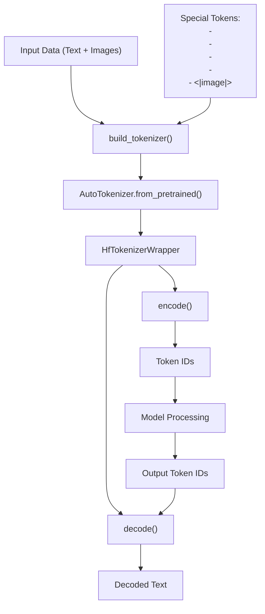
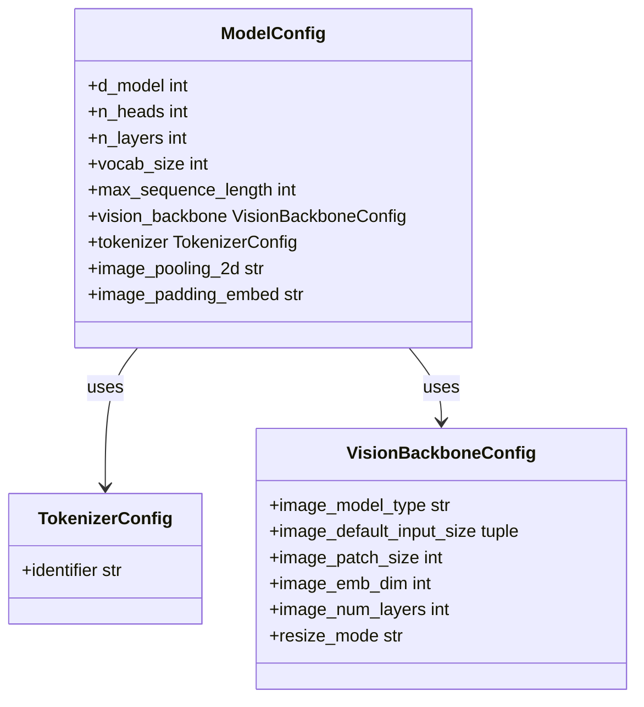
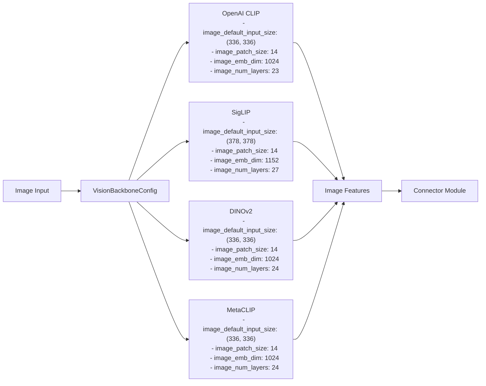
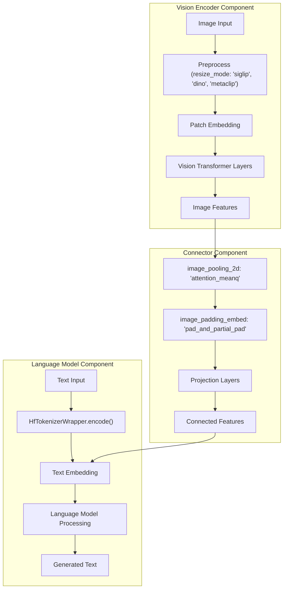
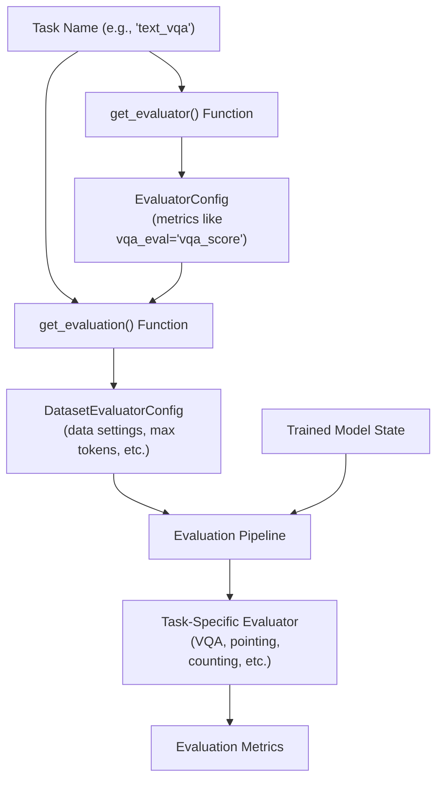

<!-- source: DeepWiki mcp.deepwiki.com · repo allenai/molmo · page 5 Implementation Details · fetched 2026-10-26 -->

# Implementation Details

<details>
<summary>Relevant source files</summary>

The following files were used as context for generating this wiki page:

- [launch_scripts/utils.py](launch_scripts/utils.py)
- [olmo/tokenizer.py](olmo/tokenizer.py)

</details>


This document provides technical details about the underlying implementation of the Molmo multimodal system. It focuses on key technical components that developers need to understand to work with, extend, or debug the system. For information about training configuration, see [Training Configuration](#3.3), and for information about evaluation metrics, see [Evaluation](#4).

## Tokenization for Multimodal Inputs

Molmo uses specialized tokenization to handle multimodal inputs (text and images). The tokenization implementation enables the system to represent both text and image content in a unified format for processing by the language model.

### Special Tokens

The system defines several special tokens to handle image inputs:

- `<im_patch>`: Represents an individual image patch token
- `<im_start>`: Marks the beginning of an image sequence
- `<im_end>`: Marks the end of an image sequence
- `<im_col>`: Used for column separation in image grids
- `<|image|>`: Used as an image prompt token

These tokens are defined as constants in the tokenizer module:

```
DEFAULT_IMAGE_PATCH_TOKEN = f"<im_patch>"
DEFAULT_IM_START_TOKEN = f"<im_start>"
DEFAULT_IM_END_TOKEN = f"<im_end>"
DEFAULT_IM_COL_TOKEN = f"<im_col>"
IMAGE_PROMPT = "<|image|>"

EXTRA_TOKENS = (DEFAULT_IM_START_TOKEN, DEFAULT_IM_END_TOKEN, DEFAULT_IMAGE_PATCH_TOKEN,
                DEFAULT_IM_COL_TOKEN, IMAGE_PROMPT)
```

### Tokenizer Implementation

The tokenization process is handled by the `HfTokenizerWrapper` class, which wraps a Hugging Face tokenizer to provide a consistent interface. 

#### Tokenization Flow



Sources: [olmo/tokenizer.py:17-24](), [olmo/tokenizer.py:27-66](), [olmo/tokenizer.py:69-124]()

### Base Tokenizers

Molmo supports various base tokenizers, with special handling for certain models:

- For Qwen2 and OLMo models, the tokenizers do not have a dedicated BOS (beginning-of-sequence) token, and instead use EOS (end-of-sequence) as a generic separator token.
- The system can pad tokenizers to a specified size, useful when the LLM embedding matrix is larger than the vocabulary size.

```python
# Qwen2 and OLMo tokenizers need special handling
if ("qwen2" in tokenizer_type.lower()) or ("olmo" in tokenizer_type.lower()):
    # These tokenizers do not have a BOS, and instead use EOS as a generic seperator token.
    # In this case we will use EOS as BOS
    assert tokenizer.bos_token_id is None
    bos_token_id = tokenizer.eos_token_id
```

Sources: [olmo/tokenizer.py:104-115]()

## Model Architecture Configurations

Molmo supports multiple model architectures, defined through configuration objects.

### Model Configuration System



Sources: [launch_scripts/utils.py:8-10]()

### Supported Language Models

The system supports several language model architectures, each defined as a comprehensive `ModelConfig` object:

| Model | Parameters | Description |
|-------|------------|-------------|
| OLMoE | 1B/7B | Expert-based mixture-of-experts model with specialized parameters |
| OLMo-1024-Preview | 7B | Dense transformer model with swiglu activation |
| Qwen2-7B | 7B | 28-layer model with grouped-query attention (4 KV heads) |
| Qwen2-72B | 72B | 80-layer model with grouped-query attention (8 KV heads) |

All model configurations include detailed parameters such as:
- Model dimensions (`d_model`)
- Number of attention heads (`n_heads`)
- Number of layers (`n_layers`)
- Maximum sequence length (`max_sequence_length`)
- Activation functions and layer normalization types
- Image handling parameters (`image_pooling_2d`, `image_padding_embed`)

```python
LLMS: Dict[str, ModelConfig] = {
    "olmoe": OLMOE,
    "olmo_1024_preview": OLMO_1024_PREVIEW,
    "qwen2_7b": QWEN2_7B,
    "qwen2_72b": QWEN2_72B,
}
```

Sources: [launch_scripts/utils.py:233-419](), [launch_scripts/utils.py:414-419]()

## Vision Backbone Configurations

The system supports multiple vision backbone architectures for processing images.

### Supported Vision Encoders



The vision backbones are defined in configuration objects and collected in a dictionary:

```python
VISION_BACKBONES: Dict[str, VisionBackboneConfig] = {
    "openai": DEFAULT_VISION_BACKBONE,
    "siglip": SIGLIP_VISION_BACKBONE,
    "dinov2_large_336": DINOV2_LARGE_336_VISION_BACKBONE,
    "metaclip_l14_336": METACLIP_L14_336_VISION_BACKBONE,
}
```

Each vision backbone has specific parameters for image processing:
- Input size and patch dimensions
- Embedding dimensionality
- Number of layers and attention heads
- Activation functions and normalization parameters
- Resize mode for image preprocessing

Sources: [launch_scripts/utils.py:146-185](), [launch_scripts/utils.py:189-230](), [launch_scripts/utils.py:406-411]()

## Multimodal Integration Architecture

This section describes how vision and language components are integrated in the Molmo system.

### Integration Flow



The integration between vision and language components is controlled by specific parameters in the model configuration:

1. **Image Pooling**: The `image_pooling_2d` parameter determines how 2D image features are pooled. The primary method used is `"attention_meanq"`, which uses an attention mechanism with a learnable query vector to pool image features.

2. **Image Padding**: The `image_padding_embed` parameter controls how image features are padded. The method `"pad_and_partial_pad"` handles padding of image features to match the expected dimensions for the language model.

These parameters appear consistently across all model configurations:

```python
image_pooling_2d="attention_meanq",
image_padding_embed="pad_and_partial_pad",
```

Sources: [launch_scripts/utils.py:285-286](), [launch_scripts/utils.py:329-330](), [launch_scripts/utils.py:358-359](), [launch_scripts/utils.py:389-390]()

## Evaluation Infrastructure

Molmo includes a comprehensive evaluation infrastructure for assessing model performance on multimodal tasks.

### Task-Specific Evaluator Configuration



The system uses a configuration-driven approach to evaluation, with task-specific evaluators selected based on the task name:

```python
def get_evaluator(name) -> EvaluatorConfig:
    """Gets the default evaluator for task `name`"""
    if name in ["text_vqa", "okvqa", "coco_2014_vqa", "coco_2014_vqa_multi"]:
        return EvaluatorConfig(vqa_eval="vqa_score")
    elif name.startswith("math_vista"):
        return EvaluatorConfig(math_vista_eval=True)
    # ... more mappings ...
```

For each evaluation task, the system configures:
- The appropriate evaluator
- Maximum number of examples to process
- Maximum number of new tokens to generate
- Dataset configuration parameters
- Example logging settings

Sources: [launch_scripts/utils.py:33-74](), [launch_scripts/utils.py:77-143]()

### Evaluation Dataset Configuration

Each evaluation dataset is configured with specific parameters:

```python
ds = DataConfig(
    dataset=task_name, sequence_length=seq_len,
    for_inference=True,
    split=split, shuffle=True, drop_last=True,
    num_workers=num_workers, pad="to_max", pin_memory=True
)
```

Task-specific configuration includes details like the maximum number of tokens to generate:

| Task Type | Max Tokens | Notes |
|-----------|------------|-------|
| Named Entity Tasks | 256 | |
| Chart QA Tasks | 256 | Includes explanation prompting |
| Math Vista Demo | 384 | |
| Counting Tasks | 192 | Enough for counts ≤10 in point tag format |
| Android Control | 16-64 | Varies by subtask |

Sources: [launch_scripts/utils.py:109-128](), [launch_scripts/utils.py:130-135]()

## Pretrained Model Loading

The system provides paths to pretrained model components through the `DEFAULT_LOAD_PATHS` dictionary:

```python
DEFAULT_LOAD_PATHS = {
    "openai": "${oc.env:MOLMO_DATA_DIR}/pretrained_image_encoders/vit-l-14-336.pt",
    "siglip": "${oc.env:MOLMO_DATA_DIR}/pretrained_image_encoders/siglip-so400m-14-384.pt",
    "dinov2_large_336": "${oc.env:MOLMO_DATA_DIR}/pretrained_image_encoders/dinov2-large-336.pt",
    "metaclip_l14_336": "${oc.env:MOLMO_DATA_DIR}/pretrained_image_encoders/metaclip-l14-336.pt",
    "olmoe": "${oc.env:MOLMO_DATA_DIR}/pretrained_llms/olmoe.pt",
    "olmo_1024_preview": "${oc.env:MOLMO_DATA_DIR}/pretrained_llms/olmo-1024-preview.pt",
    "qwen2_7b": "${oc.env:MOLMO_DATA_DIR}/pretrained_llms/qwen2-7b.pt",
    "qwen2_72b": "${oc.env:MOLMO_DATA_DIR}/pretrained_llms/qwen2-70b.pt",
}
```

The system also includes a utility function `select_checkpoint()` for finding the latest checkpoint in a directory when a specific checkpoint isn't specified:

```python
def select_checkpoint(checkpoint):
    checkpoint_dir = Path(checkpoint)
    if not (checkpoint_dir / "model.pt").exists():
        candidates = []
        for file in checkpoint_dir.iterdir():
            match = re.match("^step([0-9]+)-unsharded.*", file.name)
            if match:
                candidates.append((file, int(match.group(1))))
        # ... select the latest checkpoint ...
```

Sources: [launch_scripts/utils.py:394-403](), [launch_scripts/utils.py:422-437]()

## Debug Configuration

For rapid development and testing, the system provides a `DEBUG_MODEL` configuration with minimal parameters:

```python
DEBUG_MODEL = ModelConfig(
    d_model=128,
    n_heads=2,
    n_layers=1,
    max_sequence_length=4096,
    additional_vocab_size=128,
    vocab_size=152064,
    rope=True,
    embedding_size=None,
    weight_tying=False,
    vision_backbone=VisionBackboneConfig(
        image_num_layers=1,
    ),
    crop_mode="resize",
    tokenizer=TokenizerConfig(
        identifier="Qwen/Qwen2-7B",
    ),
)
```

This configuration uses minimal model dimensions and a single-layer vision backbone to enable rapid iteration during development.

Sources: [launch_scripts/utils.py:13-30]()

---

