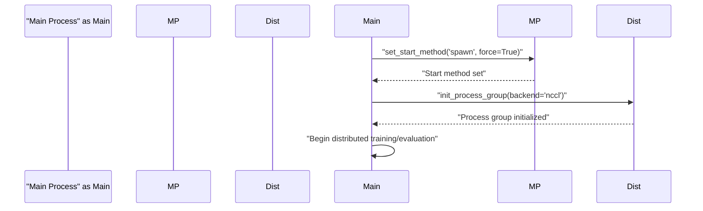
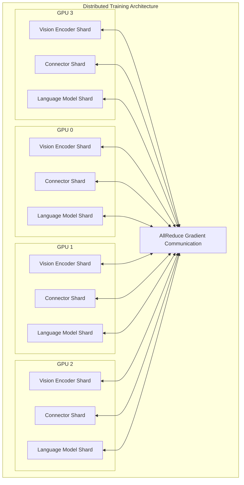
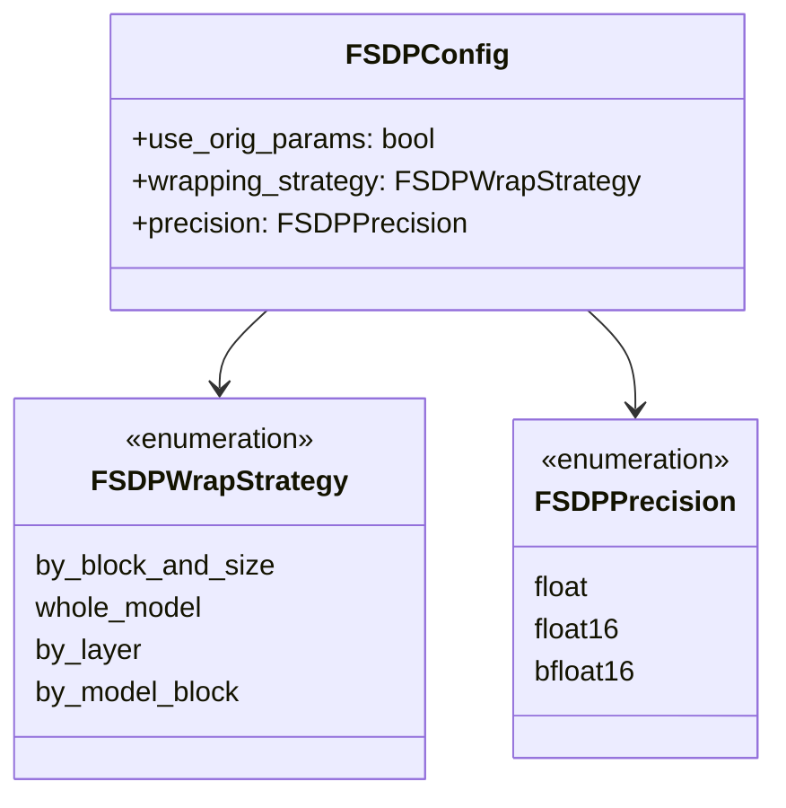
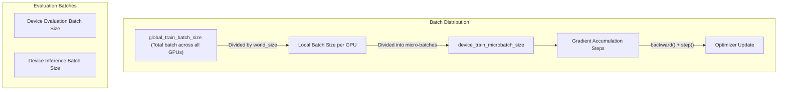
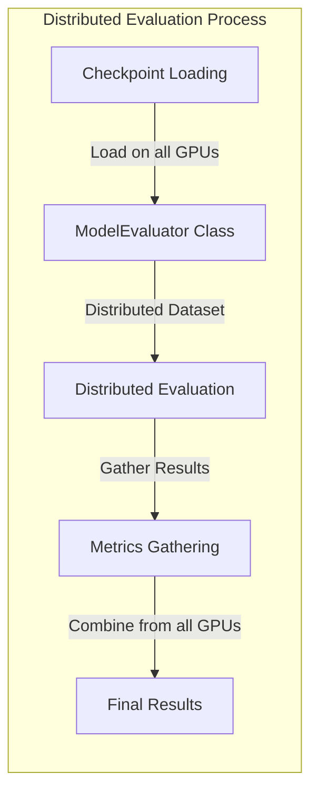
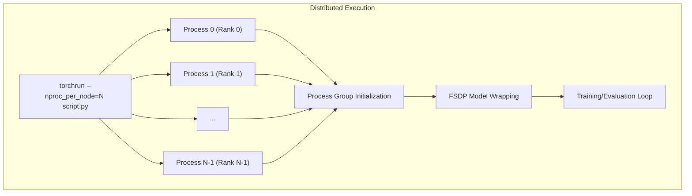
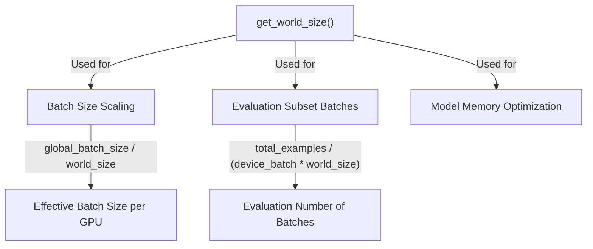

<!-- source: DeepWiki mcp.deepwiki.com · repo allenai/molmo · page 5.2 Distributed Training · fetched 2026-10-26 -->

# Distributed Training

<details>
<summary>Relevant source files</summary>

The following files were used as context for generating this wiki page:

- [launch_scripts/eval_downstream.py](launch_scripts/eval_downstream.py)
- [launch_scripts/train_captioner.py](launch_scripts/train_captioner.py)
- [launch_scripts/train_multitask_model.py](launch_scripts/train_multitask_model.py)

</details>


## Overview

This document explains how distributed training is implemented in the Molmo system. It covers the process group initialization, FSDP (Fully Sharded Data Parallel) configuration, batch size strategies, and how evaluation workloads are distributed across multiple GPUs. It focuses on the technical implementation details rather than the theoretical aspects of distributed training.

For information about training configuration options, see [Training Configuration](#3.3).

## Process Group Initialization

Before any distributed training can begin, the process group must be initialized. This establishes communication between all processes participating in the training job. In Molmo, this is done consistently across all training and evaluation scripts:



Sources: [launch_scripts/train_captioner.py:30-38](), [launch_scripts/train_multitask_model.py:73-80](), [launch_scripts/eval_downstream.py:60-67]()

## FSDP Architecture

Molmo uses PyTorch's Fully Sharded Data Parallel (FSDP) technique for training large models across multiple GPUs. FSDP shards model parameters, gradients, and optimizer states across data parallel workers, which significantly reduces the memory footprint per GPU.



Sources: [launch_scripts/train_captioner.py:164-168](), [launch_scripts/train_multitask_model.py:266-270]()

## FSDP Configuration

The FSDP configuration in Molmo is specified through the `FSDPConfig` class, which sets parameters that control how the model is sharded across GPUs:



The key configuration parameters include:

- **`use_orig_params`**: When set to `True`, allows accessing the original flattened parameters, which is useful for certain optimizers and checkpointing.

- **`wrapping_strategy`**: Determines how the model is divided into FSDP units:
  - `by_block_and_size`: Wraps at model blocks and by parameter sizes
  - `whole_model`: Wraps the entire model as a single unit
  - `by_layer`: Wraps at layer boundaries
  - `by_model_block`: Wraps at higher-level model blocks

- **`precision`**: Specifies the precision used for communication between GPUs:
  - `float`: Full precision (FP32)
  - `float16`: Half precision (FP16)
  - `bfloat16`: Brain floating point format (BF16)

In both the captioner training and multitask model training scripts, Molmo uses the following FSDP configuration:

```
FSDPConfig(
    use_orig_params=True,
    wrapping_strategy=FSDPWrapStrategy.by_block_and_size,
    precision=FSDPPrecision.float
)
```

Sources: [launch_scripts/train_captioner.py:164-168](), [launch_scripts/train_multitask_model.py:266-270](), [launch_scripts/eval_downstream.py:177-180]()

## Batch Size Strategy

Molmo employs a sophisticated batch size strategy to efficiently utilize multiple GPUs. This includes the concept of global batch size (across all GPUs) and device-specific batch sizes:



Key batch size parameters include:

- **`global_train_batch_size`**: The total batch size across all GPUs.
- **`device_train_microbatch_size`**: The batch size for each forward/backward pass on a single GPU.
- **`device_eval_batch_size`**: The batch size for evaluation on a single GPU.
- **`device_inf_eval_batch_size`**: The batch size for inference evaluation on a single GPU.

The effective batch size per GPU is calculated by dividing the global batch size by the world size (number of GPUs). If this number is larger than the device microbatch size, gradient accumulation is used.

Sources: [launch_scripts/train_captioner.py:176-178](), [launch_scripts/train_multitask_model.py:276-279]()

## Distributed Evaluation

Evaluation workloads are also distributed across multiple GPUs to speed up the process, especially for large validation sets:



The evaluation configuration includes:

- **`device_inf_eval_batch_size`**: Controls the batch size for inference on each GPU.
- **`max_examples`**: Limits the total number of examples to evaluate.
- **`subset_num_batches`**: Calculated based on max examples, batch size, and world size.

Important considerations for distributed evaluation:

1. The dataset is partitioned across all GPUs, with each GPU evaluating a different subset.
2. Results are gathered from all GPUs and combined for final metrics.
3. When using FSDP for evaluation, the `FSDPConfig` can be provided to control how the model is sharded.

Sources: [launch_scripts/eval_downstream.py:132-146](), [launch_scripts/eval_downstream.py:177-180]()

## Running Distributed Training

Molmo's distributed training and evaluation scripts are designed to be launched with `torchrun`, which handles the process spawning and environment setup:



Example command for launching distributed training:

```
torchrun --nproc_per_node=8 launch_scripts/train_captioner.py olmo_7b --global_batch_size=256
```

This will spawn 8 processes (one per GPU) and perform the following steps:
1. Initialize the process group using NCCL
2. Set up the model with FSDP
3. Distribute the global batch size of 256 across all GPUs
4. Run the training loop with synchronized gradient updates

Sources: [launch_scripts/train_captioner.py:29-38](), [launch_scripts/train_multitask_model.py:72-80](), [launch_scripts/eval_downstream.py:59-67]()

## World Size and Device Management

The world size (total number of GPUs) plays a crucial role in distributed training. It's used to:

1. Scale the batch size appropriately
2. Determine gradient accumulation steps
3. Calculate evaluation subset sizes

The world size is obtained through the `get_world_size()` function in the `olmo.torch_util` module, which is used throughout the codebase to scale various parameters.



Sources: [launch_scripts/train_captioner.py:95-95](), [launch_scripts/train_multitask_model.py:180-182](), [launch_scripts/eval_downstream.py:135-135]()

## Summary

Distributed training in Molmo is implemented using PyTorch's distributed training capabilities, particularly FSDP for efficient model distribution across multiple GPUs. The key components include:

1. Process group initialization with the NCCL backend
2. FSDP configuration with model sharding strategies
3. Batch size management with global and device-specific settings
4. Distributed evaluation for efficient model assessment

This architecture allows Molmo to scale to large models and datasets by utilizing multiple GPUs efficiently.