# Page: Overview

# Overview

<details>
<summary>Relevant source files</summary>

The following files were used as context for generating this wiki page:

- [README.md](README.md)

</details>


This document provides a technical introduction to Molmo (Multimodal Open Language Model), a framework for training and using state-of-the-art vision-language models developed by Allen AI. Molmo extends language models with visual understanding capabilities, enabling tasks such as image captioning, visual question answering, object localization, and document analysis.

For details about specific components, refer to [Key Components](#1.1), information about the dataset ecosystem in [Datasets](#2), and training procedures in [Training](#3).

## Core System Architecture

Molmo implements a multimodal architecture that processes both images and text to generate language-based outputs. The high-level architecture consists of three primary components:

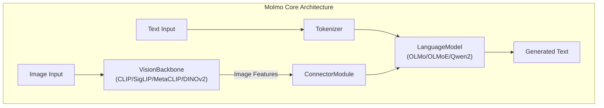

Sources: [README.md:25-30]()

### Code Structure and Main Components

The architecture is implemented through several key components in the codebase:

1. **Vision Encoder**: Extracts features from images using pretrained vision models
2. **Connector Module**: Maps vision features to the language model's dimension space
3. **Language Model**: Processes both text tokens and visual features to generate responses

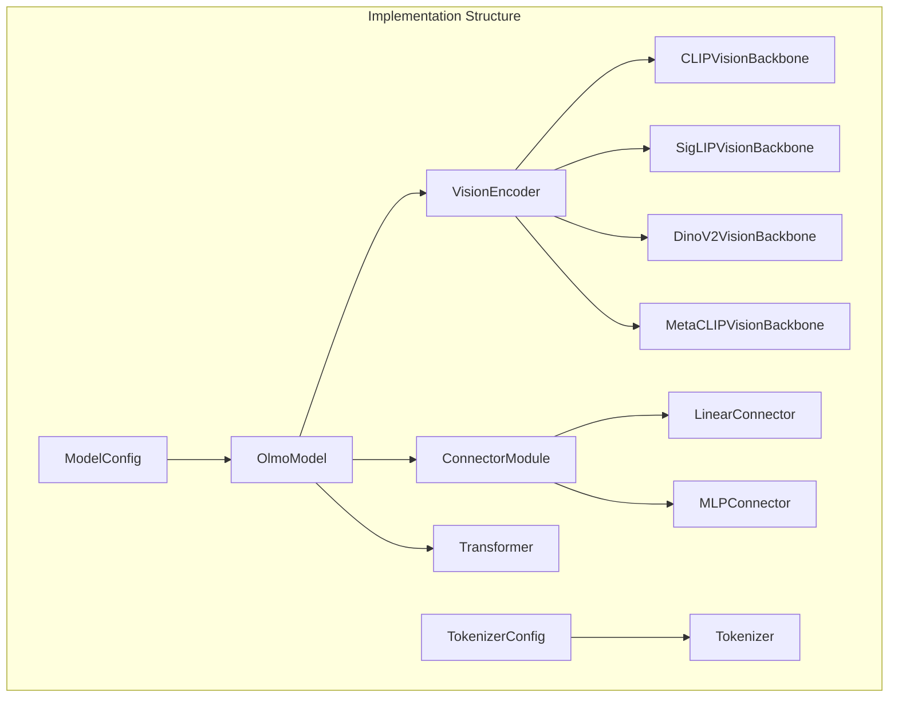

Sources: [README.md:29-30](), [README.md:92-112]()

## Molmo Model Family

The Molmo family includes several models with different parameter sizes and capabilities:

| Model | Parameters | Vision Encoder | Language Model | 11-benchmark avg |
|-------|------------|----------------|----------------|------------------|
| MolmoE-1B | 1B active (7B total) | OpenAI CLIP ViT-L/14@336 | OLMoE-1B-7B | 68.6% |
| Molmo-7B-O | 7B | OpenAI CLIP ViT-L/14@336 | OLMo-7B-1024 | 74.6% |
| Molmo-7B-D | 7B | OpenAI CLIP ViT-L/14@336 | Qwen2-7B | 77.3% |
| Molmo-72B | 72B | OpenAI CLIP ViT-L/14@336 | Qwen2-72B | 81.2% |

Sources: [README.md:84-112]()

## Data Processing Pipeline

Molmo utilizes the PixMo dataset collection for training and evaluation. The data processing pipeline involves downloading, processing, and loading dataset samples:

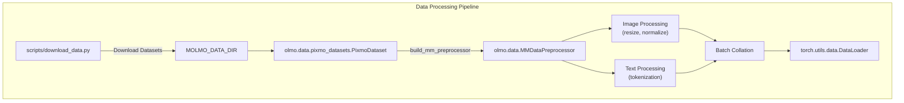

Sources: [README.md:116-152]()

### PixMo Dataset Collection

The PixMo dataset collection includes specialized datasets for different multimodal tasks:

| Dataset | Purpose | Content |
|---------|---------|---------|
| PixMo-Cap | Pre-training, Fine-tuning | Dense image captions (~200 words on average) |
| PixMo-AskModelAnything | Fine-tuning | Human-authored image-question-answer triplets |
| PixMo-CapQA | Fine-tuning | Synthetic QA pairs derived from captions |
| PixMo-Points | Fine-tuning | Images with referring expressions and annotated points |
| PixMo-Point-Explanations | Fine-tuning | Explanations with in-line points |
| PixMo-Docs | Fine-tuning | QA pairs about charts, tables, diagrams |
| PixMo-Clocks | Fine-tuning | Watch faces with time annotations |
| PixMo-Count | Fine-tuning | Images with counting QA pairs |

Sources: [README.md:36-47]()

## Training and Evaluation Framework

Molmo provides a comprehensive framework for model training and evaluation:

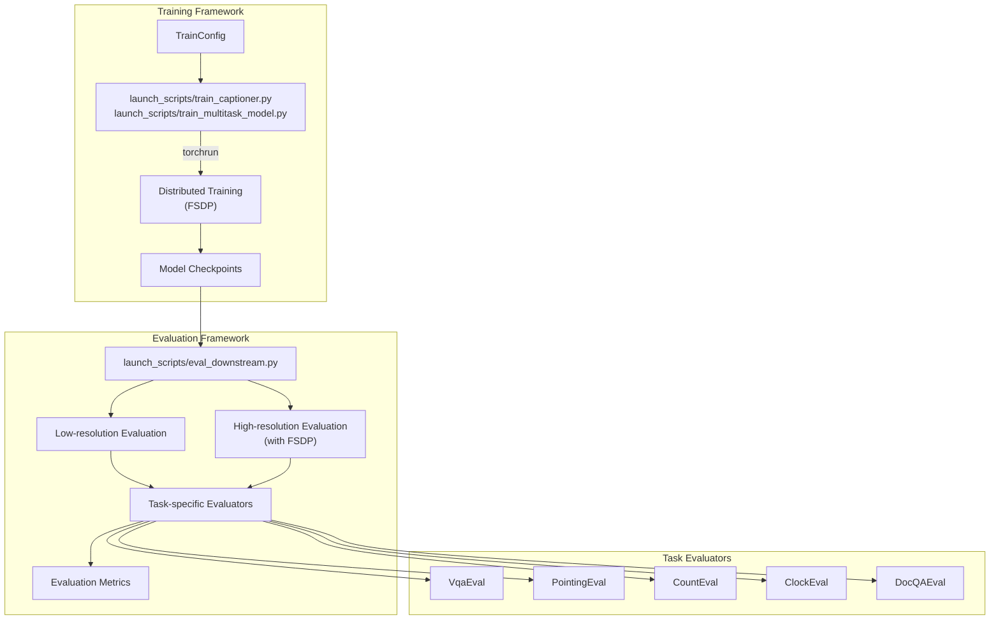

Sources: [README.md:202-237]()

### Training Pipeline

The training process typically involves two main phases:

1. **Pre-training (Captioner Training)**: Training on PixMo-Cap for vision-language alignment using `launch_scripts/train_captioner.py`
2. **Multitask Fine-tuning**: Training on multiple specialized tasks using `launch_scripts/train_multitask_model.py`

The training pipeline supports distributed training with Fully Sharded Data Parallel (FSDP) for efficient scaling across multiple GPUs.

Sources: [README.md:256-295]()

### Evaluation Pipeline

Evaluation is performed using `launch_scripts/eval_downstream.py`, which supports:

1. **Low-resolution evaluation**: Standard evaluation with lower image resolution
2. **High-resolution evaluation**: Evaluation with higher image resolution using FSDP for memory efficiency

Metrics and predictions are cached in the model's checkpoint directory for future reference.

Sources: [README.md:202-241]()

## Configuration System

Molmo uses a configuration-driven architecture where model, training, and evaluation parameters are specified through hierarchical configuration objects:

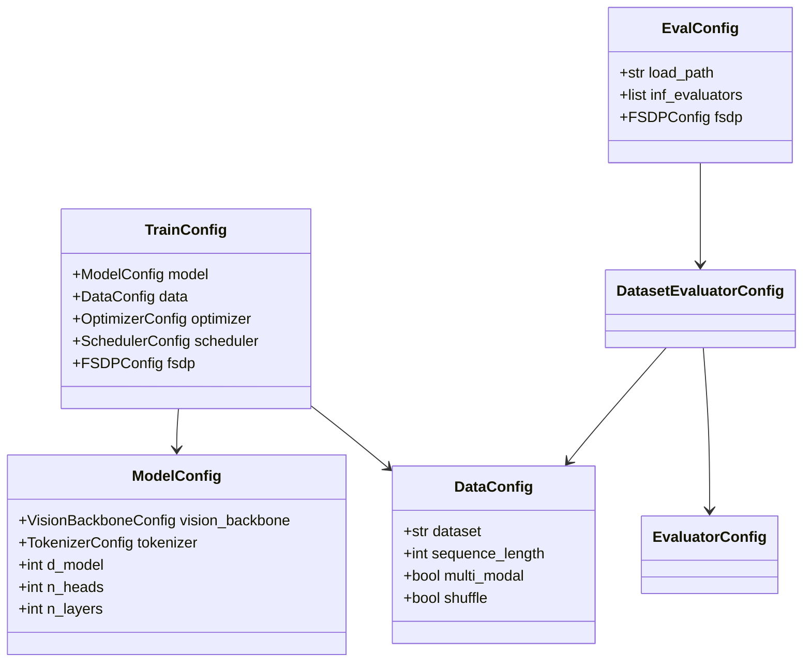

Sources: [README.md:256-295]()

This configuration system enables flexible experimentation with different model architectures, training regimes, and evaluation settings without changing code.

## Capabilities and Applications

Molmo models are designed to handle a variety of multimodal tasks, including:

1. **Image Captioning**: Generating detailed descriptions of images
2. **Visual Question Answering**: Answering questions about image content
3. **Object Localization**: Identifying and pointing to specific objects in images
4. **Document Understanding**: Analyzing and answering questions about charts, tables, and documents
5. **Visual Counting**: Counting objects or elements in images
6. **Time Reading**: Interpreting analog clocks and time displays

These capabilities are enabled through the combination of a powerful vision encoder, a connector module that bridges vision and language, and a large language model that generates contextually appropriate responses.

Sources: [README.md:36-47](), [README.md:56-62]()

---

# Page: Key Components

# Key Components

<details>
<summary>Relevant source files</summary>

The following files were used as context for generating this wiki page:

- [README.md](README.md)
- [launch_scripts/utils.py](launch_scripts/utils.py)

</details>


This page provides an overview of the core components that make up the Molmo (Multimodal Open Language Model) system. It explains the main models, vision encoders, language models, datasets, and how they connect within the overall architecture. For more details on the system architecture, see [System Architecture](#1.2).

## Models Overview

Molmo consists of a family of multimodal models that integrate vision and language capabilities:

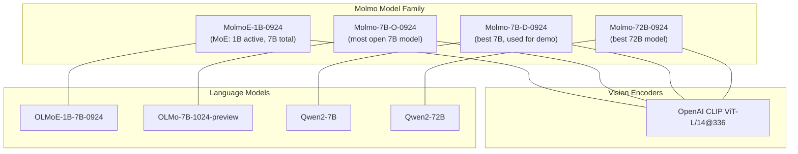

Sources:
- [README.md:56-61]()
- [launch_scripts/utils.py:394-403]()

### Model Architecture Components

Each Molmo model consists of three primary components that work together to process multimodal inputs:

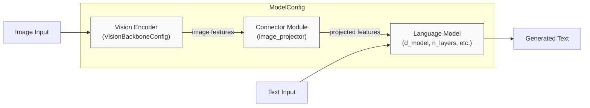

Sources:
- [launch_scripts/utils.py:13-30]()
- [launch_scripts/utils.py:146-164]()

### Vision Encoders

Molmo supports multiple vision encoders that can be configured via `VisionBackboneConfig`:

| Vision Encoder | Default Resolution | Embedding Dimension | Layers | Configuration |
|----------------|-------------------|---------------------|--------|---------------|
| OpenAI CLIP    | 336 × 336        | 1024                | 23     | `DEFAULT_VISION_BACKBONE` |
| SigLIP         | 378 × 378        | 1152                | 27     | `SIGLIP_VISION_BACKBONE` |
| MetaCLIP       | 336 × 336        | 1024                | 24     | `METACLIP_L14_336_VISION_BACKBONE` |
| DINOv2         | 336 × 336        | 1024                | 24     | `DINOV2_LARGE_336_VISION_BACKBONE` |

Sources:
- [launch_scripts/utils.py:146-230]()
- [launch_scripts/utils.py:406-411]()

### Language Models

The language model components used in Molmo models:

| Model Name | Parameters | Hidden Size | Heads | Layers | Configuration |
|------------|------------|-------------|-------|--------|---------------|
| OLMoE      | 1B active (7B total) | 2048 | 16 | 16 | `OLMOE` |
| OLMo       | 7B | 4096 | 32 | 32 | `OLMO_1024_PREVIEW` |
| Qwen2-7B   | 7B | 3584 | 28 | 28 | `QWEN2_7B` |
| Qwen2-72B  | 72B | 8192 | 64 | 80 | `QWEN2_72B` |

Sources:
- [launch_scripts/utils.py:233-391]()
- [launch_scripts/utils.py:414-419]()
- [README.md:82-111]()

## Dataset Ecosystem

Molmo is trained on the PixMo collection of multimodal datasets, each serving different purposes:

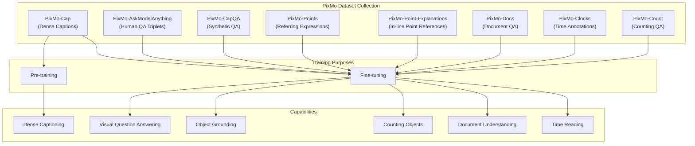

Sources:
- [README.md:36-47]()
- [README.md:117-143]()

### Dataset Loading and Usage

Datasets are downloaded and processed using dedicated scripts, with configuration handled by `DataConfig`:

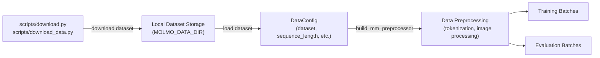

Sources:
- [README.md:116-143]()
- [launch_scripts/utils.py:130-143]()

## Training Pipeline

Molmo supports multiple training strategies through dedicated scripts:

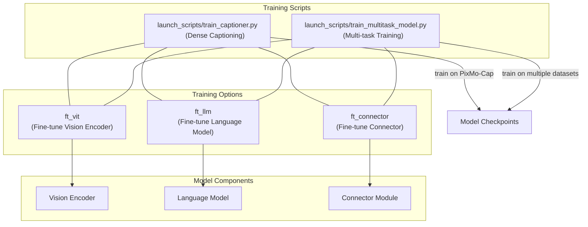

Sources:
- [README.md:256-294]()

## Evaluation Framework

The evaluation framework provides task-specific evaluators for assessing model performance:

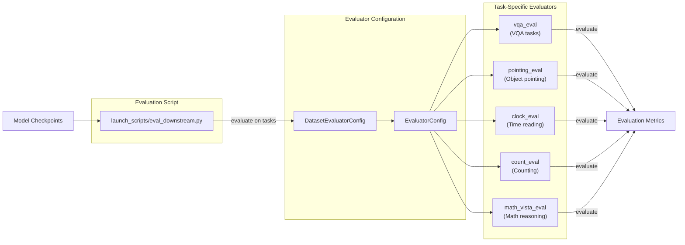

Sources:
- [README.md:202-237]()
- [launch_scripts/utils.py:33-74]()
- [launch_scripts/utils.py:77-143]()

The evaluation framework supports various tasks and metrics, with different configurations for each task type. Evaluators are selected based on the task name, and appropriate metrics are calculated for each task type (e.g., VQA score for visual question answering, pointing evaluation for object grounding tasks).

---

# Page: System Architecture

# System Architecture

<details>
<summary>Relevant source files</summary>

The following files were used as context for generating this wiki page:

- [README.md](README.md)
- [olmo/data/__init__.py](olmo/data/__init__.py)

</details>


This document explains the overall technical architecture of the Molmo (Multimodal Open Language Model) system, focusing on how the vision and language components interact, how data flows through the system, and how training and evaluation pipelines are structured. For information about specific model variants and their capabilities, see [Key Components](#1.1). For details on datasets used in training and evaluation, see [Datasets](#2).

## Core Multimodal Architecture

Molmo's fundamental architecture consists of three primary components that work together to process multimodal inputs and generate appropriate textual outputs.

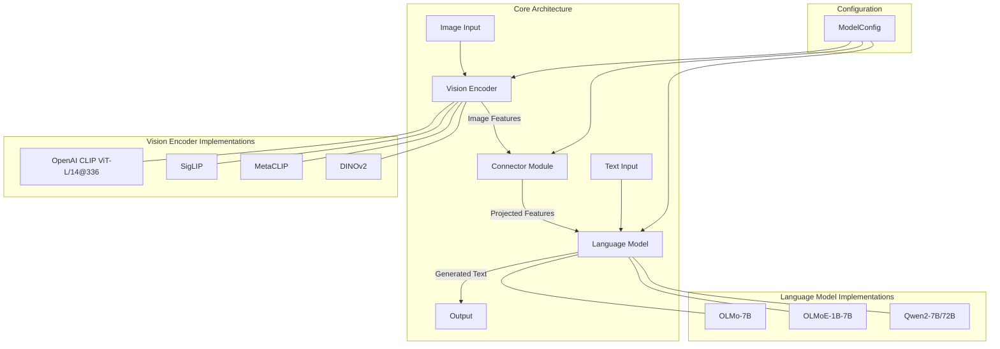

Sources:
- [README.md:56-61]()
- [README.md:92-111]()

### Vision Encoder

The Vision Encoder transforms image inputs into feature representations that can be processed by the language model. Molmo supports multiple vision encoder architectures:

- **OpenAI CLIP ViT-L/14@336**: Default vision encoder used in all released Molmo models
- **SigLIP**: Alternative vision encoder
- **MetaCLIP**: Alternative vision encoder
- **DINOv2**: Alternative vision encoder

The vision encoder is configured through `vision_backbone` parameters in the model configuration.

Sources:
- [README.md:92-111]()
- [README.md:246-251]()

### Connector Module

The Connector Module serves as a bridge between the vision and language components, projecting image features into a representation that the language model can use. This enables the seamless integration of visual information with text processing.

Sources:
- [README.md:92-111]()

### Language Model

The Language Model component processes text inputs and image features (via the connector) to generate coherent text outputs. Molmo supports various language model backends:

- **OLMo-7B**: Used in Molmo-7B-O
- **OLMoE-1B-7B**: Used in MolmoE-1B (a mixture of experts model)
- **Qwen2-7B**: Used in Molmo-7B-D
- **Qwen2-72B**: Used in Molmo-72B

Sources:
- [README.md:92-111]()

## Data Flow Architecture

The data flow architecture describes how data moves through the system from download to training and evaluation.

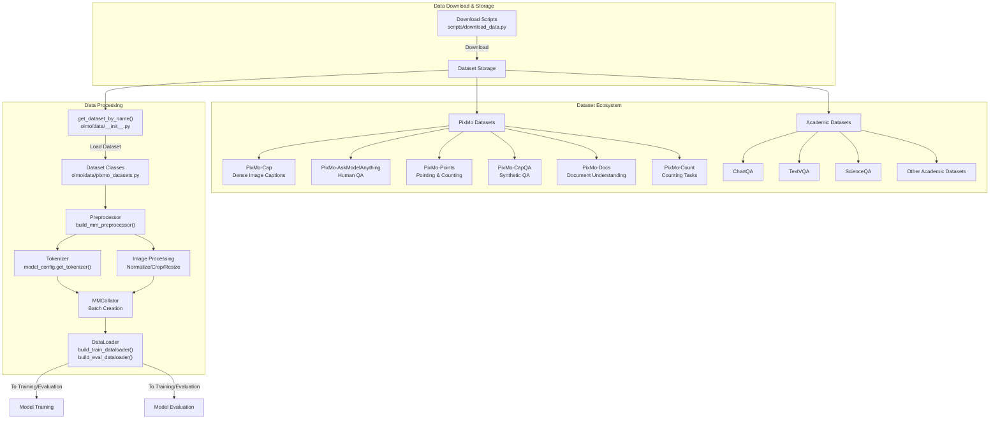

Sources:
- [olmo/data/__init__.py:14-18]()
- [olmo/data/__init__.py:23-69]()
- [olmo/data/__init__.py:72-141]()
- [olmo/data/__init__.py:144-211]()
- [olmo/data/__init__.py:214-318]()
- [README.md:116-137]()

### Dataset Downloading and Storage

The data downloading process begins with the `download.py` script, which fetches datasets from various sources and stores them in the location specified by environment variables:

- `MOLMO_DATA_DIR`: Base directory for Molmo-specific data
- `HF_HOME`: Hugging Face cache directory

The system downloads both PixMo datasets (which may require downloading images from URLs) and academic datasets (some of which require manual downloading).

Sources:
- [README.md:116-148]()

### Dataset Preprocessing

Once datasets are downloaded, they are processed through several components:

1. **Dataset Selection**: The `get_dataset_by_name()` function in [olmo/data/__init__.py:214-318]() maps dataset names to their implementations.

2. **Preprocessor Creation**: The `build_mm_preprocessor()` function creates a preprocessing pipeline that handles:
   - Data formatting (system prompts, message formatting)
   - Tokenization
   - Image processing (normalization, cropping, resizing)

3. **Data Loading**: The `build_train_dataloader()` and `build_eval_dataloader()` functions construct data loaders for training and evaluation, respectively.

4. **Collation**: The `MMCollator` class combines examples into batches suitable for model training or evaluation.

Sources:
- [olmo/data/__init__.py:23-69]()
- [olmo/data/__init__.py:72-141]()
- [olmo/data/__init__.py:144-211]()

## Training and Evaluation Architecture

The training and evaluation architecture describes how models are trained and evaluated within the Molmo system.

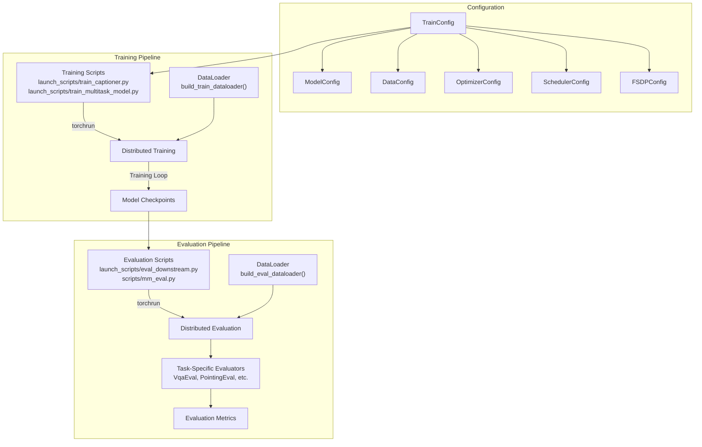

Sources:
- [README.md:202-236]()
- [README.md:256-294]()
- [olmo/data/__init__.py:144-211]()

### Training Pipeline

The training pipeline starts with configuration setup and then launches distributed training:

1. **Configuration**: A `TrainConfig` object contains nested configurations for model architecture, data loading, optimization, and distributed training.

2. **Training Scripts**: High-level scripts like `train_captioner.py` and `train_multitask_model.py` generate the appropriate configurations and launch training.

3. **Distributed Training**: Training is executed using PyTorch's `torchrun` with Fully Sharded Data Parallel (FSDP) for efficient multi-GPU and multi-node training.

4. **Checkpointing**: Model checkpoints are saved periodically during training for later resumption or evaluation.

Molmo provides two main training workflows:

- **Captioner Training**: Focused on image captioning tasks, typically used for pre-training
- **Multitask Training**: Combines multiple tasks for comprehensive fine-tuning

Sources:
- [README.md:256-294]()

### Evaluation Pipeline

The evaluation pipeline loads trained models and evaluates them on various downstream tasks:

1. **Evaluation Scripts**: Scripts like `eval_downstream.py` and `mm_eval.py` handle the evaluation process.

2. **Task-Specific Evaluators**: Different evaluators are used for different tasks (VQA, pointing, counting, etc.).

3. **Distributed Evaluation**: Like training, evaluation can be distributed across multiple GPUs and nodes.

4. **Metrics Collection**: Results are collected and saved for analysis.

Sources:
- [README.md:202-236]()

## Model Configuration System

Molmo uses a hierarchical configuration system to control all aspects of model architecture, training, and evaluation.

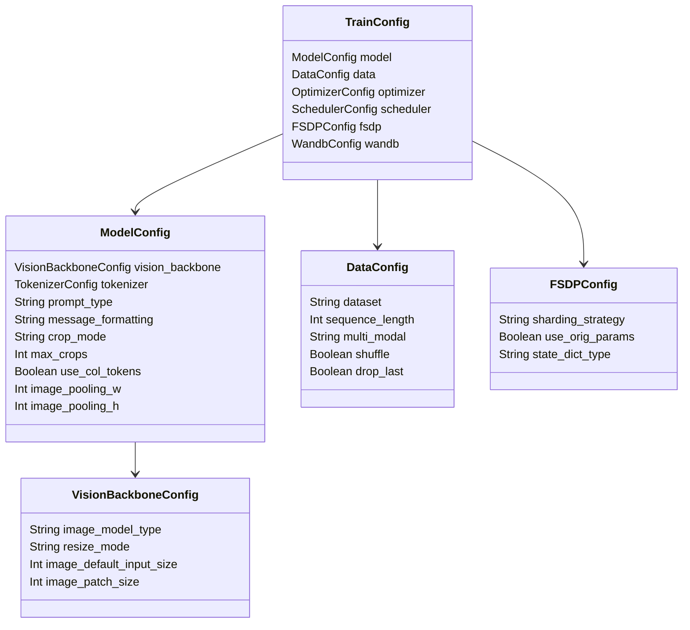

Sources:
- [olmo/data/__init__.py:6]()
- [olmo/data/__init__.py:31-62]()

The configuration system allows for flexible customization of:

- **Model Architecture**: Vision encoder, connector, language model
- **Training Parameters**: Batch size, learning rate, optimization strategy
- **Data Processing**: Dataset selection, preprocessing, data loading
- **Distributed Execution**: FSDP configuration, multi-node setup
- **Evaluation**: Task selection, metrics, evaluation strategies

## Integration with Vision Backbone Models

Molmo supports multiple vision backbone models that can be initialized from pre-trained checkpoints.

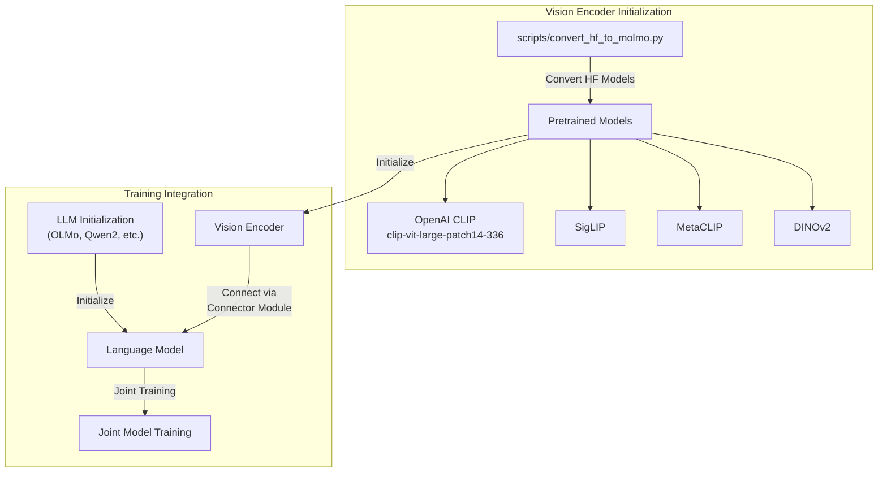

Sources:
- [README.md:242-255]()
- [README.md:92-111]()

The vision encoder models can be downloaded and converted to a Molmo-compatible format using the `convert_hf_to_molmo.py` script:

```
python3 scripts/convert_hf_to_molmo.py openai  # For OpenAI CLIP
python3 scripts/convert_hf_to_molmo.py qwen2_7b  # For Qwen2 LLM
```

These converted models serve as initialization points for the training process, allowing the system to build upon pre-trained representations.

Sources:
- [README.md:242-255]()

## Training Flow and Configuration

This diagram illustrates the complete training flow from configuration to model output:

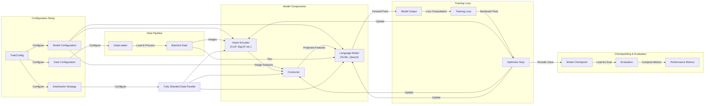

Sources:
- [README.md:256-294]()
- [olmo/data/__init__.py:144-211]()

The training process follows these steps:

1. **Configuration Setup**: Create configurations for model, data, and distribution strategy
2. **Model Initialization**: Initialize vision encoder, connector, and language model
3. **Data Loading**: Configure and create data loaders for training data
4. **Training Loop**: Execute forward and backward passes, update model parameters
5. **Checkpointing**: Periodically save model checkpoints
6. **Evaluation**: Evaluate model on downstream tasks to measure performance

Training can be executed using different strategies:

- **Pre-training with Captioning**: `launch_scripts/train_captioner.py`
- **Multi-task Fine-tuning**: `launch_scripts/train_multitask_model.py`

Sources:
- [README.md:256-294]()

---

# Page: Datasets

# Datasets

<details>
<summary>Relevant source files</summary>

The following files were used as context for generating this wiki page:

- [olmo/data/pixmo_datasets.py](olmo/data/pixmo_datasets.py)
- [scripts/download_data.py](scripts/download_data.py)

</details>


This document provides a comprehensive overview of the dataset ecosystem used in the Molmo multimodal language model framework. It covers both the proprietary PixMo dataset collection and academic datasets used for training and evaluation. For information about how datasets are processed during training, see [Data Preprocessing and Loading](#2.3).

## Dataset Ecosystem Overview

The Molmo system relies on two primary categories of datasets:

1. **PixMo Datasets**: A collection of multimodal datasets developed specifically for training Molmo models
2. **Academic Datasets**: External benchmark datasets used primarily for evaluation

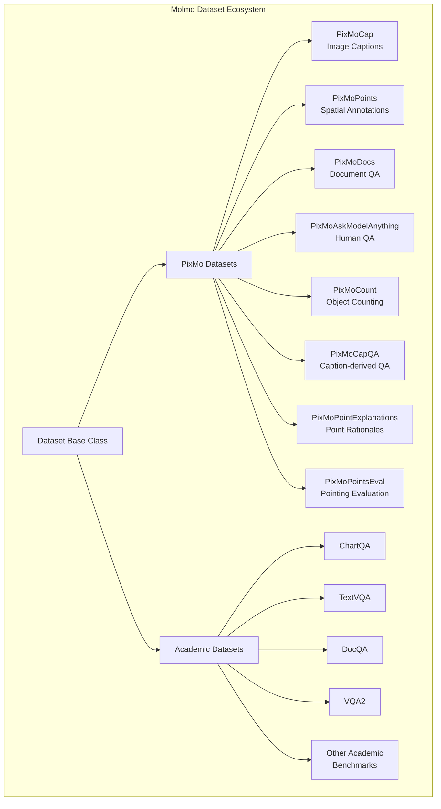

Sources: [olmo/data/pixmo_datasets.py:1-461](), [scripts/download_data.py:1-80]()

## Dataset Implementation

All datasets in the Molmo system follow a common interface pattern, inheriting from the `Dataset` base class. Each dataset class implements:

1. A `download()` class method for fetching and preparing the dataset
2. An `__init__()` method to load a specific split of the dataset
3. A `get()` method to format individual examples for model consumption

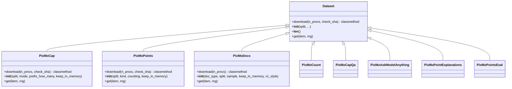

Sources: [olmo/data/pixmo_datasets.py:9-11](), [olmo/data/pixmo_datasets.py:73-459]()

## PixMo Dataset Collection

The PixMo dataset collection is a set of purpose-built multimodal datasets designed specifically for training and evaluating the Molmo system across various capabilities.

### PixMoCap

A dataset of image captions focused on training basic captioning capabilities.

- **Structure**: Contains image-caption pairs with additional image transcripts
- **Usage Modes**: Supports different training modes (`captions`, `transcripts`, `transcript_and_caption`, `transcript1_and_caption`)
- **Implementation**: [olmo/data/pixmo_datasets.py:322-373]()

### PixMoPoints

A dataset for training spatial localization abilities, containing point annotations for objects in images.

- **Structure**: Images with point coordinates and associated labels
- **Variations**: Two collection methods - `pointing` (basic) and `counting` (high-frequency)
- **Implementation**: [olmo/data/pixmo_datasets.py:156-218]()

### PixMoDocs

A document understanding dataset containing various document types with associated questions and answers.

- **Document Types**: `charts`, `diagrams`, `tables`, and `other`
- **Implementation**: [olmo/data/pixmo_datasets.py:113-152]()

### PixMoCount

A specialized dataset for training counting abilities.

- **Structure**: Images with count annotations and spatial locations of objects
- **Implementation**: [olmo/data/pixmo_datasets.py:73-111]()

### PixMoCapQa

Question-answer pairs derived from image captions.

- **Structure**: Images with synthetic QA pairs based on captions
- **Implementation**: [olmo/data/pixmo_datasets.py:278-320]()

### PixMoAskModelAnything

A dataset of human-generated questions and answers about images.

- **Structure**: Images with human-authored QA pairs
- **Implementation**: [olmo/data/pixmo_datasets.py:376-421]()

### PixMoPointExplanations

A dataset with explanations for point annotations in images.

- **Structure**: Images with points, inline text, and alt text explanations
- **Implementation**: [olmo/data/pixmo_datasets.py:221-275]()

### PixMoPointsEval

An evaluation dataset specifically for testing pointing capabilities.

- **Structure**: Images with point annotations and masks for evaluation
- **Implementation**: [olmo/data/pixmo_datasets.py:424-459]()

Sources: [olmo/data/pixmo_datasets.py:73-459]()

## Academic Datasets

Besides the PixMo collection, Molmo also uses a wide range of academic benchmark datasets primarily for evaluation purposes:

| Dataset | Purpose | Type |
|---------|---------|------|
| ChartQA | Chart understanding | Evaluation |
| TextVQA | Text in images | Evaluation |
| DocQA | Document understanding | Evaluation |
| ScienceQAImageOnly | Scientific reasoning | Training/Evaluation |
| OkVqa | Common sense reasoning | Training/Evaluation |
| InfoQa | Information extraction | Evaluation |
| Vqa2 | General visual question answering | Evaluation |
| MathVista | Mathematical reasoning | Evaluation |
| CountBenchQa | Counting ability | Evaluation |
| ClockBench | Time reading | Evaluation |

Sources: [scripts/download_data.py:5-24]()

## Dataset Downloading Process

Datasets are downloaded using the `scripts/download_data.py` script, which provides a command-line interface for fetching either individual datasets, all PixMo datasets, all academic datasets, or everything at once.

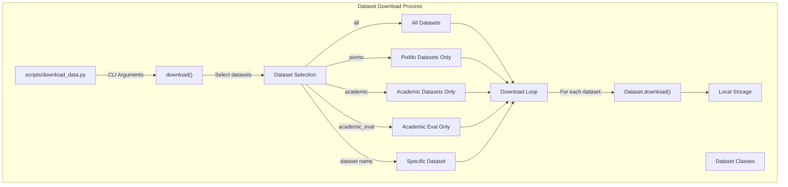

The download process works as follows:

1. The script takes a dataset identifier as input (specific dataset name or category like "all", "pixmo", "academic")
2. For each selected dataset, it calls the dataset class's `download()` method
3. The dataset's `download()` method:
   - Fetches the dataset from the original source
   - Downloads associated images 
   - Processes and prepares the data for local storage
   - Saves the dataset using the HuggingFace datasets library

Example usage:
```bash
python scripts/download_data.py pixmo --n_procs 8
```

Sources: [scripts/download_data.py:39-75]()

## Dataset Structure and Storage

All datasets are downloaded to a central location defined by the `DATA_HOME` environment variable. PixMo datasets specifically are stored in the `pixmo_datasets` subdirectory:

```
DATA_HOME/
└── pixmo_datasets/
    ├── cap/                   # PixMoCap
    ├── cap-qa/                # PixMoCapQa
    ├── count/                 # PixMoCount
    ├── ask-model-anything/    # PixMoAskModelAnything
    ├── point-explanations/    # PixMoPointExplanations
    ├── points-counting/       # PixMoPoints (counting variant)
    ├── points-pointing/       # PixMoPoints (pointing variant)
    └── pixmo-points-eval/     # PixMoPointsEval
```

Individual dataset files are stored using the HuggingFace datasets library's disk format, which includes:
- Dataset metadata
- Arrow format data files 
- Image files (stored as paths to local files)

Sources: [olmo/data/pixmo_datasets.py:9-15]()

## Common Dataset Interface

All dataset classes in the Molmo system implement a common interface, with the key method being `get()`, which returns a standardized dictionary structure used by the training pipeline:

```python
{
    "image": "/path/to/image.jpg",  # Path to image file
    "message_list": [               # List of messages for multi-turn datasets
        {
            "question": "...",      # User question (for QA datasets)
            "answer": "...",        # Model answer (for QA datasets)
            "text": "...",          # Text content (for caption datasets)
            "points": [[x1, y1], [x2, y2], ...],  # Point coordinates (for pointing)
            "style": "..."          # Dataset-specific style identifier
        }
    ],
    "metadata": {                   # Additional dataset-specific metadata
        "image_url": "...",
        "..."
    }
}
```

This standardized format allows the system to handle diverse dataset types through a unified interface, making it easier to combine multiple datasets during training.

Sources: [olmo/data/pixmo_datasets.py:96-110](), [olmo/data/pixmo_datasets.py:142-151](), [olmo/data/pixmo_datasets.py:202-218]()

---

# Page: PixMo Dataset Collection

# PixMo Dataset Collection

<details>
<summary>Relevant source files</summary>

The following files were used as context for generating this wiki page:

- [README.md](README.md)
- [olmo/data/pixmo_datasets.py](olmo/data/pixmo_datasets.py)

</details>


## Purpose and Scope

This document provides a comprehensive overview of the PixMo dataset collection - a suite of multimodal datasets specifically designed for pre-training and fine-tuning vision-language models in the Molmo framework. We cover the structure, content, and technical implementation details of each dataset in the collection.

For information about downloading these datasets, see [Dataset Downloading](#2.2). For information about how data is processed and loaded during training and evaluation, see [Data Preprocessing and Loading](#2.3).

## PixMo Dataset Overview

PixMo is a collection of carefully curated multimodal datasets designed to train Molmo models on various vision-language tasks. A key distinction of the PixMo datasets is that they were constructed **without the use of VLMs** to avoid contamination and self-reinforcement issues.

```mermaid
graph TD
    subgraph "PixMo Dataset Collection"
        PixMoCap["PixMo-Cap<br>Dense captions for<br>pre-training & fine-tuning"]
        PixMoAMA["PixMo-AskModelAnything<br>Human-authored QA triplets"]
        PixMoCapQA["PixMo-CapQA<br>Synthetic QA from captions"]
        PixMoPoints["PixMo-Points<br>Referring expressions with points"]
        PixMoPE["PixMo-Point-Explanations<br>Explanations with inline points"]
        PixMoDocs["PixMo-Docs<br>Charts, tables, diagrams QA"]
        PixMoClocks["PixMo-Clocks<br>Watch faces & time annotations"]
        PixMoCount["PixMo-Count<br>Counting QA pairs"]
    end
    
    subgraph "Training Phases"
        Pretraining["Pre-training"]
        FineTuning["Fine-tuning"]
    end
    
    subgraph "Model Capabilities"
        DenseCaption["Dense image description"]
        QA["Visual question answering"]
        Pointing["Visual pointing & grounding"]
        Counting["Object counting"]
        DocQA["Document understanding"]
        TimeReading["Time reading"]
        InlinePointing["Inline pointing in text"]
    end
    
    PixMoCap --> Pretraining
    PixMoCap --> FineTuning
    PixMoAMA --> FineTuning
    PixMoCapQA --> FineTuning
    PixMoPoints --> FineTuning
    PixMoPE --> FineTuning
    PixMoDocs --> FineTuning
    PixMoClocks --> FineTuning
    PixMoCount --> FineTuning
    
    PixMoCap --> DenseCaption
    PixMoAMA --> QA
    PixMoCapQA --> QA
    PixMoPoints --> Pointing
    PixMoPoints --> Counting
    PixMoPE --> InlinePointing
    PixMoDocs --> DocQA
    PixMoClocks --> TimeReading
    PixMoCount --> Counting
```

Sources: [README.md:35-47](), [olmo/data/pixmo_datasets.py:1-460]()

## Dataset Implementation Architecture

All PixMo datasets share a common implementation structure in the codebase. Each dataset is implemented as a Python class that inherits from a base `Dataset` class, providing standardized methods for downloading, initializing, and retrieving data.

```mermaid
classDiagram
    class Dataset {
        +download(n_procs, check_sha, n_val, cache_only)
        +__init__(split, keep_in_memory)
        +__len__()
        +get(item, rng)
    }
    
    Dataset <|-- PixMoCap
    Dataset <|-- PixMoAskModelAnything
    Dataset <|-- PixMoCapQa
    Dataset <|-- PixMoPoints
    Dataset <|-- PixMoPointExplanations
    Dataset <|-- PixMoDocs
    Dataset <|-- PixMoCount
    Dataset <|-- PixMoPointsEval
    
    class PixMoCap {
        +download(n_procs, check_sha, n_val, cache_only, sample)
        +__init__(split, mode, prefix_how_many, keep_in_memory)
        +__len__()
        +get(item, rng)
    }
    
    class PixMoAskModelAnything {
        +download(n_procs, check_sha, n_val, cache_only)
        +__init__(split, prefix_how_many, keep_in_memory)
        +__len__()
        +get(item, rng)
    }
    
    class PixMoDocs {
        +V1_STYLE: dict
        +download(n_procs)
        +__init__(doc_type, split, sample, keep_in_memory, v1_style)
        +__len__()
        +get(item, rng)
    }
    
    class PixMoPoints {
        +download(n_procs, check_sha, n_val, cache_only, hold_out_pointing_eval)
        +__init__(split, kind, counting, keep_in_memory)
        +__len__()
        +get(item, rng)
    }
```

Sources: [olmo/data/pixmo_datasets.py:1-460]()

## Data Flow Pipeline

All PixMo datasets follow a consistent flow from download to usage in training or evaluation:

```mermaid
flowchart TD
    HF["HuggingFace<br>Dataset Hub"] --> |"datasets.load_dataset()"| Raw["Raw Dataset"]
    Raw --> |"download_pixmo_urls()"| Images["Downloaded Images"]
    Raw --> |"filter_and_group_data()"| Filtered["Filtered Dataset"]
    Images --> |"add_column('image', ...)"| Filtered
    Filtered --> |"save_to_disk()"| Local["Local Dataset<br>PIXMO_DATASETS directory"]
    Local --> |"datasets.load_from_disk()"| Loaded["Dataset Object"]
    Loaded --> |"dataset.get()"| Preprocessed["Preprocessed Examples"]
    Preprocessed --> Training["Model Training"]
    Preprocessed --> Evaluation["Model Evaluation"]
    
    subgraph "Download Phase (scripts/download_data.py)"
        HF
        Raw
        Images
        Filtered
        Local
    end
    
    subgraph "Usage Phase (olmo/data/__init__.py)"
        Loaded
        Preprocessed
        Training
        Evaluation
    end
```

Sources: [olmo/data/pixmo_datasets.py:59-70](), [olmo/data/pixmo_datasets.py:73-86]()

## Detailed Dataset Descriptions

### PixMo-Cap

PixMo-Cap is a dense captioning dataset containing highly detailed image descriptions (approximately 200 words on average). It serves as the primary dataset for both pre-training and fine-tuning.

**Key Features:**
- Dense captions with an average of ~200 words per image
- Multiple transcripts per image describing different aspects
- Support for different usage modes: captions-only, transcripts-only, or combined

**Usage Modes:**
- `captions`: Only uses the main caption
- `transcripts`: Uses all available transcripts
- `transcript_and_caption`: Uses caption and a random transcript
- `transcript1_and_caption`: Uses caption and the first transcript

**Example Structure:**
```
{
    'image': '/path/to/local/image.jpg',
    'message_list': [
        {'text': 'Detailed caption text...', 'style': 'long_caption'},
        {'text': 'Transcript content...', 'style': 'transcript'}
    ],
    'metadata': {
        'image_url': 'https://original/image/url.jpg'
    }
}
```

Sources: [olmo/data/pixmo_datasets.py:322-373]()

### PixMo-AskModelAnything

PixMo-AskModelAnything contains human-authored image-question-answer triplets for instruction-tuning.

**Key Features:**
- Human-written questions and answers about images
- Special handling for "how many" questions with no-pointing prefixes
- `user_qa` style for direct question-answering

**Example Structure:**
```
{
    'image': '/path/to/local/image.jpg',
    'message_list': [
        {
            'question': 'What is shown in this image?',
            'answer': 'The image shows...',
            'style': 'user_qa'
        }
    ],
    'metadata': {
        'image_url': 'https://original/image/url.jpg'
    }
}
```

Sources: [olmo/data/pixmo_datasets.py:376-421]()

### PixMo-CapQA

PixMo-CapQA contains synthetic instruction-tuning data, using an LLM to build QA pairs from dense captions of images.

**Key Features:**
- Synthetic QA pairs derived from image captions
- Special handling for counting questions with no-pointing prefixes
- Conversation-style format with multiple turns

**Example Structure:**
```
{
    'image': '/path/to/local/image.jpg',
    'message_list': [
        {
            'messages': ['Question 1', 'Answer 1', 'Question 2', 'Answer 2'],
            'style': 'synthetic_qa'
        }
    ],
    'metadata': {
        'image_url': 'https://original/image/url.jpg'
    }
}
```

Sources: [olmo/data/pixmo_datasets.py:278-320]()

### PixMo-Points

PixMo-Points contains images paired with referring expressions and annotated points for training models on visual grounding tasks.

**Key Features:**
- Two collection methods: "pointing" and "counting"
- Points stored as (x, y) coordinates normalized to 100×100 scale
- Support for different kinds: "high_frequency", "basic", or "both"

**Example Structure:**
```
{
    'image': '/path/to/local/image.jpg',
    'message_list': [
        {
            'label': 'Point to the dog',
            'points': [[20, 30]],  # (x, y) coordinates
            'point_scale': 100,
            'style': 'pointing'
        }
    ],
    'metadata': {
        'image_url': 'https://original/image/url.jpg'
    }
}
```

Sources: [olmo/data/pixmo_datasets.py:155-218]()

### PixMo-Point-Explanations

This dataset contains instruction-tuning data with explanations that include inline points referring to specific parts of an image.

**Key Features:**
- Complex annotations with inline text and alternative text
- Points associated with specific text spans
- Option to split groups for better batch efficiency

**Example Structure:**
```
{
    'image': '/path/to/local/image.jpg',
    'message_list': [
        {
            'question': 'Describe this image with points',
            'answer': 'The image shows a dog [POINT] and a cat [POINT]',
            'answer_annotations': [
                {
                    'points': [[20, 30]],
                    'inline_text': '[POINT]',
                    'alt_text': 'dog'
                },
                {
                    'points': [[60, 40]],
                    'inline_text': '[POINT]',
                    'alt_text': 'cat'
                }
            ],
            'style': 'point_qa'
        }
    ],
    'metadata': {
        'image_url': 'https://original/image/url.jpg'
    }
}
```

Sources: [olmo/data/pixmo_datasets.py:221-275]()

### PixMo-Docs

PixMo-Docs contains synthetic image-question-answer triplets about various kinds of computer-generated visual documents.

**Key Features:**
- Four document types: "other", "charts", "diagrams", "tables"
- Different styling options with backward compatibility
- Multiple questions and answers per document

**Example Structure:**
```
{
    'image': '/path/to/local/image.jpg',
    'message_list': [
        {
            'question': 'What is the title of this chart?',
            'answer': 'Sales Growth 2020-2023',
            'style': 'pixmo_docs_charts'
        }
    ],
    'metadata': {
        'image_id': '12345'
    }
}
```

Sources: [olmo/data/pixmo_datasets.py:113-152]()

### PixMo-Count

PixMo-Count contains diverse images with counting QA pairs to train models on object counting tasks.

**Key Features:**
- Explicit count annotations
- Points coordinates for training (in train split)
- Different styles: "point_count" or "pointing"

**Example Structure:**
```
{
    'style': 'point_count',
    'image': '/path/to/local/image.jpg',
    'label': 'Count the number of dogs',
    'metadata': {
        'image_url': 'https://original/image/url.jpg',
        'count': 3
    },
    'points': [[20, 30], [40, 50], [60, 70]]  # (x, y) coordinates
}
```

Sources: [olmo/data/pixmo_datasets.py:73-110]()

## Common Implementation Patterns

All PixMo datasets share several common implementation patterns that make the codebase consistent:

### 1. Download Method

Each dataset class has a static `download` method that:
- Fetches the dataset from Hugging Face using `datasets.load_dataset()`
- Downloads images from URLs using `download_pixmo_urls()`
- Filters examples based on successfully downloaded images
- Creates train/validation splits
- Saves the processed dataset to local disk using `save_local_dataset()`

### 2. Initialization

Each dataset's `__init__` method:
- Loads the dataset from local disk using `datasets.load_from_disk()`
- Configures parameters like `split`, `mode`, etc.
- Sets up internal state for data retrieval

### 3. Data Retrieval

The `get` method in each dataset class:
- Retrieves a specific example by index
- Formats it according to the dataset's specific structure
- Returns a dictionary with standard keys: `image`, `message_list`, `metadata`
- May include task-specific fields like `points`, `label`, etc.

## Storage Configuration

PixMo datasets are stored in a directory structure defined by environment variables:

- `MOLMO_DATA_DIR`: Base directory for all Molmo data
- `HF_HOME`: Directory for Hugging Face cache
- `DATA_HOME`: Derived from `MOLMO_DATA_DIR`, base for dataset storage
- `PIXMO_DATASETS`: Specific directory for PixMo datasets (usually `DATA_HOME/pixmo_datasets`)

## Specialized Processing Features

### No-Point Prefixes

For counting questions, a special prefix is added to prevent the model from generating points:

```python
NO_POINT_PREFIX = [
    "No pointing: ",
    "No pointing:\n",
    "Refrain from pointing. ",
    # ... many more variations
]
```

These prefixes are randomly selected and prepended to counting questions to train the model to respond with text-only answers when appropriate.

Sources: [olmo/data/pixmo_datasets.py:22-55]()

### Evaluation Datasets

Special evaluation versions of datasets (like `PixMoPointsEval`) are provided for standardized testing, with fixed examples and ground truth annotations for consistent evaluation.

Sources: [olmo/data/pixmo_datasets.py:424-459]()

## Conclusion

The PixMo Dataset Collection provides a comprehensive suite of multimodal datasets specifically designed for training and evaluating vision-language models. Each dataset addresses specific capabilities ranging from dense captioning and visual question answering to pointing, counting, and document understanding. Together, they enable the training of robust, multimodal models capable of handling diverse vision-language tasks.

---

# Page: Dataset Downloading

# Dataset Downloading

<details>
<summary>Relevant source files</summary>

The following files were used as context for generating this wiki page:

- [README.md](README.md)
- [scripts/download_data.py](scripts/download_data.py)

</details>


This document provides instructions for downloading and setting up the datasets required for training and evaluating Molmo models. It covers the different types of datasets used in the Molmo ecosystem, how to download them, and special considerations for handling the download process. For information about data preprocessing and loading after downloading, see [Data Preprocessing and Loading](#2.3).

## Dataset Overview

Molmo uses two main categories of datasets: PixMo and Academic. The PixMo datasets were developed specifically for Molmo, while Academic datasets are from established benchmarks.

```mermaid
flowchart TD
    subgraph "Dataset Categories"
        DATASETS["DATASETS"] --> PIXMO["PIXMO_DATASETS"]
        DATASETS --> ACADEMIC["ACADEMIC_DATASETS"]
        ACADEMIC --> ACADEMIC_EVAL["ACADEMIC_EVAL<br>(Subset for evaluation)"]
    end

    subgraph "PixMo Datasets"
        PIXMO --> PixMoCap["PixMoCap<br>(Dense captions)"]
        PIXMO --> PixMoAMA["PixMoAskModelAnything<br>(Human QA pairs)"]
        PIXMO --> PixMoCapQA["PixMoCapQA<br>(Synthetic QA pairs)"]
        PIXMO --> PixMoPoints["PixMoPoints<br>(Referring points)"]
        PIXMO --> PixMoPE["PixMoPointExplanations<br>(Point explanations)"]
        PIXMO --> PixMoDocs["PixMoDocs<br>(Document QA)"]
        PIXMO --> PixMoCount["PixMoCount<br>(Counting)"]
        PIXMO --> PixMoClocks["PixMoClocks<br>(Time reading)"]
    end

    subgraph "Academic Datasets"
        ACADEMIC --> VQA["Visual QA<br>(VQA2, TextVQA, etc.)"]
        ACADEMIC --> Charts["Chart Understanding<br>(ChartQA, PlotQA, etc.)"]
        ACADEMIC --> Documents["Document Understanding<br>(DocQA, InfoQA, etc.)"]
        ACADEMIC --> Math["Math & Counting<br>(MathVista, TallyQA, etc.)"]
        ACADEMIC --> Other["Other Benchmarks<br>(MMMU, AI2D, etc.)"]
    end
```

Sources: [scripts/download_data.py:14-31]()

### PixMo Datasets

PixMo is a collection of datasets created specifically for pre-training and fine-tuning Molmo models:

| Dataset | Description | Purpose |
|---------|-------------|---------|
| PixMo-Cap | Dense captions (~200 words per image) | Pre-training, fine-tuning |
| PixMo-AskModelAnything | Human-authored image-question-answer triplets | Fine-tuning |
| PixMo-CapQA | Synthetic QA pairs derived from dense captions | Fine-tuning |
| PixMo-Points | Images with referring expressions and annotated points | Fine-tuning |
| PixMo-Point-Explanations | Explanations with in-line points referring to image parts | Fine-tuning |
| PixMo-Docs | Synthetic QA about charts, tables, diagrams, and documents | Fine-tuning |
| PixMo-Clocks | Virtual watch faces with time annotations | Fine-tuning |
| PixMo-Count | Diverse images with counting QA pairs | Fine-tuning |

Sources: [README.md:35-46](), [scripts/download_data.py:26-29]()

### Academic Datasets

Academic datasets include established benchmarks for multimodal understanding:

| Category | Datasets |
|----------|----------|
| Visual Question Answering | VQA2, TextVQA, OkVQA, AOkVQA |
| Chart Understanding | ChartQA, PlotQA, FigureQA, DvQA |
| Document Understanding | DocQA, InfoQA, SceneTextQA, TabWMPDirectAnswer |
| Math & Counting | MathVista, TallyQA, CountBenchQA |
| Other | MMMU, AI2D, RealWorldQA, ScienceQAImageOnly, AndroidControl |

Sources: [scripts/download_data.py:19-24]()

## Setting Up Environment Variables

Before downloading datasets, you need to set up environment variables to specify where the data should be stored:

```bash
export MOLMO_DATA_DIR=/path/to/data/directory
export HF_HOME=/path/to/data/directory/huggingface
```

- `MOLMO_DATA_DIR`: Specifies the directory where Molmo-specific data will be stored
- `HF_HOME`: Specifies the Huggingface cache directory where most datasets will be stored

Sources: [README.md:116-127]()

## Download Script Architecture

The download system is implemented in the `scripts/download_data.py` file, which manages downloading the various dataset types:

```mermaid
flowchart LR
    subgraph "Download System Architecture"
        CLI["Command Line Interface<br>download()"] --> Parser["ArgumentParser<br>-dataset<br>-n_procs<br>-ignore_errors"]
        Parser --> DatasetSelection["Dataset Selection<br>all/pixmo/academic/specific"]
        DatasetSelection --> DownloadLoop["Sequential Download Loop"]
        DownloadLoop --> DatasetDownloader["Dataset.download()<br>(dataset-specific method)"]
    end
    
    subgraph "Dataset Classes"
        AcademicDatasets["Academic Dataset Classes<br>(ChartQa, TextVqa, etc.)"]
        PixmoDatasets["PixMo Dataset Classes<br>(PixMoCap, PixMoPoints, etc.)"]
        
        AcademicDatasets --> |implements| DownloadMethod["download(n_procs)"]
        PixmoDatasets --> |implements| DownloadMethod
    end
    
    DatasetDownloader --> DownloadMethod
```

Sources: [scripts/download_data.py:39-76]()

## Downloading Datasets

### Basic Usage

The main script for downloading datasets is `scripts/download_data.py`. It supports downloading individual datasets or groups of datasets:

```bash
# Download all datasets
python3 scripts/download_data.py all --n_procs 12

# Download only PixMo datasets
python3 scripts/download_data.py pixmo --n_procs 12

# Download only academic datasets
python3 scripts/download_data.py academic --n_procs 12

# Download a specific dataset
python3 scripts/download_data.py ChartQa --n_procs 12
```

The `--n_procs` parameter specifies the number of processes to use for downloading, which can speed up the process but may increase the risk of being rate-limited.

Sources: [README.md:129-133](), [scripts/download_data.py:39-63]()

### Download Process

When you run the download script:

1. It parses command-line arguments to determine which datasets to download
2. For each dataset in the list:
   - It logs the start of the download process
   - Calls the dataset-specific download method with the specified number of processes
   - Logs completion time for the dataset
3. If an error occurs during download:
   - With `--ignore_errors`: The error is logged, and the script continues with the next dataset
   - Without `--ignore_errors`: The script stops with an error

Sources: [scripts/download_data.py:64-75]()

## Special Considerations

### Download Time and Resources

Downloading all datasets, especially PixMo datasets that involve fetching images from URLs, can take a significant amount of time (up to a day when downloading everything from scratch). More processes can make it faster but may increase the risk of being rate-limited.

Sources: [README.md:134-138]()

### Resuming Interrupted Downloads

If a download is canceled or encounters an error, it can be resumed by running the same command again. The download system will detect already downloaded files and continue from where it left off.

Sources: [README.md:139-140]()

### Manually Downloaded Datasets

Some datasets require manual downloading:

- InfoQa
- Scene-Text

The download scripts will throw an error if these files are not found in the expected location.

Sources: [README.md:142-143]()

### Additional Dependencies

The AndroidControl dataset requires additional dependencies since it involves parsing the original TFRecords format.

Sources: [README.md:145-147]()

### Multi-Node Setup

For multi-node setups, ensure data is downloaded before training and consider using `HF_DATASETS_OFFLINE=1` environment variable to prevent nodes from flooding Hugging Face with requests:

```bash
# Download first
python3 scripts/download_data.py all --n_procs 12

# Then for training across nodes
export HF_DATASETS_OFFLINE=1
```

Sources: [README.md:303-309]()

## Dataset Visualization

After downloading, you can visualize dataset samples using the `scripts/dataset_visualize.py` script:

```bash
python3 scripts/dataset_visualize.py chart_qa /path/to/viz/dir
```

This is helpful for inspecting the data quality and understanding the dataset characteristics.

Sources: [README.md:154-158]()

## Troubleshooting

### Common Issues

1. **Rate Limiting**: If you're getting rate-limited when downloading from external sources, try reducing the number of processes (`--n_procs`) or adding delays between requests.

2. **Missing Manual Datasets**: Ensure you've manually downloaded and placed the required files for InfoQa and Scene-Text datasets in the correct location.

3. **Storage Space**: Ensure you have sufficient storage space, especially for image-heavy datasets.

4. **Permission Issues**: Make sure the specified `MOLMO_DATA_DIR` and `HF_HOME` directories are writable by the current user.

### Error Handling

If you want to continue downloading even when some datasets fail, use the `--ignore_errors` flag:

```bash
python3 scripts/download_data.py all --n_procs 12 --ignore_errors
```

With this flag, errors will be logged, but the script will continue processing other datasets.

Sources: [scripts/download_data.py:44-46](), [scripts/download_data.py:69-74]()

---

# Page: Data Preprocessing and Loading

# Data Preprocessing and Loading

<details>
<summary>Relevant source files</summary>

The following files were used as context for generating this wiki page:

- [olmo/data/__init__.py](olmo/data/__init__.py)
- [olmo/data/pixmo_datasets.py](olmo/data/pixmo_datasets.py)

</details>


This section documents the data preprocessing and loading components in the Molmo system. It covers how data is processed, formatted, and loaded for model training and evaluation. For information about dataset downloading, see [Dataset Downloading](#2.2).

## 1. Data Processing Pipeline Overview

The Molmo system implements a comprehensive data processing pipeline that handles various multimodal datasets, preprocesses them for model consumption, and loads them efficiently during training and evaluation.

```mermaid
flowchart TD
    subgraph "Dataset Sources"
        PD["PixMo Datasets"]
        AD["Academic Datasets"]
    end

    subgraph "Data Loading & Management"
        DM["Dataset Management<br>get_dataset_by_name()"]
        DD["Deterministic Dataset<br>DeterministicDataset"]
        IDM["Iterable Dataset Mixture<br>IterableDatasetMixture"]
    end

    subgraph "Preprocessing"
        DF["Data Formatter<br>DataFormatter"]
        MP["Multimodal Preprocessor<br>MultiModalPreprocessor"]
        P["Preprocessor<br>Preprocessor"]
    end

    subgraph "Data Loading"
        DL["DataLoader"]
        MMC["Multimodal Collator<br>MMCollator"]
        DS["Distributed Sampler"]
    end

    PD --> DM
    AD --> DM
    DM --> DD
    DD --> IDM
    IDM --> DL
    DF --> P
    MP --> P
    P --> DD
    DS --> DL
    MMC --> DL
```

Sources: [olmo/data/__init__.py:22-70](), [olmo/data/__init__.py:126-211]()

## 2. Dataset Ecosystem

The Molmo system uses a variety of datasets for training and evaluation, primarily categorized into PixMo datasets and academic datasets.

### 2.1 Dataset Class Structure

All dataset classes in the system extend a base `Dataset` class and implement consistent interfaces:

```mermaid
classDiagram
    class Dataset {
        +download()
        +__len__()
        +get(item, rng)
    }
    
    class PixMoDatasets {
        +PixMoCap
        +PixMoCapQa
        +PixMoPoints
        +PixMoCount
        +PixMoDocs
        +PixMoPointExplanations
        +PixMoAskModelAnything
        +PixMoPointsEval
    }
    
    class AcademicDatasets {
        +ChartQa
        +TextVqa
        +DocQa
        +InfoQa
        +CountBenchQa
        +MathVista
        +MMMU
        +...other academic datasets
    }
    
    Dataset <|-- PixMoDatasets
    Dataset <|-- AcademicDatasets
```

Sources: [olmo/data/pixmo_datasets.py:73-459](), [olmo/data/__init__.py:6-9]()

### 2.2 Dataset Retrieval System

Datasets are retrieved using the `get_dataset_by_name` function, which maps dataset names to their respective class instantiations:

```mermaid
flowchart TD
    GDN["get_dataset_by_name(dataset_name, split)"]
    
    subgraph "PixMo Datasets"
        PC["PixMoCap"]
        PP["PixMoPoints"]
        PD["PixMoDocs"]
        PCQ["PixMoCapQa"]
        PCN["PixMoCount"]
        PPE["PixMoPointExplanations"]
        PAM["PixMoAskModelAnything"]
    end
    
    subgraph "Academic Datasets"
        CQ["ChartQa"]
        TV["TextVqa"]
        SC["ScienceQA"]
        OK["OkVqa"]
        TQ["TallyQa"]
        MV["MathVista"]
        MM["MMMU"]
    end
    
    GDN --> PC
    GDN --> PP
    GDN --> PD
    GDN --> PCQ
    GDN --> PCN
    GDN --> PPE
    GDN --> PAM
    
    GDN --> CQ
    GDN --> TV
    GDN --> SC
    GDN --> OK
    GDN --> TQ
    GDN --> MV
    GDN --> MM
```

Sources: [olmo/data/__init__.py:214-319]()

## 3. Data Preprocessing Components

### 3.1 Preprocessor Architecture

The data preprocessing pipeline consists of several components working together to transform raw data into the format expected by the model:

```mermaid
flowchart TD
    subgraph "Preprocessor System"
        P["Preprocessor"]
        DF["DataFormatter"]
        MP["MultiModalPreprocessor"]
        
        P --> DF
        P --> MP
    end
    
    subgraph "DataFormatter Responsibilities"
        PT["Prompt Templates"]
        MF["Message Formatting"]
        SP["System Prompts"]
    end
    
    subgraph "MultiModalPreprocessor Responsibilities"
        T["Tokenization"]
        IN["Image Normalization"]
        IR["Image Resizing"]
        IC["Image Cropping"]
        IP["Image Patching"]
        IPM["Image Padding Mask"]
    end
    
    DF --> PT
    DF --> MF
    DF --> SP
    
    MP --> T
    MP --> IN
    MP --> IR
    MP --> IC
    MP --> IP
    MP --> IPM
```

Sources: [olmo/data/__init__.py:23-69]()

### 3.2 Building the Preprocessor

The `build_mm_preprocessor` function constructs the preprocessing pipeline with the following key components:

1. **DataFormatter**: Handles text formatting, including:
   - Prompt templates
   - Message formatting
   - System prompts

2. **MultiModalPreprocessor**: Handles image processing and tokenization, with options for:
   - Normalization based on the vision model
   - Cropping mode (center, multiple, etc.)
   - Resizing strategy
   - Image patching
   - Padding masks

The preprocessor can be configured for either training or inference, with options to shuffle messages and enable/disable image feature extraction.

Sources: [olmo/data/__init__.py:23-69]()

## 4. Data Loading Mechanisms

### 4.1 Training Data Loading

The `build_train_dataloader` function handles loading data for training, which includes:

1. Building the multimodal preprocessor
2. Loading datasets based on configuration
3. Creating dataset mixtures for multi-dataset training
4. Setting up an iterable dataset with deterministic processing
5. Configuring the data loader with appropriate batch size, collation, and worker settings

For multi-dataset training, the system supports configuring sampling rates for different datasets, including using the square root of dataset sizes to balance sampling.

```mermaid
flowchart TD
    BT["build_train_dataloader()"]
    
    subgraph "Dataset Loading"
        GD["get_dataset_by_name()"]
        DDS["DeterministicDataset"]
        IDM["IterableDatasetMixture"]
    end
    
    subgraph "Data Loader Configuration"
        DL["DataLoader"]
        MMC["MMCollator"]
        W["Workers Configuration"]
    end
    
    BT --> P["build_mm_preprocessor()"]
    BT --> GD
    GD --> DDS
    DDS --> IDM
    IDM --> DL
    MMC --> DL
    W --> DL
```

Sources: [olmo/data/__init__.py:144-211]()

### 4.2 Evaluation Data Loading

The `build_eval_dataloader` and `build_torch_mm_eval_dataloader` functions handle loading data for evaluation:

1. Building evaluation-specific preprocessor (typically with `for_inference=True`)
2. Loading the specified dataset
3. Optionally padding the dataset for distributed evaluation
4. Creating a distributed sampler
5. Configuring the data loader with appropriate settings for evaluation

For distributed evaluation, especially with FSDP (Fully Sharded Data Parallel), the system ensures all devices receive the same number of batches by padding the dataset when needed.

Sources: [olmo/data/__init__.py:72-141]()

## 5. Collation and Batch Formation

The `MMCollator` class handles collating individual examples into batches for model consumption, including:

1. Padding sequences to a specified length
2. Handling multiple image crops
3. Including metadata when required
4. Preparing tensors in the format expected by the model

The collator is configured with the maximum sequence length and maximum number of crops per image, ensuring consistent batch sizes and formats.

Sources: [olmo/data/__init__.py:109-123](), [olmo/data/__init__.py:198-204]()

## 6. Configuration Options

Key configuration parameters that affect data preprocessing and loading include:

| Parameter | Description | Location |
|-----------|-------------|----------|
| `sequence_length` | Maximum sequence length for tokenized inputs | DataConfig |
| `multi_modal` | Type of multimodal processing ("torch", "torch_hf") | DataConfig |
| `shuffle` | Whether to shuffle the data | DataConfig |
| `pad` | Whether to pad sequences | DataConfig |
| `drop_last` | Whether to drop the last incomplete batch | DataConfig |
| `num_workers` | Number of worker processes for data loading | DataConfig |
| `crop_mode` | How to crop images (center, multiple, etc.) | ModelConfig |
| `max_crops` | Maximum number of crops per image | ModelConfig |
| `image_pooling_w/h` | Width/height for image pooling | ModelConfig |
| `normalize` | Image normalization strategy | ModelConfig |
| `image_padding_mask` | Type of padding mask for images | ModelConfig |

Sources: [olmo/data/__init__.py:23-69](), [olmo/data/__init__.py:105-123]()

---

# Page: Training

# Training

<details>
<summary>Relevant source files</summary>

The following files were used as context for generating this wiki page:

- [README.md](README.md)
- [launch_scripts/train_captioner.py](launch_scripts/train_captioner.py)
- [launch_scripts/train_multitask_model.py](launch_scripts/train_multitask_model.py)

</details>


This page provides an overview of the training process for Molmo multimodal language models. It covers the general training architecture, workflow, and key components involved in training Molmo models. For detailed information about specific training approaches, see [Captioner Training](#3.1) and [Multitask Training](#3.2). For a comprehensive guide to training configuration options, see [Training Configuration](#3.3).

## Training Architecture

The Molmo training system is built to efficiently train multimodal models that integrate vision encoders with language models. The training architecture is designed to support both pre-training on captioning data and fine-tuning on multitask data.

### High-Level Training Architecture

```mermaid
flowchart TD
    subgraph "Training Initialization"
        TC["TrainConfig"] --> M["ModelConfig"]
        TC --> DC["DataConfig"]
        TC --> OC["OptimizerConfig"]
        TC --> SC["SchedulerConfig"]
        TC --> FC["FSDPConfig"]
        
        PT["Pre-trained Models"] --> VE["Vision Encoder<br>(CLIP, SigLIP, etc.)"]
        PT --> LM["Language Model<br>(OLMo, Qwen2, etc.)"]
    end
    
    subgraph "Training Pipeline"
        M --> |"initialize_model()"| Model["Molmo Model"]
        DC --> |"build_data_loader()"| DL["Data Loader"]
        OC --> |"build_optimizer()"| Opt["Optimizer"]
        SC --> |"build_scheduler()"| Sched["Scheduler"]
        FC --> |"setup_fsdp()"| FSDP["FSDP Wrapper"]
        
        DL --> Batch["Training Batch"]
        Batch --> FP["Forward Pass"]
        FP --> Loss["Loss Calculation"]
        Loss --> BP["Backward Pass"]
        BP --> Opt
        Opt --> Sched
        
        Checkpoint["Checkpointing<br>save_interval"] --> |"save_model()"| SavedModel["Model Checkpoint"]
    end
    
    subgraph "Evaluation"
        SavedModel --> Eval["Evaluation<br>eval_interval"]
        Eval --> Metrics["Training Metrics"]
    end
```

Sources: [launch_scripts/train_captioner.py:110-203](), [launch_scripts/train_multitask_model.py:209-295]()

## Training Types

Molmo supports two primary training workflows:

### Captioner Training

Captioner training focuses on teaching the model to generate text descriptions for images. This is typically the first stage of training, where the model learns to understand and describe visual content.

```mermaid
flowchart LR
    subgraph "Captioner Training Flow"
        pixmo["PixMo-Cap Dataset"] --> |"train_captioner.py"| model["Molmo Model"]
        model --> caption["Image Captions"]
    end
```

Sources: [launch_scripts/train_captioner.py:1-212](), [README.md:258-276]()

### Multitask Training

Multitask training builds on top of captioner training by incorporating various multimodal tasks such as visual question answering, pointing, counting, and more. This is typically the second stage of training, where a previously trained captioner model is fine-tuned on multiple tasks.

```mermaid
flowchart LR
    subgraph "Multitask Training Flow"
        mixtures["Dataset Mixtures"] --> |"train_multitask_model.py"| model["Pre-trained Captioner"]
        model --> mmodel["Multitask Molmo"]
    end
    
    subgraph "Dataset Mixtures"
        demo["Demo Tasks<br>- pixmo_ask_model_anything<br>- pixmo_cap<br>- pixmo_cap_qa<br>- pixmo_pointing_explanations"]
        aux["Auxiliary Tasks<br>- chart_qa<br>- doc_qa<br>- vqa_tasks<br>- many others"]
        pointing["Pointing Tasks<br>- pixmo_points<br>- pixmo_count<br>- pointing_tasks"]
    end
```

Sources: [launch_scripts/train_multitask_model.py:1-304](), [README.md:278-295]()

## Key Components

### Configuration System

The Molmo training system uses a hierarchical configuration system to define all aspects of training. The `TrainConfig` class is the root configuration that contains nested configurations for model, data, optimizer, scheduler, and FSDP.

```mermaid
classDiagram
    class TrainConfig {
        +model: ModelConfig
        +data: DataConfig
        +optimizer: OptimizerConfig
        +scheduler: SchedulerConfig
        +fsdp: FSDPConfig
        +wandb: WandbConfig
        +max_duration: int
        +global_train_batch_size: int
        +device_train_microbatch_size: int
        +save_interval: int
        +eval_interval: int
    }
    
    class ModelConfig {
        +vision_backbone: VisionBackboneConfig
        +tokenizer: TokenizerConfig
        +crop_mode: str
        +max_crops: int
        +vit_layers: List[int]
    }
    
    class DataConfig {
        +dataset: str
        +sequence_length: int
        +split: str
        +shuffle: bool
    }
    
    class OptimizerConfig {
        +name: OptimizerType
        +connector_learning_rate: float
        +vit_learning_rate: float
        +llm_learning_rate: float
    }
    
    class SchedulerConfig {
        +name: SchedulerType
        +connector_t_warmup: int
        +vit_t_warmup: int
        +llm_t_warmup: int
    }
    
    TrainConfig --> ModelConfig
    TrainConfig --> DataConfig
    TrainConfig --> OptimizerConfig
    TrainConfig --> SchedulerConfig
```

Sources: [launch_scripts/train_captioner.py:110-203](), [launch_scripts/train_multitask_model.py:209-295]()

### Model Components

During training, different components of the model can be selectively fine-tuned:

| Component       | Control Flag   | Learning Rate Parameter     | Description                                      |
|-----------------|----------------|----------------------------|--------------------------------------------------|
| Vision Encoder  | `ft_vit`       | `vit_learning_rate`        | The vision component (CLIP, SigLIP, etc.)        |
| Connector       | `ft_connector` | `connector_learning_rate`  | Module connecting vision and language components |
| Language Model  | `ft_llm`       | `llm_learning_rate`        | The text generation component (OLMo, Qwen2)      |

Sources: [launch_scripts/train_captioner.py:137-139](), [launch_scripts/train_multitask_model.py:239-241]()

## Distributed Training

Molmo uses PyTorch's Fully Sharded Data Parallel (FSDP) for efficient distributed training across multiple GPUs and potentially multiple nodes.

```mermaid
flowchart TD
    subgraph "Distributed Training"
        torchrun["torchrun<br>--nproc-per-node=N"] --> FSDP["FSDP Wrapper"]
        
        subgraph "Model Sharding"
            FSDP --> GPU1["GPU 1<br>Model Shard"]
            FSDP --> GPU2["GPU 2<br>Model Shard"]
            FSDP --> GPUN["GPU N<br>Model Shard"]
        end
        
        subgraph "Data Parallelism"
            B1["Batch 1"] --> GPU1
            B2["Batch 2"] --> GPU2
            BN["Batch N"] --> GPUN
        end
        
        subgraph "Gradient Synchronization"
            GPU1 --> AllReduce["All-Reduce"]
            GPU2 --> AllReduce
            GPUN --> AllReduce
        end
    end
```

Sources: [README.md:303-310](), [launch_scripts/train_captioner.py:164-169](), [launch_scripts/train_multitask_model.py:266-270]()

## Training Workflow

The typical workflow for training a Molmo model involves:

1. **Initialization Phase**:
   - Download pre-trained models for initialization
   - Configure training parameters
   - Set up distributed training environment

2. **Captioner Training**:
   - Train on the PixMo-Cap dataset to learn basic image-text alignment
   - Example command:
     ```
     torchrun --nproc-per-node=8 launch_scripts/train_captioner.py qwen2_7b --save_folder=/path/to/save/folder
     ```

3. **Multitask Training**:
   - Fine-tune the captioner model on a mixture of tasks
   - Example command:
     ```
     torchrun --nproc-per-node=8 launch_scripts/train_multitask_model.py 3.2-synthetic /path/to/captioner/checkpoint --save_folder=/path/to/save/folder
     ```

4. **Evaluation**:
   - Periodic evaluation during training at intervals specified by `eval_interval`
   - Comprehensive evaluation after training

Sources: [README.md:242-295](), [launch_scripts/train_captioner.py:29-212](), [launch_scripts/train_multitask_model.py:72-304]()

## Common Training Parameters

Below are some important training parameters that can be configured:

| Parameter                    | Description                                                |
|------------------------------|------------------------------------------------------------|
| `global_batch_size`          | Total batch size across all GPUs                           |
| `device_train_microbatch_size` | Batch size per GPU                                       |
| `seq_len`                    | Maximum sequence length for training                       |
| `max_duration`               | Maximum number of training steps                           |
| `save_interval`              | Number of steps between checkpoints                        |
| `eval_interval`              | Number of steps between evaluations                        |
| `learning_rates`             | Separate learning rates for vision, connector, and LLM components |
| `warmup_steps`               | Steps for learning rate warmup                             |

For a complete list of configuration options, see [Training Configuration](#3.3).

Sources: [launch_scripts/train_captioner.py:110-203](), [launch_scripts/train_multitask_model.py:209-295]()

## Data Mixtures for Training

For multitask training, Molmo uses a mixture of datasets with configurable proportions:

```mermaid
flowchart TD
    subgraph "Data Mixture Example"
        MM["RootSizeMixture"] --> |"15%"| Demo["Demo Tasks"]
        MM --> |"50%"| Aux["Auxiliary Tasks"]
        MM --> |"35%"| Pointing["Pointing Tasks"]
        
        Demo --> AMA["pixmo_ask_model_anything"]
        Demo --> Cap["pixmo_cap"]
        Demo --> CapQA["pixmo_cap_qa"]
        Demo --> PE["pixmo_pointing_explanations"]
        
        Aux --> ChartQA["chart_qa"]
        Aux --> DocQA["doc_qa"]
        Aux --> VQA["coco_2014_vqa_multi"]
        Aux --> Others["...other auxiliary tasks"]
        
        Pointing --> Points["pixmo_points"]
        Pointing --> Count["pixmo_count"]
        Pointing --> HC["pixmo_points_high_freq_counting"]
    end
```

Sources: [launch_scripts/train_multitask_model.py:28-143](), [launch_scripts/train_multitask_model.py:192-195]()

## Further Reading

For more detailed information about specific aspects of training, refer to:
- [Captioner Training](#3.1) for details on training image captioning models
- [Multitask Training](#3.2) for information on training models across various tasks
- [Training Configuration](#3.3) for comprehensive documentation on configuration options
- [Datasets](#2) for information about the data used for training
- [Evaluation](#4) for understanding how models are evaluated during and after training

---

# Page: Captioner Training

# Captioner Training

<details>
<summary>Relevant source files</summary>

The following files were used as context for generating this wiki page:

- [README.md](README.md)
- [launch_scripts/train_captioner.py](launch_scripts/train_captioner.py)

</details>


This document covers the process of training the image captioning component of the Molmo multimodal language model. Captioner training focuses specifically on teaching the model to generate detailed textual descriptions of images, which serves as the foundation for more complex multimodal capabilities. For training models on multiple tasks simultaneously, see [Multitask Training](#3.2).

## Overview of Captioner Training

Captioner training is the initial stage of training a Molmo model, where the model learns to generate detailed descriptions (captions) for images. This training primarily uses the PixMo-Cap dataset, which contains images paired with highly detailed captions (averaging approximately 200 words per caption).

```mermaid
flowchart TB
    subgraph "Captioner Training Pipeline"
        PixMoCap["PixMoCap Dataset"] --> DataLoader["PixMoCap DataLoader"]
        DataLoader --> Batches["Image-Caption Pairs"]
        
        Batches --> |"Images"| Model["Multimodal Model"]
        Model --> |"Generate Caption"| Loss["Caption Loss"]
        GoldCaption["Target Caption"] --> Loss
        Loss --> Backprop["Backpropagation\n(Update Model Weights)"]
        Backprop --> Model
        
        subgraph "Model Architecture"
            VisionEncoder["Vision Encoder\n(CLIP/SigLIP/MetaCLIP/DINOv2)"] --> Connector["Connector Module"]
            Connector --> LLM["Language Model\n(OLMo/OLMoE/Qwen2)"]
        end
    end
```

Sources: [launch_scripts/train_captioner.py:1-211](), [README.md:37-40]()

## Training Configuration and Setup

Captioner training is orchestrated by the `train_captioner.py` script which sets up the proper configuration and launches the training process. The training can be configured with various parameters for model architecture, optimization, and data processing.

```mermaid
classDiagram
    class TrainConfig {
        model: ModelConfig
        data: DataConfig
        optimizer: OptimizerConfig
        scheduler: SchedulerConfig
        fsdp: FSDPConfig
        wandb: WandbConfig
        ft_connector: bool
        ft_llm: bool
        ft_vit: bool
    }
    
    class ModelConfig {
        vision_backbone: VisionBackboneConfig
        crop_mode: string
        max_crops: int
        vit_layers: List[int]
        system_prompt_kind: string
    }
    
    class DataConfig {
        dataset: string
        sequence_length: int
        shuffle: bool
        split: string
    }
    
    TrainConfig --> ModelConfig
    TrainConfig --> DataConfig
    TrainConfig --> OptimizerConfig
    TrainConfig --> SchedulerConfig
```

Sources: [launch_scripts/train_captioner.py:110-203]()

### Key Training Parameters

The following table outlines important parameters that control the captioner training process:

| Parameter | Default Value | Description |
|-----------|---------------|-------------|
| `global_batch_size` | 128 | Total batch size across all GPUs |
| `seq_len` | 2304 | Maximum sequence length for captions |
| `dataset` | "pixmo_cap_with_transcripts" | Default dataset for training |
| `vision_backbone` | "openai" | Default vision encoder (CLIP) |
| `ft_connector` | True | Whether to fine-tune the connector module |
| `ft_llm` | True | Whether to fine-tune the language model |
| `ft_vit` | True | Whether to fine-tune the vision encoder |
| `connector_learning_rate` | 2e-4 | Learning rate for connector module |
| `vit_learning_rate` | 6e-6 | Learning rate for vision encoder |
| `llm_learning_rate` | 2e-5 | Learning rate for language model |
| `max_crops` | 12 | Maximum number of image crops |
| `crop_mode` | "overlap-and-resize-c2" | Image cropping strategy |
| `eval_interval` | 1000 | Steps between evaluations |
| `save_interval` | 4000 | Steps between saving checkpoints |

Sources: [launch_scripts/train_captioner.py:48-203]()

## Multimodal Model Architecture

The captioner training involves a multimodal architecture consisting of three main components:

1. **Vision Encoder**: Processes images to extract visual features
2. **Connector Module**: Bridges the vision and language components
3. **Language Model**: Generates textual captions based on visual features

```mermaid
flowchart LR
    subgraph "Molmo Model Architecture"
        IMG["Image Input"] --> VE["Vision Encoder\n(CLIP/SigLIP/MetaCLIP/DINOv2)"]
        VE --> |"Visual Features"| C["Connector Module"]
        C --> LLM["Language Model\n(OLMo/OLMoE/Qwen2)"]
        LLM --> Caption["Generated Caption"]
    end
    
    subgraph "Component Initialization"
        PretrainedVE["Pretrained Vision Encoder"] --> VE
        PretrainedLLM["Pretrained Language Model"] --> LLM
        C --> |"Initialized from scratch"| C
    end
```

Sources: [launch_scripts/train_captioner.py:77-91](), [README.md:83-111]()

## Component-Specific Training

One of the key aspects of captioner training is the ability to separately configure the fine-tuning of different components. Each component (vision encoder, connector, language model) has its own learning rate and optimization parameters.

```mermaid
flowchart TB
    subgraph "Fine-tuning Configuration"
        FT["Fine-tuning Parameters"] --> VITFT["Vision Encoder\n(ft_vit=True)"]
        FT --> CONNFT["Connector\n(ft_connector=True)"]
        FT --> LLMFT["Language Model\n(ft_llm=True)"]
        
        VITFT --> VITLR["vit_learning_rate: 6e-6\nvit_weight_decay: 0.0\nvit_betas: [0.9, 0.95]\nvit_t_warmup: 2000"]
        CONNFT --> CONNLR["connector_learning_rate: 2e-4\nconnector_weight_decay: 0.0\nconnector_betas: [0.9, 0.95]\nconnector_t_warmup: 200"]
        LLMFT --> LLMLR["llm_learning_rate: 2e-5\nllm_weight_decay: 0.0\nllm_betas: [0.9, 0.95]\nllm_t_warmup: 2000"]
    end
```

Sources: [launch_scripts/train_captioner.py:137-163]()

## Distributed Training

Captioner training supports distributed training across multiple GPUs using PyTorch's Distributed Data Parallel (DDP) with Fully Sharded Data Parallel (FSDP) for memory efficiency.

```mermaid
flowchart LR
    subgraph "Distributed Training Setup"
        TS["torchrun\nMulti-GPU Training"] --> FSDP["FSDP Configuration"]
        FSDP --> |"Shard Model"| GPU1["GPU 1"]
        FSDP --> |"Shard Model"| GPU2["GPU 2"]
        FSDP --> |"Shard Model"| GPUn["GPU n"]
        
        GPU1 --> |"Gradients"| GradSync["Gradient Synchronization"]
        GPU2 --> |"Gradients"| GradSync
        GPUn --> |"Gradients"| GradSync
        
        GradSync --> |"Update Sharded Params"| GPU1
        GradSync --> |"Update Sharded Params"| GPU2
        GradSync --> |"Update Sharded Params"| GPUn
    end
```

Sources: [launch_scripts/train_captioner.py:29-38](), [launch_scripts/train_captioner.py:164-168]()

## Running Captioner Training

To launch captioner training, you use the `train_captioner.py` script with appropriate arguments. Here are the main ways to run training:

### Debug Mode

For quick testing and debugging:

```bash
torchrun --nproc-per-node=1 launch_scripts/train_captioner.py debug --save_folder=/path/to/save/folder
```

### Full Training

For training with Qwen2 7B LLM and CLIP vision encoder:

```bash
torchrun --nproc-per-node=8 launch_scripts/train_captioner.py qwen2_7b --wandb.name=run_name --wandb.entity=entity --wandb.project=project --save_folder=/path/to/save/folder
```

### Customizing Vision Encoder

To use a different vision encoder:

```bash
torchrun --nproc-per-node=8 launch_scripts/train_captioner.py qwen2_7b --vision_backbone=siglip --save_folder=/path/to/save/folder
```

Sources: [README.md:260-276](), [launch_scripts/train_captioner.py:46-53]()

## Training Data and Evaluation

The captioner is primarily trained on the PixMo-Cap dataset, which contains high-quality image-caption pairs with detailed descriptions. During training, the model is periodically evaluated on a validation set.

```mermaid
flowchart TB
    subgraph "Training and Evaluation Data"
        PixMoCap["PixMo-Cap Dataset"] --> |"split=train"| TrainData["Training Data"]
        PixMoCap --> |"split=validation"| ValData["Validation Data"]
        
        TrainData --> |"Train Model"| Model["Molmo Model"]
        
        subgraph "Evaluation Process"
            ValData --> Evaluator["DatasetEvaluatorConfig\nEvaluator"]
            Model --> Evaluator
            Evaluator --> Metrics["Loss Metrics"]
            Metrics --> |"Log to"| WandB["Weights & Biases"]
        end
    end
```

Sources: [launch_scripts/train_captioner.py:93-108](), [launch_scripts/train_captioner.py:190-202]()

## Next Steps After Captioner Training

Once captioner training is complete, the model can be further refined through [Multitask Training](#3.2) to handle more complex multimodal tasks such as visual question answering, pointing, counting, and more. The captioner provides a strong foundation for these advanced capabilities by teaching the model to understand and describe images thoroughly.

Sources: [README.md:278-288]()

---

# Page: Multitask Training

# Multitask Training

<details>
<summary>Relevant source files</summary>

The following files were used as context for generating this wiki page:

- [README.md](README.md)
- [launch_scripts/train_multitask_model.py](launch_scripts/train_multitask_model.py)

</details>


This document explains how to configure and run multitask training for Molmo multimodal models. Multitask training allows a single model to learn multiple capabilities simultaneously by training on a mixture of diverse tasks. For information about single-task captioning models, see [Captioner Training](#3.1).

## Overview of Multitask Training

Multitask training in Molmo combines multiple dataset types with different weights to create a balanced training regimen that teaches the model various capabilities simultaneously. This approach differs from single-task training by allowing a model to develop competency across numerous tasks rather than optimizing for just one objective.

```mermaid
flowchart TD
    subgraph "Multitask Training Pipeline"
        CP["Checkpoint<br>(Usually from Captioner)"] --> MT["Multitask Training"]
        MT --> FT["Fine-tuned Model"]
        
        subgraph "Task Mixtures"
            Demo["Demo Tasks<br>(Human QA, Captions)"]
            Aux["Auxiliary Tasks<br>(Document QA, Charts, etc.)"]
            Pointing["Pointing Tasks<br>(Point Reference, Counting)"]
            
            Demo --> MT
            Aux --> MT
            Pointing --> MT
        end
        
        FT --> Eval["Evaluation<br>(Multiple Benchmarks)"]
    end
```

Sources: [launch_scripts/train_multitask_model.py:114-143](), [README.md:278-294]()

## Training Mixtures

Molmo supports several predefined training mixtures for different use cases:

| Mixture Name | Description | Main Tasks |
|--------------|-------------|------------|
| `single_*` | Single-task training | Specified task only |
| `debug` | Small mixture for debugging | Chart QA, Doc QA |
| `small1` | Small training mixture | Chart QA, Doc QA |
| `small2` | Expanded small mixture | Chart QA, Doc QA, Info QA |
| `3.2-synthetic` | Production mixture | Multiple task groups with varied weights |

The `3.2-synthetic` mixture is the primary production-ready mixture, composed of three task groups:

```mermaid
flowchart TD
    subgraph "3.2-synthetic Mixture"
        MainMix["Multitask Training<br>Mixture"] 
        
        Demo["Demo Tasks (15%)<br>Human Instructions & QA"]
        Aux["Auxiliary Tasks (50%)<br>Academic & Synthetic"]
        Pointing["Pointing Tasks (35%)<br>Visual Grounding"]
        
        Demo --> |0.15| MainMix
        Aux --> |0.50| MainMix
        Pointing --> |0.35| MainMix
        
        subgraph "Demo Tasks"
            AMA["pixmo_ask_model_anything<br>(Human QA)"]
            Cap["pixmo_cap<br>(Dense Captions)"]
            CapQA["pixmo_cap_qa<br>(Caption-based QA)"]
            PointExp["pixmo_pointing_explanations<br>(Point References)"]
        end
        
        subgraph "Auxiliary Tasks"
            VQA["VQA Datasets<br>(COCO, TextVQA, etc.)"]
            DocQA["Document QA<br>(Charts, Tables, etc.)"]
            DiagQA["Diagram QA"]
            OtherQA["Other QA Tasks"]
        end
        
        subgraph "Pointing Tasks"
            Points["pixmo_points<br>(Point References)"]
            Count["pixmo_count<br>(Counting Objects)"]
            HFPoints["pixmo_points_high_freq<br>(Common Objects)"]
            PointsCount["pixmo_points_counting<br>(Counting with Points)"]
        end
    end
```

Sources: [launch_scripts/train_multitask_model.py:114-143]()

## Task Weighting System

The multitask training system uses a hierarchical weighting approach:

1. **Group-level weighting**: The main mixture assigns weights to task groups (e.g., Demo tasks 15%, Auxiliary tasks 50%, Pointing tasks 35%)
2. **Task-level weighting**: Within each group, individual tasks can be weighted by:
   - Equal weighting (default)
   - Fixed size limiting (e.g., `pixmo_cap` limited to 50,000 examples)

The weighting system is implemented through the `RootSizeMixture` configuration in the training setup.

```mermaid
classDiagram
    class TrainConfig {
        +DataConfig data
        +ft_connector: bool
        +ft_llm: bool
        +ft_vit: bool
    }
    
    class DataConfig {
        +root_size_mixture: List[RootSizeMixture]
        +sequence_length: int
        +shuffle: bool
    }
    
    class RootSizeMixture {
        +rate: float
        +submixture: Dict[str, Optional[int]]
    }
    
    TrainConfig --> DataConfig
    DataConfig --> RootSizeMixture
```

Sources: [launch_scripts/train_multitask_model.py:192-195](), [launch_scripts/train_multitask_model.py:60-69]()

## Component-wise Fine-tuning

Multitask training allows fine-tuning different components of the multimodal architecture:

| Component | Parameter | Default | Description |
|-----------|-----------|---------|------------|
| Vision Encoder | `ft_vit` | `True` | Fine-tune the vision transformer |
| Connector | `ft_connector` | `True` | Fine-tune the vision-language connector |
| Language Model | `ft_llm` | `True` | Fine-tune the language model |

Each component has its own learning rate, weight decay, and training parameters:

```mermaid
flowchart LR
    subgraph "Multimodal Architecture Components"
        VE["Vision Encoder<br>(CLIP, SigLIP, etc.)"] --> |"ft_connector=True"| C["Connector Module"]
        C --> |"ft_llm=True"| LLM["Language Model<br>(OLMo, Qwen2, etc.)"]
    end
    
    subgraph "Component-specific Parameters"
        VEParams["vit_learning_rate: 5e-6<br>vit_weight_decay: 0.0<br>vit_t_warmup: 200"] --> VE
        CParams["connector_learning_rate: 5e-6<br>connector_weight_decay: 0.0<br>connector_t_warmup: 200"] --> C
        LLMParams["llm_learning_rate: 1e-5<br>llm_weight_decay: 0.0<br>llm_t_warmup: 200"] --> LLM
    end
```

Sources: [launch_scripts/train_multitask_model.py:239-265]()

## Training Setup

### Launch Configuration

To launch a multitask training job:

```bash
torchrun --nproc-per-node=8 launch_scripts/train_multitask_model.py 3.2-synthetic /path/to/checkpoint \
--wandb.name=run_name --wandb.entity=entity --wandb.project=project \
--save_folder=/path/to/save/folder
```

Key parameters:
- First argument: Mixture name (`3.2-synthetic`, `debug`, etc.)
- Second argument: Path to checkpoint to start from (typically a captioner model)
- `--save_folder`: Directory to save checkpoints
- `--wandb.*`: Weights & Biases logging configuration

Sources: [README.md:278-284]()

### Sequence Length and Batch Size

Multitask training allows configuring various sequence length and batch size parameters:

| Parameter | Default | Description |
|-----------|---------|------------|
| `--seq_len` | 2304 | Maximum sequence length for training |
| `--inf_seq_len` | 1792 | Sequence length for inference evaluation |
| `--global_batch_size` | 256 | Total batch size across all GPUs |
| `--device_train_batch_size` | 4 | Per-GPU batch size for training |
| `--device_eval_batch_size` | 4 | Per-GPU batch size for evaluation |
| `--device_inf_batch_size` | 4 | Per-GPU batch size for inference |

Sources: [launch_scripts/train_multitask_model.py:92-97]()

## Training Process

The training process involves:

1. Loading a starting checkpoint (typically from captioner training)
2. Configuring the task mixture and training parameters
3. Setting up evaluation tasks for periodic assessment
4. Running distributed training with FSDP (Fully Sharded Data Parallel)

```mermaid
sequenceDiagram
    participant CP as Checkpoint
    participant TM as train_multitask_model.py
    participant DL as DataLoader
    participant M as Model
    participant E as Evaluator
    
    TM->>CP: Load model config & weights
    TM->>TM: Configure task mixture
    TM->>DL: Set up data streams
    loop Training
        DL->>M: Provide batched examples
        M->>M: Forward pass
        M->>M: Backward pass & update
        alt Every eval_interval
            M->>E: Run evaluation
            E->>TM: Report metrics
        end
    end
    TM->>TM: Save checkpoint
```

Sources: [launch_scripts/train_multitask_model.py:175-181](), [launch_scripts/train_multitask_model.py:209-296]()

## Debug vs. Production Settings

For debugging purposes, a special configuration is provided:

| Setting | Debug | Production |
|---------|-------|------------|
| Global batch size | 8 | 256 |
| Evaluation interval | 20 steps | 2000 steps |
| Log interval | 5 steps | 20 steps |
| Max duration | 1000 steps | 30000 steps |
| Evaluation examples | 16 | 2048 |
| Model architecture | Small debug model | Full-scale model |

Sources: [launch_scripts/train_multitask_model.py:157-181]()

## Evaluation During Training

Multitask training incorporates periodic evaluation on various downstream tasks to monitor progress:

| Parameter | Description |
|-----------|-------------|
| `eval_interval` | Steps between evaluation runs |
| `inf_eval_interval` | Steps between inference evaluations |
| `max_inf_examples` | Maximum examples to evaluate per task |

Key evaluation tasks for the `3.2-synthetic` mixture include:
- Chart QA
- Info QA
- Doc QA
- Diagram QA
- COCO VQA
- Android Control
- Pointing evaluation
- Counting benchmark

Sources: [launch_scripts/train_multitask_model.py:117-126](), [launch_scripts/train_multitask_model.py:197-207]()

## Related Features

The multitask training setup includes several advanced features:

1. **Activation checkpointing**: Conserves memory by not storing all activations
2. **Auxiliary loss**: Additional softmax loss for improved stability
3. **Distributed training**: FSDP for efficient multi-GPU training
4. **Warm-up scheduling**: Separate warm-up periods for different components

Sources: [launch_scripts/train_multitask_model.py:266-270](), [launch_scripts/train_multitask_model.py:288-290]()

---

# Page: Training Configuration

# Training Configuration

<details>
<summary>Relevant source files</summary>

The following files were used as context for generating this wiki page:

- [launch_scripts/train_captioner.py](launch_scripts/train_captioner.py)
- [launch_scripts/train_multitask_model.py](launch_scripts/train_multitask_model.py)
- [launch_scripts/utils.py](launch_scripts/utils.py)

</details>


This page provides a detailed explanation of the configuration options available for training Molmo multimodal models. It covers the structure and parameters of the training configuration system, which is used to control model architecture, data processing, optimization, distributed training, and evaluation. For information on specific training workflows, see [Captioner Training](#3.1) and [Multitask Training](#3.2).

## Configuration Overview

Molmo uses a hierarchical configuration system to manage the complex settings required for training multimodal models. The `TrainConfig` class serves as the top-level configuration object, which contains nested configuration objects for different aspects of the training process.

```mermaid
classDiagram
    class "TrainConfig" {
        +ModelConfig model
        +DataConfig data
        +OptimizerConfig optimizer
        +SchedulerConfig scheduler
        +FSDPConfig fsdp
        +WandbConfig wandb
        +bool ft_connector
        +bool ft_llm
        +bool ft_vit
        +int global_train_batch_size
        +int device_train_microbatch_size
        +int device_eval_batch_size
        +int max_duration
        +str precision
        +str save_folder
        +int save_interval
        +List evaluators
    }
```

Sources: [launch_scripts/train_captioner.py:110-203](), [launch_scripts/train_multitask_model.py:209-295]()

## Model Configuration

The `ModelConfig` defines the architecture of the Molmo multimodal model, including the vision encoder, language model, and connector components.

```mermaid
classDiagram
    class "ModelConfig" {
        +VisionBackboneConfig vision_backbone
        +TokenizerConfig tokenizer
        +int d_model
        +int n_heads
        +int n_layers
        +int vocab_size
        +int max_sequence_length
        +bool rope
        +str crop_mode
        +int max_crops
        +List vit_layers
    }
    class "VisionBackboneConfig" {
        +str image_model_type
        +Tuple image_default_input_size
        +int image_patch_size
        +int image_emb_dim
        +int image_num_heads
        +int image_num_layers
    }
    class "TokenizerConfig" {
        +str identifier
    }
    ModelConfig --> VisionBackboneConfig
    ModelConfig --> TokenizerConfig
```

Sources: [launch_scripts/utils.py:13-31](), [launch_scripts/utils.py:146-229](), [launch_scripts/utils.py:233-287](), [launch_scripts/utils.py:290-332](), [launch_scripts/utils.py:334-391]()

### Supported Vision Encoders

Molmo supports multiple vision encoders, each with different architectures and capabilities:

| Vision Encoder | Type | Input Size | Features |
|---------------|------|------------|----------|
| CLIP (OpenAI) | `openai` | 336×336 | 1024-dim embeddings, 23 layers |
| SigLIP | `siglip` | 378×378 | 1152-dim embeddings, 27 layers |
| DINOv2 | `dino` | 336×336 | 1024-dim embeddings, 24 layers |
| MetaCLIP | `metaclip` | 336×336 | 1024-dim embeddings, 24 layers |

Sources: [launch_scripts/utils.py:146-229](), [launch_scripts/utils.py:406-411]()

### Supported Language Models

Molmo can be integrated with several language models:

| Language Model | Parameters | Architecture | Tokenizer |
|---------------|------------|--------------|-----------|
| OLMoE | 1B (MoE) | 2048-dim, 16 layers, 64 experts | `allenai/OLMoE-1B-7B-0924` |
| OLMo | 7B | 4096-dim, 32 layers | `allenai/dolma2-tokenizer` |
| Qwen2-7B | 7B | 3584-dim, 28 layers | `Qwen/Qwen2-7B` |
| Qwen2-72B | 72B | 8192-dim, 80 layers | `Qwen/Qwen2-72B` |

Sources: [launch_scripts/utils.py:233-287](), [launch_scripts/utils.py:290-332](), [launch_scripts/utils.py:334-391](), [launch_scripts/utils.py:414-419]()

## Data Configuration

The `DataConfig` controls how data is loaded, processed, and fed to the model during training. It supports both single dataset training and multi-dataset training with weighted mixtures.

```mermaid
classDiagram
    class "DataConfig" {
        +str dataset
        +List root_size_mixture
        +int sequence_length
        +bool for_inference
        +bool shuffle
        +str split
        +bool drop_last
        +int num_workers
        +str pad
        +bool shuffle_messages
        +bool pin_memory
    }
    class "RootSizeMixture" {
        +float rate
        +Dict submixture
    }
    DataConfig --> RootSizeMixture
```

Sources: [launch_scripts/train_captioner.py:93-107](), [launch_scripts/train_captioner.py:124-136](), [launch_scripts/train_multitask_model.py:226-238]()

### Dataset Mixture Configuration

For multitask training, Molmo uses a weighted mixture of datasets. Each mixture is defined by:

1. A weight (rate) determining how frequently it's sampled
2. A list of datasets in the mixture, optionally with size limits

Example of dataset mixture configuration:

```
[
    ["demo", ["pixmo_ask_model_anything", ("pixmo_cap", 50000)], 0.15],
    ["aux", ["chart_qa", "doc_qa", "info_qa"], 0.50],
    ["pointing", ["pixmo_points", "pixmo_count"], 0.35]
]
```

Sources: [launch_scripts/train_multitask_model.py:28-57](), [launch_scripts/train_multitask_model.py:97-143](), [launch_scripts/train_multitask_model.py:194-196]()

## Optimizer and Scheduler Configuration

Molmo uses separate learning rates and optimization parameters for different components of the model (vision encoder, language model, and connector).

```mermaid
classDiagram
    class "OptimizerConfig" {
        +OptimizerType name
        +float connector_learning_rate
        +float vit_learning_rate
        +float llm_learning_rate
        +float connector_weight_decay
        +float vit_weight_decay
        +float llm_weight_decay
        +List connector_betas
        +List vit_betas
        +List llm_betas
    }
    class "SchedulerConfig" {
        +SchedulerType name
        +int connector_t_warmup
        +int vit_t_warmup
        +int llm_t_warmup
        +float alpha_f
        +float warmup_min_lr
    }
```

Sources: [launch_scripts/train_captioner.py:140-155](), [launch_scripts/train_captioner.py:156-163](), [launch_scripts/train_multitask_model.py:242-257](), [launch_scripts/train_multitask_model.py:258-265]()

### Learning Rate Configuration

The learning rates for different components can be configured separately:

| Component | Parameter | Typical Range | Description |
|-----------|-----------|---------------|-------------|
| Connector | `connector_learning_rate` | 2e-4 to 5e-6 | Controls learning rate for the connector module |
| Vision Encoder | `vit_learning_rate` | 6e-6 to 5e-6 | Controls learning rate for the vision encoder |
| Language Model | `llm_learning_rate` | 2e-5 to 1e-5 | Controls learning rate for the language model |

Sources: [launch_scripts/train_captioner.py:142-144](), [launch_scripts/train_multitask_model.py:244-246]()

### Component-Wise Fine-Tuning

Molmo allows for selectively fine-tuning specific components of the multimodal architecture:

```mermaid
flowchart TD
    subgraph "Component Fine-Tuning Control"
        FT_VIT["ft_vit: boolean"]
        FT_CONNECTOR["ft_connector: boolean"]
        FT_LLM["ft_llm: boolean"]
    end

    subgraph "Model Components"
        VE["Vision Encoder (VIT)"]
        C["Connector"]
        LLM["Language Model"]
    end

    FT_VIT --> |controls| VE
    FT_CONNECTOR --> |controls| C
    FT_LLM --> |controls| LLM
```

Sources: [launch_scripts/train_captioner.py:137-139](), [launch_scripts/train_multitask_model.py:239-241]()

## Distributed Training Configuration

Molmo uses Fully Sharded Data Parallel (FSDP) for distributed training across multiple GPUs.

```mermaid
flowchart LR
    subgraph "FSDP Configuration"
        WrappingStrategy["Wrapping Strategy"]
        Precision["Precision"]
        UseOrigParams["use_orig_params"]
    end

    subgraph "Batch Size Configuration"
        GBS["global_train_batch_size"]
        MBS["device_train_microbatch_size"]
        BatchDivisor["batch_divisor"]
    end

    subgraph "Training Process"
        GPU1["GPU 1"]
        GPU2["GPU 2"]
        GPUn["GPU n"]
    end

    WrappingStrategy --> GPU1 & GPU2 & GPUn
    Precision --> GPU1 & GPU2 & GPUn
    GBS --> |divided by| BatchDivisor
    BatchDivisor --> MBS
    MBS --> GPU1 & GPU2 & GPUn
```

Sources: [launch_scripts/train_captioner.py:164-168](), [launch_scripts/train_captioner.py:176-178](), [launch_scripts/train_multitask_model.py:266-270](), [launch_scripts/train_multitask_model.py:276-279]()

### Batch Size Configuration

The batch size configuration involves several parameters:

| Parameter | Description |
|-----------|-------------|
| `global_train_batch_size` | Total batch size across all GPUs |
| `device_train_microbatch_size` | Batch size per GPU per forward/backward pass |
| `device_eval_batch_size` | Batch size per GPU during evaluation |
| `batch_divisor` | How to divide the global batch (by global batch or by gradient accumulation) |

Sources: [launch_scripts/train_captioner.py:176-178](), [launch_scripts/train_multitask_model.py:276-279]()

## Checkpointing and Logging

Molmo provides extensive configuration options for model checkpointing and training progress logging.

```mermaid
flowchart TD
    subgraph "Checkpointing Configuration"
        SaveInterval["save_interval: int"]
        SaveFolder["save_folder: str"]
        NumCheckpoints["save_num_checkpoints_to_keep: int"]
        SaveUnsharded["save_interval_unsharded: int"]
    end

    subgraph "Logging Configuration"
        WandbConfig["WandbConfig"]
        ConsoleLogInterval["console_log_interval: int"]
        SpeedMonitor["speed_monitor: SpeedMonitorConfig"]
    end

    subgraph "Training Loop"
        Training["Training Process"]
        Checkpoint["Checkpoint Files"]
        Logs["Training Logs"]
    end

    SaveInterval --> Training
    SaveFolder --> Checkpoint
    NumCheckpoints --> Checkpoint
    WandbConfig --> Logs
    ConsoleLogInterval --> Logs
    SpeedMonitor --> Logs
    Training --> Checkpoint
    Training --> Logs
```

Sources: [launch_scripts/train_captioner.py:116-122](), [launch_scripts/train_captioner.py:169-176](), [launch_scripts/train_multitask_model.py:215-221](), [launch_scripts/train_multitask_model.py:272-275]()

### WandB Configuration

The `WandbConfig` allows configuring Weights & Biases logging:

| Parameter | Description |
|-----------|-------------|
| `name` | Run name in WandB |
| `project` | Project name in WandB |
| `entity` | Team/user name in WandB |
| `log_interval` | How often to log metrics |
| `group` | Optional group name for related runs |

Sources: [launch_scripts/train_captioner.py:116-122](), [launch_scripts/train_multitask_model.py:215-221]()

## Evaluation Configuration

Molmo supports periodic evaluation during training, with configuration for both loss evaluation and inference-based evaluation.

```mermaid
flowchart LR
    subgraph "Evaluation Configuration"
        EvalInterval["eval_interval: int"]
        InfEvalInterval["inf_eval_interval: int"]
        DeviceEvalBatchSize["device_eval_batch_size: int"]
    end

    subgraph "Evaluators"
        LossEvaluators["evaluators: List[DatasetEvaluatorConfig]"]
        InfEvaluators["inf_evaluators: List[DatasetEvaluatorConfig]"]
    end

    subgraph "DatasetEvaluatorConfig"
        Label["label: str"]
        MaxExamples["max_examples: int"]
        Data["data: DataConfig"]
        TaskEvaluator["mm_evaluator: EvaluatorConfig"]
    end

    EvalInterval --> LossEvaluators
    InfEvalInterval --> InfEvaluators
    DeviceEvalBatchSize --> LossEvaluators
    DeviceEvalBatchSize --> InfEvaluators
    LossEvaluators -.-> DatasetEvaluatorConfig
    InfEvaluators -.-> DatasetEvaluatorConfig
```

Sources: [launch_scripts/train_captioner.py:190-202](), [launch_scripts/train_multitask_model.py:292-295](), [launch_scripts/utils.py:77-143]()

### Task-Specific Evaluators

Molmo provides task-specific evaluators for different multimodal tasks:

| Task | Evaluator | Metrics |
|------|-----------|---------|
| VQA | `vqa_eval` | VQA score, accuracy |
| Pointing | `pointing_eval` | Pointing accuracy |
| Counting | `count_eval`, `point_count_eval` | Counting accuracy |
| Clocks | `clock_eval` | Clock reading accuracy |
| Charts | `vqa_eval="relaxed_correctness,em"` | Relaxed correctness, exact match |
| Document QA | `vqa_eval="ansl,em"` | Answer similarity, exact match |
| Math | `math_vista_eval` | Mathematical accuracy |

Sources: [launch_scripts/utils.py:33-74]()

## Example Configurations

Below are example configurations for common training scenarios in Molmo:

### Captioner Training Configuration

Key parameters for training a captioner model (simplified):

```
TrainConfig:
  model: Qwen2-7B with CLIP vision encoder
  data: pixmo_cap_with_transcripts dataset
  ft_connector: True
  ft_llm: True
  ft_vit: True
  optimizer:
    connector_learning_rate: 2e-4
    vit_learning_rate: 6e-6
    llm_learning_rate: 2e-5
  scheduler:
    connector_t_warmup: 200
    vit_t_warmup: 2000
    llm_t_warmup: 2000
  global_train_batch_size: 128
  device_train_microbatch_size: 4
  device_eval_batch_size: 4
  precision: "amp_bf16"
```

Sources: [launch_scripts/train_captioner.py:110-203]()

### Multitask Training Configuration

Key parameters for multitask training (simplified):

```
TrainConfig:
  model: (loaded from checkpoint)
  data:
    root_size_mixture:
      - rate: 0.15
        submixture: [pixmo_ask_model_anything, pixmo_cap, pixmo_cap_qa]
      - rate: 0.50
        submixture: [chart_qa, doc_qa, info_qa, ...]
      - rate: 0.35
        submixture: [pixmo_points, pixmo_count, ...]
  ft_connector: True
  ft_llm: True
  ft_vit: True
  optimizer:
    connector_learning_rate: 5e-6
    vit_learning_rate: 5e-6
    llm_learning_rate: 1e-5
  scheduler:
    connector_t_warmup: 200
    vit_t_warmup: 200
    llm_t_warmup: 200
  global_train_batch_size: 256
  device_train_microbatch_size: 4
  precision: "amp_bf16"
```

Sources: [launch_scripts/train_multitask_model.py:209-295]()

---

# Page: Evaluation

# Evaluation

<details>
<summary>Relevant source files</summary>

The following files were used as context for generating this wiki page:

- [README.md](README.md)
- [launch_scripts/eval_downstream.py](launch_scripts/eval_downstream.py)
- [olmo/eval/inf_evaluator.py](olmo/eval/inf_evaluator.py)

</details>


This document provides a comprehensive overview of the evaluation framework used to assess the performance of Molmo multimodal language models. It covers the evaluation pipeline architecture, available task-specific evaluators, and instructions for running evaluations. For information about training models, see [Training](#3).

## Evaluation Framework Overview

The Molmo evaluation system is designed to enable systematic assessment of multimodal language models across a diverse range of tasks, from visual question answering to counting and pointing tasks. The framework supports both low-resolution and high-resolution evaluation settings, with configurable batch sizes and distributed processing capabilities to handle large models efficiently.

```mermaid
flowchart TD
    subgraph "Evaluation Pipeline"
        CheckpointLoading["Checkpoint Loading"]
        TaskConfig["Task Configuration"]
        ModelLoading["Model Loading"]
        DatasetLoading["Dataset Loading"]
        InferenceGeneration["Inference Generation"]
        MetricCalculation["Metric Calculation"]
        ResultsAggregation["Results Aggregation"]
    end

    CheckpointLoading --> ModelLoading
    TaskConfig --> DatasetLoading
    ModelLoading --> InferenceGeneration
    DatasetLoading --> InferenceGeneration
    InferenceGeneration --> MetricCalculation
    MetricCalculation --> ResultsAggregation

    subgraph "Configuration"
        EvalConfig["EvalConfig"]
        DatasetEvalConfig["DatasetEvaluatorConfig"]
        EvaluatorConfig["EvaluatorConfig"]
        
        EvalConfig --> DatasetEvalConfig
        DatasetEvalConfig --> EvaluatorConfig
    end

    EvalConfig --> CheckpointLoading
    DatasetEvalConfig --> TaskConfig
    EvaluatorConfig --> MetricCalculation
```

Sources: [launch_scripts/eval_downstream.py:169-188](), [olmo/eval/inf_evaluator.py:30-71]()

## Evaluation Components

The evaluation system comprises several key components that work together to provide comprehensive assessment of model capabilities:

```mermaid
classDiagram
    class ModelEvaluator {
        +run()
        -evaluate_datasets()
    }
    
    class InfDatasetEvaluator {
        +dataloader
        +evaluator: InfEvaluator
        +max_new_tokens
        +evaluate_model()
    }
    
    class InfEvaluator {
        +metrics: List
        +__call__()
    }
    
    class TaskEvaluators {
        VqaEval
        PointingEval
        ClockEval
        CountEval
        PointCountEval
        AndroidControlEval
        MathVistaEval
    }
    
    ModelEvaluator --> InfDatasetEvaluator: "creates and runs"
    InfDatasetEvaluator --> InfEvaluator: "uses"
    InfEvaluator --> TaskEvaluators: "contains"
```

Sources: [olmo/eval/inf_evaluator.py:30-71](), [olmo/eval/inf_evaluator.py:109-198]()

### ModelEvaluator

The top-level component that orchestrates the evaluation process. It's initialized with an `EvalConfig` and responsible for:
- Loading the model checkpoint
- Setting up task-specific evaluators
- Running evaluation across multiple datasets
- Aggregating and reporting results

### InfDatasetEvaluator

Handles evaluation of a model on a specific dataset:
- Manages the dataloader for the task
- Processes batches and passes them to the model
- Collects model predictions for evaluation
- Supports distributed evaluation and progress reporting

### InfEvaluator

Evaluates the text outputs from a model on a specific task:
- Contains a list of task-specific evaluators (metrics)
- Calls each evaluator to compute metrics on the model predictions
- Handles aggregation of metrics across distributed processes
- Reports final metrics for the task

### Task-Specific Evaluators

The system includes several specialized evaluators for different multimodal tasks:

| Evaluator | Purpose | Metrics |
|-----------|---------|---------|
| VqaEval | Visual Question Answering | Accuracy |
| PointingEval | Pointing to objects in images | Accuracy |
| ClockEval | Reading time from clock images | Accuracy |
| CountEval | Counting objects in images | Per-category accuracy, average |
| PointCountEval | Counting with pointing | Accuracy |
| AndroidControlEval | Android UI control tasks | Success rate |
| MathVistaEval | Math reasoning with visual context | Accuracy |

Sources: [olmo/eval/inf_evaluator.py:15-18](), [olmo/eval/inf_evaluator.py:74-106]()

## Running Evaluations

The primary interface for running evaluations is the `eval_downstream.py` script, which can be used to evaluate a model checkpoint on one or more tasks.

### Basic Usage

To evaluate a model on a single task:

```bash
torchrun --nproc-per-node 8 launch_scripts/eval_downstream.py [checkpoint] [task] --save_to_checkpoint_dir
```

Where:
- `[checkpoint]` is the path to the model checkpoint
- `[task]` is the name of the task to evaluate (e.g., `text_vqa`, `chart_qa`)

### Predefined Task Sets

The evaluation system includes predefined sets of tasks that can be evaluated together:

1. **Low-resolution tasks** (`low-res`):
   - `android_control_ll`
   - `countbench_qa:huggingface`
   - `pixmo_count_counting:validation`

2. **High-resolution tasks** (`high-res`):
   - `coco_2014_vqa_multi`
   - `text_vqa`
   - `okvqa`
   - `chart_qa`
   - `doc_qa`
   - `info_qa`
   - `science_qa_img`
   - `ai2_diagram_v2_mix_transparent`
   - `a_okvqa_mc`
   - `a_okvqa_da`
   - `mmmu_test`
   - `real_world_qa_no_instruction:test`
   - `math_vista_v2`

To run evaluation on these predefined sets:

```bash
# For low-resolution tasks
torchrun --nproc-per-node 8 launch_scripts/eval_downstream.py [checkpoint] low-res --save_to_checkpoint_dir

# For high-resolution tasks (with FSDP and reduced batch size)
torchrun --nproc-per-node 8 launch_scripts/eval_downstream.py [checkpoint] high-res --save_to_checkpoint_dir --high_res --fsdp --device_batch_size=2
```

Sources: [launch_scripts/eval_downstream.py:74-128](), [README.md:202-229]()

### Configuration Options

The evaluation script supports several configuration options:

| Option | Description | Default |
|--------|-------------|---------|
| `--high_res` | Use high-resolution settings (36 crops, 4096 seq len) | False |
| `--max_examples` | Maximum number of examples to evaluate | -1 (all) |
| `--max_crops` | Override model's default number of crops | None |
| `--seq_len` | Maximum sequence length to use | 1536 |
| `--device_batch_size` | Batch size per GPU | 4 |
| `--save_dir` | Directory to save evaluation results | None |
| `--save_to_checkpoint_dir` | Save results to checkpoint directory | False |
| `--eval_name` | Prefix for saved results | None |
| `--pbar` | Show progress bar during evaluation | False |
| `--overwrite` | Overwrite cached metrics | False |
| `--fsdp` | Use Fully Sharded Data Parallel for memory efficiency | False |
| `--max_new_tokens` | Maximum number of tokens to generate | Task-specific |

Sources: [launch_scripts/eval_downstream.py:25-53]()

## Distributed Evaluation

The evaluation framework is designed to take advantage of multiple GPUs for efficient evaluation of large models and datasets. The system uses PyTorch's Distributed Data Parallel (DDP) for standard evaluations and Fully Sharded Data Parallel (FSDP) for memory-intensive evaluations.

```mermaid
flowchart TD
    subgraph "Distributed Evaluation Process"
        Process0["Process 0<br>Rank 0"]
        Process1["Process 1<br>Rank 1"]
        ProcessN["Process N<br>Rank N-1"]
        
        Process0 --> |"evaluate_batch()"| LocalMetrics0["Local Metrics<br>Device 0"]
        Process1 --> |"evaluate_batch()"| LocalMetrics1["Local Metrics<br>Device 1"]
        ProcessN --> |"evaluate_batch()"| LocalMetricsN["Local Metrics<br>Device N-1"]
        
        LocalMetrics0 --> |"dist.all_reduce()"| GlobalMetrics["Global Metrics<br>(Aggregated)"]
        LocalMetrics1 --> |"dist.all_reduce()"| GlobalMetrics
        LocalMetricsN --> |"dist.all_reduce()"| GlobalMetrics
        
        GlobalMetrics --> FinalResults["Final Results"]
    end
```

Sources: [olmo/eval/inf_evaluator.py:37-71](), [launch_scripts/eval_downstream.py:49-50](), [launch_scripts/eval_downstream.py:177-180]()

### Fully Sharded Data Parallel (FSDP)

For high-resolution evaluation or very large models (e.g., Molmo-72B), FSDP is used to shard model parameters across multiple GPUs, reducing per-GPU memory requirements. This is enabled with the `--fsdp` flag:

```bash
torchrun --nproc-per-node 8 launch_scripts/eval_downstream.py [checkpoint] [task] --fsdp --device_batch_size=2
```

The FSDP configuration is specified in the `EvalConfig` object:

```python
fsdp=FSDPConfig(
    wrapping_strategy=FSDPWrapStrategy.by_block_and_size,
    precision=FSDPPrecision.float,
)
```

For the 72B model, multi-node evaluation is often necessary:

```bash
# Run on multiple nodes with appropriate arguments
torchrun --nnodes=N --node_rank=RANK --master_addr=MASTER_IP --master_port=PORT --nproc-per-node=GPUS_PER_NODE launch_scripts/eval_downstream.py Molmo-72B-0924 high-res --save_to_checkpoint_dir --high_res --fsdp --device_batch_size=1
```

Sources: [launch_scripts/eval_downstream.py:177-180](), [README.md:231-237]()

## Evaluation Workflow

The diagram below illustrates the complete evaluation workflow, from configuration to result reporting:

```mermaid
sequenceDiagram
    participant User
    participant EvalScript as "eval_downstream.py"
    participant ModelEvaluator
    participant InfDatasetEvaluator
    participant Model
    participant InfEvaluator
    participant TaskEvaluators
    
    User->>EvalScript: "torchrun eval_downstream.py checkpoint tasks"
    EvalScript->>EvalScript: Parse arguments and create EvalConfig
    EvalScript->>ModelEvaluator: Initialize with EvalConfig
    ModelEvaluator->>ModelEvaluator: Load model from checkpoint
    
    loop For each task
        ModelEvaluator->>InfDatasetEvaluator: Create for task
        InfDatasetEvaluator->>InfDatasetEvaluator: Initialize dataloader
        InfDatasetEvaluator->>InfEvaluator: Create with task evaluators
        
        loop For each batch
            InfDatasetEvaluator->>Model: generate(input_ids, images, ...)
            Model->>InfDatasetEvaluator: Return generated tokens
            InfDatasetEvaluator->>InfDatasetEvaluator: Collect predictions and metadata
        end
        
        InfDatasetEvaluator->>InfEvaluator: Evaluate predictions
        InfEvaluator->>TaskEvaluators: Compute task-specific metrics
        TaskEvaluators->>InfEvaluator: Return metrics
        
        InfEvaluator->>InfDatasetEvaluator: Return aggregated metrics
        InfDatasetEvaluator->>ModelEvaluator: Return task metrics
    end
    
    ModelEvaluator->>EvalScript: Return all task metrics
    EvalScript->>User: Save and display results
```

Sources: [launch_scripts/eval_downstream.py:188](), [olmo/eval/inf_evaluator.py:120-197]()

## Caching Evaluation Results

The evaluation system includes a caching mechanism to avoid redundant evaluations. When evaluations are run, the metrics and predictions are saved to the specified directory (either the checkpoint directory with `--save_to_checkpoint_dir` or a custom directory with `--save_dir`).

Future evaluations will check for cached metrics and reuse them unless the `--overwrite` flag is used:

```bash
# Overwrite cached metrics
torchrun --nproc-per-node 8 launch_scripts/eval_downstream.py [checkpoint] [task] --save_to_checkpoint_dir --overwrite
```

This is particularly useful when running multiple evaluations on the same model, as it allows for incremental testing and result collection.

Sources: [README.md:235-237](), [launch_scripts/eval_downstream.py:151]()

## Evaluation Result Format

After evaluation completes, the results are saved in the specified directory with the following structure:

```
[save_dir]/
├── [eval_name]_[task]_metrics.json  # Task-specific metrics
├── [eval_name]_[task]_predictions.json  # Model predictions
└── [eval_name]_[task]_examples.json  # Example inputs and outputs
```

These files can be analyzed to understand model performance and behavior on specific tasks, and they serve as inputs for more detailed error analysis or model comparison.

Sources: [olmo/eval/inf_evaluator.py:76-86]()

---

# Page: Evaluation Pipeline

# Evaluation Pipeline

<details>
<summary>Relevant source files</summary>

The following files were used as context for generating this wiki page:

- [README.md](README.md)
- [launch_scripts/eval_downstream.py](launch_scripts/eval_downstream.py)
- [scripts/mm_eval.py](scripts/mm_eval.py)

</details>


The Evaluation Pipeline in Molmo provides a robust framework for assessing the performance of multimodal models across a variety of tasks. This document explains how to run evaluations on trained Molmo models, how the evaluation system works internally, and how to interpret and store evaluation results.

For information about specific task evaluators used within this pipeline, see [Task-Specific Evaluators](#4.2).

## Overview

The Molmo evaluation pipeline allows users to test trained models on diverse multimodal tasks, from visual question answering to document understanding to counting. The pipeline supports:

- Distributed evaluation across multiple GPUs
- High-resolution image processing
- Metric computation and reporting
- Result caching to avoid redundant evaluations
- Configurable evaluation parameters

```mermaid
flowchart TD
    subgraph "Evaluation Pipeline"
        EvalScript["eval_downstream.py"] --> |"Initialize"| ModelEvaluator["ModelEvaluator"]
        ModelEvaluator --> |"1. Load"| Model["Molmo Model"]
        ModelEvaluator --> |"2. Create"| DataLoader["Evaluation DataLoader"]
        Model --> |"3. Generate"| Predictions["Model Predictions"]
        DataLoader --> |"Batch"| Model
        Predictions --> |"4. Compute"| Metrics["Evaluation Metrics"]
        Metrics --> |"5. Save"| Results["Results File"]
    end
    
    subgraph "Configuration"
        EvalConfig["EvalConfig"] --> ModelEvaluator
        EvaluationConfigs["DatasetEvaluatorConfig[]"] --> EvalConfig
        TaskConfigs["Task-specific evaluator configs"] --> EvaluationConfigs
    end
```

Sources: [launch_scripts/eval_downstream.py:1-192](), [scripts/mm_eval.py:1-356]()

## Core Components

The evaluation pipeline consists of these key components:

| Component | Purpose | Key Classes |
|-----------|---------|-------------|
| Entry Point | Command-line interface for evaluation | `eval_downstream.py` |
| Evaluator | Core evaluation logic | `ModelEvaluator` |
| Dataset Evaluator | Task-specific evaluation | `InfDatasetEvaluator` |
| Metrics Processor | Compute and save metrics | Task-specific evaluators |
| Configuration | Define evaluation parameters | `EvalConfig`, `DatasetEvaluatorConfig` |

Sources: [launch_scripts/eval_downstream.py:25-188](), [scripts/mm_eval.py:69-331]()

### Internal Architecture

```mermaid
classDiagram
    class ModelEvaluator {
        +EvalConfig config
        +initialize_and_load_model()
        +get_save_dir()
        +get_metric_file()
        +run()
    }
    
    class InfDatasetEvaluator {
        +dataloader
        +evaluator
        +label
        +max_new_tokens
        +evaluate_model()
    }
    
    class TaskEvaluator {
        +compute_metrics()
        +process_results()
        +save_predictions()
    }
    
    class EvalConfig {
        +DatasetEvaluatorConfig[] evaluations
        +load_path
        +seed
        +device_inf_eval_batch_size
        +max_crops_override
        +FSDPConfig fsdp
    }
    
    class DatasetEvaluatorConfig {
        +DataConfig data
        +mm_evaluator
        +max_examples
        +max_new_tokens
        +label
    }
    
    ModelEvaluator --o EvalConfig : "uses"
    ModelEvaluator --> InfDatasetEvaluator : "creates"
    InfDatasetEvaluator --o TaskEvaluator : "uses"
    EvalConfig --o DatasetEvaluatorConfig : "contains"
```

Sources: [scripts/mm_eval.py:69-108](), [scripts/mm_eval.py:109-208](), [scripts/mm_eval.py:210-331]()

## Evaluation Configuration

Evaluations are configured through a hierarchical configuration system, centered around the `EvalConfig` class. This configuration specifies which model to evaluate, which tasks to evaluate on, and various parameters controlling the evaluation process.

### Configuration Structure

```mermaid
flowchart TD
    EvalConfig["EvalConfig"] --> LoadPath["load_path: Path to model checkpoint"]
    EvalConfig --> Evaluations["evaluations: List of DatasetEvaluatorConfigs"]
    EvalConfig --> BatchSize["device_inf_eval_batch_size: Batch size per device"]
    EvalConfig --> MaxCrops["max_crops_override: Maximum image crops to use"]
    EvalConfig --> FSDP["fsdp: FSDP configuration (optional)"]
    
    Evaluations --> |"contains"| DatasetEvalConfig["DatasetEvaluatorConfig"]
    
    DatasetEvalConfig --> DataConfig["data: Dataset configuration"]
    DatasetEvalConfig --> MMEvaluator["mm_evaluator: Task-specific evaluator config"]
    DatasetEvalConfig --> MaxExamples["max_examples: Maximum examples to evaluate"]
    DatasetEvalConfig --> MaxNewTokens["max_new_tokens: Maximum tokens to generate"]
    
    DataConfig --> Dataset["dataset: Name of the dataset"]
    DataConfig --> Split["split: Dataset split (validation/test)"]
    DataConfig --> SeqLen["sequence_length: Maximum sequence length"]
    
    MMEvaluator --> VQAEval["vqa_eval: VQA evaluation parameters"]
    MMEvaluator --> PointingEval["pointing_eval: Pointing task parameters"]
    MMEvaluator --> CountEval["count_eval: Counting task parameters"]
    MMEvaluator --> OtherEvals["Other task-specific parameters"]
```

Sources: [launch_scripts/eval_downstream.py:169-181](), [scripts/mm_eval.py:22-24]()

## Running Evaluations

### Command-Line Interface

The primary entry point for running evaluations is the `eval_downstream.py` script, which should be executed with `torchrun` for distributed evaluation:

```
torchrun --nproc-per-node [NUM_GPUS] launch_scripts/eval_downstream.py [CHECKPOINT] [TASKS] [OPTIONS]
```

Key parameters:

- `CHECKPOINT`: Path to the model checkpoint to evaluate
- `TASKS`: Names of tasks to evaluate on (can be individual tasks or predefined task groups)
- `--high_res`: Use high-resolution settings (max_crops=36, seq_len=4096)
- `--fsdp`: Use Fully Sharded Data Parallel for reduced memory usage
- `--save_to_checkpoint_dir`: Save results to the checkpoint directory
- `--max_examples`: Maximum number of examples to evaluate
- `--device_batch_size`: Batch size per GPU device

Sources: [launch_scripts/eval_downstream.py:26-53](), [README.md:202-236]()

### Task Selection

The system supports evaluating on individual tasks or predefined task groups:

- `low-res`: Standard resolution validation tasks (android_control, countbench, pixmo_count)
- `high-res`: High resolution validation tasks (VQA, TextVQA, ChartQA, DocQA, etc.)
- `test-low-res`: Standard resolution test tasks
- `test-high-res`: High resolution test tasks
- Individual task names: `text_vqa`, `chart_qa`, `doc_qa`, etc.

Sources: [launch_scripts/eval_downstream.py:72-129]()

### Example Commands

For standard resolution evaluation on a single task:

```
torchrun --nproc-per-node 8 launch_scripts/eval_downstream.py Molmo-7B-D-0924 text_vqa --save_to_checkpoint_dir
```

For high resolution evaluation (requires more memory):

```
torchrun --nproc-per-node 8 launch_scripts/eval_downstream.py Molmo-7B-D-0924 text_vqa --save_to_checkpoint_dir --high_res --fsdp --device_batch_size=2
```

For running full benchmark evaluation:

```
torchrun --nproc-per-node 8 launch_scripts/eval_downstream.py Molmo-7B-D-0924 low-res --save_to_checkpoint_dir
torchrun --nproc-per-node 8 launch_scripts/eval_downstream.py Molmo-7B-D-0924 high-res --save_to_checkpoint_dir --high_res --fsdp --device_batch_size=2
```

Sources: [README.md:211-229]()

## Evaluation Process Flow

The evaluation pipeline follows these steps when executed:

```mermaid
sequenceDiagram
    participant User
    participant eval_downstream as "eval_downstream.py"
    participant ModelEvaluator
    participant Model as "Molmo Model"
    participant Dataloader
    participant TaskEvaluator
    
    User->>eval_downstream: Run with args (checkpoint, tasks)
    eval_downstream->>eval_downstream: Parse arguments
    eval_downstream->>eval_downstream: Initialize distributed environment
    
    eval_downstream->>ModelEvaluator: Create with EvalConfig
    
    ModelEvaluator->>ModelEvaluator: Check for cached metrics
    
    alt All metrics cached
        ModelEvaluator-->>eval_downstream: Return cached metrics
    else Some evaluations needed
        ModelEvaluator->>Model: Load model from checkpoint
        
        loop For each evaluation task
            alt Metrics already cached for task
                ModelEvaluator->>ModelEvaluator: Skip task
            else Need to evaluate
                ModelEvaluator->>Dataloader: Create dataloader for task
                ModelEvaluator->>TaskEvaluator: Create task evaluator
                
                loop For each batch
                    Dataloader->>Model: Pass batch
                    Model->>TaskEvaluator: Generate predictions
                end
                
                TaskEvaluator->>TaskEvaluator: Compute metrics
                TaskEvaluator->>ModelEvaluator: Return metrics
                ModelEvaluator->>ModelEvaluator: Save metrics
            end
        end
        
        ModelEvaluator-->>eval_downstream: Return all metrics
    end
    
    eval_downstream-->>User: Display evaluation results
```

Sources: [scripts/mm_eval.py:210-331]()

## Model Loading

The evaluation pipeline can load models in different ways depending on the configuration:

1. **Regular Loading**: Loads the entire model on a single GPU
2. **FSDP Loading**: Uses Fully Sharded Data Parallel to distribute the model across multiple GPUs, reducing per-GPU memory requirements
3. **Debug Mode**: Loads a small debug model for testing the pipeline

The `ModelEvaluator.initialize_and_load_model()` method handles model loading based on the configuration:

```mermaid
flowchart TD
    Start["initialize_and_load_model()"] --> CheckLoadPath["Check load_path"]
    
    CheckLoadPath --> |"load_path == 'debug'"| LoadDebug["Load debug model"]
    CheckLoadPath --> |"load_path starts with 'hf-'"| LoadHF["Load HuggingFace model"]
    CheckLoadPath --> |"normal checkpoint"| CheckFSDP["Check if FSDP enabled"]
    
    CheckFSDP --> |"FSDP disabled"| LoadRegular["Load model without sharding"]
    CheckFSDP --> |"FSDP enabled"| BuildFSDP["Build FSDP model"]
    
    BuildFSDP --> |"on rank 0"| LoadState["Load state dict"]
    BuildFSDP --> WrapFSDP["Wrap with FSDP"]
    
    LoadDebug --> Return["Return model"]
    LoadHF --> Return
    LoadRegular --> Return
    WrapFSDP --> Return
```

Sources: [scripts/mm_eval.py:109-208]()

## Result Processing and Storage

The evaluation pipeline saves several types of results:

1. **Metrics**: Quantitative evaluation metrics in JSON format
2. **Predictions**: Model predictions for each example
3. **Visualizations**: HTML visualizations of model outputs (if enabled)

Results are saved to either:
- A specified save directory (`--save_dir`)
- The checkpoint directory (`--save_to_checkpoint_dir`)

The `get_save_dir()` and `get_metric_file()` methods determine where to save results based on the configuration.

Sources: [scripts/mm_eval.py:74-108]()

### Metrics Caching

To avoid redundant evaluations, the pipeline supports metrics caching:

1. When evaluating, metrics are saved to a `metrics.json` file
2. When running future evaluations, if `skip_if_metrics_cached=True` and a metrics file exists, the pipeline will load the cached metrics instead of re-evaluating

This is useful for:
- Evaluating a model on different task subsets without duplicating work
- Combining results from different evaluation runs
- Resuming evaluation after an interruption

Sources: [scripts/mm_eval.py:214-236]()

## Distributed Evaluation

The evaluation pipeline uses PyTorch's distributed training framework to enable evaluation across multiple GPUs:

1. The `torchrun` command initializes the distributed process group
2. Each process gets a unique rank and handles a slice of the evaluation data
3. For large models, FSDP (Fully Sharded Data Parallel) can be used to shard the model across GPUs

When using FSDP:
- Only rank 0 loads the model weights initially
- The model parameters are sharded across all GPUs
- This reduces the per-GPU memory requirement, enabling evaluation of larger models

Sources: [launch_scripts/eval_downstream.py:61-67](), [scripts/mm_eval.py:334-343]()

## Key Considerations

When using the evaluation pipeline, keep in mind:

1. **Memory Usage**: High-resolution evaluations require more memory. Use `--fsdp` and adjust `--device_batch_size` if needed.
2. **Speed vs. Quality**: High-resolution evaluations produce better results but are slower.
3. **Result Consistency**: Use the same settings (resolution, crops) for fair comparisons between models.
4. **Test Submissions**: Some test set evaluations require submitting results to external evaluation servers.
5. **Multi-Node Evaluation**: For very large models (72B+), multi-node evaluation may be necessary.

Sources: [README.md:232-236]()

---

# Page: Task-Specific Evaluators

# Task-Specific Evaluators

<details>
<summary>Relevant source files</summary>

The following files were used as context for generating this wiki page:

- [olmo/eval/evaluators.py](olmo/eval/evaluators.py)
- [olmo/eval/inf_evaluator.py](olmo/eval/inf_evaluator.py)

</details>


This document describes the task-specific evaluators in the Molmo system, which are responsible for assessing model performance on various multimodal tasks. These evaluators measure how well models can interpret images and generate appropriate text responses for tasks like visual question answering, pointing at objects, counting, and more. For information about the overall evaluation pipeline, see [Evaluation Pipeline](#4.1).

## Overview

Task-specific evaluators are specialized components that compute metrics for different multimodal tasks. Each evaluator is designed to handle a specific task type and calculate relevant performance metrics. The evaluators process model predictions and ground truth data to quantify how well the model performs at the task.

```mermaid
flowchart TD
    subgraph "Evaluation Flow"
        Model["Molmo Model"] --> |"Generates predictions"| Predictions
        Predictions["Predictions (token IDs)"] --> InfEval
        Metadata["Example Metadata\n(Ground truth, image info)"] --> InfEval
        InfEval["InfEvaluator"] --> |"Applies task evaluators"| TaskEvals
        TaskEvals["Task-Specific Evaluators"] --> Metrics["Evaluation Metrics"]
    end
```

Sources: [olmo/eval/inf_evaluator.py:30-71](), [olmo/eval/evaluators.py:146-149]()

## Evaluator Architecture

The evaluation system is designed around a hierarchical architecture that allows for flexible configuration and application of different evaluation metrics to model outputs.

```mermaid
classDiagram
    class Evaluator {
        <<interface>>
        +__call__(metadatas, predictions, tokenizer, step) dict
    }
    
    class InfEvaluator {
        +metrics: List[Evaluator]
        +__call__(predictions, example_metadata, tokenizer, device, step)
    }
    
    class InfDatasetEvaluator {
        +dataloader: Any
        +evaluator: InfEvaluator
        +n_steps: int
        +label: str
        +max_new_tokens: int
        +evaluate_model(model, device, autocast_precision, is_distributed)
    }
    
    InfDatasetEvaluator --> InfEvaluator: uses
    InfEvaluator --> Evaluator: contains list of
    
    Evaluator <|-- TaskEvaluators
    
    class TaskEvaluators {
        <<multiple implementations>>
    }
```

Sources: [olmo/eval/inf_evaluator.py:30-71](), [olmo/eval/inf_evaluator.py:109-197]()

### Configuration and Building Evaluators

The evaluation system is configured through the `EvaluatorConfig` object, which specifies which task-specific evaluators to use. The `build_inf_evaluator` function creates an `InfEvaluator` instance with the appropriate evaluators based on the configuration.

```mermaid
flowchart TD
    Config["EvaluatorConfig"] --> |"Configuration parameters"| BuildFn["build_inf_evaluator()"]
    BuildFn --> InfEval["InfEvaluator"]
    
    subgraph "Task-Specific Evaluator Selection"
        BuildFn --> |"vqa_eval=True"| VQA["VqaEval"]
        BuildFn --> |"pointing_eval=True"| Pointing["PointingEval"]
        BuildFn --> |"clock_eval=True"| Clock["ClockEval"]
        BuildFn --> |"count_eval=True"| Count["CountEval"]
        BuildFn --> |"point_count_eval=True"| PointCount["PointCountEval"] 
        BuildFn --> |"math_vista_eval=True"| MathVista["MathVistaEval"]
        BuildFn --> |"android_eval=True"| Android["AndroidControlEval"]
        BuildFn --> |"save_predictions=True"| Save["SavePredictions"]
    end
    
    VQA --> InfEval
    Pointing --> InfEval
    Clock --> InfEval
    Count --> InfEval
    PointCount --> InfEval
    MathVista --> InfEval
    Android --> InfEval
    Save --> InfEval
```

Sources: [olmo/eval/inf_evaluator.py:74-106]()

## Available Task-Specific Evaluators

Molmo provides various task-specific evaluators to measure performance across different multimodal tasks:

| Evaluator | Task Type | Key Metrics |
|-----------|-----------|-------------|
| `VqaEval` | Visual Question Answering | vqa_score, ansl, relaxed_correctness |
| `PointingEval` | Object Localization | precision, recall, f1 |
| `ClockEval` | Clock Reading | overall_exact, overall_close, hour_correct, minute_correct |
| `CountEval` | Object Counting | correct, close, valid |
| `PointCountEval` | Point Counting | precision, recall, f1 |
| `MathVistaEval` | Mathematical Visual Tasks | score |
| `AndroidControlEval` | Android Interface Actions | accuracy |
| `SavePredictions` | Prediction Storage | (saves predictions for analysis) |

Sources: [olmo/eval/evaluators.py:615-714](), [olmo/eval/evaluators.py:418-479](), [olmo/eval/evaluators.py:805-911](), [olmo/eval/evaluators.py:742-802](), [olmo/eval/evaluators.py:484-583](), [olmo/eval/evaluators.py:587-615](), [olmo/eval/evaluators.py:374-415](), [olmo/eval/evaluators.py:151-227]()

### VqaEval

The Visual Question Answering evaluator assesses how well models answer questions about images. It supports multiple scoring metrics including VQA score, ANLS (Answer-based Natural Language Score), and relaxed correctness.

```mermaid
flowchart TD
    VQA["VqaEval"] --> |"Process model output"| Extract["Extract answer from prediction"]
    Extract --> Compare["Compare to ground truth answers"]
    Compare --> |"Multiple metrics"| Metrics
    
    subgraph "Metrics"
        Metrics --> VQAScore["vqa_score: Partial match scoring"]
        Metrics --> ANLS["ansl: Answer-based Natural Language Score"]
        Metrics --> Relaxed["relaxed_correctness: Fuzzy matching"]
        Metrics --> MC["mc: Multiple-choice accuracy"]
        Metrics --> EM["em: Exact match"]
    end
```

Sources: [olmo/eval/evaluators.py:615-714]()

### PointingEval

The Pointing evaluator assesses a model's ability to identify specific locations or objects in an image by outputting coordinates.

```mermaid
flowchart TD
    Pointing["PointingEval"] --> Extract["Extract point coordinates from prediction"]
    Extract --> GT["Compare with ground truth points"]
    GT --> Assignment["Compute optimal point assignment"]
    Assignment --> Metrics
    
    subgraph "Metrics"
        Metrics --> Precision["precision: Correct points / predicted points"]
        Metrics --> Recall["recall: Correct points / ground truth points"]
        Metrics --> F1["f1: Harmonic mean of precision and recall"]
    end
```

Sources: [olmo/eval/evaluators.py:418-479]()

### ClockEval

The Clock evaluator assesses how well a model can read analog clocks by parsing time values from text predictions.

```mermaid
flowchart TD
    Clock["ClockEval"] --> Parse["Parse hours, minutes, seconds from text"]
    Parse --> Compare["Compare with ground truth time"]
    Compare --> Metrics
    
    subgraph "Metrics"
        Metrics --> Exact["overall_exact: Exactly correct time"]
        Metrics --> Close["overall_close: Time within error threshold"]
        Metrics --> Hour["hour_correct: Correct hour"]
        Metrics --> Minute["minute_correct: Correct minute"]
        Metrics --> MinuteClose["minute_close: Minute within threshold"]
    end
```

Sources: [olmo/eval/evaluators.py:805-911]()

### CountEval and PointCountEval

These evaluators assess a model's ability to count objects in an image, with `PointCountEval` also evaluating the ability to locate those objects.

```mermaid
flowchart TD
    Count["Count/PointCountEval"] --> ParseCount["Parse number from prediction"]
    ParseCount --> CompareCount["Compare with ground truth count"]
    CompareCount --> Metrics
    
    subgraph "PointCountEval Only"
        ParseCount --> ParsePoints["Extract point coordinates"]
        ParsePoints --> ComparePoints["Compare with ground truth points"]
        ComparePoints --> PointMetrics["Point metrics (precision, recall, f1)"]
    end
    
    subgraph "Metrics"
        Metrics --> Correct["correct: Exactly correct count"]
        Metrics --> Close["close: Count within ±1 error"]
        Metrics --> Valid["valid: Valid numerical prediction"]
    end
```

Sources: [olmo/eval/evaluators.py:484-583](), [olmo/eval/evaluators.py:742-802]()

### MathVistaEval

This evaluator assesses mathematical reasoning ability on visual inputs, using an external API (OpenAI) for scoring.

```mermaid
flowchart TD
    MathVista["MathVistaEval"] --> Extract["Extract answer from prediction"]
    Extract --> API["Call math_vista_score (OpenAI API)"]
    API --> Score["Calculate correctness score"]
```

Sources: [olmo/eval/evaluators.py:587-615]()

### AndroidControlEval

This evaluator assesses a model's ability to generate correct interface actions for Android control tasks.

```mermaid
flowchart TD
    Android["AndroidControlEval"] --> Parse["Parse action from prediction"]
    Parse --> ActionType["Identify action type (click, type, scroll, etc.)"]
    ActionType --> Validate["Validate against ground truth action"]
    Validate --> Score["Calculate accuracy"]
```

Sources: [olmo/eval/evaluators.py:374-415]()

## Using Task-Specific Evaluators

Task-specific evaluators are typically used through the `InfEvaluator` and `InfDatasetEvaluator` classes. The evaluation process follows these steps:

1. Configure which task evaluators to use in your `EvaluatorConfig`
2. Create an `InfEvaluator` using `build_inf_evaluator()`
3. Create an `InfDatasetEvaluator` with your dataloader and the `InfEvaluator`
4. Call `evaluate_model()` to run the evaluation

```mermaid
sequenceDiagram
    participant Config as EvaluatorConfig
    participant Builder as build_inf_evaluator()
    participant InfEval as InfEvaluator
    participant DatasetEval as InfDatasetEvaluator
    participant Model as Molmo Model
    
    Config ->> Builder: Configure which evaluators to use
    Builder ->> InfEval: Create with task evaluators
    InfEval ->> DatasetEval: Provide to dataset evaluator
    DatasetEval ->> Model: evaluate_model()
    Model ->> DatasetEval: Generate predictions
    DatasetEval ->> InfEval: Process predictions
    InfEval ->> DatasetEval: Return metrics
    DatasetEval ->> Model: Return evaluation results
```

Sources: [olmo/eval/inf_evaluator.py:120-197]()

### Visualization and Logging

Many evaluators support visualization of predictions alongside ground truth and metrics through the `gather_examples_as_html` function. These visualizations can be configured with the `num_wandb_examples` or `n_to_log` parameters to control how many examples to log.

Sources: [olmo/eval/evaluators.py:69-138]()

## Extending with Custom Evaluators

To create a custom evaluator, implement the `Evaluator` interface by creating a class with a `__call__` method that processes predictions and metadata to compute task-specific metrics.

```python
class CustomEval(Evaluator):
    def __init__(self, n_to_log=None):
        self.n_to_log = n_to_log
        
    def __call__(self, metadatas, predictions, tokenizer, step=None):
        # Process predictions and compute metrics
        metrics = {"custom_metric": value}
        
        # Optionally add visualizations
        if self.n_to_log:
            metrics["predictions"] = gather_examples_as_html(
                self.n_to_log, tokenizer, metadatas, predictions, scores
            )
        return metrics
```

Then register your evaluator in the `build_inf_evaluator` function and update `EvaluatorConfig` to include your new evaluator type.

Sources: [olmo/eval/evaluators.py:146-149](), [olmo/eval/inf_evaluator.py:74-106]()

---

# Page: Implementation Details

# Implementation Details

<details>
<summary>Relevant source files</summary>

The following files were used as context for generating this wiki page:

- [launch_scripts/utils.py](launch_scripts/utils.py)
- [olmo/tokenizer.py](olmo/tokenizer.py)

</details>


This document provides technical details about the underlying implementation of the Molmo multimodal system. It focuses on key technical components that developers need to understand to work with, extend, or debug the system. For information about training configuration, see [Training Configuration](#3.3), and for information about evaluation metrics, see [Evaluation](#4).

## Tokenization for Multimodal Inputs

Molmo uses specialized tokenization to handle multimodal inputs (text and images). The tokenization implementation enables the system to represent both text and image content in a unified format for processing by the language model.

### Special Tokens

The system defines several special tokens to handle image inputs:

- `<im_patch>`: Represents an individual image patch token
- `<im_start>`: Marks the beginning of an image sequence
- `<im_end>`: Marks the end of an image sequence
- `<im_col>`: Used for column separation in image grids
- `<|image|>`: Used as an image prompt token

These tokens are defined as constants in the tokenizer module:

```
DEFAULT_IMAGE_PATCH_TOKEN = f"<im_patch>"
DEFAULT_IM_START_TOKEN = f"<im_start>"
DEFAULT_IM_END_TOKEN = f"<im_end>"
DEFAULT_IM_COL_TOKEN = f"<im_col>"
IMAGE_PROMPT = "<|image|>"

EXTRA_TOKENS = (DEFAULT_IM_START_TOKEN, DEFAULT_IM_END_TOKEN, DEFAULT_IMAGE_PATCH_TOKEN,
                DEFAULT_IM_COL_TOKEN, IMAGE_PROMPT)
```

### Tokenizer Implementation

The tokenization process is handled by the `HfTokenizerWrapper` class, which wraps a Hugging Face tokenizer to provide a consistent interface. 

#### Tokenization Flow

```mermaid
flowchart TD
    InputData["Input Data (Text + Images)"] --> TokenizerBuilder["build_tokenizer()"]
    TokenizerBuilder --> HFTokenizer["AutoTokenizer.from_pretrained()"]
    HFTokenizer --> Wrapper["HfTokenizerWrapper"]
    
    Wrapper --> EncodeMethod["encode()"]
    Wrapper --> DecodeMethod["decode()"]
    
    EncodeMethod --> TokenIds["Token IDs"]
    TokenIds --> ModelProcessor["Model Processing"]
    ModelProcessor --> OutputIds["Output Token IDs"]
    OutputIds --> DecodeMethod
    DecodeMethod --> OutputText["Decoded Text"]
    
    ExtraTokens["Special Tokens:
    - <im_patch>
    - <im_start>
    - <im_end>
    - <im_col>
    - <|image|>"] --> TokenizerBuilder
```

Sources: [olmo/tokenizer.py:17-24](), [olmo/tokenizer.py:27-66](), [olmo/tokenizer.py:69-124]()

### Base Tokenizers

Molmo supports various base tokenizers, with special handling for certain models:

- For Qwen2 and OLMo models, the tokenizers do not have a dedicated BOS (beginning-of-sequence) token, and instead use EOS (end-of-sequence) as a generic separator token.
- The system can pad tokenizers to a specified size, useful when the LLM embedding matrix is larger than the vocabulary size.

```python
# Qwen2 and OLMo tokenizers need special handling
if ("qwen2" in tokenizer_type.lower()) or ("olmo" in tokenizer_type.lower()):
    # These tokenizers do not have a BOS, and instead use EOS as a generic seperator token.
    # In this case we will use EOS as BOS
    assert tokenizer.bos_token_id is None
    bos_token_id = tokenizer.eos_token_id
```

Sources: [olmo/tokenizer.py:104-115]()

## Model Architecture Configurations

Molmo supports multiple model architectures, defined through configuration objects.

### Model Configuration System

```mermaid
classDiagram
    ModelConfig --> TokenizerConfig: uses
    ModelConfig --> VisionBackboneConfig: uses
    
    class ModelConfig {
        +d_model int
        +n_heads int
        +n_layers int
        +vocab_size int
        +max_sequence_length int
        +vision_backbone VisionBackboneConfig
        +tokenizer TokenizerConfig
        +image_pooling_2d str
        +image_padding_embed str
    }
    
    class TokenizerConfig {
        +identifier str
    }
    
    class VisionBackboneConfig {
        +image_model_type str
        +image_default_input_size tuple
        +image_patch_size int
        +image_emb_dim int
        +image_num_layers int
        +resize_mode str
    }
```

Sources: [launch_scripts/utils.py:8-10]()

### Supported Language Models

The system supports several language model architectures, each defined as a comprehensive `ModelConfig` object:

| Model | Parameters | Description |
|-------|------------|-------------|
| OLMoE | 1B/7B | Expert-based mixture-of-experts model with specialized parameters |
| OLMo-1024-Preview | 7B | Dense transformer model with swiglu activation |
| Qwen2-7B | 7B | 28-layer model with grouped-query attention (4 KV heads) |
| Qwen2-72B | 72B | 80-layer model with grouped-query attention (8 KV heads) |

All model configurations include detailed parameters such as:
- Model dimensions (`d_model`)
- Number of attention heads (`n_heads`)
- Number of layers (`n_layers`)
- Maximum sequence length (`max_sequence_length`)
- Activation functions and layer normalization types
- Image handling parameters (`image_pooling_2d`, `image_padding_embed`)

```python
LLMS: Dict[str, ModelConfig] = {
    "olmoe": OLMOE,
    "olmo_1024_preview": OLMO_1024_PREVIEW,
    "qwen2_7b": QWEN2_7B,
    "qwen2_72b": QWEN2_72B,
}
```

Sources: [launch_scripts/utils.py:233-419](), [launch_scripts/utils.py:414-419]()

## Vision Backbone Configurations

The system supports multiple vision backbone architectures for processing images.

### Supported Vision Encoders

```mermaid
flowchart LR
    ImageInput["Image Input"] --> VisionBackbone["VisionBackboneConfig"]
    
    VisionBackbone --> CLIP["OpenAI CLIP
    - image_default_input_size: (336, 336)
    - image_patch_size: 14
    - image_emb_dim: 1024
    - image_num_layers: 23"]
    
    VisionBackbone --> SigLIP["SigLIP
    - image_default_input_size: (378, 378)
    - image_patch_size: 14
    - image_emb_dim: 1152
    - image_num_layers: 27"]
    
    VisionBackbone --> DINOv2["DINOv2
    - image_default_input_size: (336, 336)
    - image_patch_size: 14
    - image_emb_dim: 1024
    - image_num_layers: 24"]
    
    VisionBackbone --> MetaCLIP["MetaCLIP
    - image_default_input_size: (336, 336)
    - image_patch_size: 14
    - image_emb_dim: 1024
    - image_num_layers: 24"]
    
    CLIP --> ImageFeatures["Image Features"]
    SigLIP --> ImageFeatures
    DINOv2 --> ImageFeatures
    MetaCLIP --> ImageFeatures
    
    ImageFeatures --> ConnectorModule["Connector Module"]
```

The vision backbones are defined in configuration objects and collected in a dictionary:

```python
VISION_BACKBONES: Dict[str, VisionBackboneConfig] = {
    "openai": DEFAULT_VISION_BACKBONE,
    "siglip": SIGLIP_VISION_BACKBONE,
    "dinov2_large_336": DINOV2_LARGE_336_VISION_BACKBONE,
    "metaclip_l14_336": METACLIP_L14_336_VISION_BACKBONE,
}
```

Each vision backbone has specific parameters for image processing:
- Input size and patch dimensions
- Embedding dimensionality
- Number of layers and attention heads
- Activation functions and normalization parameters
- Resize mode for image preprocessing

Sources: [launch_scripts/utils.py:146-185](), [launch_scripts/utils.py:189-230](), [launch_scripts/utils.py:406-411]()

## Multimodal Integration Architecture

This section describes how vision and language components are integrated in the Molmo system.

### Integration Flow

```mermaid
flowchart TD
    subgraph "Vision Encoder Component"
        Image["Image Input"] --> Preprocess["Preprocess 
        (resize_mode: 'siglip', 'dino', 'metaclip')"]
        Preprocess --> PatchEmbed["Patch Embedding"]
        PatchEmbed --> VisionTransformer["Vision Transformer Layers"]
        VisionTransformer --> ImageFeatures["Image Features"]
    end
    
    subgraph "Language Model Component"
        Text["Text Input"] --> Tokenize["HfTokenizerWrapper.encode()"]
        Tokenize --> TextEmbedding["Text Embedding"]
        TextEmbedding --> LLMProcess["Language Model Processing"]
        LLMProcess --> Output["Generated Text"]
    end
    
    subgraph "Connector Component"
        ImageFeatures --> Pooling["image_pooling_2d: 'attention_meanq'"]
        Pooling --> Padding["image_padding_embed: 'pad_and_partial_pad'"]
        Padding --> Projection["Projection Layers"]
        Projection --> ConnectedFeatures["Connected Features"]
    end
    
    ConnectedFeatures --> TextEmbedding
```

The integration between vision and language components is controlled by specific parameters in the model configuration:

1. **Image Pooling**: The `image_pooling_2d` parameter determines how 2D image features are pooled. The primary method used is `"attention_meanq"`, which uses an attention mechanism with a learnable query vector to pool image features.

2. **Image Padding**: The `image_padding_embed` parameter controls how image features are padded. The method `"pad_and_partial_pad"` handles padding of image features to match the expected dimensions for the language model.

These parameters appear consistently across all model configurations:

```python
image_pooling_2d="attention_meanq",
image_padding_embed="pad_and_partial_pad",
```

Sources: [launch_scripts/utils.py:285-286](), [launch_scripts/utils.py:329-330](), [launch_scripts/utils.py:358-359](), [launch_scripts/utils.py:389-390]()

## Evaluation Infrastructure

Molmo includes a comprehensive evaluation infrastructure for assessing model performance on multimodal tasks.

### Task-Specific Evaluator Configuration

```mermaid
flowchart TD
    TaskName["Task Name (e.g., 'text_vqa')"] --> GetEvaluator["get_evaluator() Function"]
    GetEvaluator --> EvaluatorConfig["EvaluatorConfig
    (metrics like vqa_eval='vqa_score')"]
    
    TaskName --> GetEvaluation["get_evaluation() Function"]
    EvaluatorConfig --> GetEvaluation
    GetEvaluation --> DatasetEvaluatorConfig["DatasetEvaluatorConfig
    (data settings, max tokens, etc.)"]
    
    DatasetEvaluatorConfig --> EvaluationPipeline["Evaluation Pipeline"]
    ModelState["Trained Model State"] --> EvaluationPipeline
    
    EvaluationPipeline --> TaskEvaluator["Task-Specific Evaluator
    (VQA, pointing, counting, etc.)"]
    TaskEvaluator --> Metrics["Evaluation Metrics"]
```

The system uses a configuration-driven approach to evaluation, with task-specific evaluators selected based on the task name:

```python
def get_evaluator(name) -> EvaluatorConfig:
    """Gets the default evaluator for task `name`"""
    if name in ["text_vqa", "okvqa", "coco_2014_vqa", "coco_2014_vqa_multi"]:
        return EvaluatorConfig(vqa_eval="vqa_score")
    elif name.startswith("math_vista"):
        return EvaluatorConfig(math_vista_eval=True)
    # ... more mappings ...
```

For each evaluation task, the system configures:
- The appropriate evaluator
- Maximum number of examples to process
- Maximum number of new tokens to generate
- Dataset configuration parameters
- Example logging settings

Sources: [launch_scripts/utils.py:33-74](), [launch_scripts/utils.py:77-143]()

### Evaluation Dataset Configuration

Each evaluation dataset is configured with specific parameters:

```python
ds = DataConfig(
    dataset=task_name, sequence_length=seq_len,
    for_inference=True,
    split=split, shuffle=True, drop_last=True,
    num_workers=num_workers, pad="to_max", pin_memory=True
)
```

Task-specific configuration includes details like the maximum number of tokens to generate:

| Task Type | Max Tokens | Notes |
|-----------|------------|-------|
| Named Entity Tasks | 256 | |
| Chart QA Tasks | 256 | Includes explanation prompting |
| Math Vista Demo | 384 | |
| Counting Tasks | 192 | Enough for counts ≤10 in point tag format |
| Android Control | 16-64 | Varies by subtask |

Sources: [launch_scripts/utils.py:109-128](), [launch_scripts/utils.py:130-135]()

## Pretrained Model Loading

The system provides paths to pretrained model components through the `DEFAULT_LOAD_PATHS` dictionary:

```python
DEFAULT_LOAD_PATHS = {
    "openai": "${oc.env:MOLMO_DATA_DIR}/pretrained_image_encoders/vit-l-14-336.pt",
    "siglip": "${oc.env:MOLMO_DATA_DIR}/pretrained_image_encoders/siglip-so400m-14-384.pt",
    "dinov2_large_336": "${oc.env:MOLMO_DATA_DIR}/pretrained_image_encoders/dinov2-large-336.pt",
    "metaclip_l14_336": "${oc.env:MOLMO_DATA_DIR}/pretrained_image_encoders/metaclip-l14-336.pt",
    "olmoe": "${oc.env:MOLMO_DATA_DIR}/pretrained_llms/olmoe.pt",
    "olmo_1024_preview": "${oc.env:MOLMO_DATA_DIR}/pretrained_llms/olmo-1024-preview.pt",
    "qwen2_7b": "${oc.env:MOLMO_DATA_DIR}/pretrained_llms/qwen2-7b.pt",
    "qwen2_72b": "${oc.env:MOLMO_DATA_DIR}/pretrained_llms/qwen2-70b.pt",
}
```

The system also includes a utility function `select_checkpoint()` for finding the latest checkpoint in a directory when a specific checkpoint isn't specified:

```python
def select_checkpoint(checkpoint):
    checkpoint_dir = Path(checkpoint)
    if not (checkpoint_dir / "model.pt").exists():
        candidates = []
        for file in checkpoint_dir.iterdir():
            match = re.match("^step([0-9]+)-unsharded.*", file.name)
            if match:
                candidates.append((file, int(match.group(1))))
        # ... select the latest checkpoint ...
```

Sources: [launch_scripts/utils.py:394-403](), [launch_scripts/utils.py:422-437]()

## Debug Configuration

For rapid development and testing, the system provides a `DEBUG_MODEL` configuration with minimal parameters:

```python
DEBUG_MODEL = ModelConfig(
    d_model=128,
    n_heads=2,
    n_layers=1,
    max_sequence_length=4096,
    additional_vocab_size=128,
    vocab_size=152064,
    rope=True,
    embedding_size=None,
    weight_tying=False,
    vision_backbone=VisionBackboneConfig(
        image_num_layers=1,
    ),
    crop_mode="resize",
    tokenizer=TokenizerConfig(
        identifier="Qwen/Qwen2-7B",
    ),
)
```

This configuration uses minimal model dimensions and a single-layer vision backbone to enable rapid iteration during development.

Sources: [launch_scripts/utils.py:13-30]()

---

# Page: Tokenization

# Tokenization

<details>
<summary>Relevant source files</summary>

The following files were used as context for generating this wiki page:

- [olmo/data/__init__.py](olmo/data/__init__.py)
- [olmo/tokenizer.py](olmo/tokenizer.py)

</details>


This document explains the tokenization process in the Molmo system, covering how text is converted into token IDs for processing by the model. It details the special tokens for handling multimodal inputs and how tokenization integrates with the broader preprocessing pipeline.

For information about the overall data preprocessing pipeline, see [Data Preprocessing and Loading](#2.3).

## Tokenizer Implementation

Molmo uses a wrapper around HuggingFace's `AutoTokenizer` to handle tokenization. The primary components are defined in the tokenizer module.

```mermaid
classDiagram
    class HfTokenizerWrapper {
        +tokenizer: AutoTokenizer
        +bos_token_id: int
        +eos_token_id: int
        +pad_id: int
        +adds_space: bool
        +encode(str): List[int]
        +decode(List[int], truncate_at_eos): str
        +vocab_size(): int
    }
    
    class build_tokenizer {
        +tokenizer_type: str
        +has_extra_token: bool
        +tokenizer_dir: str
        +pad_tokenizer_to: Optional[int]
        +returns HfTokenizerWrapper
    }
    
    build_tokenizer --> HfTokenizerWrapper: creates
```

The `HfTokenizerWrapper` class provides a consistent interface with these key methods:
- `encode()`: Converts text to token IDs without adding special tokens
- `decode()`: Converts token IDs back to text, with options to truncate at EOS tokens
- `vocab_size()`: Returns the vocabulary size

Sources: [olmo/tokenizer.py:27-66]()

## Special Tokens for Multimodal Inputs

Molmo defines several special tokens for handling images within text sequences:

```mermaid
graph LR
    subgraph "EXTRA_TOKENS"
        ImPatch["DEFAULT_IMAGE_PATCH_TOKEN<br><im_patch>"]
        ImStart["DEFAULT_IM_START_TOKEN<br><im_start>"]
        ImEnd["DEFAULT_IM_END_TOKEN<br><im_end>"]
        ImCol["DEFAULT_IM_COL_TOKEN<br><im_col>"]
        ImPrompt["IMAGE_PROMPT<br><|image|>"]
    end
    
    ImStart --> |"Marks start of"| ImageRegion["Image Region in Text"]
    ImEnd --> |"Marks end of"| ImageRegion
    ImPatch --> |"Represents"| ImagePatches["Individual Image Patches"]
    ImCol --> |"Used for"| ColumnStructure["Image Column Structure"]
    ImPrompt --> |"General"| ImagePrompting["Image Prompting"]
```

These tokens serve specific purposes in multimodal processing:
- `<im_start>` and `<im_end>`: Delimit image representations within text
- `<im_patch>`: Represents individual image patches
- `<im_col>`: Used for structuring image patches in columns
- `<|image|>`: General image prompt token

Sources: [olmo/tokenizer.py:17-24]()

## Tokenizer Building Process

The `build_tokenizer` function constructs and configures the tokenizer:

```mermaid
flowchart TD
    build_tokenizer["build_tokenizer()"] --> memory_cache["Check memory_cache"]
    memory_cache --> |"Cache hit"| return_cached["Return cached tokenizer"]
    memory_cache --> |"Cache miss"| load_tokenizer["Load AutoTokenizer"]
    load_tokenizer --> add_tokens["Add EXTRA_TOKENS"]
    
    add_tokens --> check_padding["Check pad_tokenizer_to"]
    check_padding --> |"Padding needed"| add_padding["Add padding tokens"]
    check_padding --> |"No padding"| check_model["Check tokenizer_type"]
    add_padding --> check_model
    
    check_model --> |"olmo/qwen2"| set_eos_as_bos["Set EOS as BOS token"]
    check_model --> |"other"| use_default["Use default BOS"]
    
    set_eos_as_bos --> create_wrapper["Create HfTokenizerWrapper"]
    use_default --> create_wrapper
    
    create_wrapper --> cache_result["Cache result"]
    cache_result --> return_tokenizer["Return tokenizer"]
```

The tokenizer building process includes:
1. Checking a memory cache to avoid rebuilding the same tokenizer
2. Adding special tokens for image handling
3. Optional padding to a specific vocabulary size when needed
4. Special handling for models without dedicated BOS tokens (OLMo, Qwen2)

Sources: [olmo/tokenizer.py:69-124]()

## Integration with Preprocessing Pipeline

Tokenization is integrated into the multimodal preprocessing pipeline:

```mermaid
graph TD
    build_mm_preprocessor["build_mm_preprocessor()"] --> Preprocessor["Create Preprocessor"]
    
    Preprocessor --> DataFormatter["DataFormatter<br>prompt_templates,<br>message_format"]
    Preprocessor --> MultiModalPreprocessor["MultiModalPreprocessor<br>tokenizer,<br>image processing"]
    
    ModelConfig["model_config"] --> |"get_tokenizer()"| MultiModalPreprocessor
    
    MultiModalPreprocessor --> tokenize["Tokenize text"]
    MultiModalPreprocessor --> process_image["Process images"]
    
    tokenize --> combined["Combined token sequence"]
    process_image --> combined
```

The tokenizer is obtained from `model_config.get_tokenizer()` and used by `MultiModalPreprocessor` to handle text inputs alongside image processing. This integration allows for seamless processing of multimodal data.

Sources: [olmo/data/__init__.py:23-69]()

## Special Token ID Management

The `get_special_token_ids` function retrieves the IDs assigned to special tokens:

```mermaid
flowchart LR
    get_special_token_ids["get_special_token_ids()"] --> check_tokenizer["Check tokenizer type"]
    
    check_tokenizer --> |"HfTokenizerWrapper"| encode_tokens["tokenizer.encode(EXTRA_TOKENS)"]
    check_tokenizer --> |"Other tokenizer"| encode_with_spaces["tokenizer.encode(' '.join(EXTRA_TOKENS))"]
    
    encode_tokens --> check_length["Check encoded length"]
    check_length --> |"Extra token"| remove_first["Remove first token"]
    check_length --> |"Correct length"| create_dict["Create token-to-id mapping"]
    
    remove_first --> create_dict
    encode_with_spaces --> create_dict
    
    create_dict --> return_dict["Return mapping dictionary"]
```

This function creates a mapping from special token names to their respective IDs in the tokenizer vocabulary, which is essential for model operations involving image tokens.

Sources: [olmo/tokenizer.py:127-136]()

## Multimodal Tokenization Flow

Here's how text with multimodal content flows through the tokenization system:

```mermaid
flowchart LR
    Input["Input Text + Image"] --> Preprocess["MultiModalPreprocessor"]
    
    subgraph "Tokenization Process"
        Preprocess --> TokenizeText["Tokenize text"]
        Preprocess --> ProcessImage["Process image"]
        
        TokenizeText --> InsertSpecial["Insert special tokens<br>DEFAULT_IM_START_TOKEN<br>DEFAULT_IMAGE_PATCH_TOKEN<br>DEFAULT_IM_END_TOKEN"]
        ProcessImage --> ImageFeatures["Image features"]
        
        InsertSpecial --> CombinedSequence["Combined token sequence"]
        ImageFeatures --> ModelProcessing["Model processing"]
    end
    
    CombinedSequence --> ModelInput["Model input"]
    ModelProcessing --> ModelInput
```

For a multimodal input, the system:
1. Tokenizes the text portion using the tokenizer
2. Processes the image to extract features
3. Inserts special tokens to indicate image positions
4. Creates a combined sequence that interleaves text tokens and image representations

Sources: [olmo/data/__init__.py:23-69](), [olmo/tokenizer.py:17-24]()

## Tokenizer Configuration in Model Config

The tokenizer is configured as part of the `ModelConfig`:

```mermaid
graph TD
    ModelConfig["ModelConfig"] --> |"get_tokenizer()"| build_tokenizer["build_tokenizer()"]
    build_tokenizer --> HfTokenizerWrapper["HfTokenizerWrapper"]
    
    subgraph "Tokenizer Configuration Parameters"
        tokenizer_type["tokenizer_type<br>(e.g., 'olmo', 'qwen2')"]
        has_extra_token["has_extra_token<br>(add special tokens)"]
        tokenizer_dir["tokenizer_dir<br>(cache directory)"]
        pad_tokenizer_to["pad_tokenizer_to<br>(optional size padding)"]
    end
    
    tokenizer_type --> build_tokenizer
    has_extra_token --> build_tokenizer
    tokenizer_dir --> build_tokenizer
    pad_tokenizer_to --> build_tokenizer
```

Key tokenizer properties controlled by model configuration:
- Base tokenizer type (e.g., OLMo, Qwen2)
- Whether to include special tokens for multimodal inputs
- Where to load/cache the tokenizer
- Whether to pad the tokenizer to a specific size

Sources: [olmo/data/__init__.py:39-48](), [olmo/tokenizer.py:69-124]()

## Special Cases and Considerations

### Models Without BOS Tokens

For models like OLMo and Qwen2 that don't have dedicated BOS tokens, the system uses the EOS token as a general separator:

```python
if ("qwen2" in tokenizer_type.lower()) or ("olmo" in tokenizer_type.lower()):
    # These tokenizers do not have a BOS, and instead use EOS as a generic seperator token.
    # In this case we will use EOS as BOS
    assert tokenizer.bos_token_id is None
    bos_token_id = tokenizer.eos_token_id
```

This allows for consistent handling across different tokenizer types.

Sources: [olmo/tokenizer.py:111-115]()

### Tokenizer Padding

When `pad_tokenizer_to` is specified, the tokenizer is padded to ensure special tokens get IDs above a certain threshold:

```python
if pad_tokenizer_to is not None:
    logging.info(f"Padding tokenizer with {n_extra_tokens} tokens")
    extra_tokens = [f"|<EXTRA_TOKENS_{i}>|" for i in range(n_extra_tokens)] + extra_tokens
```

This is particularly important when the language model embedding matrix is larger than the vocabulary size, ensuring special tokens are assigned appropriate IDs.

Sources: [olmo/tokenizer.py:92-102]()

## Summary

The tokenization system in Molmo provides a flexible framework for handling both text-only and multimodal inputs. By using special tokens and building on HuggingFace's tokenization infrastructure, it enables the seamless integration of text and images in a unified format that can be processed by the model.

The system accommodates important edge cases such as models without BOS tokens and ensures that special tokens for image handling are properly integrated into the vocabulary.

---

# Page: Distributed Training

# Distributed Training

<details>
<summary>Relevant source files</summary>

The following files were used as context for generating this wiki page:

- [launch_scripts/eval_downstream.py](launch_scripts/eval_downstream.py)
- [launch_scripts/train_captioner.py](launch_scripts/train_captioner.py)
- [launch_scripts/train_multitask_model.py](launch_scripts/train_multitask_model.py)

</details>


## Overview

This document explains how distributed training is implemented in the Molmo system. It covers the process group initialization, FSDP (Fully Sharded Data Parallel) configuration, batch size strategies, and how evaluation workloads are distributed across multiple GPUs. It focuses on the technical implementation details rather than the theoretical aspects of distributed training.

For information about training configuration options, see [Training Configuration](#3.3).

## Process Group Initialization

Before any distributed training can begin, the process group must be initialized. This establishes communication between all processes participating in the training job. In Molmo, this is done consistently across all training and evaluation scripts:

```mermaid
sequenceDiagram
    participant "Main Process" as Main
    participant "torch.multiprocessing" as MP
    participant "torch.distributed" as Dist
    
    Main->>MP: "set_start_method('spawn', force=True)"
    MP-->>Main: "Start method set"
    Main->>Dist: "init_process_group(backend='nccl')"
    Dist-->>Main: "Process group initialized"
    Main->>Main: "Begin distributed training/evaluation"
```

Sources: [launch_scripts/train_captioner.py:30-38](), [launch_scripts/train_multitask_model.py:73-80](), [launch_scripts/eval_downstream.py:60-67]()

## FSDP Architecture

Molmo uses PyTorch's Fully Sharded Data Parallel (FSDP) technique for training large models across multiple GPUs. FSDP shards model parameters, gradients, and optimizer states across data parallel workers, which significantly reduces the memory footprint per GPU.

```mermaid
flowchart TD
    subgraph "Distributed Training Architecture"
        subgraph "GPU 0"
            VE0["Vision Encoder Shard"]
            C0["Connector Shard"]
            LLM0["Language Model Shard"]
        end
        
        subgraph "GPU 1"
            VE1["Vision Encoder Shard"]
            C1["Connector Shard"]
            LLM1["Language Model Shard"]
        end
        
        subgraph "GPU 2"
            VE2["Vision Encoder Shard"]
            C2["Connector Shard"]
            LLM2["Language Model Shard"]
        end
        
        subgraph "GPU 3"
            VE3["Vision Encoder Shard"]
            C3["Connector Shard"]
            LLM3["Language Model Shard"]
        end
        
        AllReduce["AllReduce Gradient Communication"]
        
        VE0 <--> AllReduce
        VE1 <--> AllReduce
        VE2 <--> AllReduce
        VE3 <--> AllReduce
        
        C0 <--> AllReduce
        C1 <--> AllReduce
        C2 <--> AllReduce
        C3 <--> AllReduce
        
        LLM0 <--> AllReduce
        LLM1 <--> AllReduce
        LLM2 <--> AllReduce
        LLM3 <--> AllReduce
    end
```

Sources: [launch_scripts/train_captioner.py:164-168](), [launch_scripts/train_multitask_model.py:266-270]()

## FSDP Configuration

The FSDP configuration in Molmo is specified through the `FSDPConfig` class, which sets parameters that control how the model is sharded across GPUs:

```mermaid
classDiagram
    class FSDPConfig {
        +use_orig_params: bool
        +wrapping_strategy: FSDPWrapStrategy
        +precision: FSDPPrecision
    }
    
    class FSDPWrapStrategy {
        <<enumeration>>
        by_block_and_size
        whole_model
        by_layer
        by_model_block
    }
    
    class FSDPPrecision {
        <<enumeration>>
        float
        float16
        bfloat16
    }
    
    FSDPConfig --> FSDPWrapStrategy
    FSDPConfig --> FSDPPrecision
```

The key configuration parameters include:

- **`use_orig_params`**: When set to `True`, allows accessing the original flattened parameters, which is useful for certain optimizers and checkpointing.

- **`wrapping_strategy`**: Determines how the model is divided into FSDP units:
  - `by_block_and_size`: Wraps at model blocks and by parameter sizes
  - `whole_model`: Wraps the entire model as a single unit
  - `by_layer`: Wraps at layer boundaries
  - `by_model_block`: Wraps at higher-level model blocks

- **`precision`**: Specifies the precision used for communication between GPUs:
  - `float`: Full precision (FP32)
  - `float16`: Half precision (FP16)
  - `bfloat16`: Brain floating point format (BF16)

In both the captioner training and multitask model training scripts, Molmo uses the following FSDP configuration:

```
FSDPConfig(
    use_orig_params=True,
    wrapping_strategy=FSDPWrapStrategy.by_block_and_size,
    precision=FSDPPrecision.float
)
```

Sources: [launch_scripts/train_captioner.py:164-168](), [launch_scripts/train_multitask_model.py:266-270](), [launch_scripts/eval_downstream.py:177-180]()

## Batch Size Strategy

Molmo employs a sophisticated batch size strategy to efficiently utilize multiple GPUs. This includes the concept of global batch size (across all GPUs) and device-specific batch sizes:

```mermaid
flowchart TD
    GB["global_train_batch_size (Total batch across all GPUs)"]
    
    subgraph "Batch Distribution"
        GB --> |"Divided by world_size"| LB["Local Batch Size per GPU"]
        LB --> |"Divided into micro-batches"| MB["device_train_microbatch_size"]
        
        MB --> GA["Gradient Accumulation Steps"]
        
        GA --> |"backward() + step()"| OPT["Optimizer Update"]
    end
    
    subgraph "Evaluation Batches"
        GEB["Device Evaluation Batch Size"]
        GIB["Device Inference Batch Size"]
    end
```

Key batch size parameters include:

- **`global_train_batch_size`**: The total batch size across all GPUs.
- **`device_train_microbatch_size`**: The batch size for each forward/backward pass on a single GPU.
- **`device_eval_batch_size`**: The batch size for evaluation on a single GPU.
- **`device_inf_eval_batch_size`**: The batch size for inference evaluation on a single GPU.

The effective batch size per GPU is calculated by dividing the global batch size by the world size (number of GPUs). If this number is larger than the device microbatch size, gradient accumulation is used.

Sources: [launch_scripts/train_captioner.py:176-178](), [launch_scripts/train_multitask_model.py:276-279]()

## Distributed Evaluation

Evaluation workloads are also distributed across multiple GPUs to speed up the process, especially for large validation sets:

```mermaid
flowchart LR
    subgraph "Distributed Evaluation Process"
        CP["Checkpoint Loading"]
        
        CP --> |"Load on all GPUs"| ME["ModelEvaluator Class"]
        
        ME --> |"Distributed Dataset"| DE["Distributed Evaluation"]
        
        DE --> |"Gather Results"| MG["Metrics Gathering"]
        
        MG --> |"Combine from all GPUs"| FR["Final Results"]
    end
```

The evaluation configuration includes:

- **`device_inf_eval_batch_size`**: Controls the batch size for inference on each GPU.
- **`max_examples`**: Limits the total number of examples to evaluate.
- **`subset_num_batches`**: Calculated based on max examples, batch size, and world size.

Important considerations for distributed evaluation:

1. The dataset is partitioned across all GPUs, with each GPU evaluating a different subset.
2. Results are gathered from all GPUs and combined for final metrics.
3. When using FSDP for evaluation, the `FSDPConfig` can be provided to control how the model is sharded.

Sources: [launch_scripts/eval_downstream.py:132-146](), [launch_scripts/eval_downstream.py:177-180]()

## Running Distributed Training

Molmo's distributed training and evaluation scripts are designed to be launched with `torchrun`, which handles the process spawning and environment setup:

```mermaid
flowchart TD
    subgraph "Distributed Execution"
        TR["torchrun --nproc_per_node=N script.py"]
        
        TR --> P1["Process 0 (Rank 0)"]
        TR --> P2["Process 1 (Rank 1)"]
        TR --> PD["..."]
        TR --> PN["Process N-1 (Rank N-1)"]
        
        P1 --> INIT["Process Group Initialization"]
        P2 --> INIT
        PD --> INIT
        PN --> INIT
        
        INIT --> FSDP["FSDP Model Wrapping"]
        
        FSDP --> TRAIN["Training/Evaluation Loop"]
    end
```

Example command for launching distributed training:

```
torchrun --nproc_per_node=8 launch_scripts/train_captioner.py olmo_7b --global_batch_size=256
```

This will spawn 8 processes (one per GPU) and perform the following steps:
1. Initialize the process group using NCCL
2. Set up the model with FSDP
3. Distribute the global batch size of 256 across all GPUs
4. Run the training loop with synchronized gradient updates

Sources: [launch_scripts/train_captioner.py:29-38](), [launch_scripts/train_multitask_model.py:72-80](), [launch_scripts/eval_downstream.py:59-67]()

## World Size and Device Management

The world size (total number of GPUs) plays a crucial role in distributed training. It's used to:

1. Scale the batch size appropriately
2. Determine gradient accumulation steps
3. Calculate evaluation subset sizes

The world size is obtained through the `get_world_size()` function in the `olmo.torch_util` module, which is used throughout the codebase to scale various parameters.

```mermaid
flowchart TD
    WS["get_world_size()"]
    
    WS --> |"Used for"| BS["Batch Size Scaling"]
    WS --> |"Used for"| ESB["Evaluation Subset Batches"]
    WS --> |"Used for"| MM["Model Memory Optimization"]
    
    BS --> |"global_batch_size / world_size"| EBS["Effective Batch Size per GPU"]
    ESB --> |"total_examples / (device_batch * world_size)"| ENB["Evaluation Number of Batches"]
```

Sources: [launch_scripts/train_captioner.py:95-95](), [launch_scripts/train_multitask_model.py:180-182](), [launch_scripts/eval_downstream.py:135-135]()

## Summary

Distributed training in Molmo is implemented using PyTorch's distributed training capabilities, particularly FSDP for efficient model distribution across multiple GPUs. The key components include:

1. Process group initialization with the NCCL backend
2. FSDP configuration with model sharding strategies
3. Batch size management with global and device-specific settings
4. Distributed evaluation for efficient model assessment

This architecture allows Molmo to scale to large models and datasets by utilizing multiple GPUs efficiently.