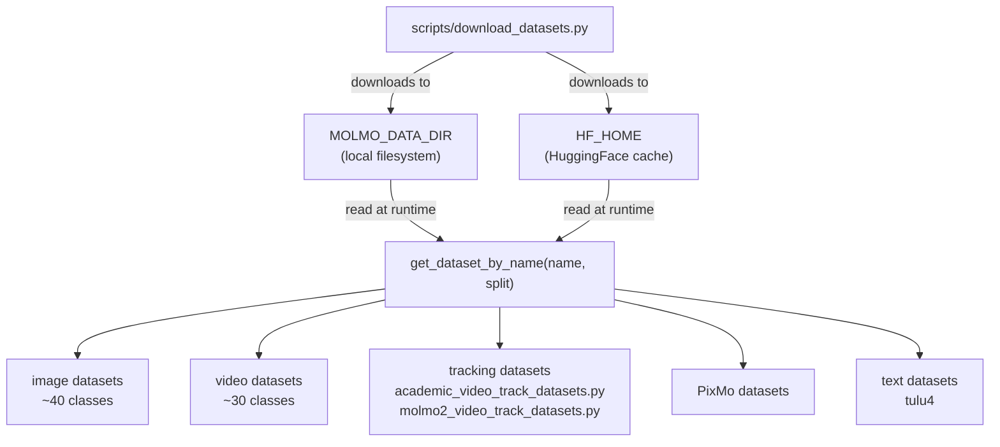
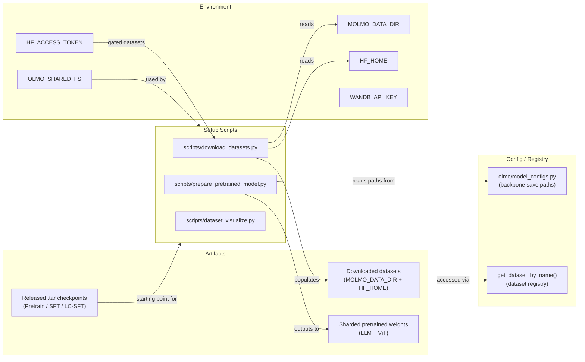

<!-- source: DeepWiki mcp.deepwiki.com · repo allenai/molmo2 · page 2 Getting Started · fetched 2026-10-26 -->

# Getting Started

<details>
<summary>Relevant source files</summary>

The following files were used as context for generating this wiki page:

- [.gitignore](.gitignore)
- [Dockerfile](Dockerfile)
- [README.md](README.md)

</details>


This page covers environment setup, installation, data download, and pretrained weight preparation — everything needed before running training or evaluation. For details on what Molmo2 is and its major subsystems, see the [Overview](#1). For how to run training after setup, see the [Training Pipeline](#3). For running evaluation, see [Evaluation](#4).

---

## Installation

Python 3.11 or higher is required. Install PyTorch separately first, then install the package:

```bash
git clone https://github.com/allenai/molmo2.git
cd molmo2
pip install torchcodec
pip install -e .[all]
```

`torchcodec` must be installed before `.[all]` because it has dependency constraints that conflict when installed together.

Sources: [README.md:67-81]()

---

## Docker

A pre-built container with all dependencies (but not the source code) is available:

```bash
docker pull ghcr.io/allenai/molmo2:latest
```

The Dockerfile is a two-stage build (build image → release image). Key components installed:

| Component | Version |
|---|---|
| Ubuntu | 24.04 |
| CUDA | 12.8.1 |
| Python | 3.12 |
| PyTorch | 2.9.1 |
| torchao | 0.15.0 |
| flash-attn | 2.8.3 |
| ring-flash-attn | 0.1.8 |
| liger-kernel | 0.6.4 |
| torchcodec | 0.9 |
| vLLM | 0.15.1 |
| grouped-gemm | custom SHA |
| molmo-utils | latest |
| ffmpeg | ≥6, <8 (conda-forge) |

The build stage compiles CUDA-dependent packages (`flash-attn`, `grouped-gemm`) against CUDA 12.8 and architectures SM 9.0 and 10.0. The release image copies the built conda environment and adds system tools (AWS CLI, gcloud, GitHub CLI, uv).

Sources: [Dockerfile:1-184]()

---

## Environment Variables

Set these variables before running any training or evaluation commands:

| Variable | Purpose | Required |
|---|---|---|
| `MOLMO_DATA_DIR` | Root directory for non-HuggingFace datasets | Yes |
| `HF_HOME` | HuggingFace cache directory | Recommended |
| `HF_DATASETS_OFFLINE` | Set to `1` to prevent HF from making network requests when data is already downloaded | Training |
| `OLMO_SHARED_FS` | Set to `1` if saving to a shared filesystem (multi-node jobs) | Multi-node |
| `HF_ACCESS_TOKEN` | HuggingFace access token (used for tokenizer download and gated datasets) | Recommended |
| `OPENAI_API_KEY` | Used by some evaluation tasks | Eval |
| `WANDB_API_KEY` | Weights & Biases logging | Training |
| `OMP_NUM_THREADS` | OpenMP threads for PyTorch; `8` is a typical value | Training |

Example setup:

```bash
export MOLMO_DATA_DIR=/data/molmo
export HF_HOME=/data/molmo/huggingface
export HF_DATASETS_OFFLINE=1
export OLMO_SHARED_FS=1
export HF_ACCESS_TOKEN=YOUR_HF_KEY
export OPENAI_API_KEY=YOUR_OPENAI_API_KEY
export WANDB_API_KEY=YOUR_WANDB_KEY
export OMP_NUM_THREADS=8
```

Sources: [README.md:161-181]()

---

## Downloading Datasets

Molmo2 uses a mix of HuggingFace datasets and custom data stored under `MOLMO_DATA_DIR`. The download script is `scripts/download_datasets.py`.

**Download everything:**

```bash
python3 scripts/download_datasets.py all --n_proc 8
```

**Download by group:**

```bash
python3 scripts/download_datasets.py image_academic
python3 scripts/download_datasets.py video_academic
python3 scripts/download_datasets.py video_tracking --n-procs 8
python3 scripts/download_datasets.py pixmo
```

**Download a specific dataset by name or class name:**

```bash
python3 scripts/download_datasets.py ChartQa --n-procs 12
python3 scripts/download_datasets.py text_vqa doc_qa chart_qa
```

### Available Download Groups

| Group | Contents |
|---|---|
| `image_academic` | Academic image benchmarks (VQA, TextVQA, ChartQA, etc.) |
| `video_academic` | Academic video benchmarks (MVBench, EgoSchema, VideoMME, etc.) |
| `pixmo` | PixMo internal datasets |
| `image_pointing` | Image pointing datasets |
| `video_pointing` | Video pointing datasets |
| `video_tracking` | MOT + SOT tracking datasets |
| `demo` | Small demo subset |

### Datasets Requiring Manual Download

Some datasets cannot be downloaded automatically due to licensing or access restrictions:

| Dataset | Where to obtain |
|---|---|
| DocQA, InfoQA, SceneText | https://rrc.cvc.uab.es |
| LVBench | HuggingFace: `zai-org/LVBench` |
| MLVU, LongVideoBench | Require HuggingFace user agreement acceptance |
| MVBench (nturgbd subset) | Manual download required |
| Ref-YT-VOS, YTVIS, ReVOS, LaSOT, Molmo2VideoTrack | See `olmo/data/academic_video_track_datasets.py` and `olmo/data/molmo2_video_track_datasets.py` |

The download script will throw an error with instructions if required files are missing.

Downloads are resumable — if a download is canceled or errors, re-running the same command will continue where it left off.

Sources: [README.md:87-135]()

### Dataset Flow: From Download to Model

The following diagram shows how datasets are registered and accessed at runtime. For details on the full data processing pipeline, see the [Data System](#5).

**Dataset Registration and Access Flow**



Sources: [README.md:87-135]()

---

## Downloading Pretrained Model Weights

To train from scratch, you need pretrained LLM and vision encoder weights. The script `scripts/prepare_pretrained_model.py` downloads, converts, and shards the weights for fast loading:

```bash
python scripts/prepare_pretrained_model.py qwen3_4b
python scripts/prepare_pretrained_model.py siglip2
```

The script reads save locations from `olmo/model_configs.py` and outputs sharded checkpoints in a format compatible with the training code.

### Supported Backbone Identifiers

| Identifier | Model |
|---|---|
| `qwen3_4b` | Qwen3-4B LLM (used for Molmo2-4B) |
| `qwen2_7b` | Qwen2-7B LLM (used for Molmo2-8B, Molmo2-O-7B) |
| `siglip2` | SigLIP2 Vision Transformer |

Sources: [README.md:139-149]()

---

## Released Training Checkpoints

If you want to skip stages of training or fine-tune from a released checkpoint, pre-trained weights are available for each stage of training. Download and extract with `wget` + `tar`:

```bash
wget https://storage.googleapis.com/oe-training-public/Molmo2-1225/Molmo2-8B.tar
tar -xf Molmo2-8B.tar
```

**Available checkpoints:**

| Model | Pretrain | SFT | Long-Context SFT |
|---|---|---|---|
| Molmo2-4B | Molmo2-4B-Pretrain.tar | Molmo2-4B-SFT.tar | Molmo2-4B.tar |
| Molmo2-8B | Molmo2-8B-Pretrain.tar | Molmo2-8B-SFT.tar | Molmo2-8B.tar |
| Molmo2-O-7B | Molmo2-O-7B-Pretrain.tar | Molmo2-O-7B-SFT.tar | Molmo2-O-7B.tar |

All checkpoints are stored at `https://storage.googleapis.com/oe-training-public/Molmo2-1225/`. The Long-Context SFT checkpoints correspond to the HuggingFace model releases. Checkpoint configs are backwards-compatible with this codebase but may not match exactly.

Sources: [README.md:193-232]()

---

## Visualizing Data

After downloading, datasets can be inspected visually using:

```bash
python3 scripts/dataset_visualize.py chart_qa /path/to/viz/dir
```

This builds an HTML file showing what the data looks like after preprocessing is applied, which is useful for verifying that a dataset downloaded and formatted correctly.

Sources: [README.md:151-158]()

---

## Setup Summary

The following diagram maps the setup steps to the scripts and environment components they interact with.

**Setup Steps to Code Entities**



Sources: [README.md:65-232](), [Dockerfile:1-184]()

---

