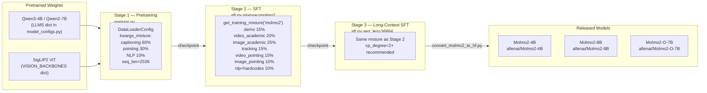
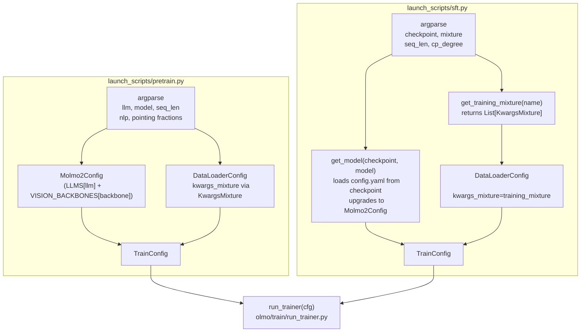

<!-- source: DeepWiki mcp.deepwiki.com · repo allenai/molmo2 · page 3 Training Pipeline · fetched 2026-10-26 -->

# Training Pipeline

<details>
<summary>Relevant source files</summary>

The following files were used as context for generating this wiki page:

- [README.md](README.md)
- [launch_scripts/pretrain.py](launch_scripts/pretrain.py)
- [launch_scripts/sft.py](launch_scripts/sft.py)

</details>


This page describes the three-stage training process at a high level: how the stages connect, what configuration and launch scripts drive each stage, what checkpoints are produced, and how the key training parameters differ between stages.

For detail on Stage 1 specifically, see [Pretraining](#3.1). For detail on Stages 2 and 3, see [Supervised Fine-Tuning](#3.2). For context parallelism (required for long-context training), see [Context Parallelism](#3.3). For information about the data processing that feeds training, see [Data System](#5).

---

## Overview

Molmo2 training is divided into three sequential stages. Each stage consumes the checkpoint produced by the previous stage and builds on it:

**Stage 1 — Pretraining:** Train from scratch using pretrained LLM and ViT weights. The data mixture focuses on image captioning, NLP text data, and image pointing. Produces a general vision-language model.

**Stage 2 — Supervised Fine-Tuning (SFT):** Load the pretrained checkpoint and fine-tune on a broad multitask mixture covering QA, pointing, tracking, video understanding, and more. Uses sequences up to 16,384 tokens.

**Stage 3 — Long-Context SFT:** Continue from the SFT checkpoint with the same script but at 36,864-token sequences and up to 384 video frames. Produces the final released models.

**Stage Flow Diagram**



Sources: [README.md:184-302](), [launch_scripts/pretrain.py:1-292](), [launch_scripts/sft.py:231-504]()

---

## Published Checkpoints

Checkpoints are released publicly after each stage for all three model variants. They can be used as starting points for fine-tuning or evaluation without running prior stages.

| Model | Pretrain Checkpoint | SFT Checkpoint | Long-Context SFT Checkpoint |
|---|---|---|---|
| Molmo2-4B | Molmo2-4B-Pretrain.tar | Molmo2-4B-SFT.tar | Molmo2-4B.tar |
| Molmo2-8B | Molmo2-8B-Pretrain.tar | Molmo2-8B-SFT.tar | Molmo2-8B.tar |
| Molmo2-O-7B | Molmo2-O-7B-Pretrain.tar | Molmo2-O-7B-SFT.tar | Molmo2-O-7B.tar |

Checkpoints are stored in the internal training format. The Long-Context SFT checkpoint is equivalent to the Hugging Face release but uses a slightly different layout. Use `convert_molmo2_to_hf.py` to convert to Hugging Face format.

To download and unpack a checkpoint:
```bash
wget https://storage.googleapis.com/oe-training-public/Molmo2-1225/Molmo2-8B.tar
tar -xf Molmo2-8B.tar
```

Sources: [README.md:193-232]()

---

## Launch Scripts and Their Relationship

Both entry-point scripts build a `TrainConfig` object programmatically and hand it to `run_trainer()`. CLI arguments are merged in via `OmegaConf.merge_with_dotlist`, which allows fine-grained override of any config field.

**Script-to-config flow diagram**



Sources: [launch_scripts/pretrain.py:34-291](), [launch_scripts/sft.py:174-504]()

---

## Key Training Configuration Parameters

The `TrainConfig` dataclass is the central configuration object. The table below highlights the parameters that differ most between stages.

| Parameter | Stage 1 (pretrain.py) | Stage 2 (sft.py) | Stage 3 (sft.py, long-ctx) |
|---|---|---|---|
| `seq_len` / `sequence_length` | 2,536 | 16,384 | 36,864 |
| `max_frames` (video) | 16 | 128 | 384 |
| `max_duration` | ~4× PixMoCap size | 300,000 steps | 2,000 steps |
| `global_train_batch_size` | 128 | 128 | 128 |
| `device_train_microbatch_size` | 4 | 2 | 1 |
| LLM learning rate | 2e-5 | 1e-5 | 1e-5 |
| ViT learning rate | 6e-6 | 5e-6 | 5e-6 |
| Connector learning rate | 2e-4 | 5e-6 | 5e-6 |
| `fsdp` | `FSDPConfig(precision=float)` | `FSDPConfig(fsdp2=True)` | `FSDPConfig(fsdp2=True)` |
| `cp_degree` | 1 | 1 (default) | 2+ recommended |
| `packing` | `PackingConfig(buffer_size=48)` | `PackingConfig(buffer_size=48, image_weight=30)` | same |
| `softmax_auxiliary_loss` | True (scale=1e-4) | True (scale=1e-4) | True (scale=1e-4) |
| `compile` | `CompilerConfig(mode="default")` | `CompilerConfig(mode="default")` | `None` (disabled with CP) |

Sources: [launch_scripts/pretrain.py:204-291](), [launch_scripts/sft.py:413-504]()

---

## Model Configuration

Both launch scripts produce a `Molmo2Config`. In `pretrain.py`, it is built directly from `LLMS` and `VISION_BACKBONES` dictionaries defined in `olmo/model_configs.py`. In `sft.py`, the function `get_model()` loads the existing config from the checkpoint's `config.yaml`, upgrades it to `Molmo2Config`, and adjusts several settings for fine-tuning:

- Sets `pointing_format` to `"html-v2"` (upgraded from `"html-v1"` used in pretraining)
- Sets `system_prompt` to `"demo_or_style_v2"`
- Sets `prompt_templates` to `"uber_model_v2"`
- Enables `pooling_attention_mask` on the vision backbone
- Sets `loss_token_weighting` to `"root_subsegments_root_tokens"`
- Configures multi-image settings: `max_multi_image_crops=8`, `max_images=5`
- Sets `max_sequence_length` to 16,384 (4096×4)

Sources: [launch_scripts/sft.py:174-228]()

---

## Training Mixture Composition

**Stage 1 mixture** is built inline in `pretrain.py` using `KwargsMixture` objects with explicit fractions for captioning, pointing, and NLP data. The default split is roughly 60% captioning (`pixmo_cap_with_transcripts`), 30% pointing (`pixmo_points_train`, `pixmo_count_train`, `cosyn_point`), and 10% NLP (`tulu4`).

**Stage 2 and 3 mixture** is produced by `get_training_mixture("molmo2")` in `sft.py`. It returns a list of `KwargsMixture` objects, each wrapping a `List[WeightedDataset]`:

```
demo             15%   pixmo_ask_model_anything, pixmo_cap, vixmo3_top_level_captions, ...
video_academic   20%   ~25 video QA datasets (tvqa, paxion, mvbench, ...)
image_academic   25%   ~35 image datasets (chart_qa, text_vqa, ai2d, cosyn_*, ...)
tracking         15%   mevis, ref_yt_vos, burst, lv_vis, molmo2_video_track, ...
video_pointing   15%   vixmo_points_minmax_*, academic_points_clip_63s_2fps
image_pointing   10%   pixmo_multi_points, pixmo_points_train, cosyn_point, ...
nlp + hardcodes  10%   tulu4, molmo2_hardcodes
```

The tracking sub-mixture is itself weighted across seven sub-groups (track, ground, single_point_track, sot_from_bbox, and distribution-tail variants).

Sources: [launch_scripts/sft.py:25-172](), [launch_scripts/sft.py:231-311]()

---

## Optimizer and Scheduler

Both stages use the `adamw` optimizer with component-specific learning rates managed by `OptimizerConfig`. The scheduler type is `multimodal`, which applies separate warmup schedules to the connector, ViT, and LLM parameter groups.

**Parameter group learning rates (Stage 2):**

| Component | Learning Rate | Warmup Steps |
|---|---|---|
| Connector | 5e-6 | 200 |
| ViT | 5e-6 | 200 |
| LLM | 1e-5 | 200 |
| Frame selector | 1e-4 | 200 |

All groups decay to 10% of their peak (`alpha_f=0.1`) with `warmup_min_lr=0.0`.

Sources: [launch_scripts/sft.py:451-466](), [launch_scripts/pretrain.py:236-252]()

---

## Distributed Training Setup

Both stages use FSDP (Fully Sharded Data Parallel). Stage 1 uses the older `FSDPConfig(precision=float, wrapping_strategy=FSDPWrapStrategy.by_block_and_size)`. Stages 2 and 3 use `FSDPConfig(fsdp2=True)`, which activates PyTorch's newer FSDP2 API.

Context parallelism is off by default (`cp_degree=1`). When `cp_degree > 1` is set:

1. `PackingConfig.cp_world_size` is set to match `cp_degree` so the packer aligns sequence boundaries to CP shard boundaries.
2. `conf.parallelism.context_parallel_config.degree` is set to `cp_degree`.
3. `conf.model.cp_enabled` is set to `True`.
4. Torch compilation is disabled (`compile=None`), as it is incompatible with context parallelism.

For full CP mechanics, see [Context Parallelism](#3.3).

Sources: [launch_scripts/sft.py:467-503](), [launch_scripts/pretrain.py:253-257]()

---

## Evaluation During Training

Both scripts register in-loop evaluators that run periodically during training. These are separated into loss evaluators (`evaluators`) and generative evaluators (`inf_evaluators`):

| Stage | Loss evaluators | Generative evaluators |
|---|---|---|
| Stage 1 | `pixmo_cap_with_transcripts` (val), `pixmo_cap` (val) | `point_bench:test`, `pixmo_count_counting:validation` |
| Stage 2 | `llava_video_oe_academic`, `pixmo_ask_model_anything`, `pixmo_cap` | `chart_qa`, `info_qa`, `coco_2014_vqa_multi`, `mvbench`, `muir_bench`, `pointing_eval_v2`, `vixmo_points_count` |

The `inf_eval_interval` and `eval_interval` fields on `TrainConfig` control how often each type of evaluator runs. In Stage 2 these are set to `-1` (disabled in-loop) by default; evaluations are intended to run post-training via `eval.py` or `eval_molmo2.py`.

Sources: [launch_scripts/pretrain.py:142-191](), [launch_scripts/sft.py:331-410]()

---

