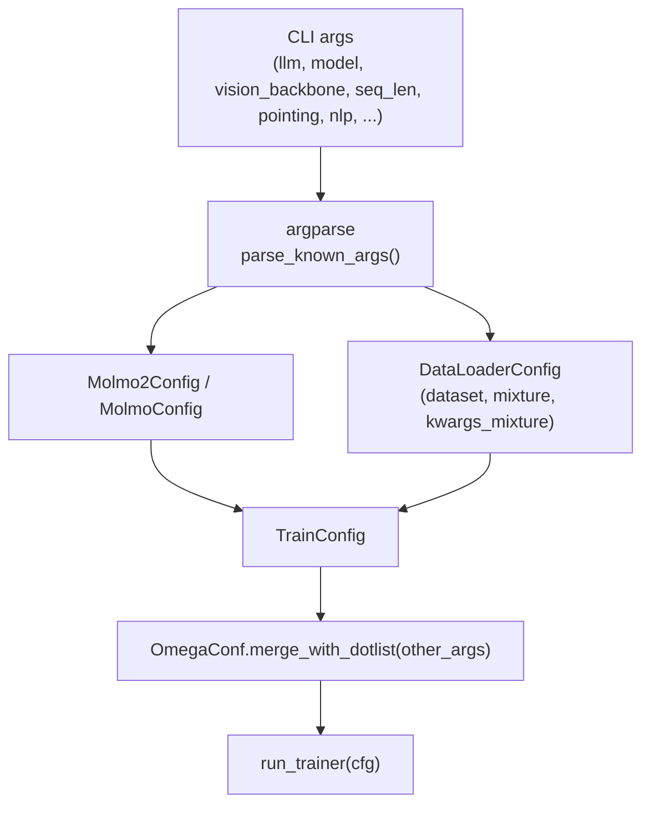
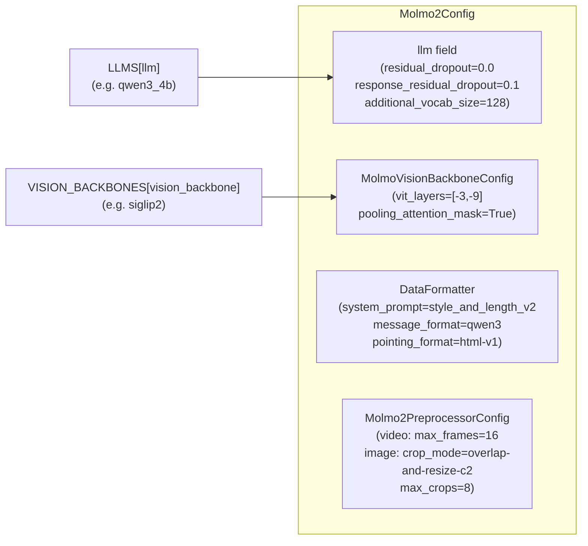
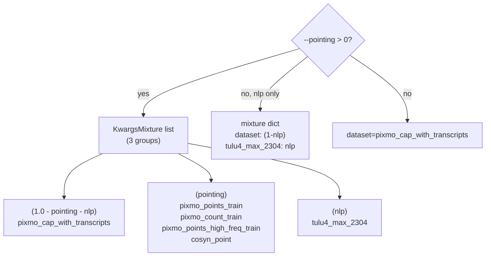
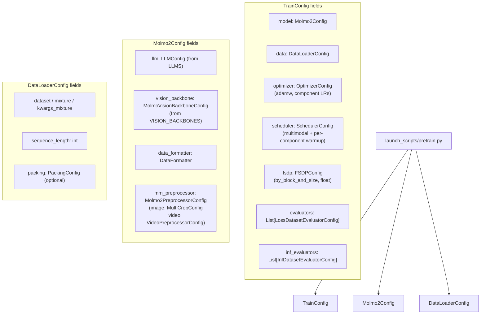

<!-- source: DeepWiki mcp.deepwiki.com · repo allenai/molmo2 · page 3.1 Pretraining · fetched 2026-10-26 -->

# Pretraining

<details>
<summary>Relevant source files</summary>

The following files were used as context for generating this wiki page:

- [README.md](README.md)
- [launch_scripts/pretrain.py](launch_scripts/pretrain.py)

</details>


This page covers Stage 1 of the Molmo2 training pipeline: pretraining via `launch_scripts/pretrain.py`. It describes model initialization, the training data mixture, key hyperparameters, and how to launch a run. For Stage 2 and Stage 3 training, see [Supervised Fine-Tuning](#3.2). For context parallelism used during long-sequence training, see [Context Parallelism](#3.3).

---

## Purpose

Stage 1 pretraining adapts a frozen pretrained LLM and ViT backbone to understand multimodal inputs. The primary training signal comes from image captioning, with optional pointing and NLP data mixed in. The output of this stage is a checkpoint used as the starting point for SFT.

---

## Script Entry Point

The pretraining script is [`launch_scripts/pretrain.py`](). It constructs a `TrainConfig` from a set of high-level CLI arguments and then calls `run_trainer(cfg)` to execute the training loop.

**Flow from CLI to Trainer:**



Sources: [launch_scripts/pretrain.py:34-291]()

---

## CLI Arguments

The script exposes a concise set of high-level arguments. Any field of `TrainConfig` can also be overridden via dotlist syntax as additional CLI args (e.g., `--wandb.name=run_name`).

| Argument | Default | Description |
|---|---|---|
| `llm` | (required) | LLM variant. One of `debug` or a key from `LLMS` (e.g., `qwen3_4b`, `qwen2_7b`) |
| `--model` | `molmo2` | Model architecture: `debug`, `molmo`, or `molmo2` |
| `--vision_backbone` | `siglip2` | ViT variant. Key from `VISION_BACKBONES` |
| `--global_batch_size` | `128` | Global training batch size |
| `--seq_len` | `2536` | Sequence length for padding/packing |
| `--pointing` | `0.3` | Fraction of pointing data in the mixture |
| `--nlp` | `0.1` | Fraction of NLP data in the mixture |
| `--vit_layers` | `[-3, -9]` | Which ViT layer features to extract |
| `--warmup_factor` | `1` | Divisor applied to warmup step counts |
| `--n_eval_examples` | `2048` | Number of examples used for in-loop evaluation |

Sources: [launch_scripts/pretrain.py:38-53]()

---

## Model Initialization

The model is built from two independently pretrained components:

**Model Configuration Assembly:**



- `LLMS` and `VISION_BACKBONES` are defined in [`olmo/model_configs.py`]() and map string names to config objects.
- The LLM config is modified with `dataclasses.replace` to set dropout values and extend the vocabulary by 128 tokens.
- The script supports both `Molmo2Config` (default) and `MolmoConfig` (older architecture) depending on `--model`.
- In debug mode, `DEBUG_MOLMO2` from `model_configs.py` is used instead.

Sources: [launch_scripts/pretrain.py:56-140]()

---

## Training Data Mixture

The mixture is controlled by the `--pointing` and `--nlp` fractions. Captioning fills the remaining fraction.

**Mixture composition based on `--pointing` and `--nlp`:**



The mixture is expressed as a `KwargsMixture` list (when pointing is enabled) or a simple `mixture` dict and is passed to `DataLoaderConfig`.

**Default mixture fractions (pointing=0.3, nlp=0.1):**

| Dataset(s) | Fraction | Content |
|---|---|---|
| `pixmo_cap_with_transcripts` | 0.6 | Image captioning with transcripts |
| `pixmo_points_train`, `pixmo_count_train`, `pixmo_points_high_freq_train`, `cosyn_point` | 0.3 | Image pointing / counting |
| `tulu4_max_2304` | 0.1 | NLP instruction following |

When `--pointing > 0`, packing is disabled (default). When `--nlp > 0` without pointing, a `PackingConfig(48)` is activated to improve efficiency since NLP examples are much shorter than captioning sequences.

Sources: [launch_scripts/pretrain.py:162-202]()

---

## Training Duration

Duration is computed automatically based on the captioning dataset size:

```
n = len(PixMoCap("train", "captions"))
duration = 4 * ceil(n / global_batch_size)   # ~4 epochs of caption data
```

When NLP is added without pointing, duration is scaled by `1.01` to compensate for packing spillover. For debug mode, `duration = 200` steps.

Sources: [launch_scripts/pretrain.py:71-72](), [launch_scripts/pretrain.py:192-196]()

---

## Optimizer and Scheduler

The optimizer uses component-specific learning rates:

| Component | Learning Rate |
|---|---|
| Connector (projection) | `2e-4` |
| ViT | `6e-6` |
| LLM | `2e-5` |
| Frame selector | `1e-4` |

- Optimizer: `AdamW` (`OptimizerType.adamw`)
- Scheduler: `multimodal` (`SchedulerType.multimodal`) with separate warmup durations per component
- All components are fine-tuned: `ft_connector=True`, `ft_llm=True`, `ft_vit=True`
- Gradient clipping: `max_grad_norm=1`

The `multimodal` scheduler applies different warmup periods to each component group. The connector warms up over 200 steps; the ViT and LLM each warm up over 2000 steps (both divided by `--warmup_factor`).

Sources: [launch_scripts/pretrain.py:237-252]()

---

## FSDP Configuration

| Setting | Value |
|---|---|
| Wrapping strategy | `FSDPWrapStrategy.by_block_and_size` |
| Precision | `FSDPPrecision.float` (full float32 master weights) |
| Training precision | `amp_bf16` (bfloat16 forward/backward) |
| `use_orig_params` | `True` |

Sources: [launch_scripts/pretrain.py:253-257]()

---

## In-Loop Evaluation

Two loss evaluators run during training:

| Label | Dataset | Split |
|---|---|---|
| `val` | `pixmo_cap_with_transcripts` | `validation` |
| `caption_val` | `pixmo_cap` | `validation` |

When pointing is enabled, two generative evaluators are also added:

| Task | Notes |
|---|---|
| `point_bench:test` | Pointing precision benchmark |
| `pixmo_count_counting:validation` | Counting accuracy |

- Loss evaluators run every `eval_interval=1000` steps.
- Generative evaluators run every `inf_eval_interval=2000` steps.

Sources: [launch_scripts/pretrain.py:142-191]()

---

## Checkpointing

| Setting | Value |
|---|---|
| `save_interval` | Every 4000 steps |
| `save_num_checkpoints_to_keep` | 1 (rolling) |
| `save_final_unsharded_checkpoint` | `False` |
| `allow_resume` | `True` |

The saved checkpoint is used as `load_path` for Stage 2 SFT. Public pretrained checkpoints are available for Molmo2-4B, Molmo2-8B, and Molmo2-O-7B (see [Training Pipeline](#3) for the checkpoint table).

Sources: [launch_scripts/pretrain.py:260-265]()

---

## Running Pretraining

**Debug run (single GPU):**
```bash
torchrun --nproc-per-node=1 launch_scripts/pretrain.py debug \
  --save_folder=/path/to/save/folder
```

**Standard run with Qwen3-4B + SigLIP2:**
```bash
WANDB_API_KEY=key torchrun --nproc-per-node=8 launch_scripts/pretrain.py qwen3_4b \
  --wandb.name=run_name --wandb.entity=entity --wandb.project=project \
  --save_folder=/path/to/save/folder
```

**Without wandb logging:**
```bash
torchrun --nproc-per-node=8 launch_scripts/pretrain.py qwen2_7b \
  --wandb=null --save_folder=/path/to/save/folder
```

Any field of `TrainConfig` can be overridden as a dotlist argument. For example, `--data.num_workers=1` can resolve DataLoader shared memory errors.

Sources: [README.md:234-266]()

---

## Configuration Object Summary

**Code entities and their roles in the pretraining configuration:**



Sources: [launch_scripts/pretrain.py:204-285]()

---

