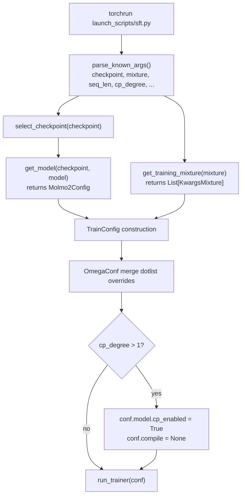
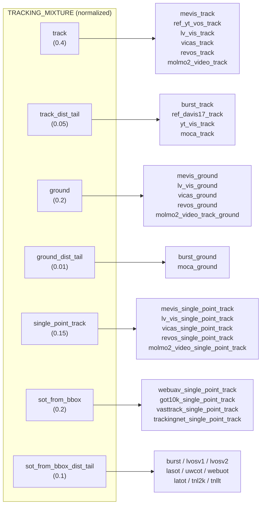
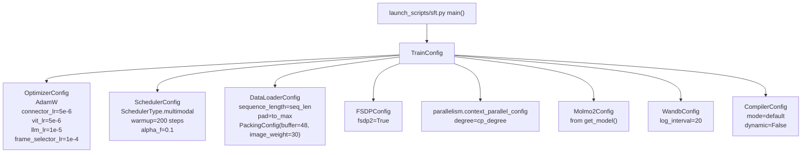

<!-- source: DeepWiki mcp.deepwiki.com · repo allenai/molmo2 · page 3.2 Supervised Fine-Tuning · fetched 2026-10-26 -->

# Supervised Fine-Tuning

<details>
<summary>Relevant source files</summary>

The following files were used as context for generating this wiki page:

- [README.md](README.md)
- [launch_scripts/sft.py](launch_scripts/sft.py)

</details>


This page covers Stage 2 (SFT) and Stage 3 (Long-Context SFT) of Molmo2 training. Both stages use the same entry point — `launch_scripts/sft.py` — and differ primarily in sequence length, video frame budget, and starting checkpoint. For Stage 1 training, see [Pretraining](#3.1). For how context parallelism enables Stage 3, see [Context Parallelism](#3.3).

---

## Overview

Supervised fine-tuning builds on a pretrained checkpoint (from Stage 1) by training on a broad multi-task mixture covering image QA, video QA, pointing, tracking, and NLP. Long-Context SFT (Stage 3) continues from the Stage 2 checkpoint with a larger sequence length and frame budget to improve performance on long-video tasks.

**Stage summary:**

| Stage | Script | Starting Checkpoint | `seq_len` | `max_frames` | Default `max_duration` |
|---|---|---|---|---|---|
| Stage 2 — SFT | `launch_scripts/sft.py` | Stage 1 pretrain | 16384 | 128 | 300 000 steps |
| Stage 3 — Long-Context SFT | `launch_scripts/sft.py` | Stage 2 SFT | 36864 | 384 | 2000 steps |

Sources: [README.md:183-302](), [launch_scripts/sft.py:314-504]()

---

## Entry Point: `sft.py`

`launch_scripts/sft.py` constructs a `TrainConfig` object and delegates to `run_trainer`. The two positional arguments select the starting checkpoint and training mixture:

```
torchrun --nproc-per-node=8 launch_scripts/sft.py <checkpoint> <mixture> [overrides...]
```

- `checkpoint` — path to a saved checkpoint directory (Stage 1 for SFT, Stage 2 for Long-Context SFT)
- `mixture` — name of the training mixture (`molmo2`, `tracking`, `debug`)

The script accepts dotlist-style CLI overrides that are merged into the `TrainConfig` via `OmegaConf.merge_with_dotlist`.

Sources: [launch_scripts/sft.py:314-504]()

---

## Two-Stage Entry-Point Flow

**Diagram: `sft.py` execution flow**



Sources: [launch_scripts/sft.py:314-504]()

---

## Model Configuration: `get_model()`

The `get_model()` function [launch_scripts/sft.py:174-228]() reads the model config from the checkpoint's `config.yaml`, upgrades it to a `Molmo2Config` (adding the `VideoPreprocessorConfig`), and applies SFT-specific overrides.

**Key settings applied in `get_model()`:**

| Setting | Value | Effect |
|---|---|---|
| `pointing_format` | `"html-v2"` | HTML-formatted point output |
| `prompt_templates` | `"uber_model_v2"` | Instruction formatting template |
| `message_format` | `"qwen3"` | Chat template style |
| `system_prompt` | `"demo_or_style_v2"` | System-level instruction prefix |
| `loss_token_weighting` | `"root_subsegments_root_tokens"` | Loss weighting scheme |
| `residual_dropout` | `0.1` | Regularization in the LLM |
| `response_residual_dropout` | `0.0` | No dropout on response tokens |
| `max_sequence_length` | `16384` | Default for Stage 2 |
| `max_frames` | `128` | Video frame cap for Stage 2 |
| `max_multi_image_crops` | `8` | Max crop slots across multi-image inputs |
| `max_images` | `5` | Max images per example |
| `normalize_on_gpu` | `True` | Reduces shared memory usage |
| `pooling_attention_mask` | `True` | Mask pooling in ViT |
| `p_multi_point_all_image` | `0.5` | Multi-point probability |
| `p_choice_content_in_mc` | `1.0` | Always include content in MC choices |

The model is always produced as a `Molmo2Config` wrapping a `Molmo2PreprocessorConfig`. If the source checkpoint only has a `MultiCropConfig` (Stage 1 `Molmo` model), the image fields are copied and a new `VideoPreprocessorConfig` is added.

Sources: [launch_scripts/sft.py:174-228]()

---

## Training Mixture: `get_training_mixture()`

`get_training_mixture()` [launch_scripts/sft.py:231-311]() maps the `mixture` argument to a list of `KwargsMixture` objects. Each `KwargsMixture` groups a list of `WeightedDataset` entries under a named bucket with a sampling rate.

### `molmo2` Mixture Composition

The `molmo2` mixture is the standard SFT mixture. Groups and their weights:

| Group name | Weight | Dataset examples |
|---|---|---|
| `demo` | 0.15 | `pixmo_ask_model_anything`, `pixmo_cap`, `vixmo3_top_level_captions_min_3`, ... |
| `video_academic` | 0.20 | `tgif`, `tvqa_with_sub`, `llava_video_mc_academic`, `mvbench`, `perception_test`, ... |
| `image_academic` | 0.25 | `coco_2014_vqa_multi`, `text_vqa`, `chart_qa_weighted`, `doc_qa`, `cosyn_*`, ... |
| `tracking` | 0.15 | `TRACKING_MIXTURE` (see below) |
| `video_pointing` | 0.15 | `vixmo_points_minmax_*`, `academic_points_clip_63s_2fps` |
| `image_pointing` | 0.10 | `pixmo_multi_points`, `pixmo_points_train`, `pixmo_count_train`, `cosyn_point` |
| `nlp` | ~0.10 | `tulu4` |
| `hardcodes` | 0.0005 | `molmo2_hardcodes` |

Sources: [launch_scripts/sft.py:244-304]()

---

### `TRACKING_MIXTURE` Composition

The tracking bucket uses its own internal sub-mixture that is normalized to sum to 1 before being converted to `WeightedDataset` entries.

**Diagram: TRACKING_MIXTURE internal weights**



Sources: [launch_scripts/sft.py:121-171]()

---

### Video Pointing Sub-Mixture

The `video_pointing` group uses its own relative weights within the bucket:

| Dataset | Relative weight |
|---|---|
| `vixmo_points_minmax_0_5` | 0.4 |
| `vixmo_points_minmax_6_25` | 0.3 |
| `vixmo_points_minmax_26_60` | 0.1 |
| `academic_points_clip_63s_2fps` | 0.2 |

Sources: [launch_scripts/sft.py:252-255]()

---

### Message Weights

Pointing and captioning datasets receive custom `MessageWeight` values to balance loss contribution:

```python
point_weight = MessageWeight(weight=0.2, root_length=False, root_subsegments=False)
cap_weight   = MessageWeight(weight=0.1, root_length=False, root_subsegments=False)
```

These are passed to `WeightedDataset` entries for tracking and pointing groups. QA datasets use the default `loss_token_weighting` scheme set in `get_model()` (`"root_subsegments_root_tokens"`).

Sources: [launch_scripts/sft.py:246-248]()

---

## `TrainConfig` Hyperparameters

The `TrainConfig` assembled in `main()` captures all training hyperparameters.

**Diagram: Key config objects and their sources**



**Core training parameters (Stage 2 defaults):**

| Parameter | Value | Notes |
|---|---|---|
| `seq_len` | `16384` | CLI `--seq_len` |
| `global_train_batch_size` | `128` | 8 GPUs × 16 grad accum |
| `device_train_microbatch_size` | `2` | CLI `--device_batch_size` |
| `max_duration` | `300000` | Steps (CLI `--max_duration`) |
| `precision` | `amp_bf16` | Mixed precision |
| `max_grad_norm` | `1.0` | Gradient clipping |
| `softmax_auxiliary_loss` | `True` | z-loss regularization |
| `softmax_auxiliary_loss_scale` | `1e-4` | z-loss weight |
| `response_logits_only` | `True` | Loss only on assistant tokens |
| `save_interval` | `2000` | Steps between checkpoints |
| `save_num_checkpoints_to_keep` | `1` | Disk usage control |

Sources: [launch_scripts/sft.py:412-492]()

---

## Stage 2: Running SFT

**Standard run (8 GPUs, `molmo2` mixture):**

```bash
WANDB_API_KEY=key torchrun --nproc-per-node=8 launch_scripts/sft.py \
  /path/to/pretrained/model molmo2 \
  --wandb.name=run_name --wandb.entity=entity --wandb.project=project \
  --save_folder=/path/to/save/folder
```

**Debug run (single GPU, minimal model and data):**

```bash
torchrun --nproc-per-node=1 launch_scripts/sft.py \
  /path/to/pretrained/model debug --debug \
  --save_folder=dbg --save_overwrite
```

In debug mode [launch_scripts/sft.py:362-378]():
- `model_cfg.llm.init_path` is set to `None` (random weights)
- `n_layers` is reduced to 1
- ViT layers are limited to 2
- `checkpoint` is set to `None` (no checkpoint loaded)
- `num_workers` and `prefetch_factor` are reduced

Sources: [launch_scripts/sft.py:362-378](), [README.md:274-290]()

---

## Stage 3: Running Long-Context SFT

Stage 3 reuses `sft.py` with overrides to increase sequence length and frame count. The starting checkpoint is a Stage 2 SFT checkpoint.

```bash
torchrun --nproc-per-node=8 launch_scripts/sft.py /path/to/sft/checkpoint molmo2 \
  --max_duration=2000 \
  --device_batch_size=1 \
  --data.num_workers=4 \
  --seq_len=36864 \
  --model.mm_preprocessor.video.max_frames=384 \
  --model.llm.max_sequence_length=36864
```

**What changes from Stage 2:**

| Parameter | Stage 2 | Stage 3 |
|---|---|---|
| `seq_len` | `16384` | `36864` |
| `max_frames` | `128` | `384` |
| `model.llm.max_sequence_length` | `16384` | `36864` |
| `max_duration` | `300000` | `2000` |
| `device_batch_size` | `2` | `1` |

For GPUs with smaller memory, or to push frame counts even higher, context parallelism is needed — see [Context Parallelism](#3.3) for `--cp_degree` usage.

Sources: [README.md:293-302](), [launch_scripts/sft.py:322-329]()

---

## In-Loop Evaluations

During training, `sft.py` registers both inference (generative) and loss-based evaluations. For the `molmo2` mixture:

**Generative evaluations** (`inf_evaluators`):
- `chart_qa`, `info_qa`, `coco_2014_vqa_multi`
- `pixmo_clocks`
- `pointing_eval_v2:test`
- `muir_bench:test`
- `mvbench`
- `vixmo_points_count:val`

**Loss evaluations** (`evaluators`):
- `llava_video_oe_academic`
- `pixmo_ask_model_anything`
- `pixmo_cap`

Both are configured with `eval_interval=-1` and `inf_eval_interval=-1` by default, which disables automatic periodic evaluation. These can be overridden via CLI to run evaluations during training.

Sources: [launch_scripts/sft.py:330-410]()

---

## Config Override Mechanism

All constructor defaults can be overridden via dotlist arguments after the positional args. The `OmegaConf` merge at [launch_scripts/sft.py:496-498]() applies these:

```bash
# Example: disable wandb, increase workers
launch_scripts/sft.py /ckpt molmo2 \
  --wandb=null \
  --data.num_workers=8 \
  --model.llm.residual_dropout=0.05
```

`clean_opt()` strips leading `--` from each argument before passing to `merge_with_dotlist`.

Sources: [launch_scripts/sft.py:496-498]()

---

## Published Checkpoints

Pre-trained checkpoints are available for each model variant at all three training stages:

| Model | Pretrain | SFT | Long-Context SFT |
|---|---|---|---|
| Molmo2-4B | Available | Available | Available (= HF release) |
| Molmo2-8B | Available | Available | Available (= HF release) |
| Molmo2-O-7B | Available | Available | Available (= HF release) |

The Long-Context SFT checkpoint matches the Hugging Face release format (after conversion via `convert_molmo2_to_hf.py`). Downloaded `.tar` checkpoints can be passed directly as `<checkpoint>` to `sft.py` for further fine-tuning.

Sources: [README.md:193-233]()

---

