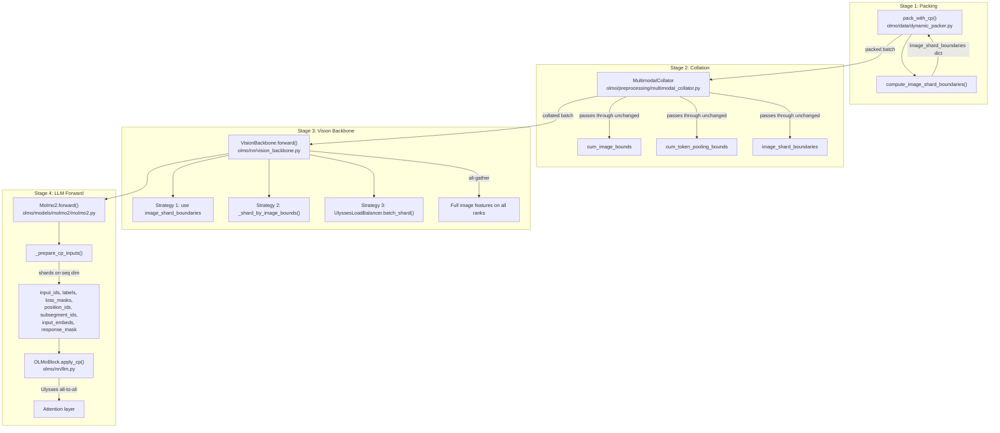
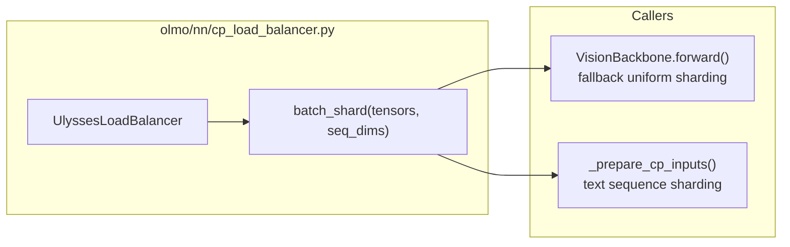
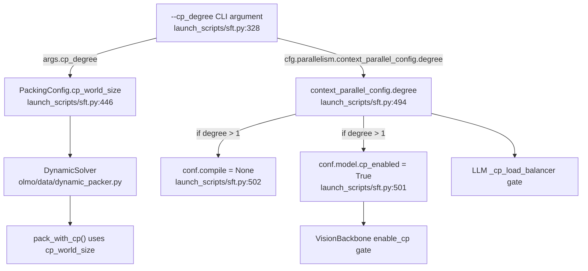

<!-- source: DeepWiki mcp.deepwiki.com · repo allenai/molmo2 · page 3.3 Context Parallelism · fetched 2026-10-26 -->

# Context Parallelism

<details>
<summary>Relevant source files</summary>

The following files were used as context for generating this wiki page:

- [docs/context_parallel.md](docs/context_parallel.md)
- [launch_scripts/sft.py](launch_scripts/sft.py)
- [olmo/data/dynamic_packer.py](olmo/data/dynamic_packer.py)

</details>


This page explains how context parallelism (CP) is implemented in Molmo2, covering its purpose, the Ulysses attention mechanism it uses, and how it integrates across all four stages of the training pipeline. For information on the dynamic packing algorithm that feeds CP, see [Dynamic Packing](#5.2). For the training stages that use CP, see [Supervised Fine-Tuning](#3.2).

---

## Purpose

Without CP, a 384-frame video at ~96 tokens per frame produces sequences exceeding 36,000 tokens — too long to fit on a single GPU at training batch sizes. CP solves this by sharding the sequence across multiple GPUs so that each GPU holds and processes only a contiguous fraction of the total sequence. The computation is mathematically equivalent to single-GPU training; it just distributes the memory and compute.

With CP degree `N`, each GPU in a CP group processes `~S/N` tokens of a sequence of length `S`. During the attention step, GPUs communicate keys and values so that attention scores are computed over the full sequence.

---

## Ulysses Attention

The codebase supports only **Ulysses attention** for CP. Ring attention is not actively used or tested, primarily because Molmo2's attention masks are complex: bidirectional attention for image tokens, subsegment masks for packed examples, and causal masks for text. Ulysses handles arbitrary mask shapes because each rank computes full-sequence attention for its assigned heads.

**Ulysses attention steps per transformer layer:**

| Step | Description |
|------|-------------|
| 1. Input | Each rank holds a contiguous sequence chunk for all heads: rank `i` holds tokens `[i·S/N, (i+1)·S/N)` |
| 2. All-to-all (scatter heads, gather sequence) | Ranks exchange data so each rank holds the *full sequence* but only a *subset of heads* |
| 3. Local attention | Each rank computes exact `softmax(QKᵀ/√d)·V` on its heads over the full sequence |
| 4. All-to-all (scatter sequence, gather heads) | Ranks exchange data back so each rank holds all heads but only its sequence chunk |

This requires exactly **two all-to-all collectives per transformer layer**, which scales efficiently on NVLink-connected GPUs.

**Example with CP degree 2 and 32 attention heads:**

```
Rank 0 input:  tokens [0, 18432), all 32 heads
Rank 1 input:  tokens [18432, 36864), all 32 heads
        ↓ all-to-all
Rank 0 computes: tokens [0, 36864), heads [0, 16)
Rank 1 computes: tokens [0, 36864), heads [16, 32)
        ↓ all-to-all
Rank 0 output: tokens [0, 18432), all 32 heads
Rank 1 output: tokens [18432, 36864), all 32 heads
```

Sources: [docs/context_parallel.md:101-133]()

---

## Pipeline Integration

CP touches four distinct stages of the training pipeline. The diagram below maps each stage to its responsible code entity.

**Diagram: CP integration across the training pipeline**



Sources: [docs/context_parallel.md:19-84](), [olmo/data/dynamic_packer.py:264-288](), [launch_scripts/sft.py:494-502]()

---

### Stage 1 — Packing

`pack_with_cp()` in [olmo/data/dynamic_packer.py:264-288]() wraps the standard `pack()` function. When `cp_world_size > 1` and the packed output contains images, it calls `compute_image_shard_boundaries()`.

`compute_image_shard_boundaries()` [olmo/data/dynamic_packer.py:14-164]() takes:
- `cum_image_bounds` — cumulative image counts across packed examples
- `cum_token_pooling_bounds` — cumulative pooling row counts
- `cp_world_size` — number of ranks in the CP group

It divides images across ranks proportionally, then runs a post-processing loop to handle **GPU starvation**: if any rank would receive zero images, it steals one assignment from a neighbor. The returned dict has the shape:

```python
{
    rank_id: {
        "start_image_idx": int,
        "end_image_idx": int,
        "start_pool_idx": int,
        "end_pool_idx": int,
        "max_num_tokens": int,
    }
}
```

This dict is stored as `image_shard_boundaries` on the packed example.

The `DynamicSolver` passes `cp_world_size` through to `pack_with_cp()` in both its shortcut path [olmo/data/dynamic_packer.py:430]() and its main solve path [olmo/data/dynamic_packer.py:473]().

Sources: [olmo/data/dynamic_packer.py:14-164](), [olmo/data/dynamic_packer.py:264-288](), [olmo/data/dynamic_packer.py:401-477]()

---

### Stage 2 — Collation

The collator in `olmo/preprocessing/multimodal_collator.py` passes the three CP-related fields through as lists (one entry per batch element) without collating them into padded tensors:

| Field | Type | Purpose |
|-------|------|---------|
| `cum_image_bounds` | list | Cumulative count of images per example in the packed sequence |
| `cum_token_pooling_bounds` | list | Cumulative count of pooling rows per example |
| `image_shard_boundaries` | list of dicts | Pre-computed per-rank image assignments |

When CP is disabled, these fields still flow through but are never consumed by the model (gated by `enable_cp` and `_cp_load_balancer is not None`).

Sources: [docs/context_parallel.md:44-52]()

---

### Stage 3 — Vision Backbone

When `enable_cp=True`, `VisionBackbone.forward()` in `olmo/nn/vision_backbone.py` assigns each CP rank a subset of images to encode through the ViT and connector. It tries three strategies in order:

1. **Pre-computed boundaries** (preferred): Uses `image_shard_boundaries` from the packer. No runtime communication needed.
2. **On-the-fly sharding**: If `cum_image_bounds` and `cum_token_pooling_bounds` are present but no pre-computed boundaries, calls `_shard_by_image_bounds()` to compute the split at runtime.
3. **Uniform sharding**: Falls back to `UlyssesLoadBalancer.batch_shard()` to split images evenly on the image dimension.

After each rank finishes encoding its image subset, the results are **all-gathered** so every rank has the complete set of image features. These features are then embedded into the token sequence for the LLM.

Sources: [docs/context_parallel.md:54-71]()

---

### Stage 4 — LLM Forward

After image features are embedded, `_prepare_cp_inputs()` in `olmo/models/molmo2/molmo2.py` shards all sequence-dimension tensors across CP ranks:

- `input_ids`
- `labels`
- `loss_masks`
- `response_mask`
- `position_ids`
- `subsegment_ids`
- `input_embeds`

It also collects the per-block RoPE sin/cos buffers so each rank uses position-correct embeddings for its shard.

The sharded tensors pass through each `OLMoBlock` (in `olmo/nn/llm.py`). Each block's attention layer uses Ulysses attention via `OLMoBlock.apply_cp()`. The loss is computed locally on each rank's portion of the sequence.

Sources: [docs/context_parallel.md:73-85]()

---

## Load Balancer

**Diagram: UlyssesLoadBalancer code entities**



`UlyssesLoadBalancer` in `olmo/nn/cp_load_balancer.py` is the low-level mechanism for sequence sharding. Its `batch_shard()` method:

1. Takes a list of tensors and their sequence dimensions.
2. Pads sequences to be divisible by `cp_world_size`.
3. Returns the contiguous slice belonging to the current rank.

| CP degree | Sequence length | Rank 0 tokens | Rank 1 tokens |
|-----------|----------------|---------------|---------------|
| 2 | 36,864 | [0, 18,432) | [18,432, 36,864) |
| 4 | 36,864 | [0, 9,216) | [9,216, 18,432) |

The load balancer also contains Ring attention implementations, but these are **not actively used or tested**.

Sources: [docs/context_parallel.md:134-142]()

---

## Configuration

CP requires setting matching values in two independent configuration paths: the data pipeline and the model.

**Diagram: Configuration wiring in launch_scripts/sft.py**



> **Note:** Compilation (`torch.compile`) is disabled when CP degree > 1, as it is not supported with context parallelism. See [launch_scripts/sft.py:502]().

### Key configuration fields

| Config location | Field | Default | Description |
|----------------|-------|---------|-------------|
| `TrainConfig.parallelism.context_parallel_config` | `degree` | `1` | Number of GPUs per CP group |
| `TrainConfig.parallelism.context_parallel_config` | `attention_type` | `"ulysses"` | Only `"ulysses"` is supported |
| `TrainConfig.parallelism.context_parallel_config` | `load_balancer` | `"ulysses"` | Load balancer type |
| `PackingConfig` | `cp_world_size` | `1` | Must match `degree` |
| `Molmo2Config` | `cp_enabled` | `False` | Set automatically when `degree > 1` |
| `Molmo2Config` | `apply_cp_to_vision_backbone` | `False` | Enable ViT encoding sharding |

Sources: [docs/context_parallel.md:144-187](), [launch_scripts/sft.py:328](), [launch_scripts/sft.py:444-446](), [launch_scripts/sft.py:494-502]()

### Example: Stage 3 long-context training with CP degree 2

```bash
torchrun --nproc-per-node=8 launch_scripts/sft.py /path/to/checkpoint molmo2 \
    --cp_degree=2 \
    --parallelism.context_parallel_config.degree=2 \
    --parallelism.context_parallel_config.attention_type=ulysses \
    --seq_len=36864 \
    --model.mm_preprocessor.video.max_frames=384 \
    --model.llm.max_sequence_length=36864 \
    --save_folder=/path/to/save
```

With 8 GPUs and CP degree 2, this creates **4 data-parallel groups**, each containing **2 CP ranks**. Each CP pair jointly processes sequences up to 36,864 tokens; each rank handles ~18,432 tokens.

Sources: [docs/context_parallel.md:173-187]()

---

## CP vs. Non-CP Comparison

| Stage | Without CP | With CP |
|-------|-----------|---------|
| Packing | `pack()` | `pack_with_cp()` + `compute_image_shard_boundaries()` |
| Collation | Standard field collation | Same, plus `image_shard_boundaries` passed through |
| Vision backbone | All images encoded on all ranks | Each rank encodes a subset, then all-gather |
| Text inputs | Full sequence per rank | `_prepare_cp_inputs()` shards on seq dimension |
| Attention | Standard SDPA | Ulysses: two all-to-all collectives per layer |
| Loss | Full sequence | Each rank computes loss on its own portion |
| `torch.compile` | Supported | Disabled |

Sources: [docs/context_parallel.md:87-99]()

---

## Key Files Reference

| File | CP-related content |
|------|--------------------|
| `olmo/nn/cp_load_balancer.py` | `UlyssesLoadBalancer`, `batch_shard()` |
| `olmo/data/dynamic_packer.py` | `compute_image_shard_boundaries()`, `pack_with_cp()`, `PackingConfig.cp_world_size` |
| `olmo/preprocessing/multimodal_collator.py` | Passes `image_shard_boundaries`, `cum_image_bounds`, `cum_token_pooling_bounds` |
| `olmo/models/molmo2/molmo2.py` | `apply_cp()`, `_prepare_cp_inputs()`, forward gating on `_cp_load_balancer` |
| `olmo/nn/vision_backbone.py` | Image sharding strategies and all-gather in `forward()` |
| `olmo/nn/llm.py` | `OLMoBlock.apply_cp()`, attention layer CP setup |
| `olmo/train/run_trainer.py` | `build_world_mesh()`, `parallelize_model()` |
| `launch_scripts/sft.py` | `--cp_degree` CLI arg, config wiring at lines 494–502 |

Sources: [docs/context_parallel.md:189-200]()

---

