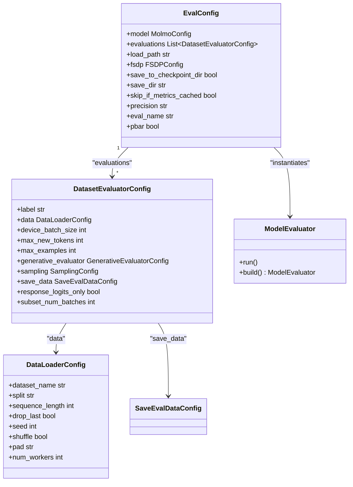
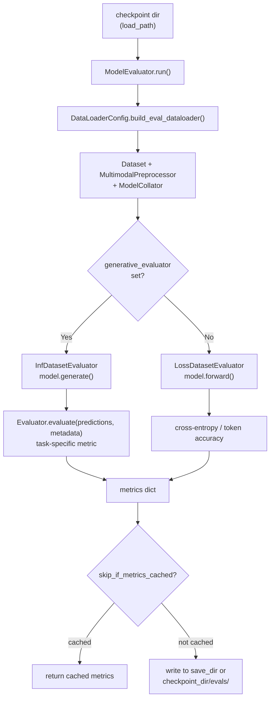

<!-- source: DeepWiki mcp.deepwiki.com · repo allenai/molmo2 · page 4 Evaluation · fetched 2026-10-26 -->

# Evaluation

Relevant source files

The following files were used as context for generating this wiki page:

- [README.md](README.md)
- [launch_scripts/eval.py](launch_scripts/eval.py)
- [launch_scripts/eval_molmo2.py](launch_scripts/eval_molmo2.py)

This page describes the evaluation system in the Molmo2 codebase: how generative and loss-based evaluation work, how results are cached, and how the two entry-point scripts relate to each other.

For details on running a single task, see [Single-Task Evaluation](#4.1). For the full multi-task suite and task taxonomy, see [Multi-Task Evaluation](#4.2). For the dataset catalog and how datasets are loaded, see [Dataset Catalog](#5.3).

---

## Overview

Evaluation is driven by `ModelEvaluator`, which loads a checkpoint, iterates over one or more evaluation datasets, runs either generation or loss computation, and writes metrics to disk. Two launch scripts provide different levels of control:

| Script | Purpose |
|---|---|
| `launch_scripts/eval.py` | Single task, fine-grained CLI control |
| `launch_scripts/eval_molmo2.py` | Named task groups, multiple checkpoints |

Both scripts build an `EvalConfig` and delegate to `ModelEvaluator.run()`.

**Sources:** [launch_scripts/eval.py:1-94](), [launch_scripts/eval_molmo2.py:1-281](), [README.md:304-360]()

---

## Core Abstractions

**Evaluation system class and configuration diagram:**

**Sources:** [launch_scripts/eval.py:53-90](), [launch_scripts/eval_molmo2.py:209-236](), [README.md:304-360]()

---

## Evaluation Modes

Each `DatasetEvaluatorConfig` operates in one of two modes, determined by whether `generative_evaluator` is set:

| Mode | Trigger | What runs | Typical use |
|---|---|---|---|
| **Generative** | `generative_evaluator` is not `None` | `InfDatasetEvaluator` — calls `model.generate()`, then scores output text | QA benchmarks, pointing, tracking |
| **Loss** | `generative_evaluator` is `None` | `LossDatasetEvaluator` — calls `model.forward()`, computes cross-entropy | `pixmo_cap`, `pixmo_ask_model_anything` |

In `eval.py`, passing `--loss` sets `generative_evaluator=None` [launch_scripts/eval.py:65-66](). In `eval_molmo2.py`, tasks in `loss_eval_tasks` always get `generative_evaluator=None` [launch_scripts/eval_molmo2.py:228-235]().

---

## Data Flow During Evaluation

**Evaluation data flow diagram:**

**Sources:** [launch_scripts/eval.py:53-90](), [launch_scripts/eval_molmo2.py:184-276](), [README.md:304-358]()

---

## Result Caching

When `skip_if_metrics_cached=True` (the default in `eval_molmo2.py`) [launch_scripts/eval_molmo2.py:270](), `ModelEvaluator` checks whether a metrics file already exists in the output directory before running inference. If found, the cached metrics are returned immediately and the task is skipped. This allows resuming an interrupted multi-task evaluation run without re-running completed tasks.

When `save_to_checkpoint_dir=True`, results are written under `<checkpoint_dir>/evals/`. A custom path can be set via `save_dir`.

---

## Task-Specific Helpers

Two utility functions mediate between task names and evaluator objects:

| Function | File | Role |
|---|---|---|
| `get_evaluator(task)` | `olmo/eval/eval_utils.py` | Returns a `GenerativeEvaluatorConfig` for a named task |
| `get_default_max_tokens(task)` | `olmo/eval/eval_utils.py` | Returns the task-specific default for `max_new_tokens` |
| `get_evaluation(name, ...)` | `olmo/eval/eval_utils.py` | Returns a fully-formed evaluation bundle (data config + evaluator + sampling) |

`eval.py` uses `get_evaluator` and `get_default_max_tokens` directly [launch_scripts/eval.py:7-8](), [launch_scripts/eval.py:50-51](). `eval_molmo2.py` uses `get_evaluation` to obtain the full bundle in one call [launch_scripts/eval_molmo2.py:186-187]().

---

## Model Configuration Overrides at Eval Time

Before building `EvalConfig`, `eval_molmo2.py` applies standard overrides to the loaded model config [launch_scripts/eval_molmo2.py:244-256]():

- `max_crops = 24` and `max_images = 20` on the image preprocessor
- `llm.max_sequence_length = 64000`

These ensure the model can handle the full context required by long-video benchmarks without retraining.

---

## Supported Evaluation Groups

`eval_molmo2.py` defines the following named task groups as Python lists:

| Group name | Constant | Representative tasks |
|---|---|---|
| `single_image` | `IMAGE_TASKS` + `IMAGE_POINTING` | `coco_2014_vqa_8192`, `chart_qa`, `mmmu_test`, `pointing_eval_v2:test` |
| `single_image_test` | `TEST_IMAGE_TASKS` | Test splits + `a_okvqa_mc`, `a_okvqa_da` |
| `multi_image` | `MULTI_IMAGE_TASKS` | `muir_bench:test`, `mmiu:test`, `blink:validation` |
| `short_video` | `SHORT_VIDEO` | `mvbench`, `ego_schema`, `nextqa_mc:test`, `perception_test` |
| `long_video` | `LONG_VIDEO` | `video_mme`, `long_video_bench_w_subtitle`, `mlvu_mc`, `lvbench` |
| `video` | `SHORT_VIDEO` + `LONG_VIDEO` | All of the above |
| `video_no_subtitle` | `SHORT_VIDEO` + `LONG_VIDEO_NO_SUBTITLES` | Video without subtitle variants |
| `video_subtitle` | `LONG_VIDEO_SUBTITLES` | `video_mme_w_subtitle`, `long_video_bench_w_subtitle`, `lvbench` |
| `video_pointing` | `VIDEO_POINTING` | `vixmo_points_count_clip_63s:val`, `mevis_point_track_per_frame_fps_6_sample_fps_1` |
| `image_pointing` | `IMAGE_POINTING` | `countbench_qa:huggingface`, `pixmo_count_counting:validation` |
| `tracking` | `TRACKING` | `mevis_track_eval_1fps:test`, `ref_yt_vos_track_eval_1fps:test`, `molmo2_video_track_eval_1fps:test` |
| `test_video` | `TEST_VIDEO_DATASETS` | Test splits of MLVU, PerceptionTest, EgoSchema, MotionBench, LongVideoBench |

Individual task names (e.g. `chart_qa`, `mevis_track_eval_1fps:test`) can also be passed directly to `--tasks`.

**Sources:** [launch_scripts/eval_molmo2.py:29-123](), [README.md:333-350]()

---

## Batch Size Defaults

`eval_molmo2.py` implements a `device_batch_size` mode called `"4b-default"` (and `"8b-default"`) that selects per-task batch sizes automatically [launch_scripts/eval_molmo2.py:188-208]():

| Condition | `device_batch_size` (4B default) |
|---|---|
| `vixmo_points_point_eval*` | 1 |
| `TRACKING` tasks | 1 |
| `IMAGE_TASKS` or `IMAGE_POINTING` | 4 |
| All other tasks | 2 |

These can be overridden by passing a numeric value to `--device_batch_size`.

---

## Practical Notes

- Set `NCCL_TIMEOUT_MINUTES=20` when evaluating long-video tasks; different ranks can finish at very different times.
- Set `PYTORCH_CUDA_ALLOC_CONF=expandable_segments:True` to reduce OOM risk.
- The `--loss` flag in `eval.py` switches from generation to loss mode without changing any other config.
- Both scripts accept arbitrary `--key=value` overrides via `OmegaConf`, which are merged after the base config is constructed [launch_scripts/eval.py:87-89](), [launch_scripts/eval_molmo2.py:273-275]().
- Multi-node evaluation is supported via the standard `torchrun --nnodes` / `--node_rank` arguments.

**Sources:** [README.md:352-359](), [launch_scripts/eval.py:86-90](), [launch_scripts/eval_molmo2.py:272-276]()

---

