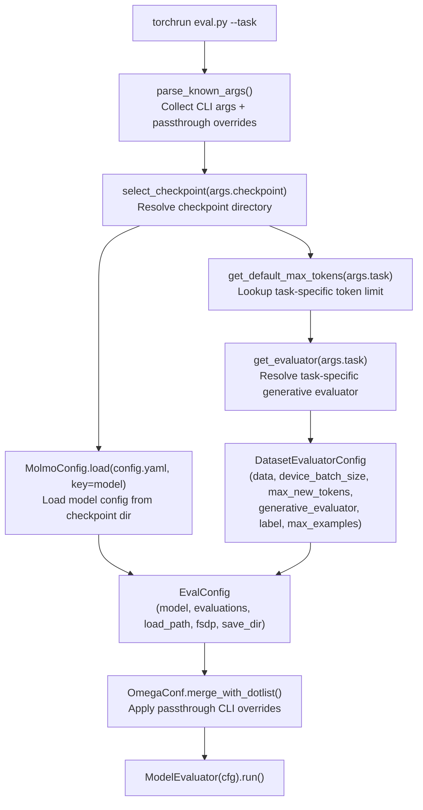
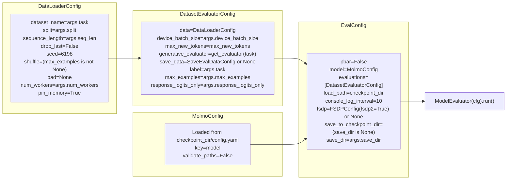
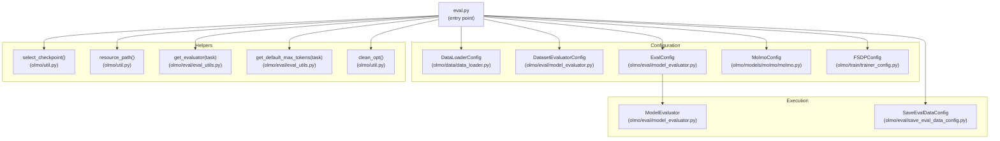

<!-- source: DeepWiki mcp.deepwiki.com · repo allenai/molmo2 · page 4.1 Single-Task Evaluation · fetched 2026-10-26 -->

# Single-Task Evaluation

<details>
<summary>Relevant source files</summary>

The following files were used as context for generating this wiki page:

- [launch_scripts/eval.py](launch_scripts/eval.py)

</details>


This page covers `launch_scripts/eval.py`, the entry point for evaluating a checkpoint on **one dataset task at a time**. It explains the CLI arguments, how the configuration objects (`EvalConfig`, `DatasetEvaluatorConfig`) are assembled, and how evaluation is dispatched through `ModelEvaluator`.

For an overview of the evaluation system and the distinction between generative vs. loss-based evaluation, see [Evaluation](#4). For evaluating across many tasks simultaneously, see [Multi-Task Evaluation](#4.2).

---

## Overview

`eval.py` is invoked with `torchrun` and evaluates a single checkpoint on a single dataset task. It constructs an `EvalConfig` programmatically from CLI arguments and then delegates all work to `ModelEvaluator`.

**Diagram: eval.py control flow**



Sources: [launch_scripts/eval.py:18-90]()

---

## CLI Arguments

All arguments are parsed via `argparse`. Unknown arguments are collected into `other_args` and applied as OmegaConf dot-list overrides, allowing any nested config field to be overridden from the command line.

| Argument | Type | Default | Description |
|---|---|---|---|
| `checkpoint` | positional | — | Path to checkpoint directory (or a glob/step selector, resolved by `select_checkpoint`) |
| `--task` | `str` | `"dense_caption_eval"` | Dataset task name, passed to `get_dataset_by_name` and `get_evaluator` |
| `--split` | `str` | `"test"` | Dataset split to evaluate on |
| `--seq_len` | `int` | `None` | Sequence length for the data loader; required when `--fsdp` is set |
| `--num_workers` | `int` | `2` | DataLoader worker count |
| `--max_examples` | `int` | `None` | Cap the number of examples evaluated; also enables shuffling when set |
| `--device_batch_size` | `int` | `1` | Number of examples per device per step |
| `--save_dir` | `str` | `None` | Directory to save results; defaults to the checkpoint directory |
| `--save_eval_data` | flag | `False` | Save detailed intermediate model data for visualization |
| `--loss` | flag | `False` | Run loss/accuracy evaluation instead of generation |
| `--fsdp` | flag | `False` | Wrap model with FSDP2 for multi-GPU evaluation |
| `--max_new_tokens` | `int` | `None` | Override token generation limit; otherwise use task default |
| `--response_logits_only` | flag | `False` | Restrict logit collection to response tokens only |

Sources: [launch_scripts/eval.py:22-38]()

---

## Configuration Assembly

**Diagram: Config object composition**



Sources: [launch_scripts/eval.py:40-90]()

### Key construction decisions

- **`max_new_tokens` resolution**: if `--loss` is set, `max_new_tokens` is `None` (no generation). If `--max_new_tokens` is provided, that value is used. Otherwise `get_default_max_tokens(args.task)` provides a per-task default [launch_scripts/eval.py:45-51]().

- **`generative_evaluator` resolution**: if `--loss` is set, `generative_evaluator=None` causes loss-only evaluation. Otherwise `get_evaluator(args.task)` returns a task-specific evaluator [launch_scripts/eval.py:65]().

- **`shuffle`**: enabled automatically when `--max_examples` is set, so a random subset is sampled rather than always taking the first N examples [launch_scripts/eval.py:58]().

- **Model config loading**: `MolmoConfig.load()` reads `config.yaml` from the checkpoint directory using `key="model"` and `validate_paths=False`, so paths inside the config are not checked against the filesystem [launch_scripts/eval.py:73-74]().

- **OmegaConf passthrough overrides**: any unrecognized CLI arguments in `other_args` are cleaned via `clean_opt()` and merged with `OmegaConf.merge_with_dotlist()`, allowing deep overrides such as `model.llm.d_model=2048` [launch_scripts/eval.py:87-89]().

---

## Generative vs. Loss Evaluation

The `--loss` flag switches the evaluation mode:

| Mode | `max_new_tokens` | `generative_evaluator` | What runs |
|---|---|---|---|
| **Generative** (default) | task default or `--max_new_tokens` | `get_evaluator(task)` result | Model generates text; task-specific metric computed |
| **Loss** (`--loss`) | `None` | `None` | Cross-entropy loss and token accuracy computed over labeled responses |

Sources: [launch_scripts/eval.py:45-65]()

---

## FSDP Configuration

When `--fsdp` is passed:

- `FSDPConfig(fsdp2=True)` is attached to the `EvalConfig`.
- `--seq_len` becomes **required** — the script raises `ValueError` if it is absent [launch_scripts/eval.py:41-43]().
- This enables multi-GPU distributed evaluation for large models that do not fit on a single device.

Without `--fsdp`, the model is loaded on a single device per rank (standard `torchrun` usage).

Sources: [launch_scripts/eval.py:41-43](), [launch_scripts/eval.py:82]()

---

## Running the Script

### Basic generative evaluation

```bash
torchrun --nproc_per_node=1 launch_scripts/eval.py \
    /path/to/checkpoint \
    --task chartqa \
    --split test \
    --device_batch_size 4
```

### Loss-based evaluation

```bash
torchrun --nproc_per_node=1 launch_scripts/eval.py \
    /path/to/checkpoint \
    --task chartqa \
    --split test \
    --loss
```

### Multi-GPU with FSDP

```bash
torchrun --nproc_per_node=4 launch_scripts/eval.py \
    /path/to/checkpoint \
    --task videomme \
    --split test \
    --fsdp \
    --seq_len 16384
```

### Evaluating a random subset

```bash
torchrun --nproc_per_node=1 launch_scripts/eval.py \
    /path/to/checkpoint \
    --task mmmu \
    --max_examples 200
```

### Overriding nested config fields

Any argument not matched by `argparse` is forwarded as an OmegaConf override:

```bash
torchrun --nproc_per_node=1 launch_scripts/eval.py \
    /path/to/checkpoint \
    --task chartqa \
    model.llm.attention_dropout=0.0
```

Sources: [launch_scripts/eval.py:18-93]()

---

## Relation to Other Components

**Diagram: eval.py in context of broader evaluation system**



Sources: [launch_scripts/eval.py:1-90]()

---

