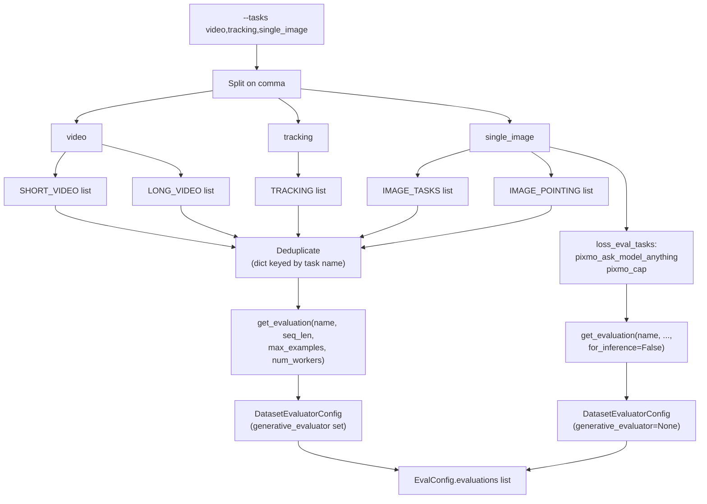
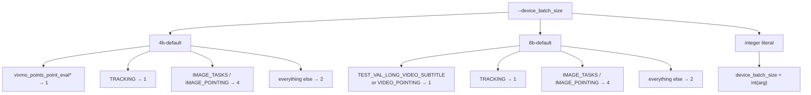
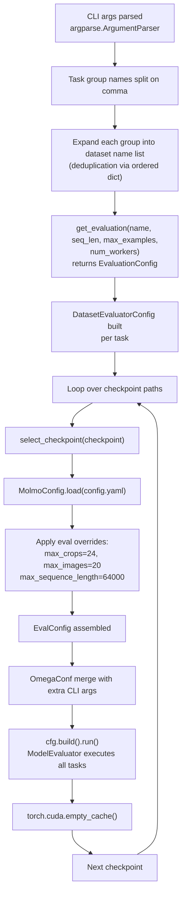

<!-- source: DeepWiki mcp.deepwiki.com · repo allenai/molmo2 · page 4.2 Multi-Task Evaluation · fetched 2026-10-26 -->

# Multi-Task Evaluation

<details>
<summary>Relevant source files</summary>

The following files were used as context for generating this wiki page:

- [launch_scripts/eval_molmo2.py](launch_scripts/eval_molmo2.py)

</details>


This page documents `launch_scripts/eval_molmo2.py`, the script used to evaluate Molmo2 models across multiple task groups in a single run. It covers the task taxonomy, how group names expand into individual evaluator configs, how batch sizes are selected per task, and how to invoke the script against one or more checkpoints.

For single-task evaluation using a YAML config file, see the [Single-Task Evaluation](#4.1) page. For an overview of the evaluation infrastructure (`ModelEvaluator`, generative and loss-based evaluators, result caching), see the [Evaluation](#4) page.

---

## Overview

`eval_molmo2.py` is a self-contained launch script that:

1. Accepts one or more checkpoint paths and one or more **task group names**.
2. Expands each group name into a list of individual dataset evaluators.
3. Constructs a `DatasetEvaluatorConfig` per task, selecting an appropriate `device_batch_size`.
4. Builds a single `EvalConfig` containing all evaluators and runs it against each checkpoint in sequence.

The script reuses the same evaluation infrastructure as `eval.py` (the `EvalConfig` / `DatasetEvaluatorConfig` types and the `ModelEvaluator.run()` call) but removes the need for a hand-written YAML config file.

---

## Task Taxonomy

Tasks are organized into named constant lists. Each list corresponds to a group name accepted by the `--tasks` flag.

**Task Group Constants** ([launch_scripts/eval_molmo2.py:29-123]())

| Constant | Group Flag | Contents |
|---|---|---|
| `IMAGE_TASKS` | `single_image` | `coco_2014_vqa_8192`, `text_vqa`, `chart_qa`, `doc_qa`, `info_qa`, `ai2_diagram_v2_mix_transparent`, `mmmu_test`, `real_world_qa_no_instruction:test`, `math_vista_v2` |
| `TEST_IMAGE_TASKS` | `single_image_test` | Held-out test splits of image tasks plus `a_okvqa_mc`, `a_okvqa_da`, `countbench_qa:huggingface`, `pixmo_count_counting:test`, `coco_2014_vqa:test` |
| `IMAGE_POINTING` | `image_pointing` | `countbench_qa:huggingface`, `pixmo_count_counting:validation`, `pointing_eval_v2:test`, `point_bench:test` |
| `SHORT_VIDEO` | `short_video` | `mvbench`, `tomato:test`, `motionbench:validation`, `temp_compass_internal`, `perception_test`, `ego_schema`, `nextqa_mc:test` |
| `LONG_VIDEO_SUBTITLES` | `video_subtitle` | `video_mme_w_subtitle`, `long_video_bench_w_subtitle`, `lvbench` |
| `LONG_VIDEO_NO_SUBTITLES` | *(partial)* | `mlvu_mc`, `video_mme`, `long_video_bench_no_subtitle`, `vixmo_caps_eval2:test`, `video_eval_pro_mc:test` |
| `LONG_VIDEO` | `long_video` | `LONG_VIDEO_SUBTITLES` + `LONG_VIDEO_NO_SUBTITLES` |
| `VIDEO_POINTING` | `video_pointing` | `vixmo_points_count_clip_63s:val`, `vixmo_points_point_eval:val`, `mevis_point_track_per_frame_fps_6_sample_fps_1`, `vixmo_points_count:val` |
| `TEST_VIDEO_DATASETS` | `test_video` | `mlvu_mc_test`, `perception_test_test`, `ego_schema_test`, `motionbench_test`, `long_video_bench_w_subtitle_test` |
| `MULTI_IMAGE_TASKS` | `multi_image` | `muir_bench:test`, `mmiu:test`, `blink:validation` |
| `TRACKING` | `tracking` | `mevis_track_eval_1fps:test`, `ref_yt_vos_track_eval_1fps:test`, `ref_davis17_track_eval_1fps:test`, `reasonvos_track_eval_1fps:test`, `molmo2_video_track_eval_1fps:test` |

**Composite groups:**

| Group Flag | Expands To |
|---|---|
| `video` | `SHORT_VIDEO` + `LONG_VIDEO` |
| `video_no_subtitle` | `SHORT_VIDEO` + `LONG_VIDEO_NO_SUBTITLES` |
| `single_image` | `IMAGE_TASKS` + `IMAGE_POINTING` + loss evals for `pixmo_ask_model_anything`, `pixmo_cap` |

Any unrecognized name is passed through as a literal dataset name, allowing ad hoc evaluation of individual tasks.

---

## Task Expansion Flow

**Diagram: Task Group Resolution**



Sources: [launch_scripts/eval_molmo2.py:147-236]()

---

## Device Batch Size Selection

The script includes two built-in batch size profiles, selected via `--device_batch_size`.

**Diagram: Batch Size Profile Logic**



Sources: [launch_scripts/eval_molmo2.py:188-208]()

Tasks with large or variable-length outputs (tracking, long-form video pointing) use `device_batch_size=1`. Standard image tasks use 4. Most video QA tasks use 2.

---

## Evaluator Configuration

For each task, a `DatasetEvaluatorConfig` is assembled as follows ([launch_scripts/eval_molmo2.py:209-224]()):

| Field | Value |
|---|---|
| `label` | From `get_evaluation()` result |
| `data` | From `get_evaluation()` result, with `pad=None` |
| `generative_evaluator` | From `get_evaluation()` result; `n_to_log=4`, `num_wandb_examples=10`, `save_predictions="_default"` |
| `sampling` | From `get_evaluation()` result |
| `device_batch_size` | Profile-selected (see above) |
| `subset_num_batches` | `None` (evaluate full dataset) |
| `max_examples` | `--max_examples` argument (default `-1`, meaning all) |
| `max_new_tokens` | `--max_new_tokens` override, or task default |

For **loss-only tasks** (`pixmo_ask_model_anything`, `pixmo_cap`), `generative_evaluator` is set to `None`, and `pad` is set to `"to_max"` when FSDP is enabled ([launch_scripts/eval_molmo2.py:225-236]()).

---

## Model Configuration Overrides

After loading `config.yaml` from each checkpoint, the script applies fixed overrides ([launch_scripts/eval_molmo2.py:246-256]()):

- For `Molmo2Config`: `mm_preprocessor.image.max_crops = 24`, `mm_preprocessor.image.max_images = 20`
- For `MolmoConfig`: `mm_preprocessor.max_crops = 24`, `mm_preprocessor.max_images = 20`
- For both: `llm.max_sequence_length = 64000`

These override the training-time values to allow evaluation of longer, more complex inputs.

---

## `EvalConfig` Assembly and Execution

After constructing all `DatasetEvaluatorConfig` entries, a single `EvalConfig` is built per checkpoint ([launch_scripts/eval_molmo2.py:258-276]()):

| `EvalConfig` Field | Value |
|---|---|
| `evaluations` | List of all `DatasetEvaluatorConfig` objects |
| `load_path` | Resolved checkpoint directory |
| `precision` | `"amp_bf16"` |
| `eval_name` | `--eval_name` argument (used as result file prefix) |
| `fsdp` | `FSDPConfig(fsdp2=True)` if `--fsdp` else `None` |
| `skip_if_metrics_cached` | `True` (skips tasks with existing results) |
| `save_to_checkpoint_dir` | `True` (results written alongside checkpoint) |
| `model` | Overridden `MolmoConfig` / `Molmo2Config` |

`cfg.build().run()` invokes `ModelEvaluator`, which iterates through each `DatasetEvaluatorConfig`, loads data, runs generation or loss computation, and writes metrics. `torch.cuda.empty_cache()` is called between checkpoints.

Any additional `--key=value` arguments passed on the command line are merged into the config via `OmegaConf.merge_with_dotlist` ([launch_scripts/eval_molmo2.py:273-275]()).

---

## CLI Reference

```
python -m torch.distributed.run --nproc_per_node=N launch_scripts/eval_molmo2.py \
    <checkpoint> [<checkpoint2> ...] \
    --tasks <group1>[,<group2>,...] \
    [--max_examples N] \
    [--seq_len N] \
    [--fsdp] \
    [--device_batch_size {4b-default|8b-default|<int>}] \
    [--eval_name PREFIX] \
    [--overwrite] \
    [--max_new_tokens N] \
    [--num_workers N]
```

| Argument | Default | Description |
|---|---|---|
| `checkpoint` | *(required)* | One or more checkpoint paths; each is evaluated sequentially |
| `--tasks` | `video` | Comma-separated group names (see task taxonomy table above) |
| `--max_examples` | `-1` (all) | Limit examples per task, useful for quick smoke tests |
| `--seq_len` | `None` | Override sequence length passed to `get_evaluation()` |
| `--fsdp` | `False` | Enable FSDP2 for multi-GPU memory distribution |
| `--device_batch_size` | `4b-default` | Batch size profile or explicit integer |
| `--eval_name` | `None` | Prefix string prepended to saved result files |
| `--overwrite` | `False` | Re-run even if cached metrics already exist |
| `--max_new_tokens` | `None` | Override per-task generation length limit |
| `--num_workers` | `4` | DataLoader worker count |

**Example: evaluate all video tasks on two checkpoints**

```bash
torchrun --nproc_per_node=8 launch_scripts/eval_molmo2.py \
    /checkpoints/stage2/step300000 \
    /checkpoints/stage3/step50000 \
    --tasks video,video_pointing \
    --device_batch_size 8b-default \
    --eval_name stage3-vs-stage2
```

**Example: image + tracking evaluation with FSDP**

```bash
torchrun --nproc_per_node=4 launch_scripts/eval_molmo2.py \
    /checkpoints/molmo2-7b \
    --tasks single_image,tracking \
    --fsdp \
    --device_batch_size 8b-default
```

---

## End-to-End Flow

**Diagram: eval_molmo2.py Execution Flow**



Sources: [launch_scripts/eval_molmo2.py:126-277]()

---

## Result Storage

Because `save_to_checkpoint_dir=True` and `skip_if_metrics_cached=True`, results are written as JSON files inside each checkpoint directory. If a task's result file already exists, it is skipped unless `--overwrite` is passed. The `eval_name` prefix (if provided) is prepended to the result filename to distinguish runs with different configurations against the same checkpoint.

Sources: [launch_scripts/eval_molmo2.py:258-276]()

---

