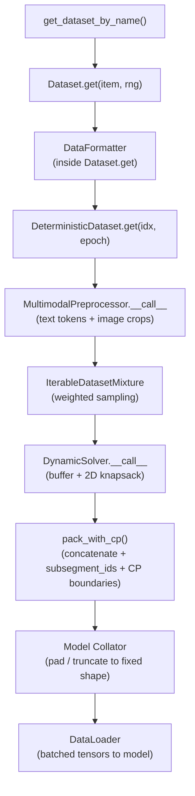
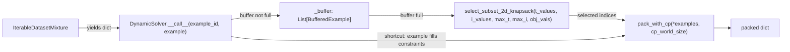
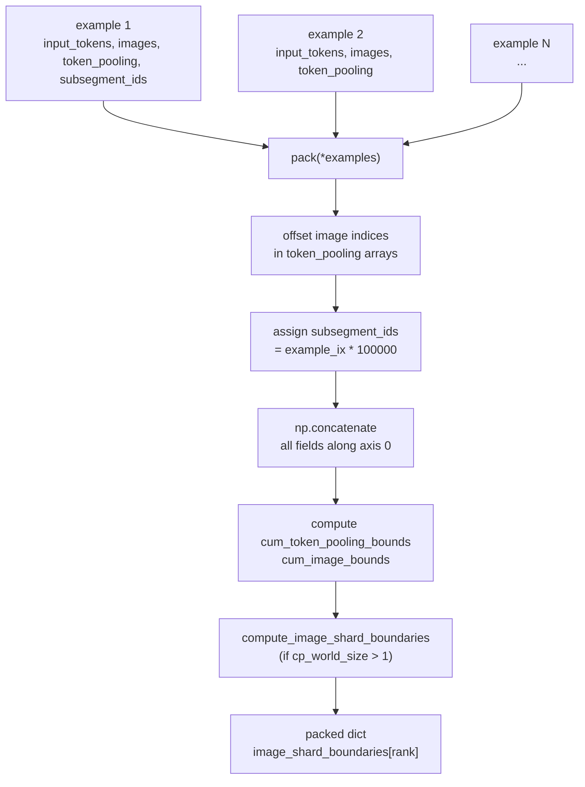
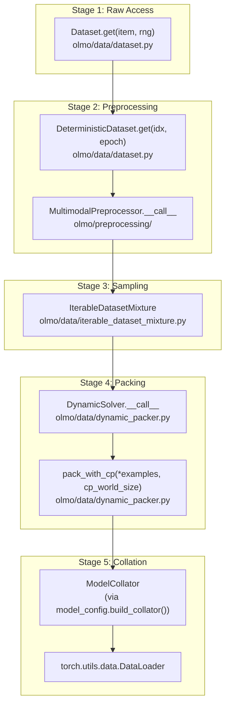

<!-- source: DeepWiki mcp.deepwiki.com · repo allenai/molmo2 · page 5.1 Data Pipeline · fetched 2026-10-26 -->

# Data Pipeline

<details>
<summary>Relevant source files</summary>

The following files were used as context for generating this wiki page:

- [olmo/data/data_loader.py](olmo/data/data_loader.py)
- [olmo/data/dataset.py](olmo/data/dataset.py)
- [olmo/data/dynamic_packer.py](olmo/data/dynamic_packer.py)

</details>


This page documents the four processing stages that transform raw dataset entries into batched tensors ready for model training and evaluation. It covers the `Dataset` base class, `DeterministicDataset`, `IterableDatasetMixture`, `DynamicSolver`/`pack`/`pack_with_cp`, and the final `Collator` step as orchestrated by `DataLoaderConfig`.

For details on the 2D knapsack packing algorithm and context-parallel boundary computation, see [Dynamic Packing](#5.2). For the dataset registry and individual dataset implementations, see [Dataset Catalog](#5.3).

---

## Pipeline Overview

The pipeline converts raw dataset entries into fixed-shape batched tensors through four sequential stages:

**Pipeline: From Raw Data to Model Input**



Sources: [olmo/data/data_loader.py:1-384](), [olmo/data/dataset.py:1-157](), [olmo/data/dynamic_packer.py:1-479]()

---

## Stage 1 — Raw Dataset Access

### Dataset Base Class

Every dataset in the system extends `Dataset` ([olmo/data/dataset.py:26-44]()). The primary method is:

```
Dataset.get(item, rng) -> dict
```

The `rng` argument is a `numpy.random.RandomState` passed in from the outside so that random augmentation inside `get()` is reproducible without relying on global RNG state.

Two concrete base classes build on top of `Dataset`:

| Class | Location | Purpose |
|---|---|---|
| `DatasetBase` | [olmo/data/dataset.py:83-105]() | Loads a list via `self.load()` at construction; supports optional sampling |
| `HfDataset` | [olmo/data/dataset.py:108-121]() | Wraps a HuggingFace `datasets.Dataset` with a `PATH` class variable |
| `Ai2HfDataset` | [olmo/data/dataset.py:124-156]() | HF dataset with style annotation and optional flattening of `message_list` |

### Formatting

Each `Dataset.get()` call applies a `DataFormatter` internally before returning. The formatter converts structured data (points, multiple-choice options, image descriptions) into text prompt templates and `human`/`assistant` message pairs. This step is dataset-specific and happens before any shared preprocessing.

Sources: [olmo/data/dataset.py:26-157]()

---

## Stage 2 — Preprocessing (DeterministicDataset)

`DeterministicDataset` ([olmo/data/dataset.py:47-80]()) wraps a raw `Dataset` and a `MultimodalPreprocessor`. It is the boundary between raw data and tensor-ready examples.

### How it Works

```
DeterministicDataset.get(idx, epoch) -> dict[str, ndarray]
```

1. Derives a deterministic `rng = make_random_state(idx, epoch)`.
2. Calls `self.dataset.get(idx, rng)` to get the formatted dict.
3. If `idx >= len(self.dataset)`, returns a padding example (a copy of index 0 with `metadata.valid=False`). This is used in eval to ensure every data-parallel rank gets the same number of batches.
4. Optionally stamps `item["weight"]` with a per-dataset `MessageWeight`.
5. Calls `self.preprocessor(item, rng)` — the `MultimodalPreprocessor` — which produces token arrays, image crop tensors, and pooling index arrays.

### Constructor Parameters

| Parameter | Type | Description |
|---|---|---|
| `dataset` | `Dataset` | Raw data source |
| `preprocessor` | `MultimodalPreprocessor` | Converts formatted dict to tensors |
| `seed` | `int` | Base seed for RNG derivation |
| `n_pad` | `int` | Number of dummy examples appended after real data (for eval padding) |
| `weighting` | `MessageWeight` | Per-dataset token loss weight override |

Sources: [olmo/data/dataset.py:47-80]()

---

## Stage 3 — Mixture Sampling + Packing

### DataLoaderConfig._build_mixture()

`DataLoaderConfig._build_mixture()` ([olmo/data/data_loader.py:233-306]()) constructs a list of `DeterministicDataset` objects and their normalized sampling rates from one of three configuration styles:

| Config Field | Behavior |
|---|---|
| `dataset` (str) | Single dataset, rate = 1.0 |
| `mixture` (Dict[str, float]) | Named datasets with explicit rates |
| `root_size_mixture` | Groups where per-dataset rate ∝ √(dataset size) |
| `kwargs_mixture` | Groups of `WeightedDataset` with per-task `sampling_rate`, `root_size_factor`, `message_weight`, and `override_p_high_res` |

For `kwargs_mixture`, the per-task effective size is computed as:

```
size = sqrt(len(dataset) * root_size_factor)   # if root_size_factor is set
size = sqrt(len(dataset))                       # if root_size_factor is None
size = 1                                        # if root_size_factor == 0
```

Then optionally multiplied by `sampling_rate`, normalized within the group, and scaled by the group's `rate`.

### WeightedDataset

`WeightedDataset` ([olmo/data/data_loader.py:49-83]()) is the per-task configuration unit inside `kwargs_mixture`:

| Field | Type | Description |
|---|---|---|
| `dataset_name` | `str` | Name passed to `get_dataset_by_name()` |
| `sampling_rate` | `float` | Multiplier on computed size |
| `root_size_factor` | `float` | Override for dataset size in the √-rate formula |
| `message_weight` | `MessageWeight` | Token loss weighting for this dataset |
| `override_p_high_res` | `float` | Override probability of using high-res crops |

### IterableDatasetMixture

`IterableDatasetMixture` samples from a list of `DeterministicDataset` objects according to normalized `mixture_rates`. It is an iterable (not indexable) and feeds examples one at a time into the packer.

### DynamicSolver

`DynamicSolver` ([olmo/data/dynamic_packer.py:401-477]()) maintains a rolling buffer of up to `max_buffer_size` examples. When the buffer is full, it runs a 2D knapsack DP (`select_subset_2d_knapsack`) to find the best subset that fits within `(max_text_len, max_image_len)` constraints, then emits those examples as a single packed sequence via `pack_with_cp()`.

**Packing: Code Entity Map**



Sources: [olmo/data/dynamic_packer.py:401-477](), [olmo/data/data_loader.py:308-383]()

### PackingConfig

`PackingConfig` ([olmo/data/dynamic_packer.py:298-323]()) configures the packer:

| Field | Default | Description |
|---|---|---|
| `buffer_size` | 32 | Rolling buffer size |
| `mode` | `"dynamic_solver"` | Solver algorithm |
| `text_weight` | 1.0 | Objective weight for text tokens |
| `image_weight` | 1.0 | Objective weight for image patches |
| `shortcut_max_len_images` | `False` | Emit immediately if example saturates image capacity |
| `cp_world_size` | 1 | CP group size for shard boundary precomputation |
| `track_packing_state` | `True` | Whether to track packing efficiency metrics |

---

## Stage 4 — pack() and pack_with_cp()

`pack(*examples)` ([olmo/data/dynamic_packer.py:167-261]()) concatenates multiple example dicts into a single dict:

1. **Image index offsetting**: For each packed example, adjusts all token pooling index arrays (e.g. `token_pooling`) by the cumulative image patch count so that indices remain valid in the merged image tensor.
2. **subsegment_ids**: Each packed example receives a unique `subsegment_id` base offset of `example_ix * EXAMPLE_SUBSEGMENT_INCREMENT` (100,000). This prevents cross-example attention — the model's attention mask allows tokens to attend only to tokens with an equal or lower `subsegment_id` within the same segment.
3. **Concatenation**: All fields are concatenated along axis 0.
4. **Boundary tracking**: `cum_token_pooling_bounds` and `cum_image_bounds` are stored so that downstream code can recover per-example image boundaries.

`pack_with_cp(*examples, cp_world_size)` ([olmo/data/dynamic_packer.py:264-288]()) calls `pack()` then additionally calls `compute_image_shard_boundaries()` to precompute `image_shard_boundaries` — a dict keyed by GPU rank containing `start_image_idx`, `end_image_idx`, `start_pool_idx`, `end_pool_idx`, and `max_num_tokens` for each context-parallel rank.

**pack_with_cp: Internal Data Flow**



Sources: [olmo/data/dynamic_packer.py:167-288]()

---

## Stage 5 — Collation and DataLoader Assembly

After packing, the `Model Collator` (built via `model_config.build_collator()`) pads or truncates all tensors to a fixed shape determined by `output_shapes` from `preprocessor.get_output_shapes()`. Fixed shapes allow `torch.compile` static graph capture.

When packing is enabled, token pooling keys (`TOKEN_POOLING_KEYS`) and a few other fields (`num_images`, `multimodal_type`, `num_image_starts`) receive `VariablePaddingSpec` instead of a fixed shape, because their second dimension varies depending on how many images were packed together ([olmo/data/data_loader.py:322-332]()).

The final `torch.utils.data.DataLoader` is constructed with:

| Parameter | Train | Eval |
|---|---|---|
| `batch_size` | `global_batch_size // dp_world_size` | Passed in directly |
| `sampler` | None (iterable) | `DistributedSampler` (unless packing) |
| `collate_fn` | Model Collator | Model Collator |
| `drop_last` | From config | From config |

Sources: [olmo/data/data_loader.py:308-383](), [olmo/data/data_loader.py:137-231]()

---

## Train vs. Eval Dataloader Differences

| Concern | `build_train_dataloader` | `build_eval_dataloader` |
|---|---|---|
| Entry point | [olmo/data/data_loader.py:308-383]() | [olmo/data/data_loader.py:137-231]() |
| Preprocessor | `is_training=True` | `is_training=False`, `for_inference` flag |
| Sampler | `IterableDatasetMixture` always | `DistributedSampler` unless packing enabled |
| n_pad | Not used | Computed to fill final batch across DP ranks |
| Metadata | Not included | Included when `for_inference=True` |
| Mixture | Full `_build_mixture()` logic | Single dataset only (`self.dataset`) |

Sources: [olmo/data/data_loader.py:137-383]()

---

## Full Stage-to-Code Mapping



Sources: [olmo/data/data_loader.py:1-384](), [olmo/data/dataset.py:1-157](), [olmo/data/dynamic_packer.py:1-479]()

---

