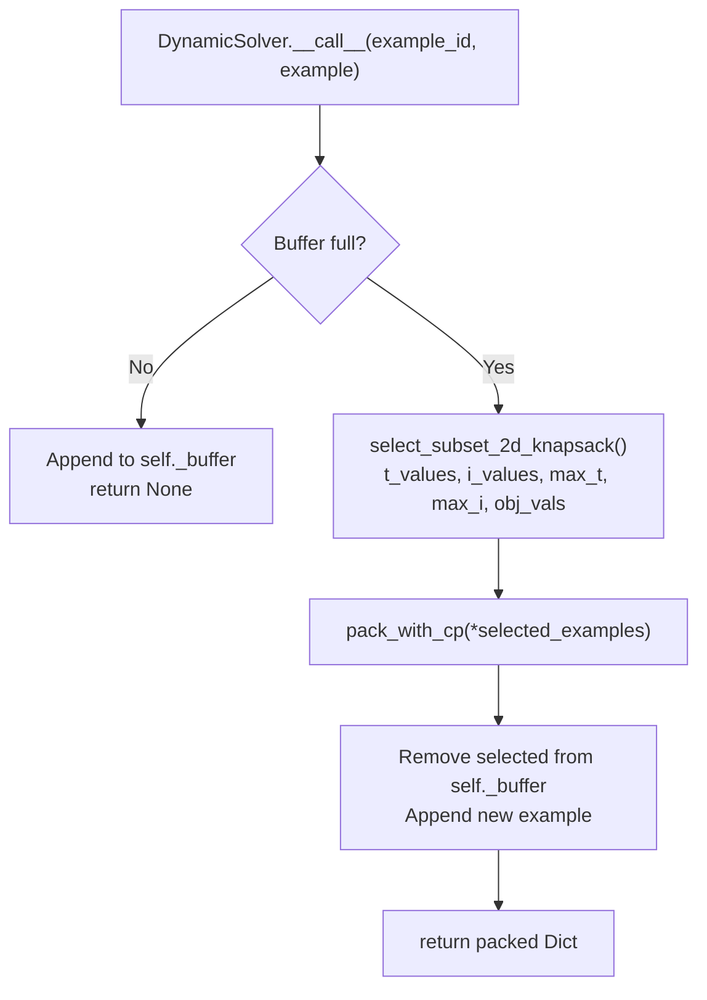
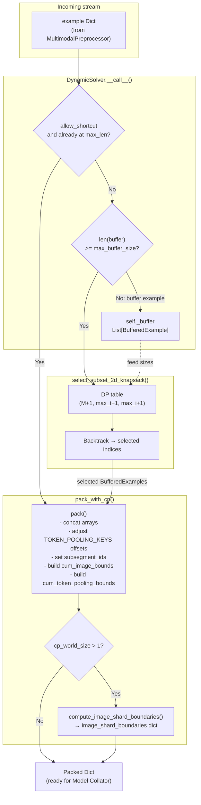
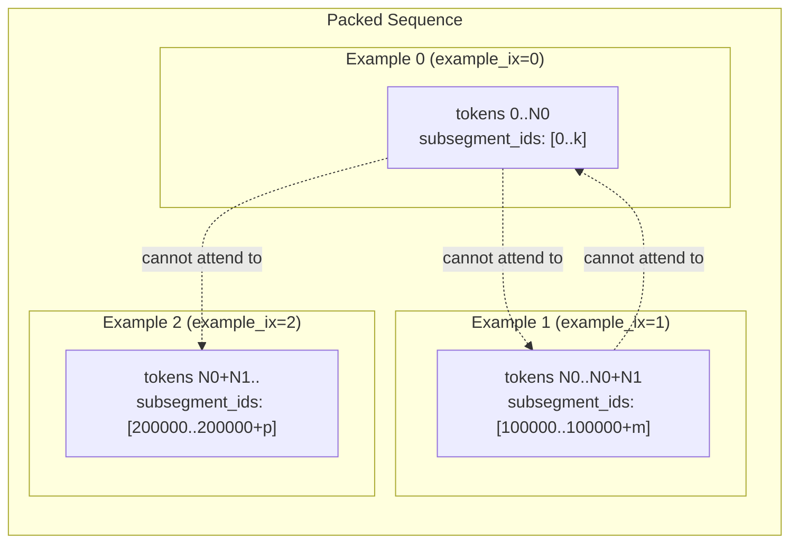

<!-- source: DeepWiki mcp.deepwiki.com · repo allenai/molmo2 · page 5.2 Dynamic Packing · fetched 2026-10-26 -->

# Dynamic Packing

<details>
<summary>Relevant source files</summary>

The following files were used as context for generating this wiki page:

- [docs/context_parallel.md](docs/context_parallel.md)
- [olmo/data/dynamic_packer.py](olmo/data/dynamic_packer.py)

</details>


Dynamic packing is the mechanism that combines multiple preprocessed examples into a single training sequence. It solves a 2D knapsack problem over a rolling buffer of examples to maximize sequence utilization, then concatenates the chosen examples while adjusting token indices and attention masks to prevent cross-example attention.

This page covers the internals of `olmo/data/dynamic_packer.py`. For how packing fits into the broader data pipeline (where it sits relative to tokenization, collation, etc.), see the [Data Pipeline](#5.1) page. For how context parallelism integrates at each stage of training, see [Context Parallelism](#3.3).

---

## Overview

A naïve approach to batching would pad every example to the maximum sequence length, wasting compute on padding tokens. Dynamic packing instead concatenates several short examples end-to-end to fill a single long sequence slot. The challenge is to select which examples to combine so that the total length stays within both a text-token budget and an image-patch budget simultaneously — a 2D bin packing problem.

**Key components:**

| Class / Function | Role |
|---|---|
| `PackingConfig` | Configuration dataclass; creates a `DynamicSolver` via `.build()` |
| `Constraint` | Describes one dimension of the packing problem (key, max length, weight) |
| `BufferedExample` | Internal wrapper holding a buffered example and its quantized sizes |
| `DynamicSolver` | Buffers incoming examples; triggers knapsack selection when buffer is full |
| `select_subset_2d_knapsack` | Vectorized 2D DP that selects the best subset from the buffer |
| `pack()` | Concatenates selected examples; adjusts indices and subsegment IDs |
| `pack_with_cp()` | Calls `pack()`, then runs `compute_image_shard_boundaries()` when CP is enabled |
| `compute_image_shard_boundaries()` | Assigns images to CP ranks to balance load |

Sources: [olmo/data/dynamic_packer.py:1-50]()

---

## PackingConfig and Constraints

`PackingConfig` [olmo/data/dynamic_packer.py:298-323]() is the entry point from the configuration system. Its `.build(text_max_len, image_max_len)` method constructs a `DynamicSolver` with two `Constraint` objects:

| Constraint field | Text constraint | Image constraint |
|---|---|---|
| `key` | `"input_tokens"` | `"images"` |
| `max_len` | `text_max_len` (e.g. 16384) | `image_max_len` |
| `allow_shortcut` | `True` | `False` (unless `shortcut_max_len_images=True`) |
| `weight` | `text_weight` (default 1.0) | `image_weight` (default 1.0) |
| `granularity` | `max(1, text_max_len // 512)` | `1` |

The `granularity` field controls quantization: text lengths are rounded up to the nearest multiple of `text_max_len // 512` before entering the DP table. This reduces the DP table size, making the solver faster at the cost of a small amount of packing precision.

`allow_shortcut=True` on the text constraint means that if an incoming example is already at or near `text_max_len` on its own, it bypasses buffering entirely and is emitted immediately as a single-example pack.

Sources: [olmo/data/dynamic_packer.py:298-348]()

---

## DynamicSolver: Buffer and Selection

### Buffering

`DynamicSolver.__call__(example_id, example)` [olmo/data/dynamic_packer.py:423-477]() is called once per incoming example. If the buffer has fewer than `max_buffer_size` entries, the example is wrapped in a `BufferedExample` and appended. The method returns `None`, signaling that no packed output is ready yet.

### Knapsack Selection

When the buffer is full (`len(self._buffer) == max_buffer_size`), the solver:

1. Calls `select_subset_2d_knapsack()` with the quantized sizes and objective values from every buffered example.
2. Packs the selected examples together with `pack_with_cp()`.
3. Removes the selected examples from the buffer.
4. Adds the new (triggering) example to the now-smaller buffer.
5. Returns the packed output.

**Objective value** for each example is `sum(len(example[c.key]) * c.weight for c in constraints)` — a weighted count of tokens plus image patches. The solver maximizes total objective subject to both constraints fitting within their respective budgets.

**2D Knapsack DP diagram:**



Sources: [olmo/data/dynamic_packer.py:401-477]()

### The 2D Knapsack DP

`select_subset_2d_knapsack(t_values, i_values, max_t, max_i, obj_vals)` [olmo/data/dynamic_packer.py:350-390]() implements a standard 0/1 knapsack DP over two capacity dimensions.

- **DP table shape**: `(M+1, max_t+1, max_i+1)` where `M` is buffer size.
- **Fill**: For each item, copy the previous layer, then vectorize the "take item" update using NumPy slice assignment and `np.maximum`.
- **Backtrack**: Walk backwards through items to recover the selected set.

All sizes passed in are already quantized by their respective `Constraint.get_quantized_value()`, so the table size is bounded by `buffer_size × (text_max_len // granularity) × image_max_len`.

Sources: [olmo/data/dynamic_packer.py:350-390]()

---

## pack(): Concatenating Examples

`pack(*examples)` [olmo/data/dynamic_packer.py:167-261]() takes a variable number of example dicts (each the output of `MultimodalPreprocessor`) and concatenates them into one. The critical adjustments it makes:

### Image Patch Index Offsets

Arrays that index into the image patch dimension — identified by keys in `TOKEN_POOLING_KEYS` — must be offset by the total number of image patches from all preceding examples. The variable `image_offset` accumulates this count.

```
example 0: images shape (N0, crops, H, W) → patch indices unchanged
example 1: images shape (N1, crops, H, W) → patch indices += N0
example 2: images shape (N2, crops, H, W) → patch indices += N0 + N1
```

### subsegment_ids

The attention mask for packed sequences is controlled by `subsegment_ids`. The model allows a token at position `p` to attend to position `q` only if `subsegment_ids[q] <= subsegment_ids[p]`. To prevent cross-example attention entirely:

- Example at index `i` gets its `subsegment_ids` shifted by `i * EXAMPLE_SUBSEGMENT_INCREMENT` (= `i * 100000`).
- If an example has no prior `subsegment_ids`, a uniform array filled with `example_ix * EXAMPLE_SUBSEGMENT_INCREMENT` is created.
- If an example already has `subsegment_ids` (e.g., from image vs. text regions within an example), those values are incremented by the same offset.

This ensures that example 1's tokens have subsegment IDs ≥ 100000 and can never be attended to by example 0's tokens (whose IDs are < 100000).

### Cumulative Bounds Arrays

`pack()` builds two cumulative arrays that track where each example's images and pooling rows end within the concatenated sequence:

| Array | Content |
|---|---|
| `cum_image_bounds` | Cumulative total images per input frame/example |
| `cum_token_pooling_bounds` | Cumulative total token-pooling rows per input |

These are stored in the output dict and consumed later by `compute_image_shard_boundaries()` and the vision backbone.

### point_target_ids Offsets

If examples contain pointing targets (`point_target_ids`), token column indices are offset by the cumulative count of image tokens from preceding examples.

### Field Alignment

For token-pooling keys, the second dimension (number of pooling columns) can differ across examples. `pack()` pads all examples to the maximum width with `-1` before concatenation.

All other scalar and array fields are concatenated with `np.concatenate` across the first axis.

Sources: [olmo/data/dynamic_packer.py:167-261]()

---

## pack_with_cp(): Context-Parallel Extension

`pack_with_cp(*examples, cp_world_size=1)` [olmo/data/dynamic_packer.py:264-288]() is a thin wrapper around `pack()`. When `cp_world_size > 1` and the packed output contains images, it calls `compute_image_shard_boundaries()` and stores the result in `out["image_shard_boundaries"]`.

When `cp_world_size == 1` (no context parallelism), `pack_with_cp` is identical to `pack`.

Sources: [olmo/data/dynamic_packer.py:264-288]()

---

## compute_image_shard_boundaries(): CP Load Balancing

When context parallelism is active, each CP rank must encode a disjoint subset of the images in the packed sequence. `compute_image_shard_boundaries()` [olmo/data/dynamic_packer.py:14-164]() pre-computes these assignments at packing time so the vision backbone does not need to recalculate them at training time.

### Algorithm

1. **Initial split**: Divide `total_images` evenly by `cp_world_size`. For each rank, find the frame/example boundary in `cum_image_bounds` that crosses the target threshold.
2. **Starvation fix**: If any rank ends up with zero images (possible when a single example contains many images), steal one frame from an adjacent rank. This iterates until all ranks have at least one image, or no further redistribution is possible.
3. **max_num_tokens**: After redistribution, compute the maximum token-pooling count across all ranks and store it as `max_num_tokens` in every rank's boundary entry. The vision backbone uses this to size its output buffer.

### Output Structure

The returned dict maps `rank_id → boundary_dict`:

```
{
  0: {"start_image_idx": 0, "end_image_idx": 12,
      "start_pool_idx": 0, "end_pool_idx": 576, "max_num_tokens": 576},
  1: {"start_image_idx": 12, "end_image_idx": 24,
      "start_pool_idx": 576, "end_pool_idx": 1152, "max_num_tokens": 576},
}
```

These boundaries are stored in the packed example and passed through the collator unchanged to the vision backbone.

Sources: [olmo/data/dynamic_packer.py:14-164](), [docs/context_parallel.md:32-43]()

---

## Data Flow Diagram

**Diagram: Dynamic Packing Data Flow (code entity view)**



Sources: [olmo/data/dynamic_packer.py:264-477]()

---

## subsegment_ids: Preventing Cross-Example Attention

**Diagram: subsegment_id assignment across packed examples**



The constant `EXAMPLE_SUBSEGMENT_INCREMENT = 100000` [olmo/data/dynamic_packer.py:11]() ensures that no subsegment value from a later example overlaps with those from an earlier example, as long as no single example uses more than 100,000 distinct subsegment IDs internally.

Sources: [olmo/data/dynamic_packer.py:11-227]()

---

## Configuration Reference

`PackingConfig` [olmo/data/dynamic_packer.py:298-323]() fields:

| Field | Default | Description |
|---|---|---|
| `buffer_size` | `32` | Max examples held in the rolling buffer |
| `mode` | `"dynamic_solver"` | Only `"dynamic_solver"` is implemented |
| `text_weight` | `1.0` | Objective weight for text tokens |
| `image_weight` | `1.0` | Objective weight for image patches |
| `shortcut_max_len_images` | `False` | Bypass buffer for max-image-length examples |
| `track_packing_state` | `True` | Track buffer state for diagnostics |
| `cp_world_size` | `1` | Must match `parallelism.context_parallel_config.degree` |

Sources: [olmo/data/dynamic_packer.py:298-323](), [docs/context_parallel.md:144-171]()

---

