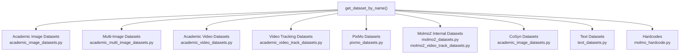

<!-- source: DeepWiki mcp.deepwiki.com · repo allenai/molmo2 · page 5.3 Dataset Catalog · fetched 2026-10-26 -->

# Dataset Catalog

<details>
<summary>Relevant source files</summary>

The following files were used as context for generating this wiki page:

- [olmo/data/academic_image_datasets.py](olmo/data/academic_image_datasets.py)
- [olmo/data/academic_multi_image_datasets.py](olmo/data/academic_multi_image_datasets.py)
- [olmo/data/academic_video_datasets.py](olmo/data/academic_video_datasets.py)
- [olmo/data/academic_video_track_datasets.py](olmo/data/academic_video_track_datasets.py)
- [olmo/data/get_dataset.py](olmo/data/get_dataset.py)

</details>


This page documents the `get_dataset_by_name` factory function and provides a complete reference map of all dataset names, their corresponding Python classes, and the source files they live in. It is the entry point for understanding which string names map to which dataset implementations.

For in-depth documentation of how each category is implemented — including download steps, internal data structures, and the `get()` interface — see the sub-pages:
- Image datasets: [5.3.1](#5.3.1)
- Multi-image datasets: [5.3.2](#5.3.2)
- Video datasets: [5.3.3](#5.3.3)
- Video tracking datasets: [5.3.4](#5.3.4)
- Dataset builders (HuggingFace `GeneratorBasedBuilder` subclasses): [5.3.5](#5.3.5)

For how datasets are wrapped, mixed, and packed into model inputs, see [Data Pipeline (5.1)](#5.1) and [Dynamic Packing (5.2)](#5.2).

---

## The Factory Function

All dataset construction flows through a single function:

```python
get_dataset_by_name(dataset_name: str, split: str) -> Dataset
```

Located in [olmo/data/get_dataset.py:39-480](), this function is a large `if`/`elif` chain that maps every supported `dataset_name` string to a concrete `Dataset` subclass constructor call. It is the sole authoritative registry of dataset names.

The `DataLoaderConfig` in `olmo/config.py` always calls `get_dataset_by_name` when constructing train and eval dataloaders. No other dataset instantiation path exists in normal training or evaluation flows.

Two helper functions are also defined in the same file:

| Function | Purpose |
|---|---|
| `get_dataset_class_by_name(name)` | Returns the `Dataset` subclass for a name without calling `__init__` |
| `download_dataset_by_name(name, n_procs)` | Calls `.download()` on the resolved class |

Sources: [olmo/data/get_dataset.py:39-513]()

---

## Dataset Category Overview

**Category overview — factory to class to source file**



Sources: [olmo/data/get_dataset.py:1-35]()

---

## Academic Image Datasets

Implemented in [olmo/data/academic_image_datasets.py](). All classes extend `Dataset`, `DatasetBase`, `HfDataset`, or `Ai2HfDataset`.

| Dataset Name | Class | HF / Source |
|---|---|---|
| `coco_2014_vqa_multi` | `Vqa2` | `allenai/molmo2-vqa2-2014` |
| `coco_2014_vqa_8192` | `Vqa2` (sampled) | `allenai/molmo2-vqa2-2014` |
| `text_vqa` | `TextVqa` | `allenai/molmo2-text-vqa` |
| `info_qa` | `InfoQa` | manual download (RRC) |
| `doc_qa` | `DocQa` | manual download (RRC) |
| `ai2_diagram_v2_mix_transparent` | `AI2D` | `Ai2dDatasetBuilder` |
| `plot_qa` | `PlotQa` | `PlotQaBuilder` |
| `figure_qa` | `FigureQa` | `FigureQaBuilder` |
| `dv_qa` | `DvQa` | `DvQaBuilder` |
| `okvqa` | `OkVqa` | `allenai/molmo2-okvqa` |
| `a_okvqa_da` | `AOkVqa` | `allenai/molmo2-a-ok-vqa` |
| `a_okvqa_mc` | `AOkVqa` | `allenai/molmo2-a-ok-vqa` |
| `mmmu` / `mmmu_test` | `MMMU` | `MMMU/MMMU` |
| `mmmu_test_v2` | `MMMU` (multi-image) | `MMMU/MMMU` |
| `math_vista_v2` | `MathVista` | `AI4Math/MathVista` |
| `chart_qa` | `ChartQa` | `HuggingFaceM4/ChartQA` |
| `chart_qa_weighted` | `ChartQa` (weighted) | `HuggingFaceM4/ChartQA` |
| `science_qa_img` | `ScienceQAImageOnly` | `derek-thomas/ScienceQA` |
| `real_world_qa_no_instruction` | `RealWorldQa` | `xai-org/RealworldQA` |
| `countbench_qa` | `CountBenchQa` | `CountQaBuilder` |
| `st_qa` | `SceneTextQa` | manual download (RRC) |
| `tabwmp_da` | `TabWMPDirectAnswer` | `TabMwpBuilder` |
| `tally_qa` | `TallyQa` | `allenai/molmo2-tally-qa` |
| `point_bench` | `PointBench` | `PointArena/pointarena-data` |

Sources: [olmo/data/get_dataset.py:41-102](), [olmo/data/academic_image_datasets.py:79-1026]()

---

## CoSyn Datasets

`CoSyn` and its variants are also defined in [olmo/data/academic_image_datasets.py](), but form a distinct naming pattern in the factory.

| Dataset Name Pattern | Class | HF Source |
|---|---|---|
| `cosyn_point` | `CoSynPoint` | `allenai/CoSyn-point` |
| `cosyn_{doc_type}` | `CoSyn` | `allenai/CoSyn-400K` |
| `cosyn_{doc_type}_exp` | `CoSyn` (with explanations) | `allenai/CoSyn-400K` |
| `cosyn_multidoc_{doc_type}` | `PixmoMulitDocQa` | `allenai/Molmo2-SynMultiImageQA` |
| `cosyn_multidoc_{doc_type}_exp` | `PixmoMulitDocQa` (with exp) | `allenai/Molmo2-SynMultiImageQA` |

Valid `doc_type` values: `chart`, `chemical`, `circuit`, `diagram`, `document`, `graphic`, `math`, `music`, `nutrition`, `table`.

Sources: [olmo/data/get_dataset.py:120-141](), [olmo/data/academic_image_datasets.py:665-759]()

---

## Multi-Image Datasets

Implemented in [olmo/data/academic_multi_image_datasets.py](). These handle questions that span 1–62 images per example.

| Dataset Name | Class | HF / Source |
|---|---|---|
| `muir_bench` | `MuirBench` | `MUIRBENCH/MUIRBENCH` |
| `blink` | `BLINK` | `BLINK-Benchmark/BLINK` |
| `mmiu` | `MMIU` | `FanqingM/MMIU-Benchmark` |
| `mantis_instruct_{name}` | `MantisInstruct` | `allenai/molmo2-mantis-instruct-{name}` |
| `mantis_instruct_{name}_da` | `MantisInstruct` (direct answer) | same |
| `mantis_instruct_{name}_flat` | `MantisInstruct` (flattened) | same |

Valid `MantisInstruct` names: `nlvr2`, `llava_665k_multi`, `spot-the-diff`, `nextqa`, `star`.

Sources: [olmo/data/get_dataset.py:104-117](), [olmo/data/academic_multi_image_datasets.py:40-422]()

---

## PixMo Datasets

Implemented in `olmo/data/pixmo_datasets.py`. These are AllenAI's internally collected pointing, counting, and captioning datasets.

| Dataset Name | Class | Notes |
|---|---|---|
| `pixmo_cap` | `PixMoCap` | Captions only |
| `pixmo_cap_with_transcripts` | `PixMoCap` | Transcripts + captions |
| `pixmo_count_train` | `PixMoCount` | Both counting modes |
| `pixmo_count_counting` | `PixMoCount` | Counting only |
| `pixmo_cap_qa` | `PixMoCapQa` | Caption-based QA |
| `pixmo_cap_qa_as_user_qa` | `PixMoCapQa` | User QA style |
| `pixmo_ask_model_anything` | `PixMoAskModelAnything` | Open-ended QA |
| `pixmo_points_train` | `PixMoPoints` | Basic pointing, max 60 pts |
| `pixmo_points_high_freq_train` | `PixMoPoints` | High-frequency objects |
| `pixmo_multi_points` | `PixMoMultiPoints` | Multi-object pointing |
| `pixmo_multi_image_qa` | `PixmoMultiImageQa` | Multi-image QA |
| `pixmo_multi_image_qa_multi_only_max5` | `PixmoMultiImageQa` | Filtered to ≤5 images |
| `pointing_eval_v2` / `pixmo_point_eval2` | `PixMoPointsEval` | Pointing eval set |

Sources: [olmo/data/get_dataset.py:144-168]()

---

## Text Datasets

| Dataset Name | Class | Notes |
|---|---|---|
| `tulu4` | `Tulu4Filtered` | Full dataset |
| `tulu4_max_2304` | `Tulu4Filtered` | First message ≤ 2304 tokens |

Sources: [olmo/data/get_dataset.py:95-98]()

---

## Molmo2 Internal Datasets

These are AllenAI's internally produced video, captioning, and QA datasets, split across `molmo2_datasets.py` and `molmo2_video_track_datasets.py`.

| Dataset Name | Class | Notes |
|---|---|---|
| `molmo2_captions_eval` | `Molmo2CaptionsEval` | Caption eval |
| `molmo2_syn_captions_qa` | `Molmo2SynCaptionsQA` | Synthetic caption QA |
| `molmo2_syn_captions_subtitle_qa` | `Molmo2SynCaptionsSubtitleQA` | With subtitles |
| `molmo2_human_qa` | `Molmo2HumanQA` | Human-annotated QA |
| `molmo2_video_point_minmax_{min}_{max}` | `Molmo2VideoPoint` | Point training, N∈[min,max] |
| `molmo2_video_point_eval` | `Molmo2VideoPointEval` | Point eval |
| `molmo2_video_count_eval` | `Molmo2VideoCountEval` | Count eval |
| `molmo2_hardcodes` | `Molmo2HardCodes` | Hard-coded examples |
| `molmo2_video_track` | `Molmo2VideoTrackInstruction` | Track task |
| `molmo2_video_track_1fps` / `_2fps` | `Molmo2VideoTrackInstruction` | FPS-filtered |
| `molmo2_video_track_ground` | `Molmo2VideoTrackInstruction` | Ground task |
| `molmo2_video_single_point_track` | `Molmo2VideoTrackInstruction` | Single-point track |
| `molmo2_video_track_eval_1fps` | `Molmo2VideoTrackEval` | Full eval, 1 fps |
| `molmo2_video_track_eval_{subset}_1fps` | `Molmo2VideoTrackEval` | Subset: `animal`, `dance`, `sports`, `person`, `misc` |

Sources: [olmo/data/get_dataset.py:170-479]()

---

## Academic Video Datasets

Implemented in [olmo/data/academic_video_datasets.py](). All are accessed via the factory. This is the largest category.

**Name-to-class mapping (academic video)**

```mermaid
flowchart LR
    subgraph "Eval Benchmarks"
        mvbench["mvbench → MVBench"]
        ego_schema["ego_schema → EgoSchema"]
        mlvu_mc["mlvu_mc → MLVU"]
        longvideobench["long_video_bench_w_subtitle → LongVideoBench"]
        videomme["video_mme_w_subtitle → VideoMME"]
        lvbench["lvbench → LVBench"]
        motionbench["motionbench → MotionBench"]
        temporalbench["temporal_bench → TemporalBenchQa"]
        tomato["tomato → Tomato"]
        videoevalPro["video_eval_pro_mc → VideoEvalProMC"]
    end

    subgraph "Training Datasets"
        actnet["activitynet_all_qa → ActivityNet"]
        coin["coin_all_qa → COIN"]
        epicK["epic_kitchens_qa → EpicKitchens"]
        moments["moments_in_time_qa → MomentsInTime"]
        kinetics["kinetics_qa → Kinetics710"]
        youcook2["youcook2_all_qa → Youcook2"]
        star["star_mc → STAR"]
        perception["perception_test → PerceptionTest"]
        ego4d["ego4d_all → Ego4dCachedClips"]
        llavatrain["llava_video_mc_academic → LLaVAVideoAcademic"]
        motionbenchcap["motionbench_caption → MotionBenchCaption"]
        vidloc["video_localized_narratives → VideoLocalizedNarratives"]
    end
```



| Dataset Name | Class |
|---|---|
| `mvbench` | `MVBench` |
| `ego_schema` | `EgoSchema` |
| `mlvu_mc` / `mlvu_gen` | `MLVU` |
| `long_video_bench_w_subtitle` | `LongVideoBench` |
| `video_mme_w_subtitle` | `VideoMME` |
| `lvbench` | `LVBench` |
| `motionbench` / `motionbench_test` | `MotionBench` |
| `temporal_bench` / `temporal_bench_mc` | `TemporalBenchQa` |
| `tomato` | `Tomato` |
| `video_eval_pro_mc` | `VideoEvalProMC` |
| `activitynet_caption` / `_qa` / `_all` / `_all_qa` | `ActivityNet` |
| `coin` / `coin_qa` / `coin_all_qa` | `COIN` |
| `epic_kitchens` / `epic_kitchens_qa` | `EpicKitchens` |
| `moments_in_time` / `moments_in_time_qa` | `MomentsInTime` |
| `kinetics` / `kinetics_qa` | `Kinetics710` |
| `youcook2_caption_clip` / `_caption_start_end` / `_all` / `_qa` / `_all_qa` | `Youcook2` |
| `perception_test` / `_flat` / `_max5` | `PerceptionTest` |
| `ego4d_all` | `Ego4dCachedClips` |
| `ego4d_mq_label_clip` / `_start_end` / `_temporal_grounding` / `nlq_temporal_grounding` | `Ego4d` |
| `llava_video_mc_academic` / `llava_video_oe_academic` | `LLaVAVideoAcademic` |
| `motionbench_caption` / `motionbench_train` | `MotionBenchCaption` |
| `qv_highlights` | `QVHighlights` |
| `camerabench_qa` | `CameraBenchTrain` |
| `clevrer` | `CLEVRER` |
| `funqa` | `FunQA` |
| `how2qa` | `How2QA` |
| `intent_qa` | `IntentQA` |
| `social_iq2` | `SocialIQ2` |
| `sutd_trafficqa` | `SUTDTrafficQA` |
| `star` / `star_mc` | `STAR` |
| `sportsqa_oe` | `SportsQA` |
| `road_text_vqa` | `RoadTextVQA` |
| `video_localized_narratives` | `VideoLocalizedNarratives` |
| `video_localized_narratives_caption` | `VideoLocalizedNarrativesCaptionHf` |
| `cinepile` / `cinepile_with_sub` | `CinepileHf` |
| `news_video_qa` / `news_video_qa_filtered` | `NewsVideoQA` |
| `countix_oe` / `countix_mc` | `Countix` |
| `paxion` | `Paxion` |
| `tgif` | `TGIF` |
| `tvqa` / `tvqa_with_sub` | `TVQA` |
| `nextqa_mc` / `nextqa_mc_{difficulty}` | `NeXTQA` |
| `charades_sta` / `_qa` / `_all` / `_all_qa` | `CharadesSTA` |
| `academic_video_points` / `academic_points_clip_63s_2fps` | `AcademicVideoPoint` |

Sources: [olmo/data/get_dataset.py:207-358](), [olmo/data/academic_video_datasets.py:94-1148]()

---

## Video Tracking Datasets

Implemented in [olmo/data/academic_video_track_datasets.py](). All share a base class `TrackingDataset`. Three task types exist for each dataset: `track`, `ground`, and `single_point_track`.

**Tracking dataset hierarchy**

```mermaid
flowchart TD
    TrackingDataset["TrackingDataset\n(base class)"]

    subgraph "Multi-Object Tracking"
        Mevis["Mevis\nmevis_track / mevis_ground / mevis_single_point_track"]
        MevisChallenge["MevisChallenge\nmevis_valid_track_eval_1fps"]
        RefYoutubeVOS["RefYoutubeVOS\nref_yt_vos_track"]
        RefDavis17["RefDavis17\nref_davis17_track"]
        ReasonVOS["ReasonVOS\nreasonvos_track_eval_1fps"]
        Burst["Burst\nburst_track / burst_ground / burst_single_point_track"]
        LVVIS["LVVIS\nlv_vis_track / lv_vis_ground / lv_vis_single_point_track"]
        YTVIS["YTVIS\nyt_vis_track"]
        ViCaS["ViCaS\nvicas_track / vicas_ground / vicas_single_point_track"]
        ReVOS["ReVOS\nrevos_track / revos_ground / revos_single_point_track"]
        MoCA["MoCA\nmoca_track / moca_ground"]
    end

    subgraph "Single-Object Tracking"
        LaSOT["LaSOT\nlasot_single_point_track"]
        TrackingNet["TrackingNet\ntrackingnet_single_point_track"]
        GOT10k["GOT10k\ngot10k_single_point_track"]
        LVOSv1["LVOSv1\nlvosv1_single_point_track"]
        LVOSv2["LVOSv2\nlvosv2_single_point_track"]
        WebUAV["WebUAV\nwebuav_single_point_track"]
        WebUOT["WebUOT\nwebuot_single_point_track"]
        UWCOT["UWCOT\nuwcot_single_point_track"]
        LaTOT["LaTOT\nlatot_single_point_track"]
        TNL2K["TNL2K\ntnl2k_single_point_track"]
        TNLLT["TNLLT\ntnllt_single_point_track"]
        VastTrack["VastTrack\nvasttrack_single_point_track"]
    end

    TrackingDataset --> Mevis
    TrackingDataset --> MevisChallenge
    TrackingDataset --> RefYoutubeVOS
    TrackingDataset --> RefDavis17
    TrackingDataset --> ReasonVOS
    TrackingDataset --> Burst
    TrackingDataset --> LVVIS
    TrackingDataset --> YTVIS
    TrackingDataset --> ViCaS
    TrackingDataset --> ReVOS
    TrackingDataset --> MoCA
    TrackingDataset --> LaSOT
    TrackingDataset --> TrackingNet
    TrackingDataset --> GOT10k
    TrackingDataset --> LVOSv1
    TrackingDataset --> LVOSv2
    TrackingDataset --> WebUAV
    TrackingDataset --> WebUOT
    TrackingDataset --> UWCOT
    TrackingDataset --> LaTOT
    TrackingDataset --> TNL2K
    TrackingDataset --> TNLLT
    TrackingDataset --> VastTrack
```



| Dataset Name | Class | Tasks | HF Source |
|---|---|---|---|
| `mevis_track` / `_1fps` / `_2fps` | `Mevis` | track | `allenai/molmo2-mevis` |
| `mevis_ground` | `Mevis` | ground | `allenai/molmo2-mevis` |
| `mevis_single_point_track` | `Mevis` | single_point_track | `allenai/molmo2-mevis` |
| `mevis_valid_track_eval_1fps` | `MevisChallenge` | track | `allenai/molmo2-mevis-valid` |
| `ref_yt_vos_track` | `RefYoutubeVOS` | track | `allenai/molmo2-ref-yt-vos` |
| `ref_davis17_track` | `RefDavis17` | track | `allenai/molmo2-ref-davis17` |
| `reasonvos_track_eval_1fps` | `ReasonVOS` | track | `allenai/molmo2-reasonvos` |
| `burst_track` / `_ground` / `_single_point_track` | `Burst` | all | `allenai/molmo2-burst` |
| `lv_vis_track` / `_ground` / `_single_point_track` | `LVVIS` | all | `allenai/molmo2-lv-vis` |
| `yt_vis_track` | `YTVIS` | track | `allenai/molmo2-yt-vis` |
| `vicas_track` / `_ground` / `_single_point_track` | `ViCaS` | all | `allenai/molmo2-vicas` |
| `revos_track` / `_ground` / `_single_point_track` | `ReVOS` | all | `allenai/molmo2-revos` |
| `moca_track` / `_ground` | `MoCA` | track, ground | `allenai/molmo2-moca` |
| `lasot_single_point_track` | `LaSOT` | single_point_track | `allenai/molmo2-single-object-track` |
| `trackingnet_single_point_track` | `TrackingNet` | single_point_track | `allenai/molmo2-single-object-track` |
| `got10k_single_point_track` | `GOT10k` | single_point_track | `allenai/molmo2-single-object-track` |
| `lvosv1_single_point_track` | `LVOSv1` | single_point_track | `allenai/molmo2-single-object-track` |
| `lvosv2_single_point_track` | `LVOSv2` | single_point_track | `allenai/molmo2-single-object-track` |
| `webuav_single_point_track` | `WebUAV` | single_point_track | `allenai/molmo2-single-object-track` |
| `webuot_single_point_track` | `WebUOT` | single_point_track | `allenai/molmo2-single-object-track` |
| `uwcot_single_point_track` | `UWCOT` | single_point_track | `allenai/molmo2-single-object-track` |
| `latot_single_point_track` | `LaTOT` | single_point_track | `allenai/molmo2-single-object-track` |
| `tnl2k_single_point_track` | `TNL2K` | single_point_track | `allenai/molmo2-single-object-track` |
| `tnllt_single_point_track` | `TNLLT` | single_point_track | `allenai/molmo2-single-object-track` |
| `vasttrack_single_point_track` | `VastTrack` | single_point_track | `allenai/molmo2-single-object-track` |

Sources: [olmo/data/get_dataset.py:362-479](), [olmo/data/academic_video_track_datasets.py:226-547]()

---

## Adding a New Dataset

To register a new dataset:

1. Implement a class inheriting from `Dataset` or `DatasetBase` in the appropriate module under `olmo/data/`.
2. Implement `__len__`, `get(item, rng)`, and optionally `download(cls, n_procs)`.
3. Add a branch in `get_dataset_by_name` in [olmo/data/get_dataset.py]() mapping the new name string to your constructor call.
4. The dataset is then accessible by name from `DataLoaderConfig.dataset_name` or in a `WeightedDataset` mixture entry.

`get_dataset_class_by_name` and `download_dataset_by_name` will work automatically once the factory branch is added, because they resolve the class by patching `__init__` and calling the factory.

Sources: [olmo/data/get_dataset.py:483-513]()

---

