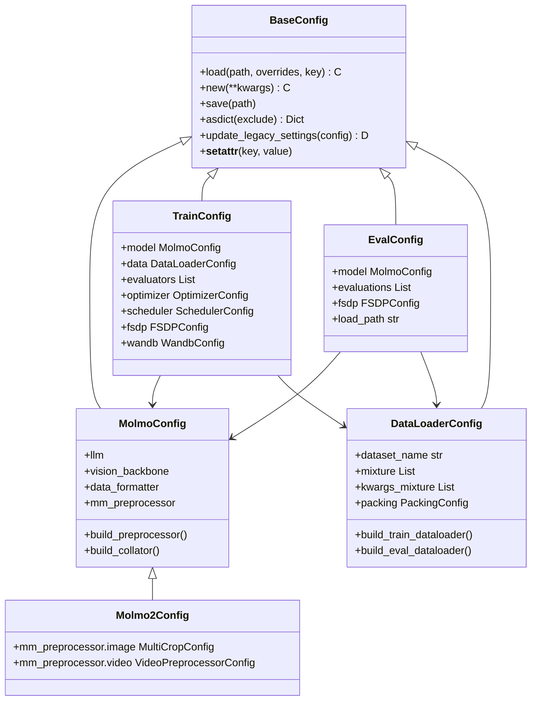
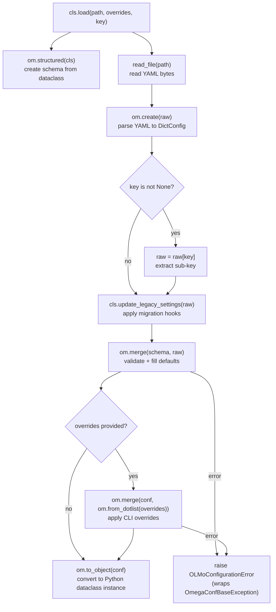
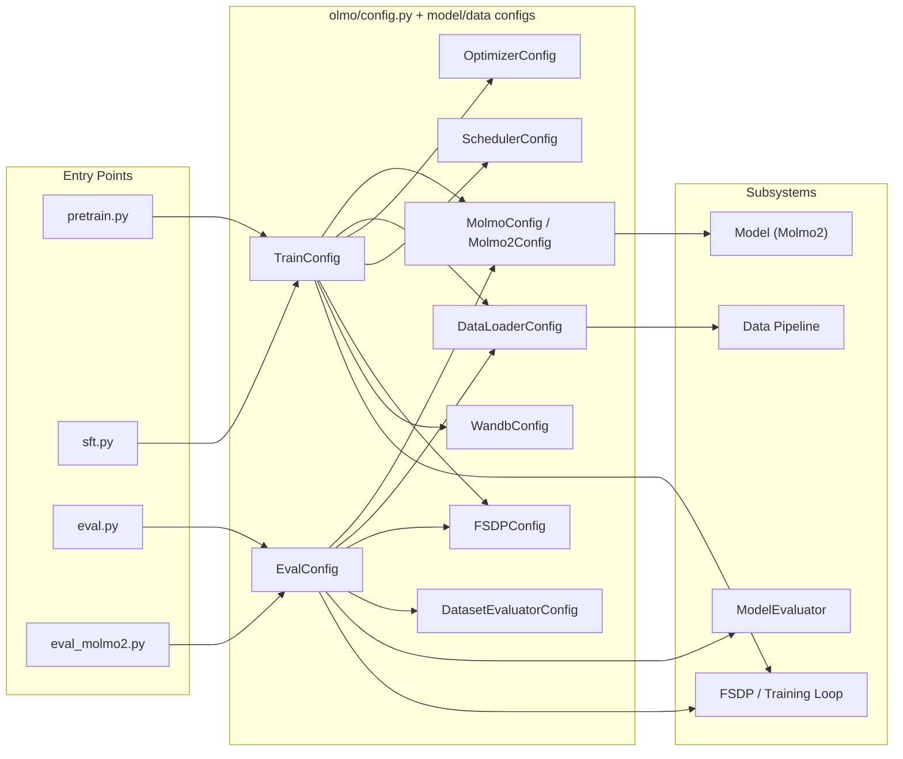

<!-- source: DeepWiki mcp.deepwiki.com · repo allenai/molmo2 · page 6 Configuration System · fetched 2026-10-26 -->

# Configuration System

<details>
<summary>Relevant source files</summary>

The following files were used as context for generating this wiki page:

- [olmo/__init__.py](olmo/__init__.py)
- [olmo/config.py](olmo/config.py)
- [olmo/data/__init__.py](olmo/data/__init__.py)

</details>


This page documents the configuration system used throughout the Molmo2 codebase. It covers the `BaseConfig` base class, its OmegaConf integration, loading and saving semantics, the derived config classes, and the supporting enumerations (`DType`, `TransformerDataParallelWrappingStrategy`).

For information about how `TrainConfig` is used in the training pipeline, see [Training Pipeline](#3). For how `EvalConfig` drives evaluation, see [Evaluation](#4). For how `DataLoaderConfig` constructs datasets, see [Data System](#5).

---

## Overview

All configuration in Molmo2 is expressed as Python `dataclass` instances. The `BaseConfig` class in [olmo/config.py:20-80]() wraps OmegaConf's structured config facilities to provide:

- YAML loading with schema validation
- Dot-list override merging (e.g., `model.llm.d_model=2048`)
- YAML serialization
- Legacy config migration hooks
- Strict attribute protection (no accidental new fields)

**Config class hierarchy:**



Sources: [olmo/config.py:1-137]()

---

## `BaseConfig`

`BaseConfig` is defined in [olmo/config.py:19-80]() as a plain `@dataclasses.dataclass`. All concrete config classes inherit from it.

### Methods

| Method | Signature | Description |
|---|---|---|
| `load` | `cls.load(path, overrides=None, key=None, validate_paths=True)` | Load a YAML file, merge with schema, apply dot-list overrides |
| `new` | `cls.new(**kwargs)` | Construct an instance from keyword args via OmegaConf merge |
| `save` | `self.save(path)` | Serialize to a YAML file via `om.save` |
        | `asdict` | `self.asdict(exclude=None)` | Return a plain `dict` via `dataclasses.asdict`, with optional field exclusion |
| `update_legacy_settings` | `cls.update_legacy_settings(config)` | Override point for backward-incompatible schema migrations; default is a no-op |

### Loading Flow

**Diagram: `BaseConfig.load()` execution path**



Sources: [olmo/config.py:41-61]()

### Strict Attribute Protection

`BaseConfig.__setattr__` [olmo/config.py:75-80]() raises `AttributeError` if an attempt is made to set any attribute that is not a declared dataclass field. This prevents silent bugs caused by typos in field names.

```
# This would raise AttributeError — 'lr' is not a declared field
config.lr = 0.001  # AttributeError: Cannot add new attribute 'lr'
```

### `new()` vs `load()`

| | `new(**kwargs)` | `load(path, overrides)` |
|---|---|---|
| Input source | Keyword arguments | YAML file + optional overrides |
| Schema validation | Via OmegaConf merge | Via OmegaConf merge |
| Override format | Python kwargs | Dot-list strings |
| Legacy migration | Not called | Called via `update_legacy_settings` |

Sources: [olmo/config.py:29-61]()

---

## OmegaConf Integration

OmegaConf provides two key mechanisms used here:

1. **Structured configs** (`om.structured(cls)`): OmegaConf reads the dataclass field definitions, types, and defaults to create a typed schema. This enforces that only declared fields can be set and that values match declared types.

2. **Merge semantics** (`om.merge(base, override)`): Values in `override` replace corresponding values in `base`. Nested dicts are merged recursively. This is how YAML files layer on top of defaults, and how CLI overrides layer on top of the YAML.

The `_register_resolvers()` call in `new()` [olmo/config.py:31]() registers any custom OmegaConf interpolation resolvers before structured config creation.

Sources: [olmo/config.py:1-61]()

---

## Supporting Enumerations

### `StrEnum`

Defined at [olmo/config.py:83-93](). A backport of Python 3.11's `enum.StrEnum`, included for compatibility with older Python versions. `str(member)` returns `member.value`, and `repr(member)` returns `'value'` (with quotes).

All domain enumerations in the codebase inherit from `StrEnum`, which means:
- Enum values serialize directly to/from YAML strings.
- OmegaConf can validate string values against the enum's members.

---

### `DType`

Defined at [olmo/config.py:96-117](). Maps string names to PyTorch `dtype` objects.

| Enum member | String value | PyTorch type |
|---|---|---|
| `DType.float32` | `"float32"` | `torch.float32` |
| `DType.bfloat16` | `"bfloat16"` | `torch.bfloat16` |
| `DType.float16` | `"float16"` | `torch.float16` |

**Key methods:**

| Method | Description |
|---|---|
| `DType.from_pt(dtype)` | Convert a `torch.dtype` to a `DType` member |
| `dtype.as_pt()` | Return the corresponding `torch.dtype` via `getattr(torch, self)` |

This allows configs to declare dtype fields as `DType` strings (e.g., `param_dtype: bfloat16`) that serialize cleanly to YAML while being trivially convertible to PyTorch types in model code.

Sources: [olmo/config.py:96-117]()

---

### `TransformerDataParallelWrappingStrategy`

Defined at [olmo/config.py:120-136](). Controls how FSDP (Fully Sharded Data Parallel) wraps transformer modules.

| Enum member | String value | Behavior |
|---|---|---|
| `full` | `"full"` | Wrap each block and the LM head separately |
| `blocks` | `"blocks"` | Wrap each block; LM head is not wrapped separately |
| `fine_grained` | `"fine_grained"` | Wrap sub-modules within each block in addition to wrapping each block |

Sources: [olmo/config.py:120-136]()

---

## Config Classes and Their Roles

The following diagram maps top-level config classes to entry points and subsystems:



Sources: [olmo/config.py:1-137]()

### `TrainConfig`

Used by `pretrain.py` and `sft.py`. Contains nested configs for:
- `model` — a `MolmoConfig` or `Molmo2Config` instance
- `data` — a `DataLoaderConfig` controlling dataset mixture and packing
- `optimizer`, `scheduler` — training hyperparameters
- `fsdp` — FSDP wrapping and sharding settings
- `wandb` — experiment tracking
- `evaluators` — optional inline evaluation during training

### `EvalConfig`

Used by `eval.py` and `eval_molmo2.py`. Contains:
- `model` — same `MolmoConfig` / `Molmo2Config` structure
- `load_path` — path to the checkpoint to evaluate
- `evaluations` — list of `DatasetEvaluatorConfig` instances
- `fsdp` — FSDP settings for inference

### `MolmoConfig` / `Molmo2Config`

Both `TrainConfig` and `EvalConfig` embed a model config. `MolmoConfig` holds:
- `llm` — LLM architecture config
- `vision_backbone` — ViT config
- `data_formatter` — how to format data for training
- `mm_preprocessor` — tokenization and image crop settings

`Molmo2Config` extends `MolmoConfig` with:
- `mm_preprocessor.image` — `MultiCropConfig` for multi-resolution image crops
- `mm_preprocessor.video` — `VideoPreprocessorConfig` for frame sampling

### `DataLoaderConfig`

Controls dataset construction. Key fields:
- `dataset_name` — name of a single dataset (used in single-dataset mode)
- `mixture` — list of `WeightedDataset` entries for mixture sampling
- `kwargs_mixture` — list of `KwargsMixture` entries for datasets requiring extra kwargs
- `packing` — `PackingConfig` controlling sequence packing behavior

Exposes `build_train_dataloader()` and `build_eval_dataloader()` which drive the full data pipeline described in [Data System](#5).

---

## YAML Configuration Format

A typical training YAML file has this top-level structure, corresponding directly to `TrainConfig` fields:

```yaml
model:
  llm:
    d_model: 2560
    ...
  vision_backbone:
    ...
  mm_preprocessor:
    ...

data:
  mixture:
    - dataset_name: coco_cap
      weight: 1.0
    - dataset_name: pixmo_cap
      weight: 2.0
  packing:
    max_seq_len: 16384

optimizer:
  lr: 1.0e-4

fsdp:
  wrapping_strategy: full
  param_dtype: bfloat16
```

CLI overrides use OmegaConf's dot-list notation and are merged last, allowing any field to be overridden without editing the YAML file:

```
python pretrain.py config.yaml \
  optimizer.lr=2e-4 \
  data.packing.max_seq_len=8192
```

Sources: [olmo/config.py:41-61]()

---

## Error Handling

All OmegaConf exceptions (`OmegaConfBaseException`) are caught and re-raised as `OLMoConfigurationError` (from `olmo/exceptions.py`), as seen in [olmo/config.py:37-38]() and [olmo/config.py:60-61](). This gives a consistent error type for all config-related failures, whether from schema validation, missing keys, type mismatches, or merge conflicts.

---

