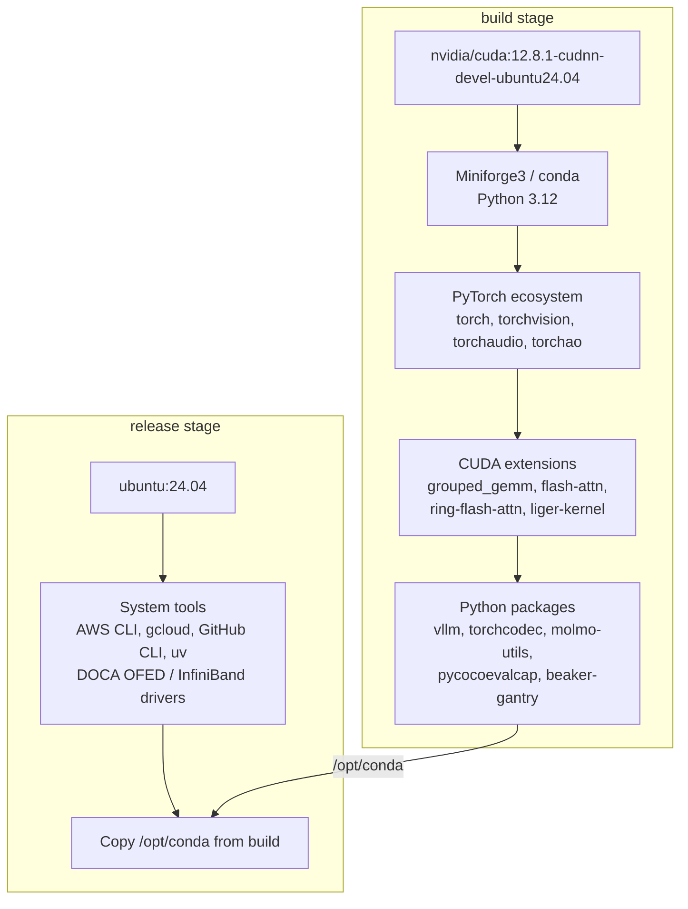
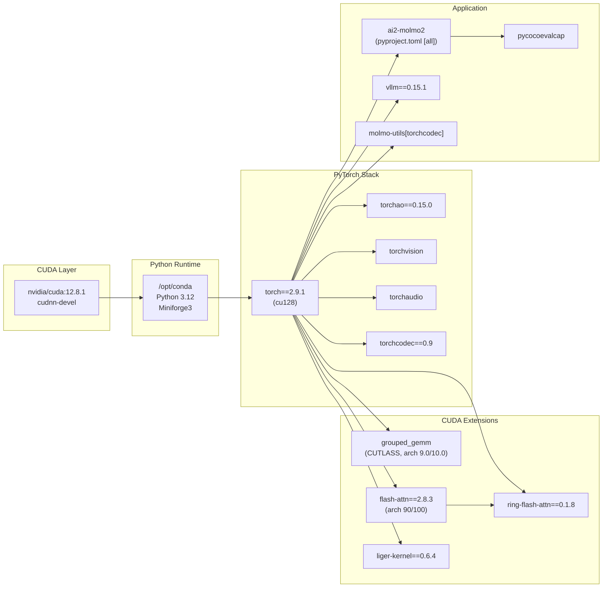

<!-- source: DeepWiki mcp.deepwiki.com · repo allenai/molmo2 · page 7 Infrastructure · fetched 2026-10-26 -->

# Infrastructure

Relevant source files

The following files were used as context for generating this wiki page:

- [.gitignore](.gitignore)
- [Dockerfile](Dockerfile)
- [LICENSE](LICENSE)

This page documents the Docker image build process, the deep learning software stack it installs, the development toolchain inferred from the repository structure, and the Apache 2.0 license terms.

For information about setting up the environment and required environment variables before running training or evaluation, see [Getting Started](#2). For the training pipeline that runs inside this environment, see [Training Pipeline](#3).

---

## Docker Image

The repository ships a single multi-stage `Dockerfile` that produces two images: a `build` image that compiles CUDA extensions, and a `release` image that is the runtime environment for training and evaluation.

### Build Stages Overview

**Docker build diagram**

Sources: [Dockerfile:1-186]()

---

### Build Stage Details

The `build` stage ([Dockerfile:13-103]()) starts from the CUDA devel image and installs the full ML software stack.

#### Base Image and System Dependencies

| ARG | Default Value |
|-----|--------------|
| `UBUNTU_VERSION` | `24.04` |
| `CUDA_VERSION` | `12.8.1` |
| `CUDA_VERSION_PATH` | `cu128` |
| `PYTHON_VERSION` | `3.12` |
| `TARGET_PLATFORM` | `x86_64` |
| `DEVEL_BASE_IMAGE` | `nvidia/cuda:12.8.1-cudnn-devel-ubuntu24.04` |

System packages installed in the build stage: `build-essential`, `cmake`, `curl`, `wget`, `libxml2-dev`, `libjpeg-dev`, `libpng-dev`, `gcc`, `git`.

[Dockerfile:18-29]()

#### Python Environment

Miniforge (`conda`) is installed at `/opt/conda` ([Dockerfile:34-44]()). The following are installed via conda:

- `python=3.12`
- `cmake`, `conda-build`, `pyyaml`, `numpy`, `ipython`
- `ffmpeg>=6,<8` (from `conda-forge`)

#### PyTorch Ecosystem

All PyTorch packages are installed from `https://download.pytorch.org/whl/cu128`:

| Package | Version ARG | Default |
|---------|-------------|---------|
| `torch` | `TORCH_VERSION` | `2.9.1` |
| `torchao` | `TORCHAO_VERSION` | `0.15.0` |
| `torchvision` | — | latest compatible |
| `torchaudio` | — | latest compatible |

[Dockerfile:47-52]()

#### CUDA Extension Packages

These packages are compiled from source or installed with specific CUDA architecture flags:

| Package | Version ARG | Default | Notes |
|---------|-------------|---------|-------|
| `grouped_gemm` | `GROUPED_GEMM_SHA` | `f1429a3c...` | Built with `GROUPED_GEMM_CUTLASS=1`; CUDA arch 9.0, 10.0 |
| `flash-attn` | `FLASH_ATTN_VERSION` | `2.8.3` | CUDA arch 90, 100 |
| `ring-flash-attn` | `RING_FLASH_ATTN_VERSION` | `0.1.8` | Used for context parallelism |
| `liger-kernel` | `LIGER_KERNEL_VERSION` | `0.6.4` | Fused kernels |
| `torchcodec` | `TORCH_CODEC_VERSION` | `0.9` | Video decoding |

[Dockerfile:54-74]()

`grouped_gemm` is sourced from `https://github.com/tgale96/grouped_gemm` because it requires a specific commit that supports passing batch sizes on GPU via CUTLASS. See the comment at [Dockerfile:55-56]().

`ring-flash-attn` is required for the Ulysses attention mechanism used in context parallelism. See [Context Parallelism](#3.3).

#### Python Package Dependencies

[Dockerfile:77-101]()

1. `pyproject.toml` is copied and `pip install '.[all]'` is run to install all declared dependencies, then the `ai2-molmo2` package itself is uninstalled (to allow the source tree to be mounted at runtime).
2. `vllm==${VLLM_VERSION}` (default `0.15.1`) is installed separately since it has its own CUDA index requirements.
3. `molmo-utils[torchcodec]` — utilities shared with other Molmo repos.
4. `pycocoevalcap` and `openjdk` — required for COCO caption evaluation metrics.
5. Utility packages: `gpustat`, `jupyter`, `beaker-gantry`, `torch-c-dlpack-ext`.

---

### Release Stage Details

The `release` stage ([Dockerfile:109-186]()) starts from a clean `ubuntu:24.04` base and copies the entire `/opt/conda` from the `build` stage. This keeps the release image free of CUDA devel headers.

#### System Tools

[Dockerfile:112-157]()

| Tool | Purpose |
|------|---------|
| `rsync`, `curl`, `wget` | File transfer |
| `vim`, `emacs`, `fish`, `zsh` | Editor / shell preferences |
| `htop`, `tmux` | Process monitoring / multiplexing |
| `parallel` | Parallel shell execution |
| `jq` | JSON processing |
| `sudo`, `unzip`, `make` | General utilities |
| AWS CLI | S3 / AWS storage access |
| `google-cloud-cli` | GCS storage access |
| GitHub CLI (`gh`) | GitHub interaction |
| `uv` | Fast Python package manager |

#### InfiniBand / RDMA Networking

The release image installs DOCA OFED user-space drivers for high-speed inter-node communication on multi-node GPU clusters:

| Component | Version |
|-----------|---------|
| MFT (Mellanox Firmware Tools) | `4.31.0-149` |
| DOCA OFED userspace | `2.10.0` |

[Dockerfile:159-173]()

#### Runtime Environment Variables

| Variable | Value |
|----------|-------|
| `NVIDIA_VISIBLE_DEVICES` | `all` |
| `NVIDIA_DRIVER_CAPABILITIES` | `compute,utility` |
| `LD_LIBRARY_PATH` | `/usr/local/nvidia/lib:/usr/local/nvidia/lib64` |
| `UV_SYSTEM_PYTHON` | `1` |
| `UV_BREAK_SYSTEM_PACKAGES` | `1` |
| `PATH` | Prepends CUDA bin, cargo, local bin, conda bin |

[Dockerfile:178-183]()

---

### Software Stack Dependency Map

**Package dependency diagram**

Sources: [Dockerfile:1-103]()

---

## Development Toolchain

The `.gitignore` file reveals the development tools expected in local environments.

| Tool | Indicator in `.gitignore` |
|------|--------------------------|
| `direnv` | `.envrc` ([.gitignore:10]()) |
| `pyenv` / `uv` version pinning | `.python-version` ([.gitignore:11]()) |
| JetBrains IDEs | `.idea`, `*.iml` ([.gitignore:12](), [.gitignore:15]()) |
| VS Code | `.vscode/` ([.gitignore:14]()) |
| Pyright (type checker) | `pyrightconfig.json` ([.gitignore:16]()) |
| Ruff (linter) | `.ruff.toml` ([.gitignore:17]()) |
| uv (package manager) | `uv.lock` ([.gitignore:57]()) |
| pytest | `.pytest_cache/`, `.benchmarks` ([.gitignore:45](), [.gitignore:46]()) |
| Jupyter | `.ipynb_checkpoints` ([.gitignore:23]()) |
| W&B | `/wandb/` ([.gitignore:53]()) |

Build artifacts and run directories that are excluded:

- `/runs/` — training run outputs
- `checkpoints/` — model checkpoints
- `/scratch/` — temporary scratch data
- `docs/build`, `site/` — documentation build outputs

Sources: [.gitignore:1-58]()

---

## License

The repository is released under the **Apache License, Version 2.0** ([LICENSE:1-201]()).

Key terms:

| Term | Description |
|------|-------------|
| **Use** | Perpetual, worldwide, non-exclusive, royalty-free permission to use, reproduce, and distribute |
| **Derivative Works** | Must retain copyright, patent, and attribution notices from the original |
| **Patent Grant** | Contributors grant a patent license covering their contributions |
| **Trademark** | License does not grant permission to use the licensor's trade names or marks |
| **No Warranty** | Provided "AS IS" without warranties of any kind |
| **Liability** | Contributors are not liable for any damages arising from use |

The full license text is in [LICENSE:1-201]().