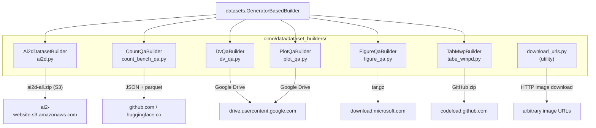
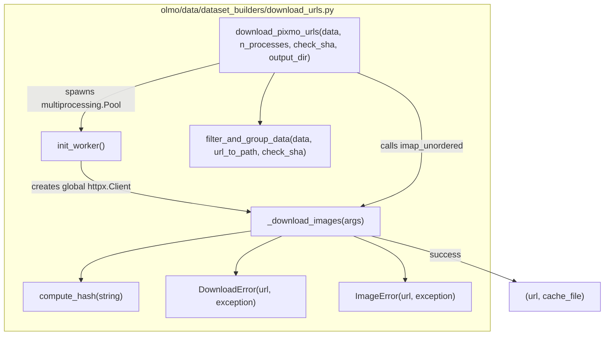
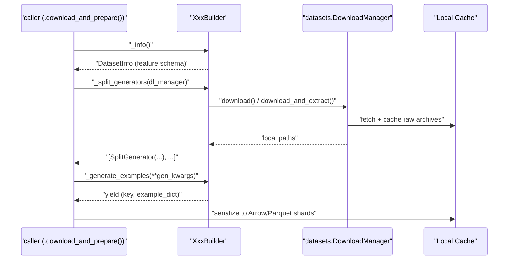

<!-- source: DeepWiki mcp.deepwiki.com · repo allenai/molmo2 · extra page Dataset Builders · fetched 2026-10-26 -->

# Dataset Builders

<details>
<summary>Relevant source files</summary>

The following files were used as context for generating this wiki page:

- [olmo/data/dataset_builders/ai2d.py](olmo/data/dataset_builders/ai2d.py)
- [olmo/data/dataset_builders/count_bench_qa.py](olmo/data/dataset_builders/count_bench_qa.py)
- [olmo/data/dataset_builders/download_urls.py](olmo/data/dataset_builders/download_urls.py)
- [olmo/data/dataset_builders/dv_qa.py](olmo/data/dataset_builders/dv_qa.py)
- [olmo/data/dataset_builders/figure_qa.py](olmo/data/dataset_builders/figure_qa.py)
- [olmo/data/dataset_builders/plot_qa.py](olmo/data/dataset_builders/plot_qa.py)
- [olmo/data/dataset_builders/tabe_wmpd.py](olmo/data/dataset_builders/tabe_wmpd.py)

</details>


## Purpose and Scope

This page covers the HuggingFace `GeneratorBasedBuilder` subclasses located in `olmo/data/dataset_builders/`. These classes download raw datasets from external sources, transform their structure, and serialize them into the HuggingFace Datasets cache format so they can be loaded by the dataset classes described in [Image Datasets](#5.3.1).

This page is specifically about the *preparation* step — downloading, extracting, annotating, and structuring raw files. It does **not** cover how the resulting datasets are formatted into prompts or tokenized (see [Data Pipeline](#5.1)) or how they are registered and retrieved via `get_dataset_by_name()` (see [Dataset Catalog](#5.3)).

---

## Overview

Each builder follows the standard HuggingFace `datasets.GeneratorBasedBuilder` contract, implementing three methods:

| Method | Responsibility |
|---|---|
| `_info()` | Declare feature schema (`datasets.DatasetInfo`) |
| `_split_generators()` | Download source files; return one `SplitGenerator` per split |
| `_generate_examples()` | Yield `(key, example_dict)` tuples matching the declared schema |

All builders can be run standalone via their `__main__` blocks, which call `.download_and_prepare()` to write the prepared dataset to disk.

**Dataset Builders Overview**



Sources: [olmo/data/dataset_builders/ai2d.py:92-100](), [olmo/data/dataset_builders/count_bench_qa.py:15-23](), [olmo/data/dataset_builders/dv_qa.py:9-14](), [olmo/data/dataset_builders/figure_qa.py:9-20](), [olmo/data/dataset_builders/plot_qa.py:9-14](), [olmo/data/dataset_builders/tabe_wmpd.py:9-13]()

---

## Individual Builders

### `Ai2dDatasetBuilder`

**File:** `olmo/data/dataset_builders/ai2d.py`

Downloads the AI2D (Allen Institute for AI Diagrams) dataset and augments images with labeled bounding boxes for multiple-choice questions that use letter codes (A, B, C…) to refer to diagram regions.

**Data sources:**
- `AI2D_ALL` — full dataset zip from `ai2-website.s3.amazonaws.com`
- `AI2D_TEST_IDS` — CSV of held-out test image IDs from `prior-datasets` S3

**Key preprocessing logic in `_split_generators()`** [olmo/data/dataset_builders/ai2d.py:124-249]():

1. Reads per-image question JSON files and answer annotation JSON files.
2. For questions with `abcLabel=True`, calls `draw_abc_labels()` to overlay colored boxes and replacement text onto the image in two variants:
   - **Opaque**: fills the region with a solid color and centers the letter inside (`mode="in_box"`).
   - **Transparent**: overlays a semi-transparent fill and places the letter to the left (`mode="left", use_transparent=True`).
3. Splits data into `train`, `validation` (384 randomly held-out images), and `test` sets.
4. Includes both the original and transparent-annotated variants as separate examples (with `question_id` suffixed `_transparent`).

**Output schema:**

| Field | Type | Description |
|---|---|---|
| `image` | `Image` | Annotated or plain diagram image |
| `question` | `string` | Question text |
| `image_id` | `int32` | Numeric image identifier |
| `option_is_abc` | `Sequence[bool]` | Whether each option text is an ABC label |
| `abc_label` | `bool` | Whether the question uses ABC labels |
| `answer_texts` | `Sequence[string]` | Deduplicated answer options |
| `correct_answer` | `int32` | Index into `answer_texts` |
| `has_transparent_box` | `bool` | Marks transparent-annotated variants |

**Helper functions:**

- `draw_abc_labels(image_f, annotations, mode, use_transparent)` — core image manipulation, uses `PIL.ImageDraw` and `PIL.ImageFont` [olmo/data/dataset_builders/ai2d.py:33-89]()
- `get_font_size(image_size)` — dynamically scales font between 16–32 px [olmo/data/dataset_builders/ai2d.py:22-30]()

Sources: [olmo/data/dataset_builders/ai2d.py:1-258]()

---

### `CountQaBuilder`

**File:** `olmo/data/dataset_builders/count_bench_qa.py`

Constructs the CountQA benchmark by joining two separate sources:

- **CountBench images**: a parquet file hosted on HuggingFace Hub (`nielsr/countbench`) containing `image` (bytes), `number`, and `image_url` columns.
- **Natural language questions**: a JSON file from the `big_vision` GitHub repo containing per-image questions authored for the PaliGemma evaluation suite.

**`_generate_examples()`** [olmo/data/dataset_builders/count_bench_qa.py:44-66]() iterates the parquet rows, attaches the corresponding question string by index, decodes image bytes via `PIL.Image`, and filters out rows with null or non-RGB images.

**Output schema:**

| Field | Type | Description |
|---|---|---|
| `image` | `Image` | Decoded image array |
| `question` | `string` | Natural language count question |
| `count` | `int32` | Ground truth count |
| `example_id` | `int32` | Row index |
| `image_url` | `string` | Original image URL |

Only a `test` split is produced.

Sources: [olmo/data/dataset_builders/count_bench_qa.py:1-70]()

---

### `DvQaBuilder`

**File:** `olmo/data/dataset_builders/dv_qa.py`

Downloads DVQA (bar chart question answering) from Google Drive. Two Google Drive file IDs are resolved to download URLs using the `drive.usercontent.google.com` endpoint:

- `image_dir` — archive of chart images
- `annotation_dir` — per-split JSON annotation files

**Splits produced:** `train`, `val_hard`, `val_easy`.

**`_generate_examples()`** [olmo/data/dataset_builders/dv_qa.py:43-57]() loads the per-split annotation JSON, groups questions by image path, strips unused fields (`answer_bbox`), and yields one example per image.

**Output schema:**

| Field | Type | Description |
|---|---|---|
| `image` | `Image` | Bar chart image |
| `image_id` | `string` | Filename-based identifier |
| `questions` | `Sequence[{question, answer}]` | All Q&A pairs for this image |

Sources: [olmo/data/dataset_builders/dv_qa.py:1-61]()

---

### `FigureQaBuilder`

**File:** `olmo/data/dataset_builders/figure_qa.py`

Downloads FigureQA (synthetic scientific figure QA) from Microsoft's CDN. Five tar.gz archives are declared in `URLS`:

```
validation1, validation2, train, test1, test2
```

Each archive extracts to a folder with a `qa_pairs.json` and a `png/` subdirectory.

**`_generate_examples()`** [olmo/data/dataset_builders/figure_qa.py:51-70]() groups all question records by `image_index` and yields one example per image with a `questions` list. The `answer` field is an integer (0 = No, 1 = Yes).

**Output schema:**

| Field | Type | Description |
|---|---|---|
| `image` | `Image` | Synthetic chart image (PNG path) |
| `image_index` | `int64` | Image identifier |
| `questions` | `Sequence[{question, answer}]` | All Q&A pairs for the image |

Sources: [olmo/data/dataset_builders/figure_qa.py:1-74]()

---

### `PlotQaBuilder`

**File:** `olmo/data/dataset_builders/plot_qa.py`

Downloads PlotQA (real-world scientific plot QA) from Google Drive. Six separate Drive archives are fetched:

- `{train,validation,test}_images` — image archives
- `{train,validation,test}_annotations` — JSON annotation files

**`_generate_examples()`** [olmo/data/dataset_builders/plot_qa.py:49-71]() groups question records by `image_index`, converts numeric answers to strings, and yields one record per image.

Note that the `image` feature is declared with `decode=False` [olmo/data/dataset_builders/plot_qa.py:19](), so image bytes are stored raw rather than decoded at dataset load time.

**Output schema:**

| Field | Type | Description |
|---|---|---|
| `image` | `Image(decode=False)` | Raw PNG bytes |
| `image_index` | `int64` | Image identifier |
| `questions` | `Sequence[{question, answer, question_id}]` | All Q&A pairs |

Sources: [olmo/data/dataset_builders/plot_qa.py:1-75]()

---

### `TabMwpBuilder`

**File:** `olmo/data/dataset_builders/tabe_wmpd.py`

Downloads TabMWP (tabular math word problem) from the `lupantech/PromptPG` GitHub repository as a zip archive. The archive extracts to a single directory containing `data/tabmwp/problems_{split}.json` and a `tables/` folder with per-example PNG images.

**Splits produced:** `train`, `dev`, `test`.

**`_generate_examples()`** [olmo/data/dataset_builders/tabe_wmpd.py:42-53]() iterates the JSON problem dictionary, attaches the image path (`tables/{id}.png`), removes unused `table_for_pd` field, and yields one example per problem.

**Output schema:**

| Field | Type | Description |
|---|---|---|
| `image` | `Image` | Table rendered as PNG |
| `question` | `string` | Math word problem text |
| `answer` | `string` | Ground truth answer |
| `choices` | `Sequence[string]` | Multiple-choice options (if applicable) |
| `table_title` | `string` | Table heading |
| `table` | `string` | Raw table text |
| `column_num` | `int64` | Number of table columns |
| `row_num` | `int64` | Number of table rows |
| `solution` | `string` | Step-by-step solution |
| `ques_type` | `string` | Question type |
| `ans_type` | `string` | Answer type |
| `unit` | `string` | Unit of the answer |
| `grade` | `int32` | Difficulty grade level |
| `example_id` | `int64` | Numeric problem ID |

Sources: [olmo/data/dataset_builders/tabe_wmpd.py:1-57]()

---

## URL Downloader Utility

**File:** `olmo/data/dataset_builders/download_urls.py`

This module provides a parallel HTTP image downloader used for PixMo-style datasets where images are referenced by URL rather than distributed as archived files. It is not a `GeneratorBasedBuilder` but is used inside other builders that prepare PixMo datasets.

**Class and function map:**



Sources: [olmo/data/dataset_builders/download_urls.py:40-227]()

### `download_pixmo_urls()`

[olmo/data/dataset_builders/download_urls.py:133-197]()

Downloads all image URLs from a HuggingFace `Dataset` object into a local cache directory. Returns a `Dict[str, str]` mapping `url → local_file_path`.

**Parameters:**

| Parameter | Type | Description |
|---|---|---|
| `data` | `datasets.Dataset` | Source dataset with `image_url` / `image_sha256` columns |
| `n_processes` | `int` | Worker count; 1 runs in-process |
| `check_sha` | `bool` | Verify SHA-256 hash against `image_sha256` column |
| `output_dir` | `str` | Directory to write cached image files |
| `cache_only` | `bool` | Skip network; return error for uncached URLs |

### `_download_images()`

[olmo/data/dataset_builders/download_urls.py:68-130]()

Handles a single URL. Uses a content-addressed filename (`SHA-256(url)`) to avoid re-downloading. Retries up to 3 times with exponential backoff on `TransportError` or HTTP 429. Writes to a `.tmp` file then atomically renames to prevent partial writes. When `check_sha=False`, validates that the downloaded bytes are parseable by PIL and are not zero-dimensional.

### `filter_and_group_data()`

[olmo/data/dataset_builders/download_urls.py:200-227]()

Post-download grouping utility. Takes a flat PixMo dataset and a URL-to-path map, discards rows whose URL was not successfully downloaded, and collapses all annotations for the same image into a single record with list-valued annotation fields.

### Error dataclasses

- `DownloadError(url, exception)` — network or HTTP failure [olmo/data/dataset_builders/download_urls.py:40-43]()
- `ImageError(url, exception)` — downloaded bytes are not a valid image or fail SHA check [olmo/data/dataset_builders/download_urls.py:46-48]()

---

## Builder Method Reference

**Common pattern across all `GeneratorBasedBuilder` subclasses:**



Sources: [olmo/data/dataset_builders/ai2d.py:92-253](), [olmo/data/dataset_builders/figure_qa.py:34-70](), [olmo/data/dataset_builders/plot_qa.py:29-71]()

---

## Summary Table

| Builder class | File | `dataset_name` | Source | Splits |
|---|---|---|---|---|
| `Ai2dDatasetBuilder` | `ai2d.py` | `ai2d` | AWS S3 | train, validation, test |
| `CountQaBuilder` | `count_bench_qa.py` | `count_qa` | GitHub + HuggingFace Hub | test |
| `DvQaBuilder` | `dv_qa.py` | `dv_qa` | Google Drive | train, val_hard, val_easy |
| `FigureQaBuilder` | `figure_qa.py` | `figure_qa` | Microsoft CDN | train, validation1, validation2, test1, test2 |
| `PlotQaBuilder` | `plot_qa.py` | `plot_qa` | Google Drive | train, validation, test |
| `TabMwpBuilder` | `tabe_wmpd.py` | `tab_mwp` | GitHub | train, dev, test |

The `dataset_name` string passed to the `super().__init__()` call in each builder is the key HuggingFace uses to locate the builder when loading the dataset via `datasets.load_dataset()`.

---

