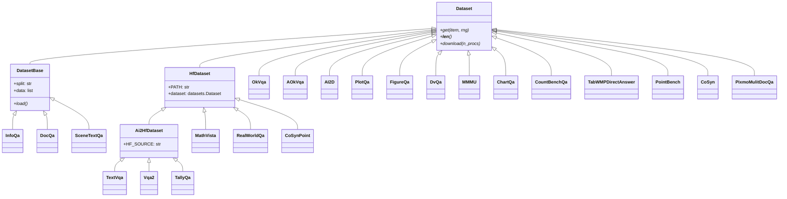
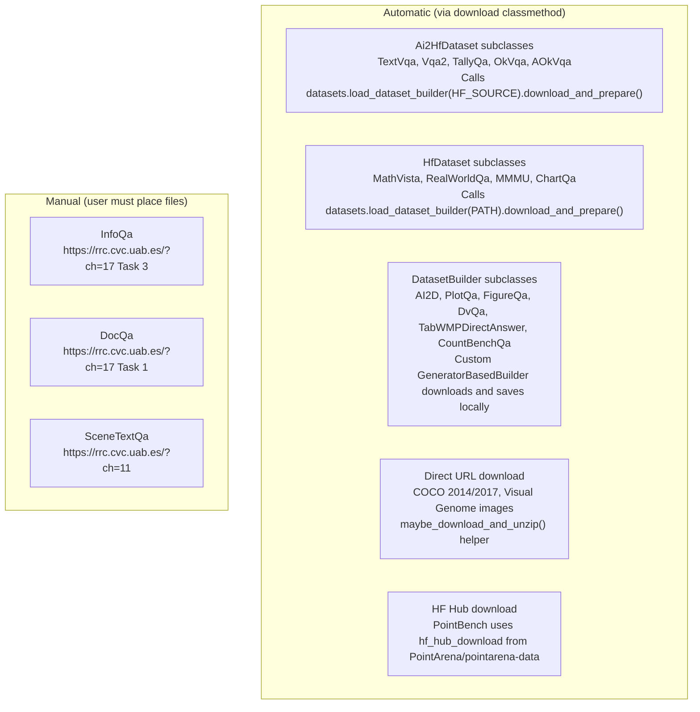
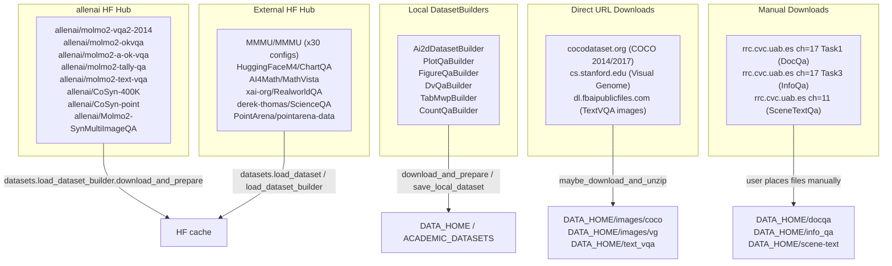

<!-- source: DeepWiki mcp.deepwiki.com · repo allenai/molmo2 · extra page Image Datasets · fetched 2026-10-26 -->

# Image Datasets

<details>
<summary>Relevant source files</summary>

The following files were used as context for generating this wiki page:

- [olmo/data/academic_image_datasets.py](olmo/data/academic_image_datasets.py)

</details>


This page documents the single-image academic datasets implemented in `olmo/data/academic_image_datasets.py`. It covers the class hierarchy, download mechanisms, and the data format each dataset produces for the pipeline. For multi-image datasets, see [Multi-Image Datasets](#5.3.2). For video datasets, see [Video Datasets](#5.3.3). For how datasets are registered and retrieved, see [Dataset Catalog](#5.3).

---

## Base Class Hierarchy

All image dataset classes inherit from one of three base types, defined in `olmo/data/dataset.py`.

**Base class responsibilities:**

| Base Class | Key Contract | Typical Use |
|---|---|---|
| `Dataset` | Abstract `get(item, rng)` + `__len__` | General use |
| `DatasetBase` | Adds lazy `load()` with caching | Datasets loaded from local JSON/files |
| `HfDataset` | Wraps a single HuggingFace `datasets.Dataset` | Datasets fetched directly from HF Hub |
| `Ai2HfDataset` | Extends `HfDataset`; assumes `allenai/molmo2-*` namespace | Datasets hosted on allenai HF org |

**Class hierarchy diagram:**



Sources: [olmo/data/academic_image_datasets.py:1-36](), [olmo/data/dataset.py]()

---

## Download Mechanisms

Datasets use three distinct download strategies. Knowing which one applies determines how to prepare data before training.

**Download strategy diagram:**



Sources: [olmo/data/academic_image_datasets.py:64-107](), [olmo/data/academic_image_datasets.py:220-367]()

> **Note:** `InfoQa`, `DocQa`, and `SceneTextQa` raise a `ValueError` with download instructions at runtime if the required files are not present. They cannot be auto-downloaded.

---

## Dataset Reference

### VQA Datasets

These datasets produce visual question answering examples. The `answers` field is a list of accepted free-form answers.

| Class | HF Source | Image Source | Splits | Style Tag |
|---|---|---|---|---|
| `Vqa2` | `allenai/molmo2-vqa2-2014` | COCO 2014 | train, validation, test | `vqa2` |
| `OkVqa` | `allenai/molmo2-okvqa` | COCO 2014 | train, val | `okvqa` |
| `AOkVqa` | `allenai/molmo2-a-ok-vqa` | COCO 2017 | train, val, test | `a_okvqa_da` / `a_okvqa_mc` |
| `TallyQa` | `allenai/molmo2-tally-qa` | COCO 2014 + VG | train, test | varies |
| `TextVqa` | `allenai/molmo2-text-vqa` | FBA images | train, validation, test | `text_vqa` |

[olmo/data/academic_image_datasets.py:79-218]()

**`AOkVqa`** has two question modes controlled by the `direct_answer` constructor parameter:
- `direct_answer=True` → style `a_okvqa_da`, returns `answers` list.
- `direct_answer=False` → style `a_okvqa_mc`, returns `options` + `answer_idx`.

**COCO image download helpers:**
- `_ensure_coco2014_downloaded()` — downloads val2014, train2014, test2015 from `cocodataset.org`
- `_ensure_coco2017_downloaded()` — downloads val2017, train2017, test2017
- `_ensure_vg_downloaded()` — downloads Visual Genome 100K images from Stanford

Sources: [olmo/data/academic_image_datasets.py:46-76]()

---

### Chart and Document QA Datasets

These datasets contain images of charts, tables, figures, and documents paired with questions.

| Class | Source | Splits | Style Tag | Notes |
|---|---|---|---|---|
| `ChartQa` | `HuggingFaceM4/ChartQA` | train, val, test | `chart_qa` | `parts` param filters human/augmented |
| `PlotQa` | `PlotQaBuilder` | train, validation, test | `plot_qa` | Multiple Q/A per image |
| `FigureQa` | `FigureQaBuilder` | train, validation1/2, test1/2 | `figure_qa` | Multiple Q/A per image |
| `DvQa` | `DvQaBuilder` | train, val_hard, val_easy | `dv_qa` | Multiple Q/A per image |
| `TabWMPDirectAnswer` | `TabMwpBuilder` | train, dev, test | `tabwmp_da` | Optional `choices` as `options` |
| `InfoQa` | Manual download | train, validation, test | `info_qa` | infographicsVQA |
| `DocQa` | Manual download | train, validation, test | `doc_qa` | DocumentVQA |
| `SceneTextQa` | Manual download | train, validation, test | `st_qa` | Custom val split via fixed RNG |

[olmo/data/academic_image_datasets.py:267-450](), [olmo/data/academic_image_datasets.py:789-901]()

**`ChartQa`** supports a `weighted` mode [olmo/data/academic_image_datasets.py:813-831]() that attaches a `weight` key per example to balance the 20,901 human vs. 7,398 augmented examples.

---

### Scientific and Diagram Datasets

| Class | Source | Splits | Style Tag | Notes |
|---|---|---|---|---|
| `AI2D` | `Ai2dDatasetBuilder` | train, validation, test | `ai2_diagram` / `ai2_diagram_no_letter` | `boxes` param: `both`/`transparent`/`opaque` |
| `MathVista` | `AI4Math/MathVista` | varies | `eval_multiple_choice` / `eval_short_answer` | `simplify_question` strips hints |
| `MMMU` | `MMMU/MMMU` (30 configs) | train, validation, test | `a_okvqa_mc` / `vqa2` | Loads all 30 subject configs and concatenates |
| `ScienceQAImageOnly` | `derek-thomas/ScienceQA` | train, validation, test | `science_qa` | Image-only subset; hint prepended to question |
| `RealWorldQa` | `xai-org/RealworldQA` | test only | `eval_short_answer` / `eval_multiple_choice` | Detects question type from prompt string |

[olmo/data/academic_image_datasets.py:372-662](), [olmo/data/academic_image_datasets.py:969-1025]()

**`MMMU`** subject list [olmo/data/academic_image_datasets.py:558-565]() includes 30 academic disciplines. Each subject is downloaded as a separate HF config and concatenated at init time. The `use_multi_image` flag enables multi-image paths for questions with multiple embedded images.

**`AI2D`** style selection [olmo/data/academic_image_datasets.py:420-430]():
- `ai2_diagram_no_letter` — when all-but-one answer options are single letters (ABC labels).
- `ai2_diagram` — standard multiple-choice with labeled options.

---

### Synthetic and CoSyn Datasets

`CoSyn` and related classes serve synthetic document Q&A data generated from structured documents.

| Class | HF Source | Doc Types | Style Tag |
|---|---|---|---|
| `CoSyn` | `allenai/CoSyn-400K` | chart, chemical, circuit, diagram, document, graphic, math, music, nutrition, table | `cosyn_{doc_type}[_exp]` |
| `PixmoMulitDocQa` | `allenai/Molmo2-SynMultiImageQA` | chart, chemical, circuit, diagram, doc, graphic, music, table | `cosyn_{doc_type}[_exp]` |
| `CoSynPoint` | `allenai/CoSyn-point` | — | `cosyn_point` |

[olmo/data/academic_image_datasets.py:665-786]()

`CoSyn` and `PixmoMulitDocQa` both accept a `use_exp` boolean parameter. When `True`, the style appends `_exp` and each message includes an `explanation` field alongside `question` and `answer`.

`PixmoMulitDocQa` differs from `CoSyn` in that it returns a list of images (`example["images"]`) rather than a single image, and accepts a `max_images` parameter to filter examples by image count.

---

### Counting and Pointing Datasets

| Class | Source | Style Tag | Notes |
|---|---|---|---|
| `CountBenchQa` | `CountQaBuilder` | `point_count` | Returns `count` in metadata |
| `PointBench` | `PointArena/pointarena-data` (HF Hub) | `pointing` | Loads binary mask from PNG; filters to examples with `mask_filename` |

[olmo/data/academic_image_datasets.py:835-966]()

`PointBench.load_mask()` [olmo/data/academic_image_datasets.py:921-940]() converts a grayscale or RGB PNG to a binary NumPy mask. This mask is stored in `metadata["mask"]` for evaluation purposes.

---

## Common `get()` Return Format

Every dataset's `get(item, rng)` method returns a dictionary. The pipeline stages downstream (formatter, preprocessor, collator) consume specific keys. The most common pattern:

```
{
  "image":        PIL.Image | str (file path) | list[PIL.Image],
  "question":     str,                          # single-turn
  "answers":      list[str],                    # for free-form VQA
  "options":      list[str],                    # for multiple choice
  "answer_idx":   int,                          # for multiple choice
  "style":        str,                          # formatter dispatch key
  "message_list": list[dict],                   # multi-turn or multi-QA
  "metadata":     dict,                         # eval metadata (example_id, etc.)
  "weight":       float,                        # optional example weight
}
```

Datasets that have multiple questions per image (e.g., `PlotQa`, `FigureQa`, `DvQa`, `CoSyn`) use `message_list` instead of a top-level `question`. Each entry in `message_list` is a dict with its own `style` key.

The `style` string determines which formatting template is applied by `DataFormatter`. For how styles map to prompt templates, see [Data Pipeline](#5.1).

---

## Download Flow Summary



Sources: [olmo/data/academic_image_datasets.py:40-107](), [olmo/data/academic_image_datasets.py:372-398](), [olmo/data/academic_image_datasets.py:456-498](), [olmo/data/academic_image_datasets.py:665-718]()

The `DATA_HOME` and `ACADEMIC_DATASETS` path roots are set from the `DATA_HOME` environment variable. See [Getting Started](#2) for environment variable setup.

---

