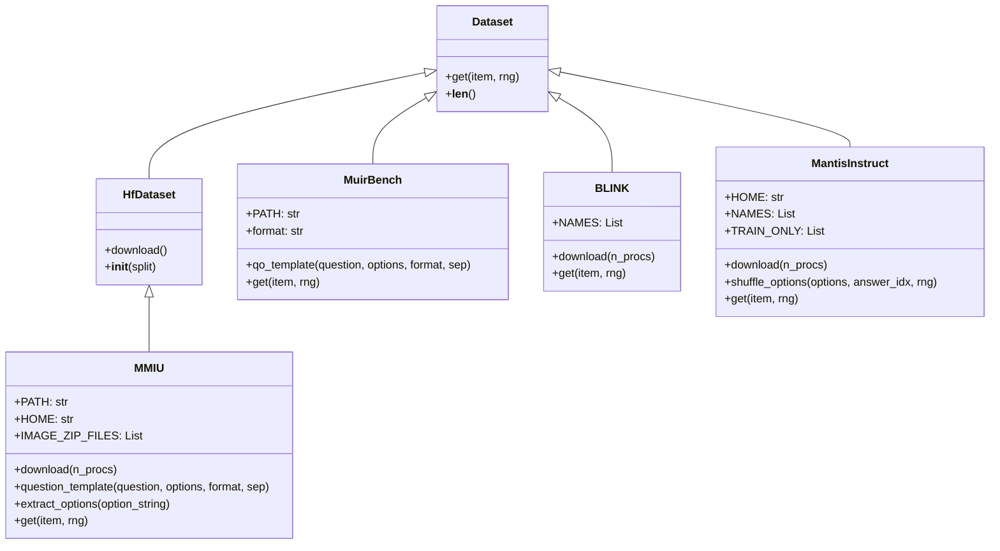
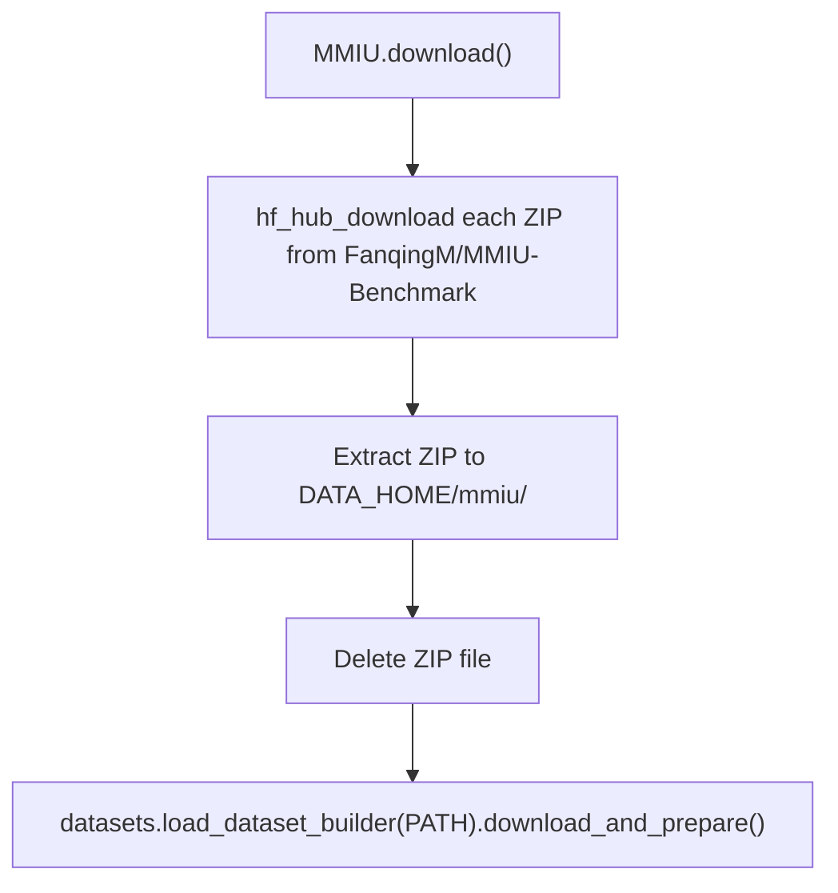
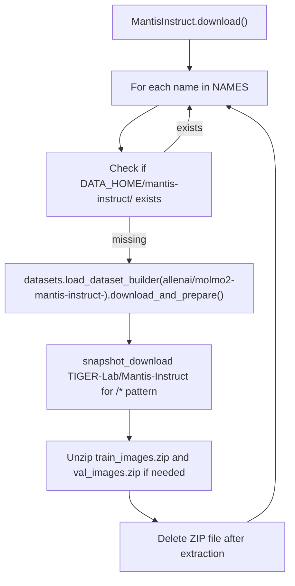
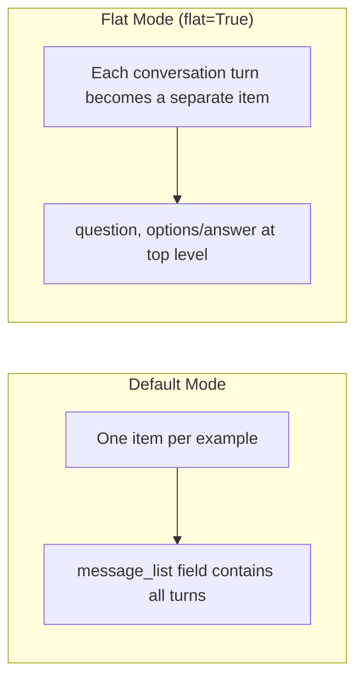
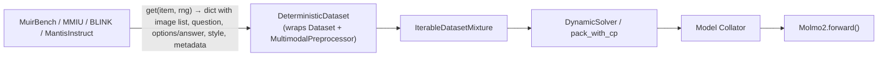

<!-- source: DeepWiki mcp.deepwiki.com · repo allenai/molmo2 · extra page Multi-Image Datasets · fetched 2026-10-26 -->

# Multi-Image Datasets

Relevant source files

The following files were used as context for generating this wiki page:

- [olmo/data/academic_multi_image_datasets.py](olmo/data/academic_multi_image_datasets.py)

This page documents the multi-image dataset classes used for training and evaluation in Molmo2. All implementations live in [`olmo/data/academic_multi_image_datasets.py`](). Each class handles download, image resolution, and question/option formatting for a benchmark where each example contains multiple images.

For background on how these datasets plug into the broader data pipeline (mixture sampling, packing, collation), see [Data Pipeline](#5.1). For the dataset factory that instantiates them by name, see [Dataset Catalog](#5.3). For single-image academic datasets, see [Image Datasets](#5.3.1).

---

## Helper Utility: `replace_images`

[`olmo/data/academic_multi_image_datasets.py:16-37`]()

The function `replace_images(question, options, max_images=None)` is shared across several dataset classes. It replaces literal `<image>` placeholder tokens in question strings and option strings with human-readable labels like `Image 1`, `Image 2`, etc.

**Behavior:**

| Input | Output |
|---|---|
| `"Compare <image> and <image>."` | `"Compare Image 1 and Image 2."` |
| Options containing `<image>` | Options with sequential image labels, continuing the counter |
| `max_images` set | Substitution stops after that many replacements; remaining `<image>` tokens are left as-is |

The counter increments across the concatenated `[question] + options` list, so image numbering is globally consistent within a single example.

Sources: [`olmo/data/academic_multi_image_datasets.py:16-37`]()

---

## Dataset Classes

**Class hierarchy diagram:**

Sources: [`olmo/data/academic_multi_image_datasets.py:40-422`]()

---

## MuirBench

[`olmo/data/academic_multi_image_datasets.py:40-100`]()

**HuggingFace path:** `MUIRBENCH/MUIRBENCH`

VQA benchmark where each example has 2–9 images. Questions test multi-image relational reasoning (e.g., image similarity, multi-view geometry).

**Constructor parameters:**

| Parameter | Default | Description |
|---|---|---|
| `split` | required | Dataset split (e.g., `"test"`) |
| `format` | `"multiple_choice"` | One of `multiple_choice`, `answer_first`, `answer_last`, `short_answer` |
| `keep_in_memory` | `False` | Passed through to `datasets.load_dataset` |

**Download:** Loaded directly via `datasets.load_dataset` from HuggingFace. No manual download step is needed.

**`get()` output fields:**

| Field | Type | Notes |
|---|---|---|
| `image` | `List[PIL.Image]` | All images for the example, from `example["image_list"]` |
| `question` | `str` | Question text after `replace_images` substitution |
| `options` | `List[str]` | Multiple-choice options (if `format="multiple_choice"`) |
| `answer_idx` | `int` | Zero-based index of the correct option |
| `style` | `str` | `"eval_multiple_choice"` (legacy) or `"mantis_instruct_mc"` |
| `metadata` | `dict` | `example_id`, `task`, `image_relation`, `image_type`, `counterpart_id` |

**Format modes and their effects on `style`:**

| `format` value | `style` field emitted |
|---|---|
| `"multiple_choice"` | `"eval_multiple_choice"` (legacy) or `"mantis_instruct_mc"` |
| `"answer_first"` | `"eval_multi_image_answer_first"` |
| `"answer_last"` | `"eval_multi_image_answer_last"` |
| `"short_answer"` | `"eval_multi_image_short_answer"` |

Sources: [`olmo/data/academic_multi_image_datasets.py:40-100`]()

---

## MMIU

[`olmo/data/academic_multi_image_datasets.py:103-221`]()

**HuggingFace path:** `FanqingM/MMIU-Benchmark`

Large-scale multi-image benchmark: 7 relationship types, 52 tasks, 77K images, 11K multiple-choice questions. Each example has 1–62 images. Only `"test"` split is supported.

**Image relationship categories (ZIP files):**

| ZIP File | Relationship Type |
|---|---|
| `2D-spatial.zip` | 2D spatial |
| `3D-spatial.zip` | 3D spatial |
| `Continuous-temporal.zip` | Continuous temporal |
| `Discrete-temporal.zip` | Discrete temporal |
| `High-level-obj-semantic.zip` | High-level object semantics |
| `High-level-sub-semantic.zip` | High-level subject semantics |
| `Low-level-semantic.zip` | Low-level semantics |

**Download logic (`MMIU.download`):**

Images are stored locally at `DATA_HOME/mmiu/<relationship>/<filename>` after extraction. The `get()` method reconstructs paths by stripping the leading `./` from the `input_image_path` field and joining with `DATA_HOME/mmiu/`.

**`extract_options(option_string)`** parses the `options` field from the HuggingFace record using regex (`[A-Z]: <text>`) into a Python list.

**`get()` output fields:**

| Field | Type | Notes |
|---|---|---|
| `image` | `List[str]` | Absolute filesystem paths to images |
| `question` | `str` | Question text (formatted depending on `legacy` flag) |
| `answer` | `str` | Raw answer letter from `ex["output"]` |
| `options` | `List[str]` | Parsed option list (non-legacy mode) |
| `style` | `str` | `"mantis_instruct_mc"` or `"eval_multi_image_mc"` |
| `content_in_mc` | `bool` | `False` (non-legacy) |
| `metadata` | `dict` | `example_id`, `task`, `relationship`, `context`, `visual_input_component`, `source`, `num_images` |

> **Note:** The ground-truth `answer_idx` is not reliably extracted because the dataset sometimes references option letters beyond those listed. The `answer` field contains the raw letter string and is used directly for evaluation.

Sources: [`olmo/data/academic_multi_image_datasets.py:103-221`]()

---

## BLINK

[`olmo/data/academic_multi_image_datasets.py:224-274`]()

**HuggingFace path:** `BLINK-Benchmark/BLINK`

Each example has 1–4 images. Covers 14 visual perception sub-tasks.

**Sub-tasks included:**

| Group A | Group B |
|---|---|
| `Art_Style` | `Forensic_Detection` |
| `Functional_Correspondence` | `Jigsaw` |
| `Multi-view_Reasoning` | `Relative_Depth` |
| `Relative_Reflectance` | `Spatial_Relation` |
| `Visual_Correspondence` | — |
| `Counting` | — |
| `IQ_Test` | — |
| `Object_Localization` | — |
| `Semantic_Correspondence` | — |
| `Visual_Similarity` | — |

**Download:** `BLINK.download()` calls `datasets.load_dataset_builder("BLINK-Benchmark/BLINK", name=name).download_and_prepare()` for each of the 14 sub-tasks.

**Initialization:** All 14 sub-task datasets are loaded and concatenated into a single `datasets.Dataset` via `datasets.concatenate_datasets`. The split name `"validation"` is internally remapped to `"val"`.

**`get()` behavior:**

- Images are collected from fields `image_1` through `image_4`, skipping `None` entries.
- If more than one image is present, `style` is set to `"mantis_instruct_mc"`. For single-image examples, `style` is `"eval_multiple_choice"`.
- The `image` field is a list when multi-image, or a single PIL image when single-image.
- The answer letter's parentheses are stripped before use.

**`get()` output fields:**

| Field | Type | Notes |
|---|---|---|
| `image` | `List[PIL.Image]` or `PIL.Image` | Depends on image count |
| `question` | `str` | From `ex["prompt"]` |
| `answer` | `str` | Letter without parentheses |
| `style` | `str` | `"mantis_instruct_mc"` or `"eval_multiple_choice"` |
| `metadata` | `dict` | `options`, `answer_idx`, `example_id`, `sub_task` |

Sources: [`olmo/data/academic_multi_image_datasets.py:224-274`]()

---

## MantisInstruct

[`olmo/data/academic_multi_image_datasets.py:277-422`]()

**HuggingFace path:** `TIGER-Lab/Mantis-Instruct` (images) + `allenai/molmo2-mantis-instruct-<name>` (metadata)

Multi-image instruction-tuning data split into five sub-datasets:

| Name | Splits Available | Notes |
|---|---|---|
| `nlvr2` | `train`, `validation` | — |
| `llava_665k_multi` | `train` only | `TRAIN_ONLY` |
| `spot-the-diff` | `train` only | `TRAIN_ONLY` |
| `nextqa` | `train` only | `TRAIN_ONLY` |
| `star` | `train` only | `TRAIN_ONLY` |

**Download logic (`MantisInstruct.download`):**

Metadata (question text, choices, answers) is loaded from the preprocessed `allenai/molmo2-mantis-instruct-<name>` HuggingFace dataset. Image files are downloaded separately as ZIP archives from `TIGER-Lab/Mantis-Instruct` and extracted locally.

**Constructor parameters:**

| Parameter | Default | Description |
|---|---|---|
| `name` | required | One of the five sub-dataset names above |
| `split` | required | `"train"` or `"validation"` |
| `direct_answer` | `False` | Use open-ended answer instead of multiple choice |
| `multi_image_only` | `False` | Filter to examples with >1 image |
| `flat` | `False` | Flatten multi-turn conversations into individual items |
| `sample` | `None` | If `flat=True`, randomly sample this many examples |
| `keep_in_memory` | `False` | Passed to `datasets.load_dataset` |

**`flat` mode vs. default mode:**

**`shuffle_options(options, answer_idx, rng)`** randomly permutes the options list and computes the new index of the correct answer, using the per-example `rng` for determinism.

**`get()` output — flat mode:**

| Field | Type | Notes |
|---|---|---|
| `image` | `List[str]` | Absolute paths constructed as `join(DATA_HOME, x)` |
| `question` | `str` | MC or OE question depending on `direct_answer` |
| `options` / `answer_idx` | `List[str]` / `int` | MC mode only; options are shuffled |
| `answer` | `str` | Direct answer mode only |
| `style` | `str` | `"mantis_instruct_mc"` or `"mantis_instruct_da"` |
| `metadata` | `dict` | `example_id`, `subset` |

**`get()` output — default (multi-turn) mode:**

| Field | Type | Notes |
|---|---|---|
| `image` | `List[str]` | Absolute image paths |
| `message_list` | `List[dict]` | Each dict has `question`, and either `options`+`answer_idx` or `answer` |
| `metadata` | `dict` | `example_id`, `subset` |

Sources: [`olmo/data/academic_multi_image_datasets.py:277-422`]()

---

## Data Flow Summary

**How `get()` output connects to the pipeline:**

The `style` field emitted by each `get()` method controls how the `DataFormatter` constructs the prompt template applied during tokenization. Multi-image examples pass a Python list in the `image` field; the `MultimodalPreprocessor` processes each image independently before concatenating their crop tensors.

Sources: [`olmo/data/academic_multi_image_datasets.py:1-422`]()

---

## Comparison Table

| Class | Images per Example | HF Repo | Local Download | `download()` Required |
|---|---|---|---|---|
| `MuirBench` | 2–9 | `MUIRBENCH/MUIRBENCH` | No (auto) | No |
| `MMIU` | 1–62 | `FanqingM/MMIU-Benchmark` | Yes (ZIPs) | Yes |
| `BLINK` | 1–4 | `BLINK-Benchmark/BLINK` | No (auto) | No (optional) |
| `MantisInstruct` | varies | `TIGER-Lab/Mantis-Instruct` + `allenai/molmo2-mantis-instruct-*` | Yes (ZIPs) | Yes |

Sources: [`olmo/data/academic_multi_image_datasets.py:40-422`]()

---

