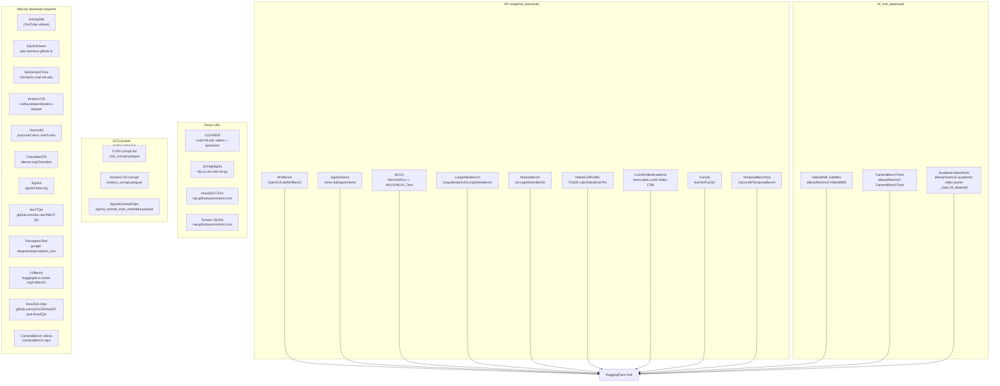

<!-- source: DeepWiki mcp.deepwiki.com · repo allenai/molmo2 · extra page Video Datasets · fetched 2026-10-26 -->

# Video Datasets

<details>
<summary>Relevant source files</summary>

The following files were used as context for generating this wiki page:

- [olmo/data/academic_video_datasets.py](olmo/data/academic_video_datasets.py)

</details>


This page documents the academic video dataset classes defined in [olmo/data/academic_video_datasets.py](), which provide training and evaluation data for video understanding tasks in Molmo2. These datasets supply the `video` field that flows through the preprocessing pipeline described in [5.1](#5.1).

For video **tracking** datasets (MeViS, RefYoutubeVOS, Burst, etc.) see [5.3.4](#5.3.4). For image-only datasets see [5.3.1](#5.3.1). For the `get_dataset_by_name` factory and how datasets are assembled into mixtures see [5.3](#5.3).

---

## Storage Layout

All video datasets share two root path constants imported from `olmo.data.dataset`:

| Constant | Used For |
|---|---|
| `VIDEO_DATA_HOME` | Primary root for all downloaded video data |
| `VIDEO_DATA_HOME_RELEASE` | Alternate path for released data |
| `DATA_HOME` | Fallback root; `VIDEO_HOME = DATA_HOME/videos` if set |

Each dataset class hard-codes its subdirectory under `VIDEO_DATA_HOME`, for example `join(VIDEO_DATA_HOME, "MVBench")`.

Sources: [olmo/data/academic_video_datasets.py:32-32]()

---

## Base Interface

All dataset classes in this file subclass one of two base types:

- **`DatasetBase`**: Calls `load()` in `__init__`, stores result as `self.data`. Most datasets use this. `load()` returns a list of example dicts.
- **`Dataset`**: Simpler base; no automatic `load()` call. Used by `Tomato` and `VideoEvalProMC`.

Both require a `get(idx, rng)` method that returns a single example dict.

The canonical output formats are described below.

**Diagram: Base class hierarchy for video datasets**

```mermaid
classDiagram
    class DatasetBase {
        +load() list
        +get(idx, rng) dict
        +self.data list
        +self.split str
    }
    class Dataset {
        +get(idx, rng) dict
    }

    DatasetBase <|-- MVBench
    DatasetBase <|-- VideoMME
    DatasetBase <|-- EgoSchema
    DatasetBase <|-- MLVU
    DatasetBase <|-- LongVideoBench
    DatasetBase <|-- LVBench
    DatasetBase <|-- TemporalBenchQa
    DatasetBase <|-- MotionBench
    DatasetBase <|-- MotionBenchCaption
    DatasetBase <|-- LLaVAVideoAcademic
    DatasetBase <|-- AcademicVideoPoint
    DatasetBase <|-- ActivityNet
    DatasetBase <|-- COIN
    DatasetBase <|-- EpicKitchens
    DatasetBase <|-- MomentsInTime
    DatasetBase <|-- Kinetics710
    DatasetBase <|-- Youcook2
    DatasetBase <|-- PerceptionTest
    DatasetBase <|-- Ego4d
    DatasetBase <|-- Ego4dCachedClips
    DatasetBase <|-- NeXTQA
    DatasetBase <|-- CharadesSTA
    DatasetBase <|-- QVHighlights
    DatasetBase <|-- CameraBenchTrain
    DatasetBase <|-- CLEVRER
    DatasetBase <|-- FunQA
    DatasetBase <|-- How2QA
    Dataset <|-- Tomato
    Dataset <|-- VideoEvalProMC
```



Sources: [olmo/data/academic_video_datasets.py:32-33]()

---

## Output Formats

Datasets produce one of two dict structures from `get()`:

### Single-question format

Used by evaluation datasets. Each call to `get()` yields one question–answer pair directly.

```
{
  "video":    "/path/to/video.mp4",
  "question": "...",
  "answer":   "A",
  "style":    "video_eval_multiple_choice",
  "metadata": {"example_id": "...", ...}
}
```

### Multi-message format

Used by training datasets that group multiple Q&A pairs per video. `message_list` is a list of message dicts; optional `metadata` carries `clip_start_time` / `clip_end_time`.

```
{
  "video":        "/path/to/video.mp4",
  "message_list": [
      {"question": "...", "answer": "...", "style": "video_short_answer"},
      ...
  ],
  "metadata": {
      "clip_start_time": 12.5,
      "clip_end_time":   45.0
  }
}
```

The `flat=True` constructor parameter, available on most training datasets, forces each message into its own example (single-message `message_list`). `max_per_video` caps the group size when `flat=False`.

**Diagram: Output format routing by dataset class**

```mermaid
flowchart TD
    subgraph "Evaluation Datasets"
        E1["MVBench.get()"]
        E2["VideoMME.get()"]
        E3["EgoSchema.get()"]
        E4["MLVU.get()"]
        E5["LongVideoBench.get()"]
        E6["MotionBench.get()"]
        E7["TemporalBenchQa.get()"]
        E8["LVBench.get()"]
        E9["Tomato.get()"]
    end
    subgraph "Training Datasets"
        T1["ActivityNet.get()"]
        T2["EpicKitchens.get()"]
        T3["Youcook2.get()"]
        T4["COIN.get()"]
        T5["Kinetics710.get()"]
        T6["MomentsInTime.get()"]
        T7["LLaVAVideoAcademic.get()"]
        T8["Ego4d.get()"]
        T9["NeXTQA.get()"]
    end
    FMT_EVAL["single question dict\nvideo + question + answer + style + metadata"]
    FMT_TRAIN["multi-message dict\nvideo + message_list\n+ optional clip_start/end_time"]
    E1 & E2 & E3 & E4 & E5 & E6 & E7 & E8 & E9 --> FMT_EVAL
    T1 & T2 & T3 & T4 & T5 & T6 & T7 & T8 & T9 --> FMT_TRAIN
```



Sources: [olmo/data/academic_video_datasets.py:170-171](), [olmo/data/academic_video_datasets.py:824-825](), [olmo/data/academic_video_datasets.py:1338-1339](), [olmo/data/academic_video_datasets.py:1793-1797]()

---

## Style Tags

The `style` field in each example dict controls how `DataFormatter` constructs prompts. The following tags are used by video datasets:

| `style` value | Format type | Typical dataset |
|---|---|---|
| `video_eval_multiple_choice` | MC eval (A/B/C/D) | MVBench, VideoMME, EgoSchema, MLVU, LongVideoBench |
| `video_eval_multiple_choice_w_subtitle` | MC eval with subtitle text | LongVideoBench, VideoMME |
| `video_multiple_choice` | MC training (with `options` + `answer_idx`) | PerceptionTest, NeXTQA, CLEVRER, FunQA |
| `video_short_answer` | Open-ended short answer | TemporalBenchQa, ActivityNet QA, How2QA |
| `video_short_caption` | Captioning | Youcook2 |
| `video_motion_caption` | Motion-focused captioning | MotionBenchCaption |
| `video_clip_short_caption_start_end` | Caption with start/end timestamps | Youcook2 |
| `video_point_count` | Count points across video frames | AcademicVideoPoint |
| `activitynet_short_caption` | ActivityNet captioning | ActivityNet |
| `activitynet_label` | ActivityNet label QA | ActivityNet |
| `coin_label` | COIN action label | COIN |
| `epic_kitchens_short_caption` | EK narration as caption | EpicKitchens |
| `epic_kitchens_label` | EK narration as QA | EpicKitchens |
| `moments_in_time_label` | Action label | MomentsInTime |
| `kinetics_label` | Action label | Kinetics710 |
| `charades_sta` | Clip caption | CharadesSTA |
| `youcook2_label` | Cooking step label QA | Youcook2 |
| `ego4d_mq_label_clip` | MQ clip labeling | Ego4d |
| `ego4d_mq_label_start_end` | MQ segment labeling | Ego4d |
| `ego4d_mq_temporal_grounding` | MQ temporal grounding | Ego4d |
| `ego4d_nlq_temporal_grounding` | NLQ temporal grounding | Ego4d |

Sources: [olmo/data/academic_video_datasets.py:163-164](), [olmo/data/academic_video_datasets.py:590-591](), [olmo/data/academic_video_datasets.py:1718-1719]()

---

## Dataset Catalog

### Evaluation Benchmarks

These datasets are used primarily for evaluation. They return single-question dicts from `get()`.

| Class | HF / Source | Splits | MC / OE | Notes |
|---|---|---|---|---|
| `MVBench` | `OpenGVLab/MVBench` | `val` | MC | 20 task types; TVQA subset needs frame→video conversion |
| `VideoMME` | `lmms-lab/Video-MME` | `validation` | MC | Optional subtitle via `allenai/Molmo2-VideoMME` |
| `EgoSchema` | `lmms-lab/egoschema` | `validation`, `test` | MC | 5-option MC; test has no answers |
| `MLVU` | `MLVU/MVLU` + `MLVU/MLVU_Test` | `validation`, `test` | MC + Gen | Gated repo; requires `HF_ACCESS_TOKEN` |
| `LongVideoBench` | `longvideobench/LongVideoBench` | `validation`, `test` | MC | Optional subtitles; gated repo |
| `LVBench` | Manual | `test` | MC | Must be manually downloaded |
| `TemporalBenchQa` | `microsoft/TemporalBench` | `test` | OE or MC | `format="mc"` enables MC mode |
| `MotionBench` | `zai-org/MotionBench` | `validation`, `test` | OE | Uses `video_eval_multiple_choice` via `get()` |
| `VideoEvalProMC` | `TIGER-Lab/VideoEval-Pro` | `test` | MC | Videos merged from split tar.gz |
| `Tomato` | GitHub + Google Drive | `test` | MC | 6 reasoning types × 3 demonstration types |
| `CLEVRER` | `csail.mit.edu` | `train`, `validation`, `test` | OE + MC | Auto-downloads questions and video zips |
| `PerceptionTest` | Manual (Google DeepMind) | `train`, `validation`, `test` | MC | Test split has no answers |
| `NeXTQA` | Manual | `train`, `val`, `test` | MC | Also useful for training |
| `AcademicVideoPoint` | `allenai/molmo2-academic-video-points` | `train`, `val` | Count/Point | Video object counting across frames |

Sources: [olmo/data/academic_video_datasets.py:658-825](), [olmo/data/academic_video_datasets.py:1243-1339](), [olmo/data/academic_video_datasets.py:1537-1603](), [olmo/data/academic_video_datasets.py:879-1026](), [olmo/data/academic_video_datasets.py:1029-1149](), [olmo/data/academic_video_datasets.py:1152-1240](), [olmo/data/academic_video_datasets.py:174-248](), [olmo/data/academic_video_datasets.py:267-323](), [olmo/data/academic_video_datasets.py:828-876](), [olmo/data/academic_video_datasets.py:94-171](), [olmo/data/academic_video_datasets.py:4165-4247](), [olmo/data/academic_video_datasets.py:2875-3018](), [olmo/data/academic_video_datasets.py:3836-3970](), [olmo/data/academic_video_datasets.py:1364-1534]()

---

### Training Datasets

These datasets use the multi-message format and support `flat`, `max_per_video`, and often `qa_format` parameters.

| Class | Source | Splits | Task styles | Download |
|---|---|---|---|---|
| `ActivityNet` | Manual (YouTube) | `train`, `validation` | `activitynet_short_caption`, `activitynet_label`, `video_short_answer` | Manual; generates `missing_videos.json` |
| `EpicKitchens` | Manual | `train`, `validation` | `epic_kitchens_short_caption`, `epic_kitchens_label` | Manual; clip extraction via script |
| `COIN` | Manual | `train`, `test` | `coin_label` | Manual; clip extraction via script |
| `MomentsInTime` | Manual (MIT) | `train`, `validation` | `moments_in_time_label` | Manual; creates renamed symlinks |
| `Kinetics710` | Manual | `train`, `val` | `kinetics_label` | Manual; corrupt list from GCS |
| `Youcook2` | Manual | `train`, `validation`, `test` | `video_short_caption`, `youcook2_label`, `video_clip_short_caption_start_end` | Manual |
| `CharadesSTA` | Manual | `train` | `charades_sta` | Manual |
| `LLaVAVideoAcademic` | `lmms-lab/LLaVA-Video-178K` | `train` | `video_short_answer`, `video_multiple_choice` | HuggingFace snapshot |
| `MotionBenchCaption` | `zai-org/MotionBench` | `train` | `video_motion_caption` | HuggingFace snapshot |
| `QVHighlights` | UNC NLP server | `train`, `validation` | `video_short_answer` | Direct URL tar.gz |
| `Ego4d` | Manual (ego4d-data.org) | `train`, `val`, `test` | `ego4d_mq_label_clip`, `ego4d_mq_label_start_end`, `ego4d_mq_temporal_grounding`, `ego4d_nlq_temporal_grounding` | Manual; clip extraction script |
| `Ego4dCachedClips` | GCS + Manual clips | `train` | same as `Ego4d` | Metadata parquet from GCS |
| `FunQA` | `fesvhtr/FunQA` | `train`, `val`, `test` | `video_short_answer`, `video_multiple_choice` | HuggingFace |
| `How2QA` | GitHub CSV + Manual clips | `train`, `val` | `video_multiple_choice` | CSV auto-downloaded; clips manual |
| `CameraBenchTrain` | `allenai/Molmo2-CameraBenchTrain` | `train` | `video_multiple_choice` | HuggingFace |

Sources: [olmo/data/academic_video_datasets.py:1606-1802](), [olmo/data/academic_video_datasets.py:2005-2221](), [olmo/data/academic_video_datasets.py:1805-2002](), [olmo/data/academic_video_datasets.py:2224-2392](), [olmo/data/academic_video_datasets.py:2395-2645](), [olmo/data/academic_video_datasets.py:2648-2872](), [olmo/data/academic_video_datasets.py:3973-4103](), [olmo/data/academic_video_datasets.py:469-655](), [olmo/data/academic_video_datasets.py:326-358](), [olmo/data/academic_video_datasets.py:361-466](), [olmo/data/academic_video_datasets.py:3021-3678](), [olmo/data/academic_video_datasets.py:3681-3833](), [olmo/data/academic_video_datasets.py:4250-4380](), [olmo/data/academic_video_datasets.py:4383-4451](), [olmo/data/academic_video_datasets.py:4107-4162]()

---

## Download Mechanisms

**Diagram: Download paths by dataset class**



Sources: [olmo/data/academic_video_datasets.py:74-85](), [olmo/data/academic_video_datasets.py:540-551](), [olmo/data/academic_video_datasets.py:730-748](), [olmo/data/academic_video_datasets.py:1039-1058](), [olmo/data/academic_video_datasets.py:1249-1277](), [olmo/data/academic_video_datasets.py:1373-1375](), [olmo/data/academic_video_datasets.py:1622-1650](), [olmo/data/academic_video_datasets.py:2031-2081]()

---

## Constructor Parameters

Most training dataset classes share a common set of optional parameters that control the output format:

| Parameter | Type | Default | Effect |
|---|---|---|---|
| `flat` | `bool` | `False` | Each message becomes its own example with a single-item `message_list` |
| `max_per_video` | `int` | `None` | Split grouped messages into chunks of at most N (only when `flat=False`) |
| `qa_format` | `bool` | `False` | Replace caption `style` with a question template + label as answer |
| `task` | `str` | varies | Select task subset (e.g., `"captioning"`, `"qa"`, `"all"` for ActivityNet) |

The `qa_format=True` option transforms captioning-style examples like:
```
{"text": "running", "style": "kinetics_label"}
```
into:
```
{"question": "What action is being performed?", "answer": "running", "style": "kinetics_label"}
```

Sources: [olmo/data/academic_video_datasets.py:2083-2096](), [olmo/data/academic_video_datasets.py:1652-1667](), [olmo/data/academic_video_datasets.py:2309-2321](), [olmo/data/academic_video_datasets.py:2485-2497]()

---

## Clip Metadata and Temporal Segmentation

Several datasets annotate specific time segments within full-length videos. The `metadata` dict carries `clip_start_time` and `clip_end_time` (in seconds) that are passed to the video decoder to extract the relevant segment:

```
{
  "video":    "/path/to/full_video.mp4",
  "message_list": [...],
  "metadata": {
      "clip_start_time": 12.5,
      "clip_end_time":   34.0
  }
}
```

Datasets that use temporal clipping:

| Dataset | Clipping strategy |
|---|---|
| `ActivityNet` | Per-annotation start/end from `activity_net.v1-3.min.json` |
| `COIN` | Per-segment start/end; pre-extracted clips via `scripts/extract_coin_clips.py` |
| `EpicKitchens` | Per-narration timestamps; pre-extracted clips in `epic-kitchens-clips/` |
| `Youcook2` | Per-sentence start/end from `youcookii_annotations_trainval.json` |
| `CharadesSTA` | Per-caption start/end from `charades_sta_train.txt` |
| `Ego4d` | Computed segments of `video_segment_length` (default 180s) containing the moment |
| `AcademicVideoPoint` | `clip_start_time`/`clip_end_time` stored in HF dataset rows |

Sources: [olmo/data/academic_video_datasets.py:1727-1735](), [olmo/data/academic_video_datasets.py:1963-1974](), [olmo/data/academic_video_datasets.py:2107-2122](), [olmo/data/academic_video_datasets.py:2808-2823](), [olmo/data/academic_video_datasets.py:3358-3371](), [olmo/data/academic_video_datasets.py:1447-1473]()

---

## Frame-to-Video Conversion

Two helper functions in this file synthesize MP4 files from image frame directories:

- **`_create_video_from_frame_range(frames_dir, start_frame, end_frame, fps, pad_frames)`** [olmo/data/academic_video_datasets.py:43-71]() — creates `video_{start:05d}_{end:05d}.mp4` from numbered JPEG frames.
- **`MVBench.create_video_from_frames(frames_dir, fps, pad_frames)`** [olmo/data/academic_video_datasets.py:686-727]() — creates `video.mp4` from all frames in a directory sorted by name.

Both pad frames to multiples of 16 pixels (required by H.264/libx264) and write via `imageio.v3.imwrite` with `codec='libx264'`.

`MVBench.download()` calls `create_video_from_frames` for the "Episodic Reasoning" subset, which ships as JPEG frame sequences from TVQA [olmo/data/academic_video_datasets.py:753-763]().

---

## AcademicVideoPoint

`AcademicVideoPoint` [olmo/data/academic_video_datasets.py:1364-1534]() deserves special attention because it bridges video datasets and the pointing/counting tasks central to Molmo2.

It loads from `allenai/molmo2-academic-video-points` on HuggingFace. Each row represents one tracked object category across a video segment with per-frame point annotations.

Key constructor arguments:

| Parameter | Effect |
|---|---|
| `subset` | Filter by tracking dataset source (`"lvvis"`, `"ovis"`, `"burst"`, `"refdavis17"`, `"mevis"`, `"refyoutube"`, or `"all"`) |
| `mode` | Style tag to apply: `"point_count"`, `"count"`, or a list to sample from |
| `flat` | One object category per example |
| `max_points` | Skip examples with more than N total tracked points |
| `max_seconds` | Skip or clip examples whose annotation spans exceed N seconds |
| `fps` | Frame sampling rate for point timestamps |
| `use_clips_from_metadata` | Use pre-computed clip boundaries from the HF dataset |

Video paths are resolved via `_make_video_path(subset, split, video_name)` [olmo/data/academic_video_datasets.py:1353-1361]() which maps subset names to subdirectories under `VIDEO_DATA_HOME`.

Sources: [olmo/data/academic_video_datasets.py:1342-1362](), [olmo/data/academic_video_datasets.py:1376-1400]()

---

## Ego4d and Ego4dCachedClips

`Ego4d` [olmo/data/academic_video_datasets.py:3021-3678]() supports four task types:

| Task (`task=`) | Description |
|---|---|
| `mq_label_clip` | Given a short clip, output the activity label |
| `mq_label_start_end` | Given a video segment and timestamps, output the label |
| `mq_temporal_grounding` | Given a label, localize all occurrences |
| `nlq_temporal_grounding` | Given a natural language query, localize the answer |

Because Ego4d videos are hours long, `video_segment_length` (default 180s) bounds the clip duration. Clips are pre-extracted using `scripts/extract_ego4d_clips.py` and stored as `{video_uid}_{start:.3f}_{end:.3f}_custom_clip.mp4` in `ego4d-clips/`.

`Ego4dCachedClips` [olmo/data/academic_video_datasets.py:3681-3833]() skips the on-the-fly annotation processing entirely, loading from a pre-built `ego4d_cached_train_metadata.parquet` (auto-downloaded from GCS) and mapping clip filenames directly to `ego4d-clips/`.

Sources: [olmo/data/academic_video_datasets.py:3283-3337](), [olmo/data/academic_video_datasets.py:3804-3830]()

---

## Datasets Requiring Pre-Processing Scripts

Several large datasets require running extraction scripts before they can be used:

| Dataset | Script | What it does |
|---|---|---|
| `COIN` | `scripts/extract_coin_clips.py` | Extracts annotated segments from full COIN videos via ffmpeg |
| `EpicKitchens` | `scripts/extract_epic_kitchens_clips.py` | Extracts narration-aligned clips from full EK videos |
| `Ego4d` | `scripts/extract_ego4d_clips.py` | Extracts NLQ/MQ clips from full Ego4d videos |

`MomentsInTime.download()` creates sequential symlinks (`{split}-videos-renamed/`) from original video files to avoid special-character filenames that break GCS-backed storage [olmo/data/academic_video_datasets.py:2248-2307]().

`ActivityNet.download()` scans for missing YouTube videos and writes a `missing_videos.json` cache so `load()` does not perform per-file existence checks during distributed training [olmo/data/academic_video_datasets.py:1636-1650]().

`Kinetics710.download()` scans the video directories and writes `kinetics_existing_videos.json` for the same reason [olmo/data/academic_video_datasets.py:2452-2483]().

Sources: [olmo/data/academic_video_datasets.py:1860-1872](), [olmo/data/academic_video_datasets.py:2064-2080](), [olmo/data/academic_video_datasets.py:3251-3278]()

---

## LLaVAVideoAcademic

`LLaVAVideoAcademic` [olmo/data/academic_video_datasets.py:469-655]() wraps the `lmms-lab/LLaVA-Video-178K` dataset's academic QA subsets only (ActivityNet QA, NeXTQA, PerceptionTest across duration bins: 0–30s, 30–60s, 1–2m, 2–3m). It is training-only (`split="train"`).

The `data_subset_config` class attribute [olmo/data/academic_video_datasets.py:472-539]() hard-codes the mapping of config names to glob patterns for JSON files within the snapshot, because the HuggingFace README contains an error in the ActivityNet configuration.

Sources: [olmo/data/academic_video_datasets.py:469-541](), [olmo/data/academic_video_datasets.py:572-655]()

---

