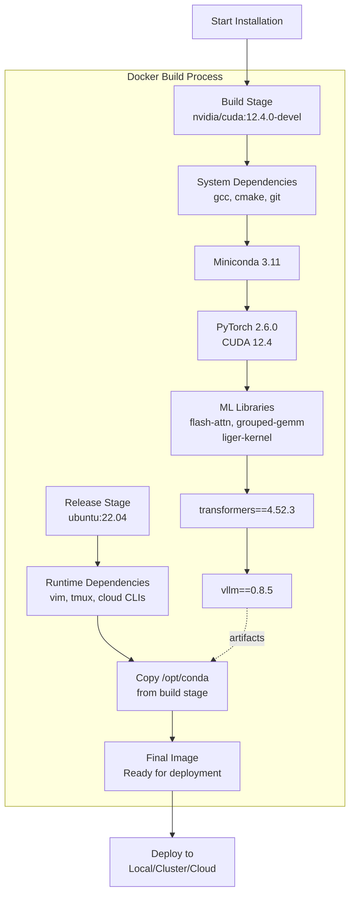
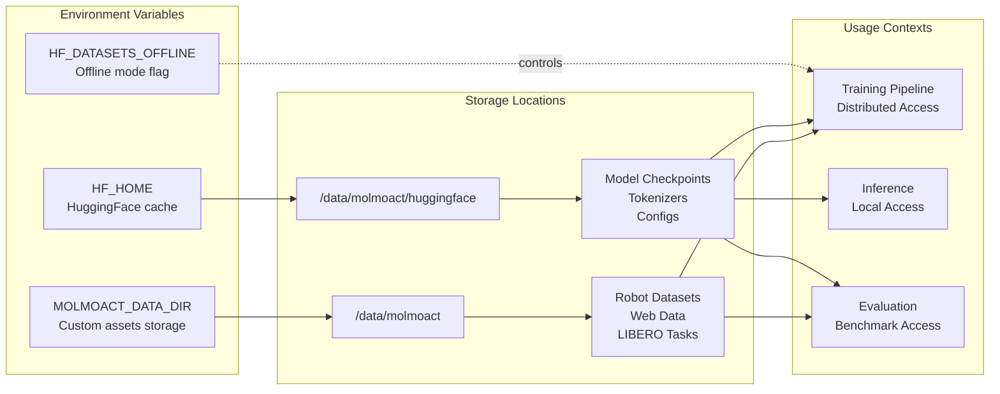
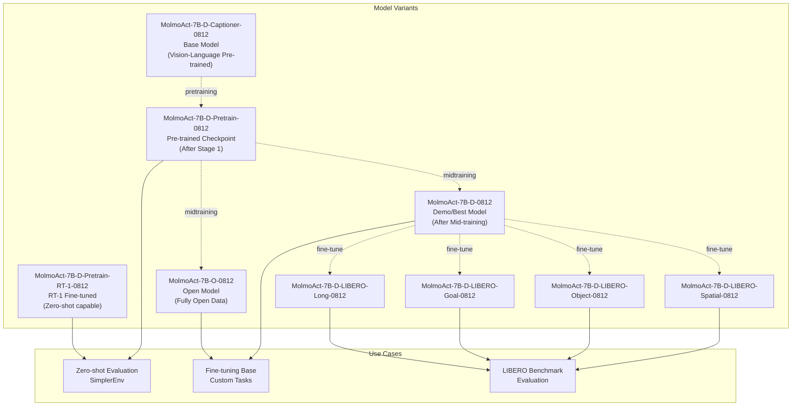
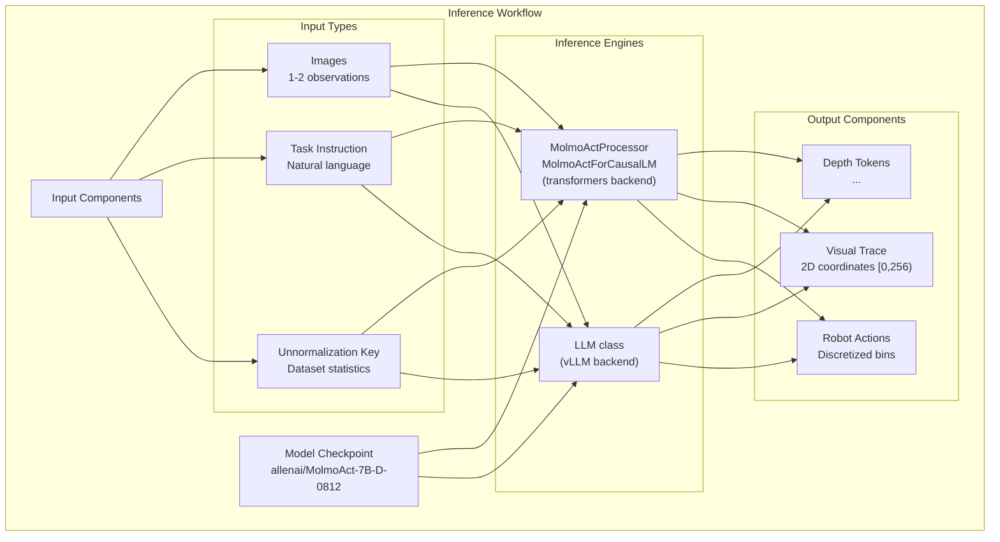
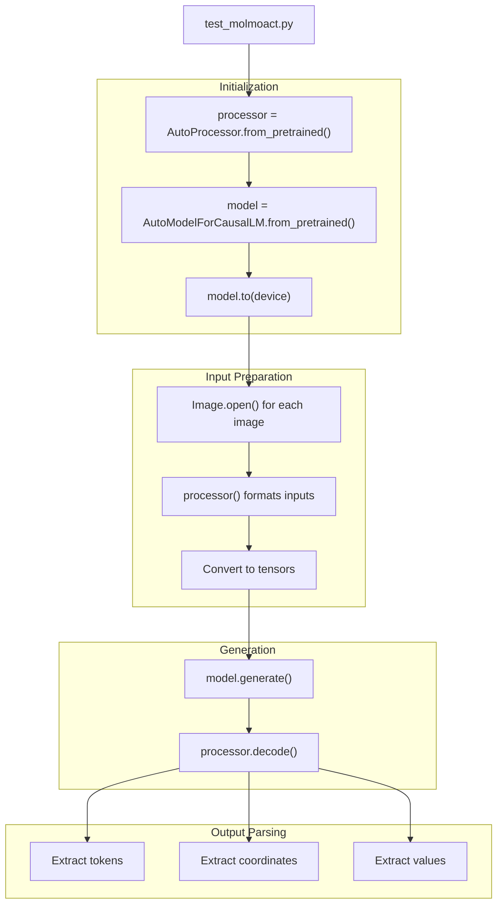
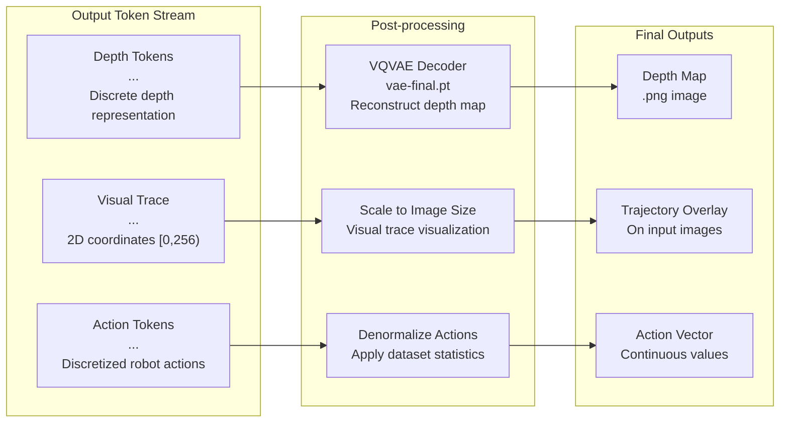

<!-- source: DeepWiki mcp.deepwiki.com · repo allenai/molmoact · page 1.1 Getting Started · fetched 2026-10-26 -->

# Getting Started

<details>
<summary>Relevant source files</summary>

The following files were used as context for generating this wiki page:

- [.dockerignore](.dockerignore)
- [Dockerfile](Dockerfile)
- [README.md](README.md)

</details>


This page guides you through installing MolmoAct, configuring your environment, and running your first inference. It covers basic setup and simple inference workflows using pre-trained checkpoints from HuggingFace Hub.

For training your own models, see [Training Pipeline](#2). For evaluation on benchmarks, see [Evaluation Pipelines](#5). For detailed data management, see [Data Management System](#3).

---

## Installation Options

MolmoAct supports two installation approaches: Docker-based deployment (recommended for training) and local installation (suitable for inference).

### Docker Installation (Recommended)

The Docker environment includes all dependencies pre-configured for multi-node GPU training and evaluation.



**Build the Docker image:**

```bash
docker build -t molmoact:latest .
```

**Run a container:**

```bash
docker run --gpus all -it \
  -v /path/to/data:/data \
  -v /path/to/checkpoints:/checkpoints \
  molmoact:latest
```

**Sources:** [Dockerfile:1-178](), [README.md:95-107]()

---

### Local Installation

For inference-only workflows or development without Docker:

**Prerequisites:**
- Python 3.11
- CUDA 12.4 compatible GPU (Ampere or Hopper architecture)
- PyTorch 2.6.0 or compatible version

**Installation steps:**

```bash
# Clone the repository
git clone https://github.com/allenai/molmoact.git
cd molmoact

# Install PyTorch for your system
# See https://pytorch.org for platform-specific instructions

# Install MolmoAct package
pip install -e .[all]
```

**Minimal inference environment** (without training dependencies):

```bash
pip install einops torchvision accelerate vllm==0.8.5 transformers==4.52
```

**Sources:** [README.md:95-107](), [README.md:244-250]()

---

## Environment Configuration

MolmoAct uses environment variables to manage data storage and caching behavior.



**Required environment variables:**

| Variable | Purpose | Example Value |
|----------|---------|---------------|
| `MOLMOACT_DATA_DIR` | Root directory for custom assets | `/data/molmoact` |
| `HF_HOME` | HuggingFace cache location | `/data/molmoact/huggingface` |
| `HF_DATASETS_OFFLINE` | Prevent HF API calls during training (optional) | `1` |

**Setup commands:**

```bash
export MOLMOACT_DATA_DIR=/data/molmoact
export HF_HOME=/data/molmoact/huggingface

# Optional: Enable offline mode to prevent rate limiting
export HF_DATASETS_OFFLINE=1
```

**Why these matter:**
- `HF_HOME` prevents repeated downloads across nodes in distributed training
- `HF_DATASETS_OFFLINE=1` avoids rate limiting when multiple nodes initialize simultaneously
- `MOLMOACT_DATA_DIR` stores assets not managed by HuggingFace (depth models, VQVAE checkpoints)

**Sources:** [README.md:268-278](), [README.md:320-327]()

---

## Model Checkpoints and Selection

MolmoAct provides several checkpoint variants for different use cases. All checkpoints are available on HuggingFace Hub.



**Checkpoint selection guide:**

| Checkpoint | HuggingFace ID | Use Case |
|-----------|----------------|----------|
| **MolmoAct-7B-D** | `allenai/MolmoAct-7B-D-0812` | Starting point for fine-tuning on custom robot tasks (best performance) |
| **MolmoAct-7B-O** | `allenai/MolmoAct-7B-O-0812` | Starting point for fine-tuning with fully open training data |
| **MolmoAct-7B-D-Pretrain** | `allenai/MolmoAct-7B-D-Pretrain-0812` | Zero-shot evaluation on SimplerEnv (Google Robot tasks) |
| **MolmoAct-7B-D-Pretrain-RT-1** | `allenai/MolmoAct-7B-D-Pretrain-RT-1-0812` | RT-1 dataset fine-tuned for SimplerEnv evaluation |
| **LIBERO variants** | `allenai/MolmoAct-7B-D-LIBERO-*-0812` | Task-specific LIBERO benchmark evaluation |

**Automatic download:** Checkpoints download automatically when referenced by their HuggingFace ID in inference scripts.

**Sources:** [README.md:76-92](), [README.md:86-92]()

---

## Running Your First Inference

MolmoAct supports two inference backends: HuggingFace Transformers (standard) and vLLM (optimized for throughput).

### Inference Architecture



---

### HuggingFace Transformers Backend

The standard inference path uses `transformers` library classes.

**Key classes and their roles:**

| Class/Function | Location | Purpose |
|---------------|----------|---------|
| `MolmoActProcessor` | [olmo/hf_model/molmoact/processing_molmoact.py]() | Image preprocessing and prompt formatting |
| `MolmoActForCausalLM` | [olmo/hf_model/molmoact/modeling_molmoact.py]() | Main model inference class |
| `AutoProcessor`, `AutoModelForCausalLM` | transformers library | HuggingFace loading utilities |

**Example inference script:**

```bash
python3 olmo/hf_model/molmoact/test_molmoact.py \
    --checkpoint_dir allenai/MolmoAct-7B-D-0812 \
    --images /path/to/image1.jpg /path/to/image2.jpg \
    --instruction "pick up the red cube" \
    --unnorm_key allenai/MolmoAct-Dataset/home-primary
```

**Script breakdown:**



**Command-line arguments:**

| Argument | Required | Description | Example |
|----------|----------|-------------|---------|
| `--checkpoint_dir` | Yes | HuggingFace model ID or local path | `allenai/MolmoAct-7B-D-0812` |
| `--images` | Yes | Paths to 1-2 observation images | `/path/to/img1.jpg /path/to/img2.jpg` |
| `--instruction` | Yes | Natural language task description | `"pick up the red cube"` |
| `--unnorm_key` | Yes | Dataset statistics key for action denormalization | `allenai/MolmoAct-Dataset/home-primary` |

**Sources:** [README.md:203-233](), [olmo/hf_model/molmoact/test_molmoact.py]()

---

### vLLM Backend

vLLM provides optimized inference with higher throughput for batch processing.

**Key components:**

| Component | Location | Purpose |
|-----------|----------|---------|
| `LLM` class | vllm library | Optimized model serving |
| `SamplingParams` | vllm library | Generation configuration |
| MolmoAct vLLM config | [olmo/vllm/molmoact/]() | Custom vLLM integration |

**Example inference script:**

```bash
python3 -m olmo.vllm.molmoact.test_molmoact \
    --checkpoint_dir allenai/MolmoAct-7B-D-0812 \
    --images /path/to/image1.jpg /path/to/image2.jpg \
    --instruction "pick up the red cube" \
    --unnorm_key allenai/MolmoAct-Dataset/home-primary
```

**Additional environment configuration for vLLM:**

```bash
# Required for proper multiprocessing
export VLLM_WORKER_MULTIPROC_METHOD=spawn
```

**Performance comparison:**

| Backend | Throughput | Memory Usage | Use Case |
|---------|-----------|--------------|----------|
| HuggingFace Transformers | Standard | Standard | Development, single inference, debugging |
| vLLM | 2-3x higher | Optimized | Batch evaluation, production deployment |

**Sources:** [README.md:234-242](), [README.md:486](), [olmo/vllm/molmoact/test_molmoact.py]()

---

## Understanding Model Outputs

MolmoAct generates three types of outputs during inference:



### Depth Tokens

Depth tokens represent a discretized depth map predicted by the model.

**Format:** `<DEPTH_START><DEPTH_1><DEPTH_2>...<DEPTH_N><DEPTH_END>`

**Reconstruction:** Use the VQVAE decoder to convert tokens back to depth images:

```bash
python3 scripts/reconstruct_from_tokens.py \
    --ckpt_path /path/to/vae-final.pt \
    --depth_tokens "<DEPTH_START><DEPTH_1>...<DEPTH_END>" \
    --output_path /path/to/depth.png
```

**Download VQVAE checkpoint:**

```bash
wget https://huggingface.co/allenai/MolmoAct-7B-D-0812/resolve/main/vae-final.pt
```

---

### Visual Trace

Visual trace consists of 2D coordinates representing the predicted trajectory.

**Format:** `<TRACE_START><TRACE_X1><TRACE_Y1><TRACE_X2><TRACE_Y2>...<TRACE_END>`

**Coordinate space:** Integer values in range `[0, 256)`

**Visualization:** Scale coordinates proportionally to the actual image dimensions:

```python
# Example scaling for a 512x512 image
scaled_x = (trace_x / 256.0) * 512
scaled_y = (trace_y / 256.0) * 512
```

---

### Robot Actions

Actions are discretized into 256 bins during training and must be denormalized during inference.

**Format:** `<ACTION_START><ACTION_0><ACTION_1>...<ACTION_N><ACTION_END>`

**Denormalization:** Requires dataset statistics specified by `--unnorm_key`:

| Unnorm Key | Dataset | Use Case |
|-----------|---------|----------|
| `allenai/MolmoAct-Dataset/home-primary` | Home environment tasks | Standard mid-trained model |
| `allenai/MolmoAct-Dataset/table-primary` | Tabletop tasks | Tabletop manipulation |
| Custom key | Your custom dataset | After fine-tuning on your data |

**Action chunk size:** By default, MolmoAct predicts 8 action steps per inference call.

**Sources:** [README.md:253-263](), [scripts/reconstruct_from_tokens.py]()

---

## Quick Start Checklist

**Environment Setup:**
- [ ] Set `MOLMOACT_DATA_DIR` environment variable
- [ ] Set `HF_HOME` environment variable
- [ ] Install PyTorch 2.6.0 with CUDA 12.4 support
- [ ] Install MolmoAct package: `pip install -e .[all]`

**For vLLM inference:**
- [ ] Install vLLM: `pip install vllm==0.8.5`
- [ ] Set `VLLM_WORKER_MULTIPROC_METHOD=spawn`

**For visualization:**
- [ ] Download VQVAE checkpoint: `vae-final.pt`
- [ ] Download Depth-Anything-V2 checkpoint (if processing new data)

**First inference:**
- [ ] Choose appropriate checkpoint for your use case
- [ ] Prepare 1-2 observation images
- [ ] Write task instruction in natural language
- [ ] Identify correct `unnorm_key` for action denormalization
- [ ] Run inference script ([HuggingFace](#huggingface-transformers-backend) or [vLLM](#vllm-backend))

**Next steps:**
- For fine-tuning on custom data: see [Post-training and Task-Specific Fine-tuning](#2.3)
- For evaluation on benchmarks: see [Evaluation Pipelines](#5)
- For understanding data formats: see [Data Management System](#3)

**Sources:** [README.md:95-250]()

---

## Common Issues and Solutions

| Issue | Cause | Solution |
|-------|-------|----------|
| OOM during inference | High-resolution crops enabled | Models are trained without high-res crops; use standard resolution |
| Rate limiting from HuggingFace | Multiple nodes downloading simultaneously | Set `HF_DATASETS_OFFLINE=1` after initial download |
| vLLM worker spawn errors | Incorrect multiprocessing method | Set `VLLM_WORKER_MULTIPROC_METHOD=spawn` |
| Missing depth checkpoint | VQVAE not downloaded | Download from HuggingFace model hub |
| Wrong action range | Incorrect unnorm_key | Match unnorm_key to the dataset used for training/fine-tuning |

**Sources:** [README.md:371](), [README.md:486]()

---

