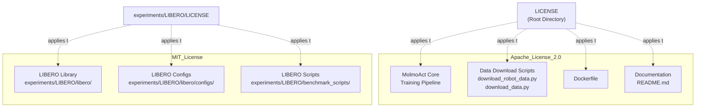
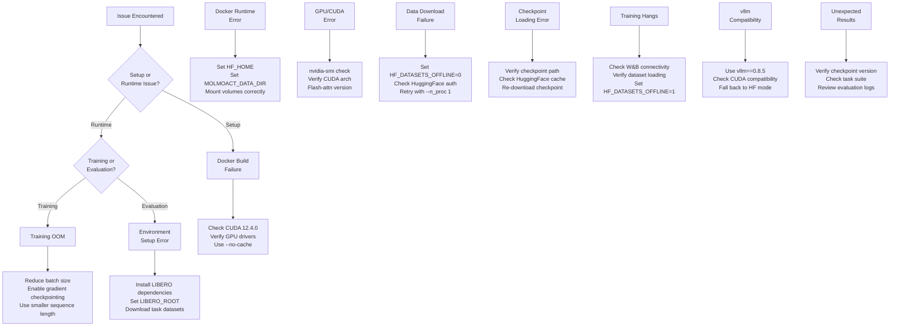
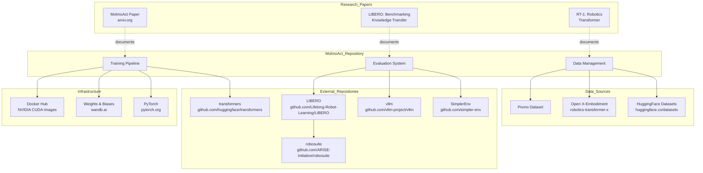

<!-- source: DeepWiki mcp.deepwiki.com · repo allenai/molmoact · page 10 Appendix · fetched 2026-10-26 -->

# Appendix

<details>
<summary>Relevant source files</summary>

The following files were used as context for generating this wiki page:

- [LICENSE](LICENSE)
- [experiments/LIBERO/LICENSE](experiments/LIBERO/LICENSE)

</details>


## Purpose and Scope

This appendix provides supplementary reference material for the MolmoAct repository. It includes licensing information for the codebase, common troubleshooting procedures for setup and execution issues, and references to external resources. For information about specific systems, refer to their dedicated pages: training pipeline ([#2](#2)), data management ([#3](#3)), LIBERO framework ([#6](#6)), and infrastructure ([#8](#8)).

---

## License Information

The MolmoAct repository contains components under two different open-source licenses. Understanding the licensing structure is important for redistribution and derivative works.

### License Coverage by Component



**Sources**: [LICENSE:1-201](), [experiments/LIBERO/LICENSE:1-22]()

### Apache License 2.0 (Main Repository)

The core MolmoAct training system, data management scripts, Docker environment, and documentation are licensed under Apache License 2.0. This license permits:

**Permissions**:
- Commercial use
- Distribution
- Modification
- Patent use
- Private use

**Conditions**:
- License and copyright notice must be included with distributions ([LICENSE:94-95]())
- State changes made to files ([LICENSE:97-98]())
- Retain copyright, patent, trademark, and attribution notices ([LICENSE:100-104]())

**Limitations**:
- No trademark use ([LICENSE:138-141]())
- No warranty provided ([LICENSE:143-151]())
- No liability assumed by contributors ([LICENSE:153-163]())

The full license text is available at [LICENSE:1-201](). Key sections:

| Section | Purpose | Line Reference |
|---------|---------|----------------|
| Grant of Copyright License | Reproduction, derivative works, distribution rights | [LICENSE:66-71]() |
| Grant of Patent License | Patent rights for contributions | [LICENSE:73-87]() |
| Redistribution Terms | Requirements for distributing copies | [LICENSE:89-128]() |
| Submission of Contributions | Terms for contributor submissions | [LICENSE:130-136]() |

**Sources**: [LICENSE:1-201]()

### MIT License (LIBERO Component)

The LIBERO benchmark framework located in `experiments/LIBERO/` is licensed under MIT License. This includes:
- LIBERO library code (`experiments/LIBERO/libero/`)
- Configuration files (`experiments/LIBERO/libero/configs/`)
- Benchmark scripts (`experiments/LIBERO/benchmark_scripts/`)

**Permissions**:
- Use, copy, modify, merge, publish, distribute, sublicense, and sell copies ([experiments/LIBERO/LICENSE:7-9]())
- No restrictions other than copyright notice inclusion ([experiments/LIBERO/LICENSE:10-11]())

**Conditions**:
- Copyright notice and permission notice must be included in all copies or substantial portions ([experiments/LIBERO/LICENSE:10-11]())

**Limitations**:
- No warranty of any kind ([experiments/LIBERO/LICENSE:15-17]())
- No liability for claims or damages ([experiments/LIBERO/LICENSE:18-20]())

The copyright holder is "Lifelong Robot Learning" (2023). Full license text is at [experiments/LIBERO/LICENSE:1-22]().

**Sources**: [experiments/LIBERO/LICENSE:1-22]()

---

## Troubleshooting Guide

This section provides solutions to common issues encountered during setup, training, and evaluation.

### Issue Resolution Flowchart



**Sources**: README.md, Dockerfile, experiments/LIBERO/README.md

### Docker and Environment Setup Issues

#### Docker Build Failures

**Symptom**: Build fails during CUDA or PyTorch installation

**Common Causes**:
- CUDA version mismatch with host drivers
- Insufficient build resources
- Network timeouts during package downloads

**Solutions**:
```bash
# Verify NVIDIA driver version (requires 550+ for CUDA 12.4)
nvidia-smi

# Build with increased resources and no cache
docker build --no-cache --build-arg MAX_JOBS=16 -t molmoact .

# If CUDA issues persist, verify base image compatibility
# Dockerfile uses cuda:12.4.0-devel-ubuntu22.04
```

Referenced in [Dockerfile:1-10]() (base image), [Dockerfile:50-70]() (CUDA setup).

#### Docker Runtime Errors

**Symptom**: Container starts but training scripts fail with import errors

**Common Causes**:
- Missing environment variables
- Volume mounts not configured
- HuggingFace cache not accessible

**Solutions**:
```bash
# Set required environment variables
export HF_HOME=/path/to/hf_cache
export MOLMOACT_DATA_DIR=/path/to/data

# Run with proper volume mounts
docker run --gpus all \
  -v $HF_HOME:/root/.cache/huggingface \
  -v $MOLMOACT_DATA_DIR:/data \
  molmoact bash
```

**Sources**: README.md, Dockerfile

### GPU and CUDA Issues

#### Out of Memory (OOM) Errors

**Symptom**: CUDA OOM during training or evaluation

**Solutions**:

| Issue | Solution | Configuration |
|-------|----------|---------------|
| Training OOM | Reduce batch size | `--batch_size 16` → `--batch_size 8` |
| Evaluation OOM | Reduce max sequence length | `--max_model_len 2048` → `--max_model_len 1024` |
| vllm OOM | Reduce GPU memory utilization | `--gpu_memory_utilization 0.9` → `--gpu_memory_utilization 0.7` |
| Multi-GPU OOM | Adjust tensor parallelism | `--tensor_parallel_size 1` → `--tensor_parallel_size 2` |

For LIBERO training, modify [experiments/LIBERO/libero/configs/train/default.yaml]() batch size parameter.

#### CUDA Architecture Mismatch

**Symptom**: Flash attention or other kernels fail to load

**Diagnosis**:
```bash
# Check GPU compute capability
nvidia-smi --query-gpu=compute_cap --format=csv

# Verify flash-attn installation
python -c "import flash_attn; print(flash_attn.__version__)"
```

**Solutions**:
- Dockerfile targets CUDA architectures 8.0 (Ampere) and 9.0 (Hopper): [Dockerfile:40-45]()
- For older GPUs (7.x), rebuild flash-attn from source without arch restrictions
- For A100 (8.0) or H100 (9.0), use pre-built wheels

**Sources**: Dockerfile, README.md

### Data Download Issues

#### HuggingFace Rate Limiting

**Symptom**: `429 Too Many Requests` errors during data download

**Solution**:
```bash
# Set offline mode during distributed training
export HF_DATASETS_OFFLINE=1

# For initial downloads, ensure authenticated
huggingface-cli login

# Use sequential processing to avoid rate limits
python data/download_robot_data.py --stage pretrain --n_proc 1
```

Referenced in README.md data download section.

#### Incomplete Downloads

**Symptom**: Data download stops partway through or shows corrupted files

**Solutions**:
1. Download scripts support resumption - simply re-run the command
2. Verify checksums after download:
```bash
cd experiments/LIBERO/benchmark_scripts
python shasum_files.py --dataset_dir /path/to/datasets
```
3. For large datasets like Pixmo, downloads may take 24+ hours - use persistent sessions

**Sources**: data/download_robot_data.py, data/download_data.py, experiments/LIBERO/benchmark_scripts/shasum_files.py

### Training Issues

#### Training Hangs at Initialization

**Symptom**: Training starts but hangs during dataset loading or first step

**Common Causes**:
- Weights & Biases connectivity issues
- Dataset streaming failures
- Distributed training initialization deadlock

**Solutions**:
```bash
# Disable W&B for testing
export WANDB_MODE=disabled

# Set offline mode for datasets
export HF_DATASETS_OFFLINE=1

# For distributed training, verify all nodes can communicate
# Check MASTER_ADDR and MASTER_PORT are accessible
```

#### Checkpoint Loading Errors

**Symptom**: `KeyError` or `RuntimeError` when loading checkpoints

**Common Causes**:
- Incorrect checkpoint path
- Model architecture mismatch
- Incomplete checkpoint download

**Solutions**:
1. Verify checkpoint exists in HuggingFace cache:
```bash
ls -lh $HF_HOME/hub/models--allenai--MolmoAct-7B-D
```
2. Clear cache and re-download if corrupted
3. For LIBERO fine-tuned models, ensure base checkpoint is loaded first

**Sources**: README.md (model checkpoint section)

### Evaluation Issues

#### LIBERO Environment Setup Errors

**Symptom**: `ModuleNotFoundError` or environment initialization failures

**Solutions**:
```bash
# Install LIBERO dependencies
cd experiments/LIBERO
pip install -e .

# Set LIBERO_ROOT environment variable
export LIBERO_ROOT=/path/to/molmoact/experiments/LIBERO

# Download task datasets
cd benchmark_scripts
python download_libero_datasets.py --dataset_dir /path/to/datasets
```

Referenced in [experiments/LIBERO/README.md]().

#### vllm Compatibility Issues

**Symptom**: vllm fails to load model or produces incorrect outputs

**Solutions**:
- Ensure vllm version is exactly 0.8.5: `pip install vllm==0.8.5`
- For compatibility issues, fall back to HuggingFace-only evaluation mode
- Check CUDA version matches vllm requirements (12.1+)

Referenced in evaluation scripts using vllm engine.

#### Unexpected Evaluation Results

**Symptom**: Success rates significantly lower than reported

**Checklist**:
1. Verify correct checkpoint is loaded (Pretrain vs Midtrain vs task-specific)
2. Check task suite matches checkpoint training (Spatial, Object, Goal, Long)
3. Review evaluation configuration in [experiments/LIBERO/libero/configs/eval/default.yaml]()
4. Ensure proper number of evaluation episodes (typically 50 per task)
5. Check for deterministic evaluation settings if reproducing results

**Sources**: experiments/LIBERO/README.md, experiments/LIBERO/libero/configs/

---

## Additional Resources

### External Dependencies and Resources



**Sources**: README.md, Dockerfile, experiments/LIBERO/README.md

### Key External Repositories

#### SimplerEnv
- **Purpose**: Simulated environments for robot manipulation benchmarks
- **URL**: https://github.com/simpler-env/SimplerEnv
- **Integration**: Used for Google Robot task evaluation (pick_coke_can, move_near, drawer tasks)
- **Referenced in**: README.md evaluation section

#### Transformers (HuggingFace)
- **Purpose**: Provides base model implementations and utilities
- **URL**: https://github.com/huggingface/transformers
- **Version**: 4.52.3
- **Integration**: Core dependency for model loading and tokenization
- **Referenced in**: [Dockerfile:80-90]()

#### vllm
- **Purpose**: High-throughput LLM inference engine
- **URL**: https://github.com/vllm-project/vllm
- **Version**: 0.8.5 (required for compatibility)
- **Integration**: LIBERO evaluation with `run_libero_eval_vllm.py`
- **Referenced in**: [Dockerfile:95-100](), experiments/LIBERO/benchmark_scripts/

#### LIBERO (Original)
- **Purpose**: Lifelong Robot Learning benchmark
- **URL**: https://github.com/Lifelong-Robot-Learning/LIBERO
- **Integration**: Forked and integrated into `experiments/LIBERO/`
- **License**: MIT (separate from main repository)
- **Referenced in**: [experiments/LIBERO/LICENSE:1-22]()

#### robosuite
- **Purpose**: MuJoCo-based robot simulation framework
- **URL**: https://github.com/ARISE-Initiative/robosuite
- **Integration**: Underlying simulation engine for LIBERO tasks
- **Referenced in**: LIBERO dependency chain

### Data Source References

| Dataset | Source | Training Stage | Download Script |
|---------|--------|----------------|-----------------|
| Open X-Embodiment | HuggingFace | Pre-training | `download_robot_data.py` |
| BridgeData V2 | HuggingFace | Pre-training | `download_robot_data.py` |
| RT-1 Dataset | HuggingFace | Pre-training, Fine-tuning | `download_robot_data.py` |
| DROID | HuggingFace | Pre-training | `download_robot_data.py` |
| Pixmo | Direct URLs | Pre-training | `download_data.py` |
| ChartQA | HuggingFace | Pre-training | `download_data.py` |
| TextCaps | HuggingFace | Pre-training | `download_data.py` |
| MolmoAct Dataset | HuggingFace | Mid-training | `download_robot_data.py` |
| LIBERO Tasks | HuggingFace | Post-training | `download_libero_datasets.py` |

**Sources**: README.md (data section), data/ directory scripts

### Research Papers and Citations

#### MolmoAct: A Vision-Language-Action Model
- **Relevance**: Primary paper describing the training methodology and results
- **Key Contributions**: Three-stage curriculum learning, Action Reasoning format
- **Expected URL**: arxiv.org (to be published)

#### LIBERO: Benchmarking Knowledge Transfer for Lifelong Robot Learning
- **Relevance**: Describes the LIBERO benchmark framework used in evaluation
- **Key Contributions**: 130 tasks across 4 suites, lifelong learning evaluation
- **Reference**: LIBERO repository and documentation

#### RT-1: Robotics Transformer for Real-World Control at Scale
- **Relevance**: RT-1 dataset and task definitions used in SimplerEnv evaluation
- **Integration**: Fine-tuning variant for SimplerEnv tasks
- **Reference**: Google Research

**Sources**: README.md, experiments/LIBERO/README.md

### Infrastructure and Tools

#### Weights & Biases (W&B)
- **Purpose**: Experiment tracking and visualization
- **Integration**: Enabled by default in training scripts
- **Configuration**: Set `WANDB_MODE=disabled` to turn off
- **Referenced in**: README.md training commands

#### Docker and NVIDIA Container Toolkit
- **Purpose**: Reproducible ML environment with GPU support
- **Base Image**: `nvidia/cuda:12.4.0-devel-ubuntu22.04`
- **Documentation**: https://docs.nvidia.com/datacenter/cloud-native/
- **Referenced in**: [Dockerfile:1-10]()

#### PyTorch Ecosystem
- **PyTorch**: 2.6.0 (core framework)
- **torchvision**: 0.21.0
- **torchaudio**: 2.6.0
- **torchao**: 0.10.0 (quantization utilities)
- **Documentation**: https://pytorch.org/docs/stable/
- **Referenced in**: [Dockerfile:70-85]()

### Community and Support

#### Issue Reporting
- **GitHub Issues**: Primary channel for bug reports and feature requests
- **Repository**: https://github.com/allenai/molmoact

#### Contributing
- Code contributions follow Apache 2.0 license terms ([LICENSE:130-136]())
- LIBERO contributions follow MIT license terms ([experiments/LIBERO/LICENSE:7-9]())

#### Related Projects from Allen Institute for AI
- Molmo: Vision-language models
- OLMo: Open Language Models
- Tülu: Instruction-following models

**Sources**: LICENSE, experiments/LIBERO/LICENSE, README.md

---

