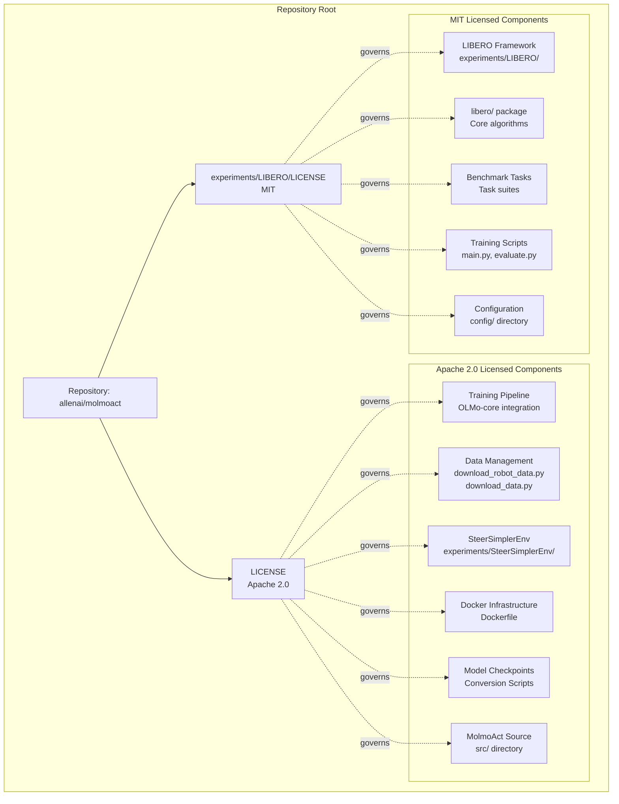
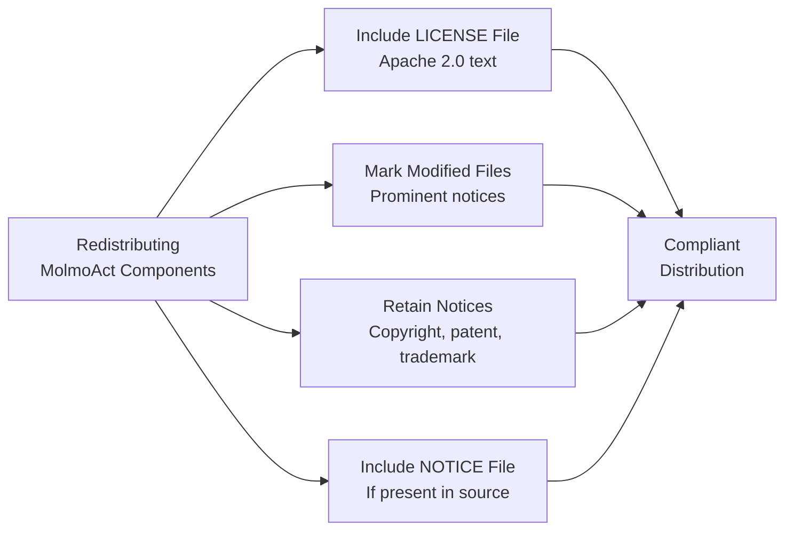
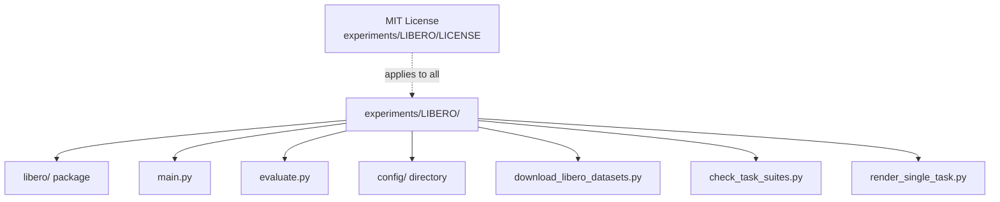
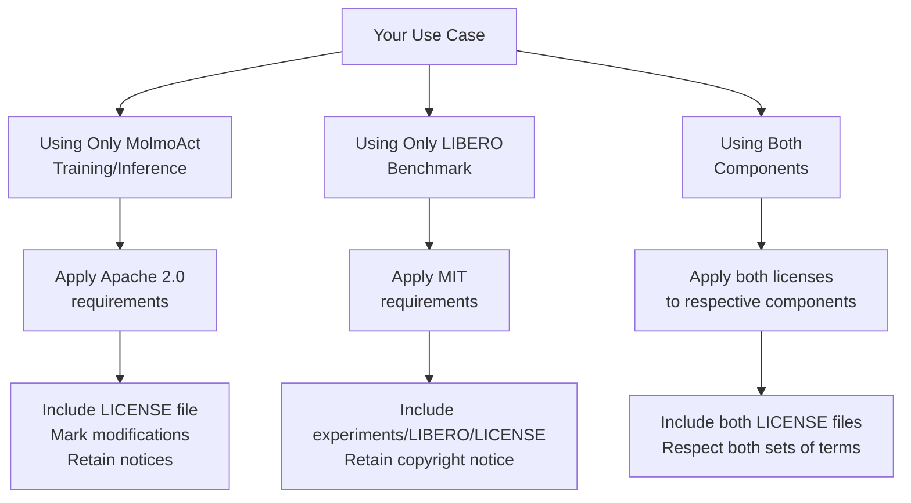

<!-- source: DeepWiki mcp.deepwiki.com · repo allenai/molmoact · page 10.1 License Information · fetched 2026-10-26 -->

# License Information

<details>
<summary>Relevant source files</summary>

The following files were used as context for generating this wiki page:

- [LICENSE](LICENSE)
- [experiments/LIBERO/LICENSE](experiments/LIBERO/LICENSE)

</details>


## Purpose and Scope

This document describes the licensing structure of the MolmoAct repository. The codebase employs a dual-license model: the main MolmoAct system and training infrastructure are licensed under **Apache License 2.0**, while the LIBERO benchmark framework (located in `experiments/LIBERO/`) is licensed under **MIT License**. This page provides details on both licenses, their implications for usage and redistribution, and guidance on proper attribution.

For information about hardware requirements and custom components for real-world deployment, see [Hardware Requirements and Custom Mounts](#10.2).

---

## License Structure Overview

The repository contains two distinct licensing zones based on the origin and purpose of different components. The following diagram illustrates the license boundaries within the codebase:



**Sources:** [LICENSE](), [experiments/LIBERO/LICENSE]()

---

## Apache License 2.0 (Main Project)

### Scope

The Apache License 2.0 applies to all components of the MolmoAct project except for the LIBERO framework. This includes:

| Component Category | Key Files/Directories | Description |
|-------------------|----------------------|-------------|
| Training Infrastructure | `src/`, `pyproject.toml` | MolmoAct model training and fine-tuning code |
| Data Pipeline | `download_robot_data.py`, `download_data.py` | Data acquisition and preprocessing scripts |
| Evaluation Extensions | `experiments/SteerSimplerEnv/` | Interactive evaluation system |
| Deployment | `Dockerfile`, `.dockerignore` | Container infrastructure |
| Configuration | Root-level config files | Training and evaluation configuration |
| Documentation | `README.md`, `.md` files | Project documentation |

### Key Terms

The Apache License 2.0 provides the following permissions:

- **Copyright License**: Perpetual, worldwide, non-exclusive, royalty-free license to reproduce, prepare derivative works, publicly display, perform, sublicense, and distribute
- **Patent License**: Protection from patent claims by contributors, with termination clause for patent litigation
- **Redistribution Rights**: Permission to distribute in source or object form with modifications

**Sources:** [LICENSE:1-201]()

### Redistribution Requirements

When redistributing Apache 2.0 licensed components, you must:



**Specific Requirements:**

1. **Include the License**: Any distribution must include a copy of the Apache License 2.0 ([LICENSE:89-95]())
2. **Notice Modified Files**: Modified files must carry prominent notices stating that changes were made ([LICENSE:97-98]())
3. **Preserve Notices**: Copyright, patent, trademark, and attribution notices from the source must be retained ([LICENSE:100-104]())
4. **NOTICE File**: If the work includes a NOTICE file, derivative works must include a readable copy of attribution notices ([LICENSE:106-121]())

**Sources:** [LICENSE:89-121]()

### Patent Protection

The Apache License 2.0 includes explicit patent grants. Each contributor grants a perpetual, royalty-free patent license covering their contributions. However, if you initiate patent litigation alleging that the work constitutes patent infringement, your patent licenses terminate as of the litigation filing date ([LICENSE:73-87]()).

**Sources:** [LICENSE:73-87]()

### Disclaimer of Warranty

The Apache License 2.0 provides the work "AS IS" without warranties of any kind, including warranties of merchantability, fitness for a particular purpose, or non-infringement. Users assume all risks associated with using the software ([LICENSE:143-151]()).

**Sources:** [LICENSE:143-151]()

---

## MIT License (LIBERO Framework)

### Scope

The MIT License applies exclusively to the LIBERO benchmark framework located in `experiments/LIBERO/`. This is a self-contained component originally developed by the Lifelong Robot Learning research group.



**Sources:** [experiments/LIBERO/LICENSE:1-22]()

### Key Terms

The MIT License is a permissive license that grants the following rights:

- **Unrestricted Use**: Permission to use, copy, modify, merge, publish, distribute, sublicense, and/or sell copies
- **No Warranty**: Software provided "AS IS" without warranty of any kind
- **Liability Protection**: Authors not liable for any claims or damages

**Sources:** [experiments/LIBERO/LICENSE:1-22]()

### Copyright Notice

The MIT License requires only that the copyright notice and permission notice be included in all copies or substantial portions of the software:

```
MIT License

Copyright (c) 2023 Lifelong Robot Learning
```

This notice is located in [experiments/LIBERO/LICENSE:1-3]().

**Sources:** [experiments/LIBERO/LICENSE:1-11]()

### Redistribution Requirements

MIT License redistribution is simpler than Apache 2.0:

| Requirement | Description |
|------------|-------------|
| Include License Text | The MIT License text must be included with any distribution |
| Include Copyright Notice | The copyright notice "Copyright (c) 2023 Lifelong Robot Learning" must be included |
| No Additional Requirements | No requirement to mark modified files or track contributions |

**Sources:** [experiments/LIBERO/LICENSE:10-11]()

---

## Practical Guidance

### Using MolmoAct in Your Project

When incorporating MolmoAct into your project, consider the following scenarios:



**Sources:** [LICENSE](), [experiments/LIBERO/LICENSE]()

### Derivative Works

The table below summarizes requirements for creating derivative works:

| Action | Apache 2.0 Components | MIT Components |
|--------|----------------------|----------------|
| Modify source code | Must mark modified files with notices | No specific requirement |
| Add features | May apply different license to additions if base work terms satisfied | May apply any license to additions |
| Distribute binaries | Must include LICENSE, retain notices | Must include copyright notice and MIT license text |
| Sublicense | Permitted for modifications only | Permitted |
| Patent claims | Contributor patent grants apply | No explicit patent provisions |

**Sources:** [LICENSE:89-129](), [experiments/LIBERO/LICENSE:1-22]()

### Model Checkpoints and Datasets

Model checkpoints and datasets distributed via HuggingFace Hub inherit the license of the code that produced them:

- **MolmoAct model checkpoints**: Apache 2.0 (produced by Apache 2.0 licensed training code)
- **LIBERO datasets**: MIT (part of the LIBERO framework)
- **Training data mixtures**: Follow the licenses of constituent datasets (see data source documentation)

When using pre-trained checkpoints, ensure compliance with the Apache 2.0 license terms, including attribution requirements.

**Sources:** [LICENSE](), [experiments/LIBERO/LICENSE]()

### Attribution Requirements

For proper attribution when using or citing this work:

**MolmoAct (Apache 2.0 components):**
```
Copyright 2024 Allen Institute for Artificial Intelligence

Licensed under the Apache License, Version 2.0 (the "License");
you may not use this file except in compliance with the License.
You may obtain a copy of the License at

    http://www.apache.org/licenses/LICENSE-2.0
```

**LIBERO (MIT components):**
```
MIT License
Copyright (c) 2023 Lifelong Robot Learning
```

**Sources:** [LICENSE:189-201](), [experiments/LIBERO/LICENSE:1-3]()

---

## License Compatibility

The combination of Apache 2.0 and MIT licenses in this repository is compatible because:

1. **MIT is permissive**: The MIT License places minimal restrictions and is compatible with Apache 2.0
2. **Clear boundaries**: The two licenses apply to distinct, separable components
3. **One-way compatibility**: MIT-licensed code can be used in Apache 2.0 projects, though not necessarily vice versa

When creating combined works that include both components, you must comply with the terms of both licenses for their respective portions.

**Sources:** [LICENSE](), [experiments/LIBERO/LICENSE]()

---

## Third-Party Dependencies

The MolmoAct project depends on numerous third-party packages, each with their own licenses. Key dependencies include:

| Dependency | License | Component |
|-----------|---------|-----------|
| PyTorch | BSD-3-Clause | Core ML framework |
| Transformers | Apache 2.0 | Model architecture |
| vLLM | Apache 2.0 | Inference optimization |
| MuJoCo | Apache 2.0 | Physics simulation (LIBERO) |
| NumPy | BSD-3-Clause | Numerical operations |
| Flash-Attention | BSD-3-Clause | Attention kernels |

Refer to `pyproject.toml` and `experiments/LIBERO/setup.py` for complete dependency lists. Users must ensure compliance with all third-party licenses when redistributing the software.

**Sources:** [LICENSE](), [experiments/LIBERO/LICENSE]()

---

## Summary

The MolmoAct repository employs a dual-license structure:

- **Apache License 2.0**: Covers the main MolmoAct training pipeline, data processing, SteerSimplerEnv extension, and deployment infrastructure
- **MIT License**: Covers the LIBERO benchmark framework in `experiments/LIBERO/`

Both licenses are permissive and allow commercial use, modification, and distribution. The primary difference lies in redistribution requirements: Apache 2.0 requires more explicit attribution and notice provisions, while MIT requires only the inclusion of the copyright notice and license text. Users should comply with the terms of whichever license applies to the components they use.

**Sources:** [LICENSE](), [experiments/LIBERO/LICENSE]()

---

