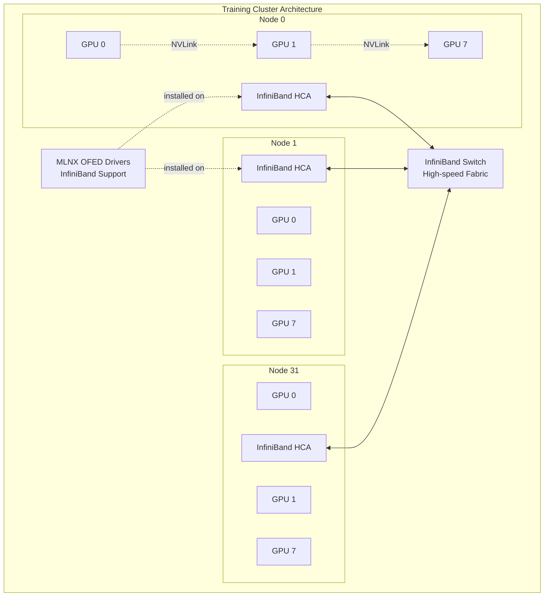
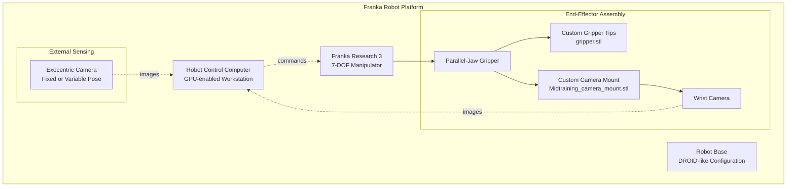
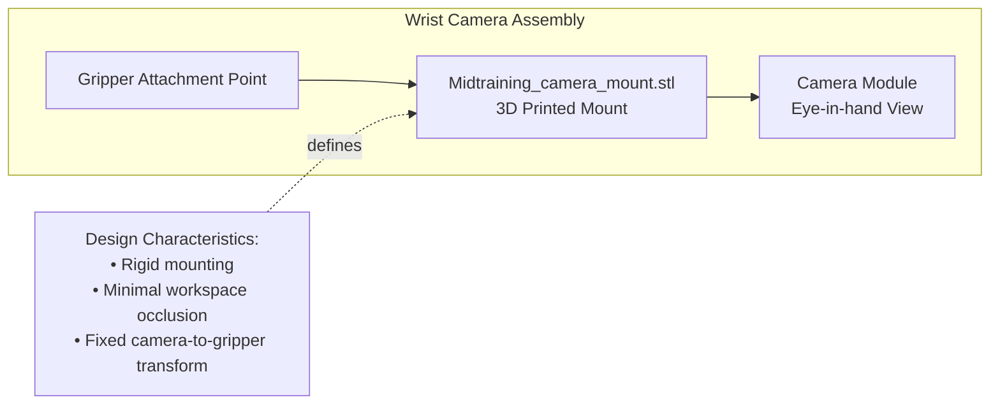
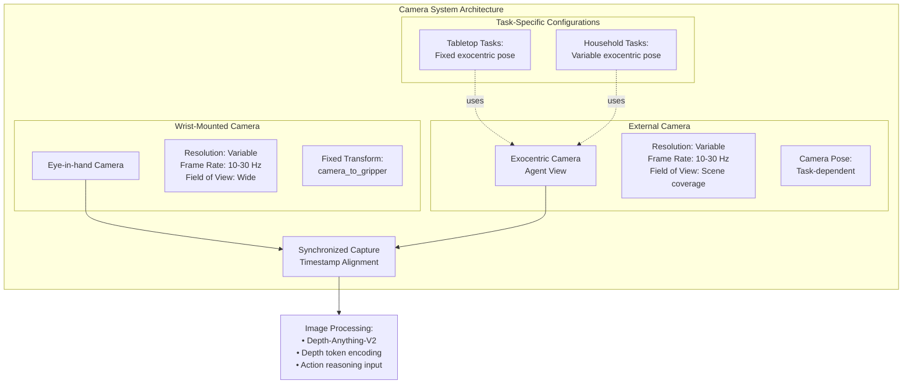
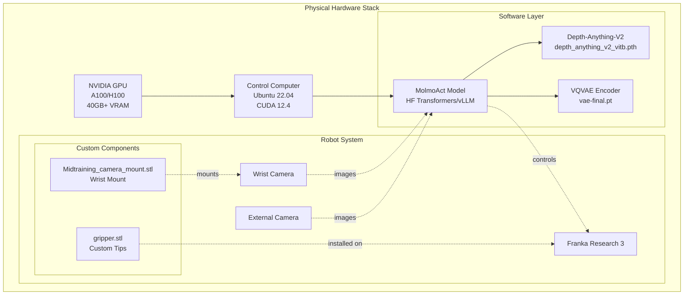

<!-- source: DeepWiki mcp.deepwiki.com · repo allenai/molmoact · page 10.2 Hardware Requirements and Custom Mounts · fetched 2026-10-26 -->

# Hardware Requirements and Custom Mounts

<details>
<summary>Relevant source files</summary>

The following files were used as context for generating this wiki page:

- [Midtraining_camera_mount.stl](Midtraining_camera_mount.stl)
- [README.md](README.md)

</details>


This document details the physical hardware requirements and custom mechanical components needed for deploying MolmoAct across its full lifecycle: training, inference, and real-world robot evaluation. This includes GPU specifications, networking infrastructure, robot platforms, camera configurations, and custom 3D-printed mounts.

For software environment setup and Docker configuration, see [Infrastructure and Deployment](#8). For evaluation procedures using this hardware, see [Evaluation Pipelines](#5).

---

## Training Infrastructure Requirements

### GPU and Compute Resources

MolmoAct training requires significant GPU resources across its three-stage pipeline. The computational requirements scale with the training stage:

| Training Stage | GPU Nodes | GPUs per Node | Total GPUs | Minimum GPU Architecture | Recommended Models |
|----------------|-----------|---------------|------------|-------------------------|-------------------|
| Pre-training | 32 | 8 | 256 | NVIDIA Ampere (8.0) | A100 80GB, H100 |
| Mid-training | 16 | 8 | 128 | NVIDIA Ampere (8.0) | A100 80GB, H100 |
| Post-training/Fine-tuning | 8 | 8 | 64 | NVIDIA Ampere (8.0) | A100 40GB/80GB, H100 |

**Key Requirements:**
- CUDA Compute Capability 8.0 (Ampere) or 9.0 (Hopper) minimum
- CUDA 12.4 runtime environment
- 40GB+ VRAM per GPU for full fine-tuning
- 24GB+ VRAM per GPU for LoRA fine-tuning

**Sources:** [README.md:333-351](), [README.md:382-400](), [README.md:416-436]()

### Multi-Node Networking

For distributed training at scale, high-bandwidth interconnects are required:



**Network Requirements:**
- InfiniBand (recommended) or high-speed Ethernet (100+ Gbps)
- MLNX OFED drivers for InfiniBand support
- NVLink or NVSwitch for intra-node GPU communication
- Low-latency switches for inter-node communication

**Configuration Details:**
- InfiniBand support is included in the Docker image
- MLNX OFED drivers are installed during the Docker build process
- Environment variables for distributed training set via `torchrun` parameters: `--node_rank`, `--master_addr`, `--master_port`

**Sources:** [README.md:333-351](), Diagram 4 analysis, Diagram 6 analysis

---

## Inference Hardware Requirements

### Single-Node Inference

For model inference and evaluation, significantly reduced hardware is needed:

| Use Case | Minimum GPUs | GPU Memory | Architecture | Notes |
|----------|--------------|------------|--------------|-------|
| HuggingFace Transformers | 1 | 24GB | Ampere+ | Standard inference |
| vLLM Optimized | 1-2 | 40GB | Ampere+ | Faster batched inference |
| SimplerEnv Evaluation | 1 | 24GB | Ampere+ | Simulation environment |
| LIBERO Evaluation | 1 | 24GB | Ampere+ | Benchmark tasks |

**Software Dependencies:**
```bash
pip install einops torchvision accelerate vllm==0.8.5 transformers==4.52
```

**vLLM-Specific Configuration:**
```bash
export VLLM_WORKER_MULTIPROC_METHOD=spawn
```

**Sources:** [README.md:244-248](), [README.md:486]()

---

## Real-World Robot Hardware Setup

### Franka Research 3 Configuration

For real-world deployment and zero-shot evaluation, MolmoAct requires a specific robot hardware configuration:



**Platform Specifications:**
- **Robot:** Franka Research 3 (or equivalent) in DROID-like configuration
- **Degrees of Freedom:** 7-DOF arm + 2-DOF gripper
- **Payload Capacity:** Sufficient for wrist camera mount and custom gripper tips
- **Control Interface:** ROS or direct control via libfranka

**Sources:** [README.md:524-534]()

### Custom Mechanical Components

Two custom 3D-printed components are required to match the mid-training hardware configuration:

#### 1. Wrist Camera Mount



**File Location:** `Midtraining_camera_mount.stl` (repository root)

**Purpose:** Provides a consistent wrist-mounted camera perspective that matches the mid-training dataset distribution. This mount ensures the camera maintains a fixed transformation relative to the gripper throughout manipulation tasks.

**Fabrication Notes:**
- Material: Rigid plastic (PLA, PETG, or ABS)
- Infill: 50%+ for structural rigidity
- Post-processing: Ensure mounting holes are clear and properly sized

**Sources:** [README.md:527-528]()

#### 2. Custom Gripper Tips

**Reference Design:** https://github.com/pantor/learning-shifting-for-grasping/blob/master/cad-models/gripper.stl

**Purpose:** These gripper tips were used during mid-training data collection and provide improved grasping performance for the tasks in the training distribution. Using the same tips improves zero-shot transfer by maintaining consistent contact geometry.

**Characteristics:**
- Increased surface area for stable grasping
- Optimized for parallel-jaw gripper operation
- Compatible with standard Franka gripper finger mounts

**Sources:** [README.md:531-532]()

---

## Camera Configuration

### Dual-Camera Setup

MolmoAct requires a two-camera configuration for optimal performance:



### Camera Positioning Guidelines

**Wrist Camera (Eye-in-hand):**
- Mounted via `Midtraining_camera_mount.stl`
- Fixed relative pose to gripper coordinate frame
- Provides close-up view of manipulation targets
- Should capture gripper tips in field of view for visual feedback

**Exocentric Camera (Agent View):**

| Task Category | Camera Placement | Height | Angle | Notes |
|--------------|------------------|--------|-------|-------|
| Tabletop manipulation | Fixed above workspace | 1.0-1.5m | 30-45° downward | Single fixed pose across episodes |
| Household tasks | Variable positions | 0.8-1.8m | Scene-dependent | Multiple poses to cover wider viewpoints |

**Technical Specifications:**
- Both cameras should provide RGB images
- Depth information is generated via Depth-Anything-V2 during inference
- Image resolution should be sufficient for 378×378 pixel input after preprocessing
- Synchronized timestamps for temporal alignment

**Sources:** [README.md:534](), Diagram 5 analysis

### Camera Calibration Requirements

For proper operation, the following calibrations are needed:

1. **Intrinsic Calibration:** Camera matrix and distortion parameters for both cameras
2. **Extrinsic Calibration (Wrist):** Fixed transformation from camera frame to gripper frame
3. **Extrinsic Calibration (External):** Transformation from camera frame to robot base frame (if required for specific tasks)

---

## Hardware Integration Overview



**Sources:** README.md sections on installation, training, and real-world evaluation

---

## Hardware Safety Considerations

### Physical Safety Requirements

MolmoAct includes built-in safety features, but proper hardware setup is critical:

**Safety Features:**
- **Visual Reasoning Trace:** Model displays intended action trajectory before execution, enabling proactive intervention
- **Force Limiting:** Action space bounded by training data distribution
- **Resistance Detection:** Compliance built in to limit excessive force when resistance is detected

**Required Safety Measures:**
1. **Emergency Stop:** Accessible e-stop button within reach of operator
2. **Workspace Barriers:** Physical barriers to prevent human entry during operation
3. **Force/Torque Monitoring:** Robot controller monitors for excessive forces
4. **Camera Health Checks:** Verify both cameras are functioning before operation
5. **Mount Integrity:** Regular inspection of 3D-printed mounts for wear/damage

**Operational Guidelines:**
- Always follow Franka Emika (or equivalent manufacturer) safety guidelines
- Operate in safely configured environment with proper risk assessment
- Maintain clear workspace boundaries
- Supervise autonomous operation, especially during initial deployment
- Test custom mechanical components under controlled conditions

**Sources:** [README.md:548-550]()

---

## Hardware Configuration Checklist

### Pre-Deployment Verification

Before running MolmoAct on physical hardware, verify:

**Compute Infrastructure:**
- [ ] GPU meets minimum requirements (Ampere/Hopper, 24GB+ VRAM)
- [ ] CUDA 12.4 properly installed
- [ ] Driver version supports compute capability 8.0+
- [ ] Network connectivity for model downloads (or offline cache configured)

**Robot Platform:**
- [ ] Franka robot operational and calibrated
- [ ] Custom gripper tips installed and tested
- [ ] Wrist camera mount securely attached
- [ ] All mechanical connections verified for stability

**Camera System:**
- [ ] Wrist camera mounted and calibrated
- [ ] External camera positioned according to task requirements
- [ ] Both cameras providing synchronized images
- [ ] Image quality verified (focus, exposure, no occlusions)

**Safety Systems:**
- [ ] Emergency stop tested and functional
- [ ] Workspace properly configured and secured
- [ ] Force limits configured in robot controller
- [ ] Operator trained on emergency procedures

**Software Stack:**
- [ ] MolmoAct model checkpoint downloaded
- [ ] Depth-Anything-V2 checkpoint available
- [ ] VQVAE checkpoint available
- [ ] Inference dependencies installed

**Sources:** README.md sections on installation and real-world evaluation

---

## Deployment Configuration Mappings

### Hardware to Software Configuration

The following table maps physical hardware configurations to software parameters:

| Hardware Component | Software Configuration | File/Parameter |
|-------------------|------------------------|----------------|
| GPU Architecture | CUDA compute capability | Docker base image: `nvidia/cuda:12.4.0-devel` |
| GPU Count (Training) | `--nproc-per-node` | `launch_scripts/train_multitask_model.py` |
| Node Count (Training) | `--nnodes` | `launch_scripts/train_multitask_model.py` |
| Camera Images | `--max_images` | Training scripts (typically `2` for dual-camera) |
| Wrist Camera | Input image preprocessing | `depth_anything_v2_vitb.pth` |
| Dataset Statistics | `--norm_stats_path` | `dataset_statistics.json` from training data |
| Custom Components | Training data distribution | Implicit in mid-training checkpoint |

### Environment Variables

Key environment variables for hardware configuration:

```bash
# GPU visibility
export NVIDIA_VISIBLE_DEVICES=all

# CUDA paths
export LD_LIBRARY_PATH=/usr/local/cuda/lib64:$LD_LIBRARY_PATH

# Data storage (affects I/O performance)
export MOLMOACT_DATA_DIR=/data/molmoact
export HF_HOME=/data/molmoact/huggingface

# vLLM configuration
export VLLM_WORKER_MULTIPROC_METHOD=spawn
```

**Sources:** [README.md:270-276](), [README.md:486](), Diagram 4 analysis

---

## Additional Hardware Recommendations

### Storage Requirements

| Use Case | Storage Type | Capacity | IOPS Requirements |
|----------|--------------|----------|-------------------|
| Training data cache | NVMe SSD | 1-5 TB | High (10K+) |
| Model checkpoints | SSD/NAS | 500GB-2TB | Medium |
| Inference runtime | Local SSD | 100GB | Low-Medium |
| Episode recordings | HDD/NAS | 500GB+ | Low |

### Power and Cooling

- **Power:** Ensure sufficient power delivery for multi-GPU systems (1500W+ per 8-GPU node)
- **Cooling:** Adequate cooling for sustained GPU utilization during training
- **UPS:** Uninterruptible power supply recommended for long training runs

### Network Storage

For multi-node training:
- Shared filesystem (NFS, Lustre) for checkpoint synchronization
- Low-latency access to training data
- Sufficient bandwidth to prevent I/O bottlenecks (10+ Gbps)

**Sources:** General infrastructure best practices, implied from training scale

---

