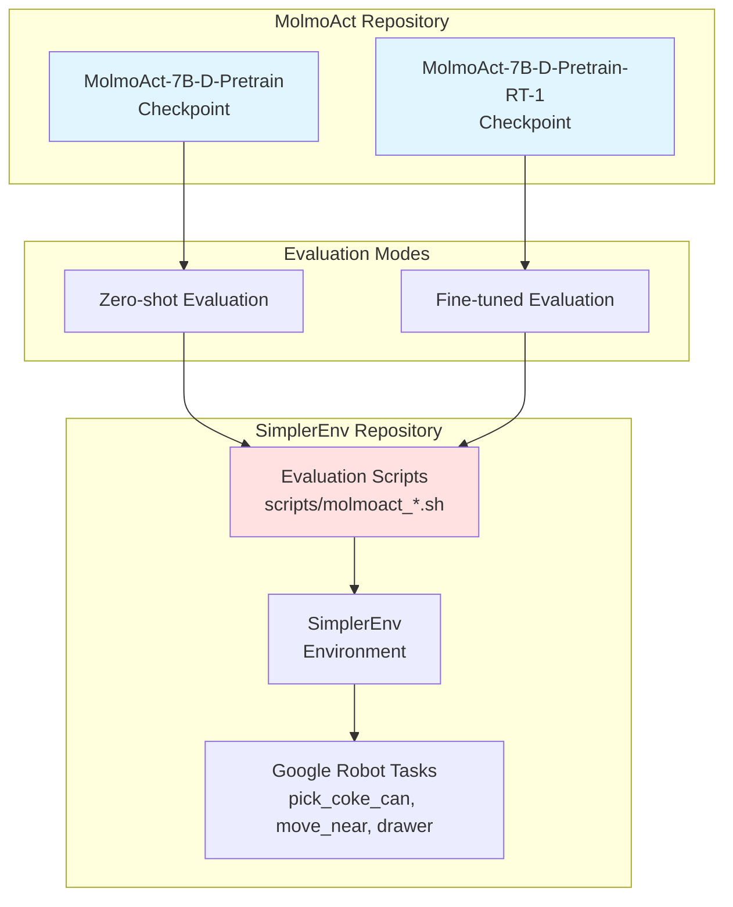
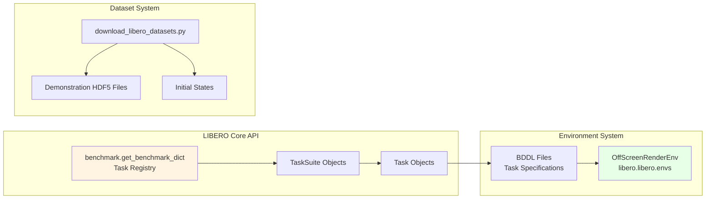
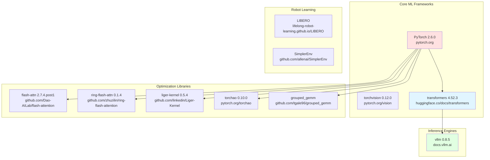
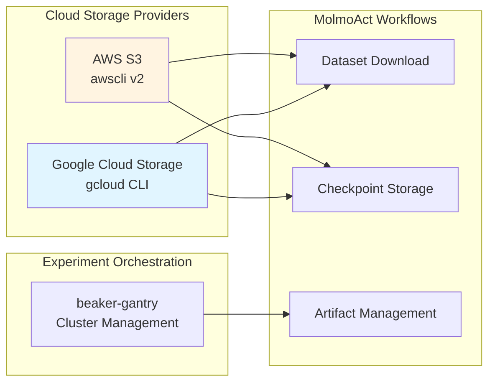

<!-- source: DeepWiki mcp.deepwiki.com · repo allenai/molmoact · page 10.3 Additional Resources · fetched 2026-10-26 -->

# Additional Resources

<details>
<summary>Relevant source files</summary>

The following files were used as context for generating this wiki page:

- [assets/molmoact_logo.svg](assets/molmoact_logo.svg)
- [experiments/LIBERO/images/fig1.png](experiments/LIBERO/images/fig1.png)
- [experiments/LIBERO/images/libero_logo.png](experiments/LIBERO/images/libero_logo.png)

</details>


This page provides a comprehensive directory of external resources, related repositories, research publications, and community tools that support the MolmoAct ecosystem. These resources include evaluation frameworks, model hosting platforms, key dependencies, and documentation for the broader AI2 research infrastructure.

For information about the internal MolmoAct codebase structure, see [Repository Structure](#1.2). For training infrastructure and deployment, see [Infrastructure and Deployment](#8).

---

## Related Repositories

### SimplerEnv Evaluation Framework

The SimplerEnv repository provides the evaluation infrastructure for testing MolmoAct on Google Robot manipulation tasks.

**Repository**: `https://github.com/allenai/SimplerEnv`

**Purpose**: Benchmark MolmoAct's zero-shot and fine-tuned performance on real-world robot tasks including:
- `pick_coke_can` tasks (visual matching and variant aggregation)
- `move_near` tasks (visual matching and variant aggregation)  
- `drawer` manipulation tasks (visual matching and variant aggregation)

**Integration with MolmoAct**:



**Installation and Setup**: Follow SimplerEnv's README for environment setup, then install MolmoAct-specific inference dependencies as documented in the SimplerEnv repository.

**Evaluation Scripts**: Located at `scripts/molmoact_*.sh` in the SimplerEnv repository, including:
- `molmoact_pick_coke_can_visual_matching.sh`
- `molmoact_pick_coke_can_variant_agg.sh`
- `molmoact_move_near_visual_matching.sh`
- `molmoact_move_near_variant_agg.sh`
- `molmoact_drawer_visual_matching.sh`
- `molmoact_drawer_variant_agg.sh`

**Sources**: [README.md:29-312]()

---

### LIBERO Benchmark Framework

LIBERO (Lifelong Benchmarking for Robot Learning) is integrated directly into the MolmoAct repository under `experiments/LIBERO/`.

**Official Repository**: `https://github.com/Lifelong-Robot-Learning/LIBERO`

**Documentation**: `https://lifelong-robot-learning.github.io/LIBERO/`

**Paper**: "LIBERO: Benchmarking Knowledge Transfer for Lifelong Robot Learning" ([arXiv:2306.03310](https://arxiv.org/pdf/2306.03310.pdf))

**Website**: `https://libero-project.github.io`

**Task Suites**:

| Suite | Tasks | Focus |
|-------|-------|-------|
| `libero_spatial` | 10 | Spatial relationship transfer |
| `libero_object` | 10 | Object knowledge transfer |
| `libero_goal` | 10 | Goal-oriented reasoning transfer |
| `libero_100` | 100 | Combined knowledge transfer (90 pretrain + 10 test) |

**Key Components**:



**MolmoAct Integration**: The LIBERO framework is used for post-training (LoRA fine-tuning) and evaluation of task-specific MolmoAct models. See [Post-training and Task-Specific Fine-tuning](#2.3) for training details and [LIBERO Benchmark Evaluation](#5.2) for evaluation procedures.

**Sources**: [experiments/LIBERO/README.md:1-185]()

---

## Research Publications

### MolmoAct Paper

**Title**: "MolmoAct: Action Reasoning Models that can Reason in Space"

**Authors**: Jason Lee, Jiafei Duan, Haoquan Fang, Yuquan Deng, Shuo Liu, Boyang Li, Bohan Fang, Jieyu Zhang, Yi Ru Wang, Sangho Lee, Winson Han, Wilbert Pumacay, Angelica Wu, Rose Hendrix, Karen Farley, Eli VanderBilt, Ali Farhadi, Dieter Fox, Ranjay Krishna

**arXiv**: `2508.07917`

**URL**: `https://arxiv.org/abs/2508.07917`

**BibTeX Citation**:
```bibtex
@misc{molmoact2025,
      title={MolmoAct: Action Reasoning Models that can Reason in Space}, 
      author={Jason Lee and Jiafei Duan and Haoquan Fang and Yuquan Deng and Shuo Liu and Boyang Li and Bohan Fang and Jieyu Zhang and Yi Ru Wang and Sangho Lee and Winson Han and Wilbert Pumacay and Angelica Wu and Rose Hendrix and Karen Farley and Eli VanderBilt and Ali Farhadi and Dieter Fox and Ranjay Krishna},
      year={2025},
      eprint={2508.07917},
      archivePrefix={arXiv},
      primaryClass={cs.RO},
      url={https://arxiv.org/abs/2508.07917}
}
```

**Sources**: [README.md:357-369]()

---

### LIBERO Paper

**Title**: "LIBERO: Benchmarking Knowledge Transfer for Lifelong Robot Learning"

**Authors**: Bo Liu, Yifeng Zhu, Chongkai Gao, Yihao Feng, Qiang Liu, Yuke Zhu, Peter Stone

**arXiv**: `2306.03310`

**URL**: `https://arxiv.org/pdf/2306.03310.pdf`

**BibTeX Citation**:
```bibtex
@article{liu2023libero,
  title={LIBERO: Benchmarking Knowledge Transfer for Lifelong Robot Learning},
  author={Liu, Bo and Zhu, Yifeng and Gao, Chongkai and Feng, Yihao and Liu, Qiang and Zhu, Yuke and Stone, Peter},
  journal={arXiv preprint arXiv:2306.03310},
  year={2023}
}
```

**Sources**: [experiments/LIBERO/README.md:168-178]()

---

## Model and Dataset Repositories

### Hugging Face Collections

MolmoAct provides two primary Hugging Face collections for models and datasets:

```mermaid
graph TB
    subgraph "Hugging Face Hub"
        MODEL_COLLECTION["Model Collection<br/>allenai/molmoact-689697591a3936fba38174d7"]
        DATA_COLLECTION["Dataset Collection<br/>allenai/molmoact-data-mixture-6897e583e13b6c2cf3ea2b80"]
    end
    
    subgraph "Model Checkpoints"
        CAPTIONER["MolmoAct-7B-D-Captioner<br/>allenai/MolmoAct-7B-D-Captioner-0812"]
        PRETRAIN["MolmoAct-7B-D-Pretrain<br/>allenai/MolmoAct-7B-D-Pretrain-0812"]
        MIDTRAIN["MolmoAct-7B-D<br/>allenai/MolmoAct-7B-D-0812"]
        MOST_OPEN["MolmoAct-7B-O<br/>allenai/MolmoAct-7B-O-0812"]
        RT1["MolmoAct-7B-D-Pretrain-RT-1<br/>allenai/MolmoAct-7B-D-Pretrain-RT-1-0812"]
        LIBERO_SPATIAL["MolmoAct-7B-D-LIBERO-Spatial<br/>allenai/MolmoAct-7B-D-LIBERO-Spatial-0812"]
        LIBERO_OBJECT["MolmoAct-7B-D-LIBERO-Object<br/>allenai/MolmoAct-7B-D-LIBERO-Object-0812"]
        LIBERO_GOAL["MolmoAct-7B-D-LIBERO-Goal<br/>allenai/MolmoAct-7B-D-LIBERO-Goal-0812"]
        LIBERO_LONG["MolmoAct-7B-D-LIBERO-Long<br/>allenai/MolmoAct-7B-D-LIBERO-Long-0812"]
    end
    
    subgraph "Dataset Repositories"
        MOLMOACT_DATA["MolmoAct Dataset<br/>allenai/MolmoAct-Dataset"]
        PRETRAIN_MIX["Pre-training Mixture<br/>allenai/MolmoAct-Pretraining-Mixture"]
        MIDTRAIN_MIX["Mid-training Mixture<br/>allenai/MolmoAct-Midtraining-Mixture"]
        LIBERO_HF["LIBERO Datasets<br/>yifengzhu-hf/LIBERO-datasets"]
    end
    
    MODEL_COLLECTION --> CAPTIONER
    MODEL_COLLECTION --> PRETRAIN
    MODEL_COLLECTION --> MIDTRAIN
    MODEL_COLLECTION --> MOST_OPEN
    MODEL_COLLECTION --> RT1
    MODEL_COLLECTION --> LIBERO_SPATIAL
    MODEL_COLLECTION --> LIBERO_OBJECT
    MODEL_COLLECTION --> LIBERO_GOAL
    MODEL_COLLECTION --> LIBERO_LONG
    
    DATA_COLLECTION --> MOLMOACT_DATA
    DATA_COLLECTION --> PRETRAIN_MIX
    DATA_COLLECTION --> MIDTRAIN_MIX
    DATA_COLLECTION --> LIBERO_HF
    
    style MODEL_COLLECTION fill:#fff4e1
    style DATA_COLLECTION fill:#e1f5ff
```



### Model Checkpoint Reference

| Checkpoint | Hugging Face Path | Use Case |
|------------|-------------------|----------|
| **MolmoAct-7B-D** | `allenai/MolmoAct-7B-D-0812` | Fine-tuning base for real robots |
| **MolmoAct-7B-O** | `allenai/MolmoAct-7B-O-0812` | Most open variant for fine-tuning |
| **MolmoAct-7B-D-Pretrain** | `allenai/MolmoAct-7B-D-Pretrain-0812` | Zero-shot SimplerEnv inference |
| **MolmoAct-7B-D-Pretrain-RT-1** | `allenai/MolmoAct-7B-D-Pretrain-RT-1-0812` | Fine-tuned SimplerEnv inference |
| **MolmoAct-7B-D-Captioner** | `allenai/MolmoAct-7B-D-Captioner-0812` | Training replication starting point |
| **LIBERO-Spatial** | `allenai/MolmoAct-7B-D-LIBERO-Spatial-0812` | LIBERO spatial task evaluation |
| **LIBERO-Object** | `allenai/MolmoAct-7B-D-LIBERO-Object-0812` | LIBERO object task evaluation |
| **LIBERO-Goal** | `allenai/MolmoAct-7B-D-LIBERO-Goal-0812` | LIBERO goal task evaluation |
| **LIBERO-Long** | `allenai/MolmoAct-7B-D-LIBERO-Long-0812` | LIBERO-10 long-horizon evaluation |

### Dataset Reference

| Dataset | Hugging Face Path | Description |
|---------|-------------------|-------------|
| **MolmoAct Dataset** | `allenai/MolmoAct-Dataset` | In-house collected robot demonstrations in LeRobot format |
| **Pre-training Mixture** | `allenai/MolmoAct-Pretraining-Mixture` | OXE subset + auxiliary robot data + web data |
| **Mid-training Mixture** | `allenai/MolmoAct-Midtraining-Mixture` | MolmoAct Dataset formatted as Action Reasoning data |
| **LIBERO Datasets** | `yifengzhu-hf/LIBERO-datasets` | Four task suites with human teleoperation demonstrations |

**Sources**: [README.md:18-86](), [experiments/LIBERO/README.md:77-87]()

---

## Key Dependencies Documentation

### ML Framework Stack



### Documentation Links

| Library | Version | Documentation URL | Purpose |
|---------|---------|-------------------|---------|
| **PyTorch** | 2.6.0 | `https://pytorch.org/docs/stable/` | Core ML framework |
| **torchvision** | 0.12.0 | `https://pytorch.org/vision/stable/` | Image transformations |
| **transformers** | 4.52.3 | `https://huggingface.co/docs/transformers/` | Model implementations |
| **vllm** | 0.8.5 | `https://docs.vllm.ai/` | High-throughput LLM serving |
| **flash-attn** | 2.7.4.post1 | `https://github.com/Dao-AILab/flash-attention` | Memory-efficient attention |
| **ring-flash-attn** | 0.1.4 | `https://github.com/zhuzilin/ring-flash-attention` | Distributed attention |
| **liger-kernel** | 0.5.4 | `https://github.com/linkedin/Liger-Kernel` | Kernel optimizations |
| **torchao** | 0.10.0 | `https://pytorch.org/torchao/` | Quantization toolkit |
| **grouped_gemm** | latest | `https://github.com/tgale96/grouped_gemm` | Batched matrix operations |
| **einops** | latest | `https://einops.rocks/` | Tensor operations |
| **accelerate** | latest | `https://huggingface.co/docs/accelerate/` | Distributed training helpers |

**Installation Notes**:
- For LIBERO evaluation: Install `transformers==4.52.1` (note specific version)
- For vLLM evaluation: Install `vllm==0.8.5` and set `export VLLM_WORKER_MULTIPROC_METHOD=spawn`
- See [Docker Environment](#8.1) for complete environment specification

**Sources**: [README.md:90-102](), [README.md:318-339]()

---

## Distributed Training Infrastructure

### Weights & Biases (W&B)

**Documentation**: `https://docs.wandb.ai/`

**Purpose**: Experiment tracking, metric logging, and artifact management for MolmoAct training runs.

**Configuration**:
```bash
# Enable W&B logging
WANDB_API_KEY=<your_key> torchrun ...
  --wandb.name=<run_name>
  --wandb.entity=<entity>
  --wandb.project=<project>

# Offline logging mode
WANDB_MODE=offline torchrun ...

# Disable W&B
torchrun ... --wandb=null
```

**Usage in Training Scripts**: The `--wandb.*` flags in training commands ([README.md:178-195](), [README.md:225-243](), [README.md:257-278]()) configure experiment tracking.

### Hugging Face Hub

**Documentation**: `https://huggingface.co/docs/huggingface_hub/`

**Purpose**: Dataset downloading, model checkpoint storage, and caching infrastructure.

**Environment Variables**:
- `HF_HOME`: Sets Hugging Face cache location (default: `~/.cache/huggingface`)
- `HF_DATASETS_OFFLINE=1`: Prevents rate limiting during distributed training by blocking API calls

**Cache Management**: See official documentation at `https://huggingface.co/docs/huggingface_hub/guides/manage-cache`

**Download Scripts**:
- [scripts/download_robot_data.py]() - Robot demonstration datasets
- [scripts/download_data.py]() - Web-based multimodal datasets
- [experiments/LIBERO/benchmark_scripts/download_libero_datasets.py]() - LIBERO task suites

**Sources**: [README.md:113-172]()

---

## Cloud Infrastructure

### Cloud CLI Tools



**AWS CLI v2**:
- Documentation: `https://docs.aws.amazon.com/cli/`
- Purpose: S3 bucket access for datasets and checkpoints
- Installation: Included in MolmoAct Docker image

**Google Cloud CLI**:
- Documentation: `https://cloud.google.com/sdk/docs`
- Purpose: GCS bucket access for datasets and checkpoints
- Installation: Included in MolmoAct Docker image

**beaker-gantry**:
- Documentation: AI2 internal tool for experiment orchestration
- Purpose: Multi-node job scheduling and resource management
- Contact: See [Community and Support](#community-and-support) for AI2-specific tooling questions

**Sources**: Referenced in Dockerfile (not provided in file list)

---

## Development Tools

### GPU Monitoring

**gpustat**:
- Documentation: `https://github.com/wookayin/gpustat`
- Purpose: Real-time GPU utilization monitoring
- Usage: Run `gpustat` in terminal for current GPU status

### Jupyter Notebooks

**Documentation**: `https://jupyter.org/documentation`

**Purpose**: Interactive development and experimentation with MolmoAct models.

**Example Notebooks**: Located in `experiments/LIBERO/notebooks/` directory for LIBERO task exploration and policy visualization.

### Shell Environments

Supported shells included in Docker environment:
- **bash**: Default shell
- **zsh**: Alternative shell with enhanced features
- **fish**: User-friendly shell

### Text Editors

Pre-installed editors in Docker environment:
- **vim**: Terminal-based text editor
- **emacs**: Extensible text editor

**Sources**: Referenced in Dockerfile (not provided in file list)

---

## Community and Support

### Official Channels

**AI2 Blog Post**: `https://allenai.org/blog/molmoact`
- Overview of MolmoAct capabilities and design philosophy
- Use cases and application examples
- Links to model demos

**GitHub Repository**: `https://github.com/allenai/MolmoAct`
- Source code
- Issue tracker: `https://github.com/allenai/MolmoAct/issues`
- Feature requests and bug reports

**Contact Information**:
```
{haoquanf,jasonl,jiafeid}@allenai.org
```

For questions, collaborations, or technical support, contact the MolmoAct team at the email addresses above.

**Sources**: [README.md:12-23](), [README.md:373-381]()

---

## Responsible Use and Safety

### Responsible Use Guidelines

**URL**: `https://allenai.org/responsible-use`

**Purpose**: AI2's guidelines for ethical and responsible use of MolmoAct models, including:
- Intended use cases (research and educational purposes)
- Limitations and known biases
- Safety considerations for robot deployment
- Data privacy and security

### Hardware Safety

**Recommendations**:
- Review visual reasoning traces before executing actions
- Operate robots in safely configured environments
- Follow hardware manufacturer guidelines
- Monitor force compliance to limit excessive force on resistance

**Model Capabilities**: MolmoAct displays visual reasoning traces showing intended actions before execution, enabling proactive behavior auditing and adjustment.

**Sources**: [README.md:344-354]()

---

## License Information

### MolmoAct License

**Type**: Apache License 2.0

**URL**: `https://github.com/allenai/MolmoAct/blob/release/LICENSE`

**Permissions**: See [License Information](#10.1) for full license terms and conditions.

### LIBERO License

**Type**: MIT License (codebase) + CC BY 4.0 (datasets)

| Component | License |
|-----------|---------|
| Codebase | MIT License |
| Datasets | Creative Commons Attribution 4.0 International (CC BY 4.0) |

**CC BY 4.0 URL**: `https://creativecommons.org/licenses/by/4.0/legalcode`

**Sources**: [README.md:344-347](), [experiments/LIBERO/README.md:180-185]()

---

## Additional Documentation Resources

### MolmoAct Wiki Pages

For detailed information on specific subsystems, refer to:
- [Getting Started](#1.1) - Initial setup and configuration
- [Training Pipeline](#2) - Three-stage curriculum learning
- [Data Management System](#3) - Dataset downloading and organization
- [Model Checkpoints and Usage](#4) - Checkpoint hierarchy and use cases
- [Evaluation Pipelines](#5) - SimplerEnv and LIBERO evaluation
- [LIBERO Benchmark Framework](#6) - Task suites and algorithms
- [Configuration System](#7) - Hydra-based configuration
- [Infrastructure and Deployment](#8) - Docker and distributed training
- [API Reference](#9) - Python API documentation
- [Troubleshooting Guide](#10.2) - Common issues and solutions

### External Documentation

**PyTorch Ecosystem**:
- PyTorch Tutorials: `https://pytorch.org/tutorials/`
- PyTorch Distributed: `https://pytorch.org/tutorials/beginner/dist_overview.html`
- torchrun Documentation: `https://pytorch.org/docs/stable/elastic/run.html`

**Hugging Face Ecosystem**:
- Transformers Course: `https://huggingface.co/learn/nlp-course/`
- Datasets Documentation: `https://huggingface.co/docs/datasets/`
- Model Hub Guide: `https://huggingface.co/docs/hub/`

**Robot Learning**:
- MuJoCo Documentation: `https://mujoco.readthedocs.io/`
- robosuite Documentation: `https://robosuite.ai/docs/`
- LeRobot Format: `https://github.com/huggingface/lerobot`