<!-- source: DeepWiki mcp.deepwiki.com · repo allenai/molmoact · page 2 Training Pipeline · fetched 2026-10-26 -->

# Training Pipeline

<details>
<summary>Relevant source files</summary>

The following files were used as context for generating this wiki page:

- [Dockerfile](Dockerfile)
- [README.md](README.md)

</details>


## Purpose and Scope

This document describes the complete three-stage training pipeline for MolmoAct models, including the execution flow, computational infrastructure, data routing, and checkpoint management across all training phases. Each training stage builds upon the previous one, progressively specializing the model from general multimodal understanding to robot action reasoning.

For detailed information about individual stages, see:
- Pre-training specifics: [Pre-training Stage](#2.1)
- Mid-training specifics: [Mid-training Stage](#2.2)
- Fine-tuning specifics: [Post-training and Task-Specific Fine-tuning](#2.3)

For data management and preprocessing details, see [Data Management System](#3).

---

## Training Pipeline Architecture

The MolmoAct training pipeline follows a three-stage curriculum learning approach where each stage has distinct computational requirements, dataset compositions, and training objectives.

### Pipeline Overview

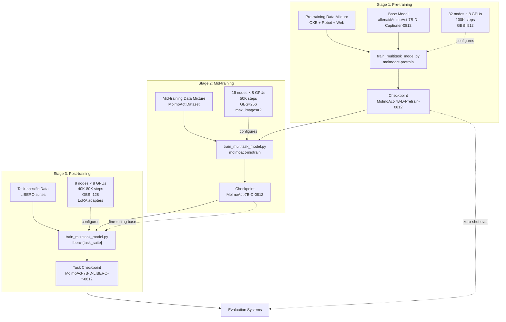

**Sources:** [README.md:329-457](), [README.md:110-265]()

---

## Training Execution Entry Point

All three training stages share the same execution script: `launch_scripts/train_multitask_model.py`. This script is invoked via PyTorch's distributed launcher (`torchrun`) with different configuration arguments for each stage.

### Command Structure

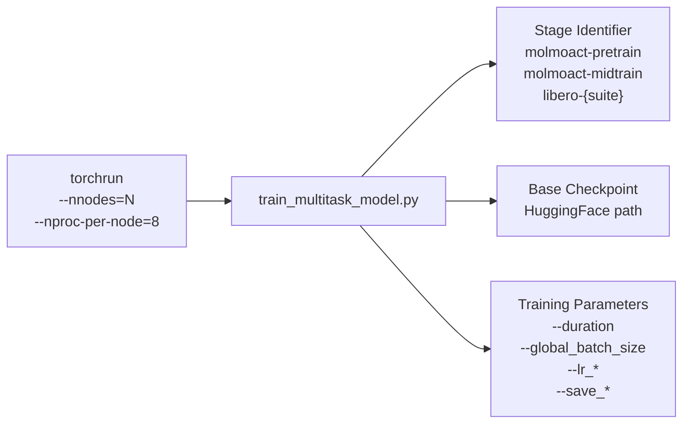

**Key Launch Parameters:**

| Parameter | Description | Stage Variation |
|-----------|-------------|-----------------|
| `--nnodes` | Number of compute nodes | 32 (pre) / 16 (mid) / 8 (post) |
| `--nproc-per-node` | GPUs per node | 8 (all stages) |
| `stage_identifier` | Dataset mixture selector | `molmoact-pretrain`, `molmoact-midtrain`, `libero-*` |
| `base_checkpoint` | Starting model | Stage-dependent HF path |

**Sources:** [README.md:332-351](), [README.md:382-400](), [README.md:416-436]()

---

## Stage Configuration Mapping

The first positional argument to `train_multitask_model.py` determines which data mixture is loaded and how the training loop is configured.

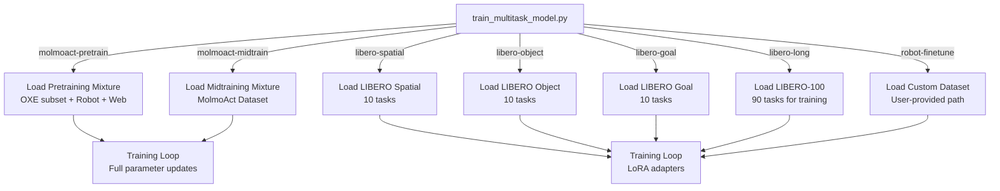

**Sources:** [README.md:336-351](), [README.md:384-400](), [README.md:418-436](), [README.md:163-187]()

---

## Computational Resource Scaling

The training pipeline scales computational resources according to the data size and training objectives at each stage:

| Stage | Nodes | GPUs | Global Batch Size | Training Steps | Wall Time Estimate |
|-------|-------|------|-------------------|----------------|-------------------|
| Pre-training | 32 | 256 | 512 | 100,000 | ~weeks |
| Mid-training | 16 | 128 | 256 | 50,000 | ~week |
| Post-training (LIBERO) | 8 | 64 | 128 | 40,000-80,000 | ~days |

**Distributed Training Setup:**

The pipeline uses PyTorch Distributed Data Parallel (DDP) with the following orchestration variables:

- `RANK`: Node rank in the cluster (0 to N-1)
- `ADDR`: Master node address for synchronization
- `PORT`: Communication port for distributed coordination

```bash
torchrun \
    --nnodes=N \
    --nproc-per-node=8 \
    --node_rank="${RANK}" \
    --master_addr="${ADDR}" \
    --master_port="${PORT}" \
    launch_scripts/train_multitask_model.py ...
```

**Sources:** [README.md:333-335](), [README.md:382-383](), [README.md:417-418](), [README.md:367-368]()

---

## Learning Rate Configuration

Each training stage uses component-specific learning rates to control the adaptation rate of different model parts:

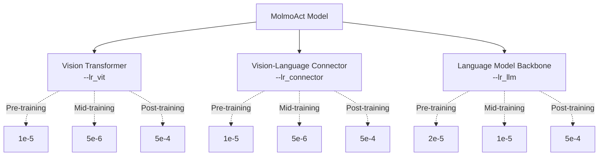

**Learning Rate Rationale:**
- **Pre-training**: Moderate LRs for full model adaptation to multimodal understanding
- **Mid-training**: Lower LRs to preserve pre-trained capabilities while specializing
- **Post-training**: Higher LRs with LoRA for rapid task-specific adaptation

**Sources:** [README.md:345-347](), [README.md:393-395](), [README.md:428-430]()

---

## Data Flow and Feature Flags

Training features are controlled through command-line flags that affect how data is processed and fed to the model:

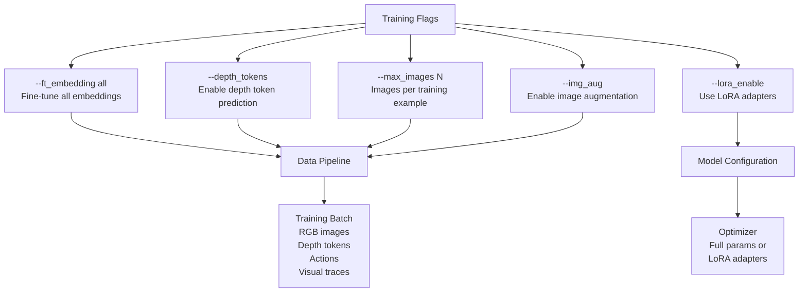

**Flag Usage by Stage:**

| Flag | Pre-training | Mid-training | Post-training |
|------|--------------|--------------|---------------|
| `--ft_embedding all` | ✓ | ✓ | ✓ |
| `--depth_tokens` | ✓ | ✓ | ✓ |
| `--max_images` | (default 1) | 2 | 2 |
| `--img_aug` | ✗ | ✗ | ✓ |
| `--lora_enable` | ✗ | ✗ | ✓ |

**Sources:** [README.md:342-343](), [README.md:390-391](), [README.md:426-435]()

---

## Checkpoint Management Strategy

The training pipeline implements a sophisticated checkpoint management system that balances storage efficiency with recovery capabilities:

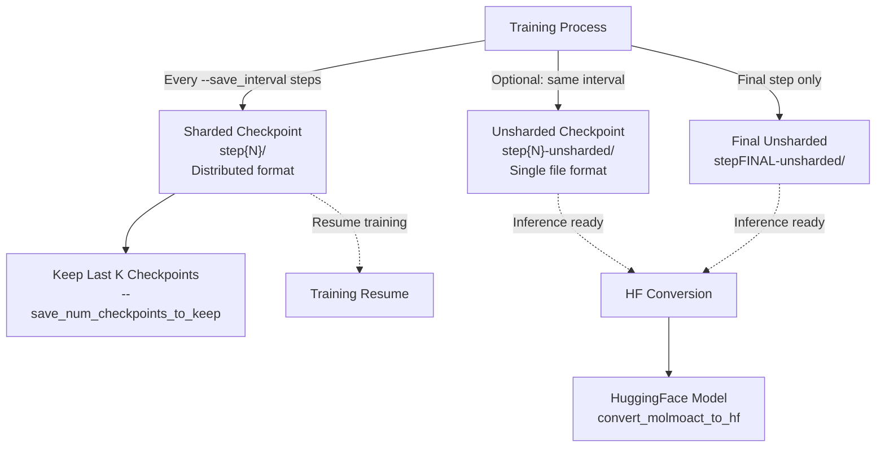

**Checkpoint Types:**

1. **Sharded Checkpoints** (`step{N}/`):
   - Default format saved every `--save_interval` steps
   - Distributed across multiple files for parallel I/O
   - Used for training resumption
   - Only last K kept (`--save_num_checkpoints_to_keep`)

2. **Unsharded Checkpoints** (`step{N}-unsharded/`):
   - Single consolidated checkpoint file
   - Required for inference and HF conversion
   - Saved at final step by default (`--save_final_unsharded_checkpoint`)
   - Optionally saved at all intervals (`--save_intermediate_unsharded_checkpoint`)

3. **LoRA Adapters** (`step{N}-lora/`):
   - Separate adapter weights when using LoRA fine-tuning
   - Must be merged with base model before inference

**Sources:** [README.md:362-365](), [README.md:193-200](), [README.md:216-222]()

---

## Training Stage Hyperparameters

Complete hyperparameter configuration for each training stage:

### Pre-training Configuration

```
Duration: 100,000 steps
Global Batch Size: 512
Learning Rates:
  - Vision Transformer: 1e-5
  - Connector: 1e-5
  - Language Model: 2e-5
Save Interval: 20,000 steps
Checkpoints Kept: 5
Max Images: 1 (default)
LoRA: Disabled
Image Augmentation: Disabled
```

### Mid-training Configuration

```
Duration: 50,000 steps
Global Batch Size: 256
Learning Rates:
  - Vision Transformer: 5e-6
  - Connector: 5e-6
  - Language Model: 1e-5
Save Interval: 10,000 steps
Checkpoints Kept: 5
Max Images: 2
LoRA: Disabled
Image Augmentation: Disabled
```

### Post-training Configuration

```
Duration: 40,000-80,000 steps (task-dependent)
Global Batch Size: 128
Learning Rates:
  - Vision Transformer: 5e-4
  - Connector: 5e-4
  - Language Model: 5e-4
Save Interval: 10,000 steps (default)
Checkpoints Kept: 5
Max Images: 2
LoRA: Enabled (rank=32, alpha=16, dropout=0.0)
Image Augmentation: Enabled
```

**Sources:** [README.md:341-351](), [README.md:389-400](), [README.md:424-436](), [README.md:444-451]()

---

## Environment Variables and Data Storage

The training pipeline relies on specific environment variables for data location and distributed coordination:

### Required Environment Variables

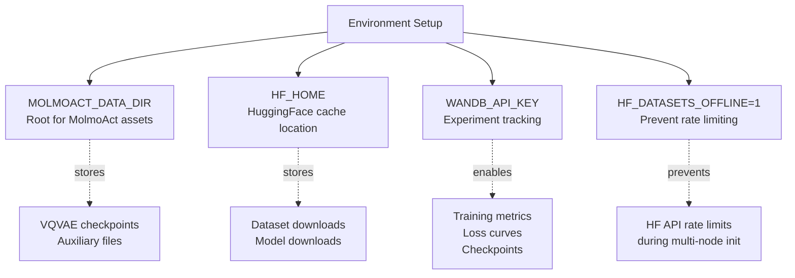

**Setup Example:**

```bash
export MOLMOACT_DATA_DIR=/data/molmoact
export HF_HOME=/data/molmoact/huggingface
export WANDB_API_KEY=<your_key>
export HF_DATASETS_OFFLINE=1  # During training only
```

**Critical Note:** Setting `HF_DATASETS_OFFLINE=1` during multi-node training prevents all nodes from simultaneously hitting HuggingFace servers during initialization, which can cause rate limiting. All datasets must be pre-downloaded before training.

**Sources:** [README.md:268-279](), [README.md:326-327](), [README.md:332-360]()

---

## Weights & Biases Integration

Training runs are tracked using Weights & Biases (W&B) for experiment monitoring:

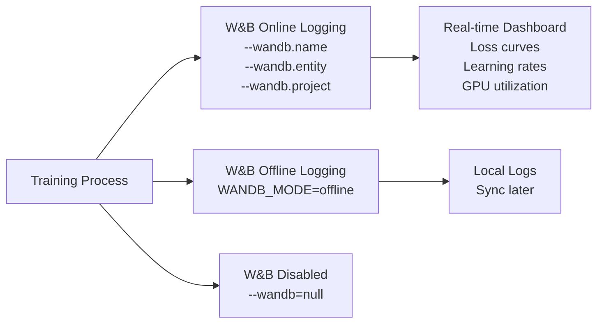

**W&B Command Examples:**

```bash
# Online logging
WANDB_API_KEY=<key> torchrun ... \
    --wandb.name=exp_name \
    --wandb.entity=team \
    --wandb.project=molmoact

# Offline logging
WANDB_MODE=offline torchrun ... \
    --wandb.name=exp_name

# Disable W&B
torchrun ... --wandb=null
```

**Sources:** [README.md:354-360]()

---

## Docker Training Environment

All training is designed to run within the containerized environment defined in the Dockerfile. The image includes optimized CUDA libraries and ML acceleration frameworks:

### Build Environment Components

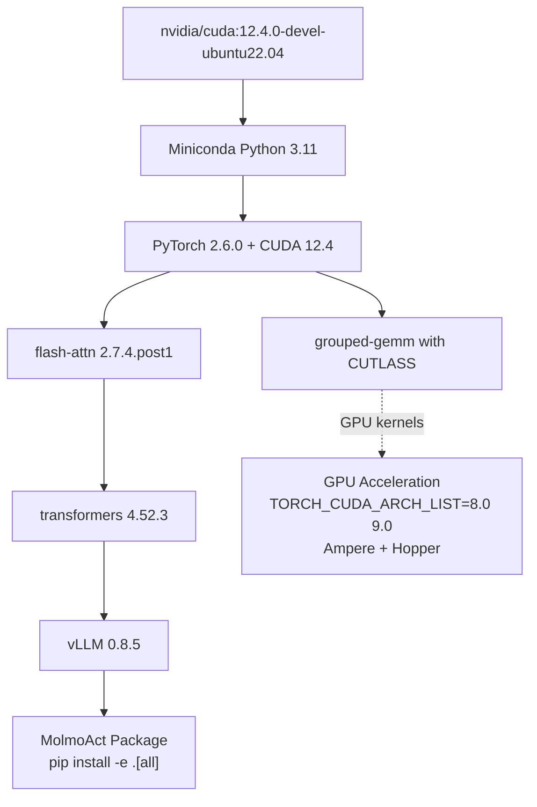

**Key Build Arguments:**

- `TORCH_CUDA_ARCH_LIST="8.0 9.0"`: Supports Ampere (A100) and Hopper (H100) architectures
- `GROUPED_GEMM_CUTLASS="1"`: Enables CUTLASS backend for batch-size-on-GPU
- Multi-stage build reduces final image size

**InfiniBand Support:**

The release image includes MLNX OFED drivers for high-speed inter-node communication during distributed training:

```dockerfile
ENV MOFED_VER="24.01-0.3.3.1"
RUN wget ... MLNX_OFED_LINUX-${MOFED_VER} ...
```

**Sources:** [Dockerfile:1-178](), [Dockerfile:51-52](), [Dockerfile:136-145]()

---

## Training Pipeline Invariants

Across all training stages, certain properties remain constant:

1. **Common Flags**: All stages use `--ft_embedding all` and `--depth_tokens`
2. **Base Architecture**: All stages train the same MolmoAct-7B architecture
3. **Entry Script**: All stages use `launch_scripts/train_multitask_model.py`
4. **GPU Configuration**: All stages use 8 GPUs per node
5. **Checkpoint Format**: All stages save sharded checkpoints by default
6. **Action Space**: 256 bins, chunk size 8 (from data preprocessing)

**Progressive Specialization Pattern:**
```
Generic Multimodal Model (Pre-training)
    ↓ Reduce compute, lower LR, robot data
Action Reasoning Model (Mid-training)
    ↓ Further reduce compute, higher LR, LoRA
Task-Specific Model (Post-training)
```

**Sources:** [README.md:342-343](), [README.md:390-391](), [README.md:426-427]()

---

## Save and Resume Workflow

The checkpoint system supports seamless training interruption and resumption:

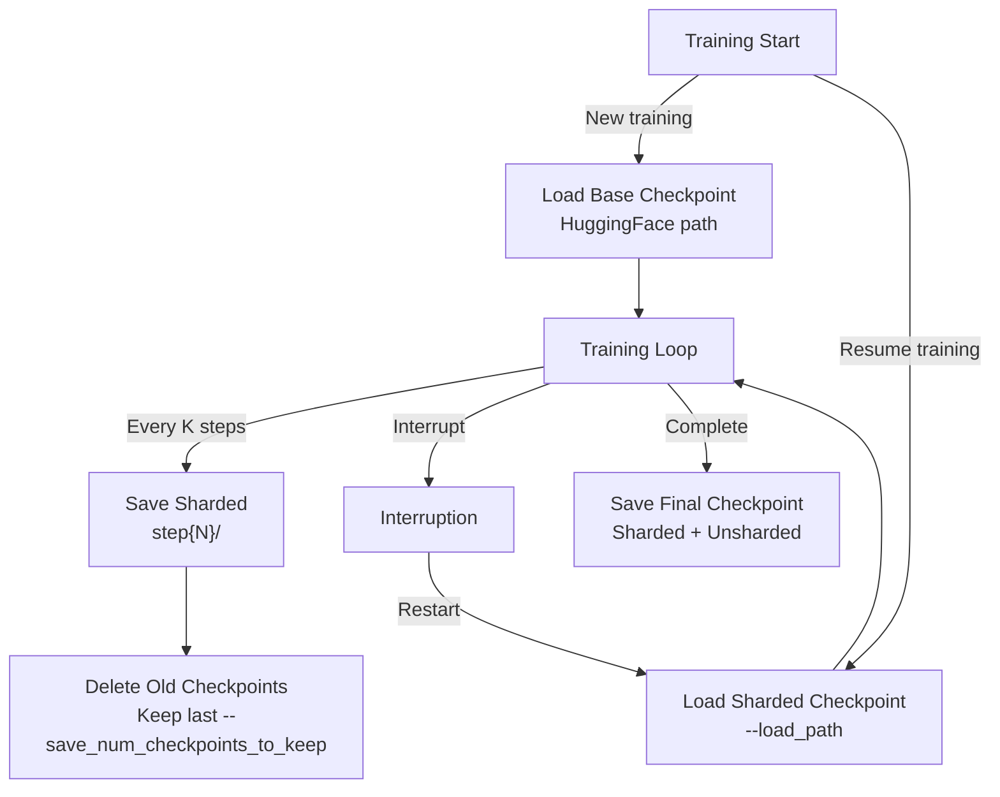

**Resume Training Command:**

```bash
torchrun ... launch_scripts/train_multitask_model.py \
    <stage> <base_checkpoint> \
    --load_path checkpoints/exp_name/step50000 \
    --save_folder checkpoints/exp_name \
    ...
```

**Sources:** [README.md:362-365]()

---

## Image Resolution Handling

The training pipeline includes special handling for image resolution to balance quality and computational efficiency:

**Pre-training and Mid-training:**
- High-resolution crops disabled by default
- All images downsized to ≤ 378×378
- Reduces memory footprint for large-scale training

**Post-training:**
- Same resolution policy maintained
- Image augmentation enabled (`--img_aug`)
- Augmentation includes spatial transformations while preserving action-image correspondence

**Rationale:** The base Molmo model supports high-resolution crops, but MolmoAct training stages intentionally disable this feature to focus computational resources on action reasoning rather than fine-grained visual detail.

**Sources:** [README.md:189-190]()

---

## Common Training Issues and Solutions

| Issue | Symptom | Solution |
|-------|---------|----------|
| OOM during data loading | Crash before training starts | Remove `--pin_memory` flag |
| HuggingFace rate limiting | Multi-node initialization hangs | Set `HF_DATASETS_OFFLINE=1` after pre-downloading data |
| Slow initial epoch | First epoch takes much longer | Expected behavior for dataset preprocessing/caching |
| Checkpoint storage overflow | Disk space exhausted | Reduce `--save_num_checkpoints_to_keep` or increase `--save_interval` |
| LoRA merge failure | Error during adapter merging | Ensure using `step{N}-lora` directory, not `step{N}` |

**Sources:** [README.md:371-372](), [README.md:326-327](), [README.md:193-200]()

---

## Post-Training Workflow

After training completes, models require conversion for inference:

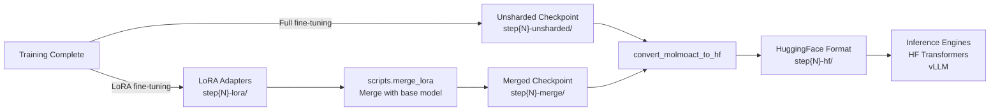

**Conversion Scripts:**

1. **Unshard** (if needed): `scripts.convert_to_unsharded`
2. **Merge LoRA**: `scripts.merge_lora`
3. **Convert to HF**: `olmo.hf_model.molmoact.convert_molmoact_to_hf`

**Sources:** [README.md:193-223](), [README.md:204-214]()

---

