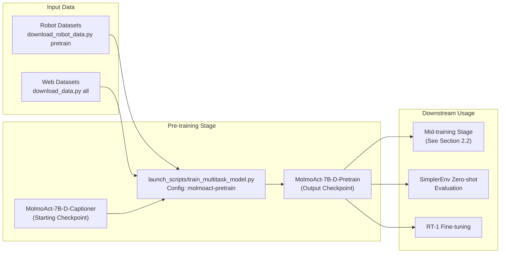
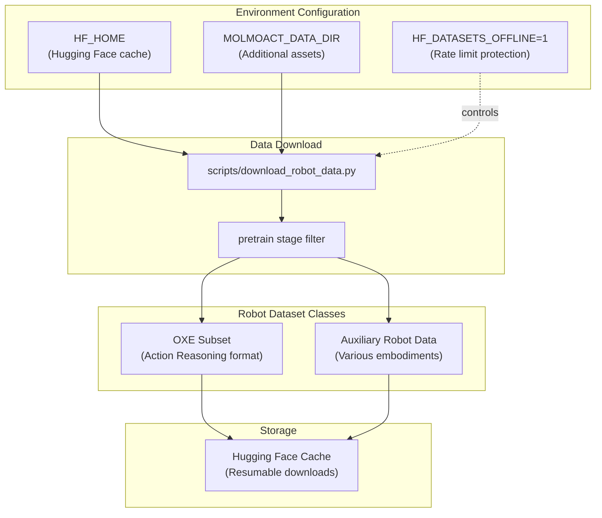
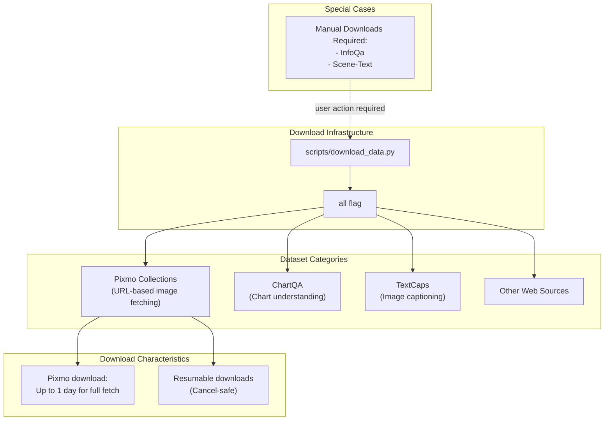
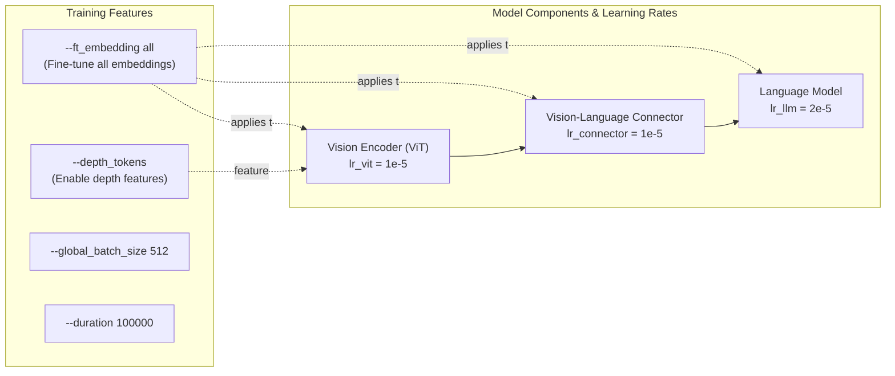
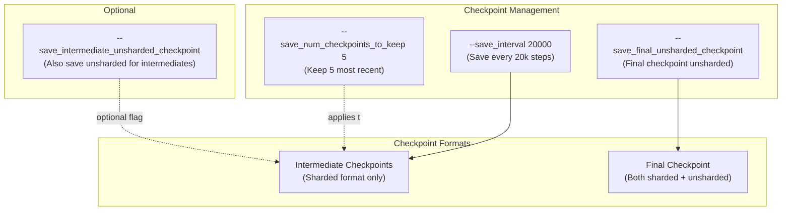
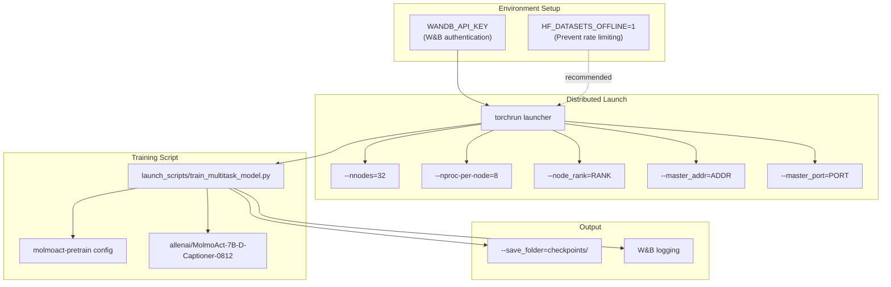
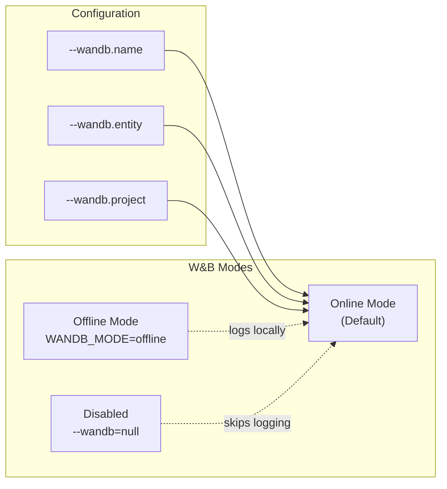
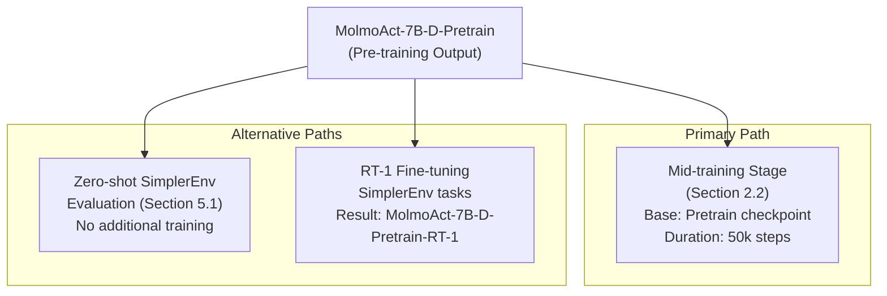

<!-- source: DeepWiki mcp.deepwiki.com · repo allenai/molmoact · page 2.1 Pre-training Stage · fetched 2026-10-26 -->

# Pre-training Stage

<details>
<summary>Relevant source files</summary>

The following files were used as context for generating this wiki page:

- [README.md](README.md)

</details>


## Purpose and Scope

This document describes the first stage of the MolmoAct three-stage training pipeline: **pre-training**. Pre-training establishes broad multimodal understanding by training on diverse robot demonstration datasets and multimodal web data. This stage uses the largest compute allocation (256 GPUs, 100,000 steps) and produces the `MolmoAct-7B-D-Pretrain` checkpoint, which can perform zero-shot evaluation on SimplerEnv or serve as a base for RT-1 fine-tuning.

For information about the subsequent training stages, see [Mid-training Stage](#2.2) and [Post-training and Task-Specific Fine-tuning](#2.3). For details about data acquisition and management, see [Data Management System](#3).

**Sources:** [README.md:174-218]()

---

## Overview

Pre-training transforms the `MolmoAct-7B-D-Captioner` checkpoint into `MolmoAct-7B-D-Pretrain` through exposure to a diverse mixture of robot manipulation demonstrations and multimodal web data. This stage prioritizes scale and diversity to establish foundational spatial reasoning capabilities before specialization.

### Training Pipeline Position



**Sources:** [README.md:60-68](), [README.md:174-218]()

---

## Data Sources

Pre-training utilizes two primary data categories: robot demonstration datasets from the Open X-Embodiment (OXE) collection and multimodal web datasets containing diverse visual reasoning tasks.

### Robot Demonstration Datasets

The robot datasets consist of a subset of OXE formulated as Action Reasoning data, supplemented with auxiliary robot datasets. These provide demonstrations of manipulation tasks across different robot embodiments, environments, and task specifications.



**Download Command:**
```bash
python3 scripts/download_robot_data.py pretrain --n_proc 16
```

The `--n_proc` parameter controls parallel download processes. Higher values speed up downloads but increase the risk of rate limiting from Hugging Face.

**Sources:** [README.md:127-147](), [README.md:113-124]()

### Multimodal Web Datasets

Web datasets provide diverse visual reasoning capabilities through tasks such as chart understanding (ChartQA), image captioning (TextCaps), and spatial reasoning across various domains. These datasets are sourced from Pixmo collections and other multimodal web sources.



**Download Command:**
```bash
python3 scripts/download_data.py all --n_proc 16
```

**Important Notes:**
- Pixmo datasets fetch images from URLs automatically but may take up to a full day for complete download
- Downloads are resumable if cancelled or interrupted
- InfoQa and Scene-Text datasets require manual download; the script will raise an error if these files are missing
- Android control dataset requires extra dependencies for TFRecord parsing

**Sources:** [README.md:150-171]()

---

## Training Configuration

### Compute Resources

Pre-training uses the largest resource allocation in the three-stage pipeline:

| Resource | Specification |
|----------|--------------|
| **Total GPUs** | 256 (32 nodes × 8 GPUs/node) |
| **Training Duration** | 100,000 steps |
| **Global Batch Size** | 512 |
| **Checkpoint Interval** | Every 20,000 steps |
| **Checkpoint Retention** | 5 most recent checkpoints |

**Sources:** [README.md:177-196]()

### Hyperparameters

The pre-training stage employs component-specific learning rates to balance training across the vision encoder, vision-language connector, and language model components:



**Key Configuration Parameters:**

| Parameter | Value | Description |
|-----------|-------|-------------|
| `--lr_vit` | 1e-5 | Vision encoder learning rate |
| `--lr_connector` | 1e-5 | Vision-language connector learning rate |
| `--lr_llm` | 2e-5 | Language model learning rate (highest) |
| `--ft_embedding` | all | Fine-tune all embedding layers |
| `--depth_tokens` | (flag) | Enable depth token features |
| `--global_batch_size` | 512 | Effective batch size across all GPUs |
| `--duration` | 100000 | Total training steps |

**Sources:** [README.md:186-196]()

### Checkpointing Strategy



By default, all intermediate checkpoints (at steps 20000, 40000, 60000, 80000) are saved in sharded format only to conserve storage. The final checkpoint at step 100000 is saved in both sharded and unsharded formats for easier downstream usage.

To save unsharded copies of every intermediate checkpoint, add the `--save_intermediate_unsharded_checkpoint` flag. This significantly increases storage requirements but provides more flexibility for checkpoint selection.

**Sources:** [README.md:207-210]()

---

## Execution

### Launch Command Structure



**Complete Launch Command:**

```bash
WANDB_API_KEY=<your_wandb_api_key> torchrun \
    --nnodes=32 --nproc-per-node=8 \
    --node_rank="${RANK}" --master_addr="${ADDR}" --master_port="${PORT}" \
    launch_scripts/train_multitask_model.py \
    molmoact-pretrain allenai/MolmoAct-7B-D-Captioner-0812 \
    --wandb.name=<name> --wandb.entity=<entity> --wandb.project=<project> \
    --save_folder=checkpoints/<exp_name> \
    --save_overwrite \
    --duration 100000 \
    --ft_embedding all \
    --depth_tokens \
    --global_batch_size 512 \
    --lr_connector 1e-5 \
    --lr_vit 1e-5 \
    --lr_llm 2e-5 \
    --save_interval 20000 \
    --save_num_checkpoints_to_keep 5 \
    --save_final_unsharded_checkpoint
```

**Sources:** [README.md:177-196]()

### Required Placeholders

Before executing, replace the following placeholders:

| Placeholder | Description | Example |
|-------------|-------------|---------|
| `<your_wandb_api_key>` | Weights & Biases API key for experiment tracking | `abc123def456...` |
| `<name>` | W&B run name | `molmoact-pretrain-exp1` |
| `<entity>` | W&B entity (username or team) | `allenai` |
| `<project>` | W&B project name | `molmoact-training` |
| `<exp_name>` | Local checkpoint folder name | `pretrain-2025-01` |

**Sources:** [README.md:198-201]()

### Cluster Launch Variables

The distributed launch requires setting cluster-specific environment variables:

- `${RANK}`: Node rank (0 to 31 for 32-node cluster)
- `${ADDR}`: Master node IP address
- `${PORT}`: Master node communication port

These variables are typically set by cluster management systems like SLURM, Kubernetes, or custom launchers. Consult your cluster documentation for the appropriate variable names.

**Sources:** [README.md:211-214]()

### Weights & Biases Configuration



**W&B Logging Options:**

1. **Online (default)**: Logs stream to W&B servers in real-time
2. **Offline mode**: Set `WANDB_MODE=offline` to log locally; sync later with `wandb sync`
3. **Disabled**: Replace `--wandb.name=<name> --wandb.entity=<entity> --wandb.project=<project>` with `--wandb=null`

**Sources:** [README.md:203-205]()

### Environment Variable Setup

Before training, configure the data and cache directories:

```bash
export MOLMOACT_DATA_DIR=/data/molmoact
export HF_HOME=/data/molmoact/huggingface
export HF_DATASETS_OFFLINE=1  # Recommended during training
```

| Variable | Purpose | Recommendation |
|----------|---------|----------------|
| `MOLMOACT_DATA_DIR` | Root for additional data assets | Set to high-capacity storage |
| `HF_HOME` | Hugging Face cache location | Set to high-capacity storage |
| `HF_DATASETS_OFFLINE` | Prevent online dataset queries during training | Set to `1` to avoid rate limiting |

The `HF_DATASETS_OFFLINE=1` flag is critical in distributed training scenarios. Without it, all nodes may simultaneously attempt to access Hugging Face servers during initialization, causing rate limiting that can delay or halt training.

**Sources:** [README.md:113-124](), [README.md:166-171]()

---

## Output Checkpoint

### Checkpoint Artifact

Pre-training produces the `MolmoAct-7B-D-Pretrain` checkpoint, saved in the directory specified by `--save_folder`. The final checkpoint (step 100000) is saved in both sharded and unsharded formats.

**Checkpoint Location:**
```
checkpoints/<exp_name>/
├── step100000-sharded/
│   ├── model.pt.0
│   ├── model.pt.1
│   └── ...
└── step100000-unsharded/
    └── model.pt
```

**Sources:** [README.md:207-210]()

### Usage Paths



The `MolmoAct-7B-D-Pretrain` checkpoint serves three primary purposes:

1. **Mid-training base (primary)**: Serves as the starting checkpoint for the mid-training stage, which introduces the MolmoAct Dataset with Action Reasoning format and multi-image inputs. See [Mid-training Stage](#2.2).

2. **Zero-shot evaluation**: Can directly evaluate on SimplerEnv Google Robot tasks without additional training. See [SimplerEnv Evaluation](#5.1).

3. **RT-1 fine-tuning**: Can be fine-tuned on RT-1 demonstrations to produce the `MolmoAct-7B-D-Pretrain-RT-1` checkpoint for improved SimplerEnv performance.

**Sources:** [README.md:60-68](), [README.md:84-86]()

---

## Important Considerations

### Memory Management

Do not use the `--pin_memory` flag with large datasets during pre-training. Pinned memory allocation during data loading can cause out-of-memory (OOM) errors when working with the diverse and large-scale datasets used in this stage.

**Sources:** [README.md:216-217]()

### Storage Requirements

Pre-training generates substantial storage requirements:

- **Input data**: Multiple terabytes for robot and web datasets
- **Checkpoints**: ~14GB per sharded checkpoint, ~28GB for unsharded
- **Total checkpoint storage**: 5 sharded checkpoints + 1 unsharded = ~98GB minimum

Plan storage capacity accordingly, especially if using `--save_intermediate_unsharded_checkpoint`.

**Sources:** [README.md:193-196](), [README.md:207-210]()

### Training Duration

Pre-training is the longest stage in the pipeline. At 100,000 steps with a global batch size of 512:

- Total training samples: 51.2 million
- Approximate wall time: Varies by hardware, typically 3-7 days on 256 A100 GPUs

Ensure sufficient cluster allocation time and implement checkpoint resumption if training may be interrupted.

**Sources:** [README.md:186-196]()

---

