<!-- source: DeepWiki mcp.deepwiki.com · repo allenai/molmoact · page 2.2 Mid-training Stage · fetched 2026-10-26 -->

# Mid-training Stage

<details>
<summary>Relevant source files</summary>

The following files were used as context for generating this wiki page:

- [README.md](README.md)

</details>


## Purpose and Scope

This document describes the mid-training stage of MolmoAct's three-stage curriculum learning pipeline. Mid-training is the second training phase that bridges pre-training and post-training, introducing the MolmoAct Dataset formatted as Action Reasoning data with multi-image inputs. This stage reduces compute resources while focusing on spatial reasoning capabilities.

For information about the first training stage, see [Pre-training Stage](#2.1). For information about task-specific fine-tuning that follows mid-training, see [Post-training and Task-Specific Fine-tuning](#2.3). For checkpoint hierarchy and usage paths, see [Model Checkpoints and Usage](#4).

---

## Overview

Mid-training continues the curriculum learning process started in pre-training, but shifts the data distribution entirely to the MolmoAct Dataset. This stage represents a strategic reduction in both computational resources and training duration while introducing more complex spatial reasoning tasks. The output of this stage, `MolmoAct-7B-D`, serves as the recommended base checkpoint for real robot adaptation and LIBERO fine-tuning.

### Training Pipeline Position

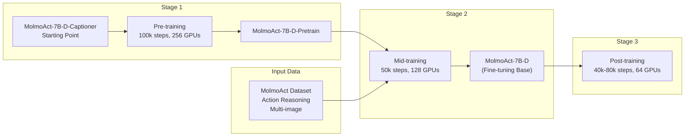

**Sources:** [README.md:60-68](), [README.md:221-249]()

---

## Training Configuration

### Entry Point

Mid-training uses the same training script as pre-training but with different configuration parameters and data mixture.

| Component | Value |
|-----------|-------|
| Training Script | `launch_scripts/train_multitask_model.py` |
| Data Mixture ID | `molmoact-midtrain` |
| Base Checkpoint | `allenai/MolmoAct-7B-D-Pretrain-0812` |
| Output Checkpoint | `allenai/MolmoAct-7B-D-0812` |

**Sources:** [README.md:224-243]()

### Compute Resources

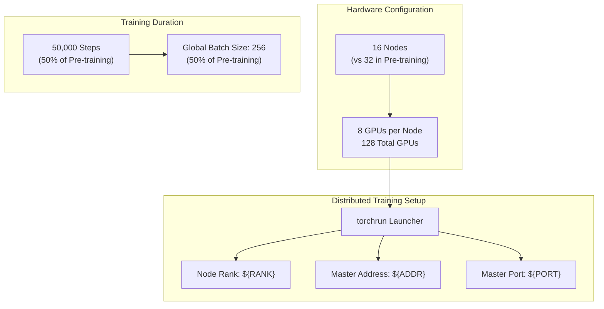

**Sources:** [README.md:225-226](), [README.md:232](), [README.md:235]()

---

## Data Sources

### MolmoAct Dataset

Mid-training exclusively uses the MolmoAct Dataset, which consists of in-house collected data formatted as Action Reasoning examples.

| Dataset Property | Value |
|-----------------|-------|
| Dataset Name | MolmoAct Dataset |
| Format | Action Reasoning |
| HuggingFace Path | `allenai/MolmoAct-Dataset` |
| Mixture Configuration | `allenai/MolmoAct-Midtraining-Mixture` |
| Images Per Example | 2 (`--max_images 2`) |

**Sources:** [README.md:74-76](), [README.md:242]()

### Data Format Characteristics

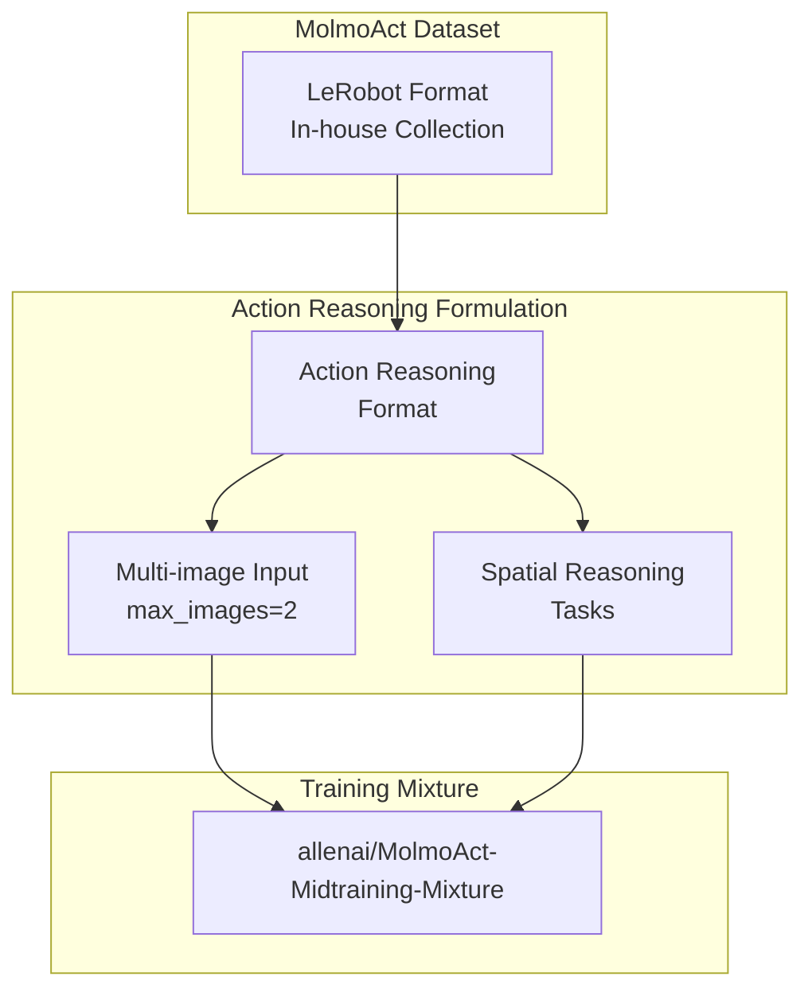

**Sources:** [README.md:74](), [README.md:76](), [README.md:242]()

---

## Training Command Structure

### Complete Command

The mid-training command follows this structure:

```bash
WANDB_API_KEY=<your_wandb_api_key> torchrun --nnodes=16 --nproc-per-node=8 \
    --node_rank="${RANK}" --master_addr="${ADDR}" --master_port="${PORT}" \
    launch_scripts/train_multitask_model.py \
    molmoact-midtrain allenai/MolmoAct-7B-D-Pretrain-0812 \
    --wandb.name=<name> --wandb.entity=<entity> --wandb.project=<project>  \
    --save_folder=checkpoints/<exp_name> \
    --save_overwrite \
    --duration 50000 \
    --ft_embedding all \
    --depth_tokens \
    --global_batch_size 256 \
    --lr_connector 5e-6 \
    --lr_vit 5e-6 \
    --lr_llm 1e-5 \
    --save_interval 10000 \
    --save_num_checkpoints_to_keep 5 \
    --save_final_unsharded_checkpoint \
    --max_images 2
```

**Sources:** [README.md:224-243]()

### Parameter Mapping

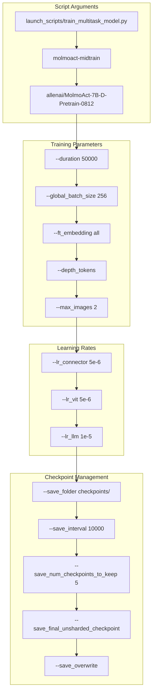

**Sources:** [README.md:227-243]()

---

## Hyperparameter Configuration

### Core Training Parameters

| Parameter | Value | Description |
|-----------|-------|-------------|
| `--duration` | `50000` | Training steps (half of pre-training) |
| `--global_batch_size` | `256` | Total batch size across all GPUs (half of pre-training) |
| `--ft_embedding` | `all` | Fine-tune all embedding layers |
| `--depth_tokens` | (flag) | Enable depth token processing |
| `--max_images` | `2` | Two images per training example |

**Sources:** [README.md:232](), [README.md:235](), [README.md:242]()

### Learning Rate Schedule

Mid-training uses lower learning rates compared to pre-training to preserve learned features while adapting to the MolmoAct Dataset.

| Component | Learning Rate | Ratio vs Pre-training |
|-----------|---------------|----------------------|
| Connector (`--lr_connector`) | `5e-6` | 0.5× (was `1e-5`) |
| Vision Encoder (`--lr_vit`) | `5e-6` | 0.5× (was `1e-5`) |
| Language Model (`--lr_llm`) | `1e-5` | 0.5× (was `2e-5`) |

**Sources:** [README.md:236-238](), [README.md:190-192]()

### Checkpoint Management

| Parameter | Value | Purpose |
|-----------|-------|---------|
| `--save_folder` | `checkpoints/<exp_name>` | Base directory for saving checkpoints |
| `--save_overwrite` | (flag) | Allow overwriting existing checkpoint directory |
| `--save_interval` | `10000` | Save checkpoint every 10,000 steps |
| `--save_num_checkpoints_to_keep` | `5` | Retain only the 5 most recent checkpoints |
| `--save_final_unsharded_checkpoint` | (flag) | Save unsharded version of final checkpoint |

**Sources:** [README.md:230-231](), [README.md:239-241]()

---

## Multi-image Input Processing

### Image Configuration

The `--max_images 2` parameter is a key distinguishing feature of mid-training, enabling the model to process temporal or multi-view information.

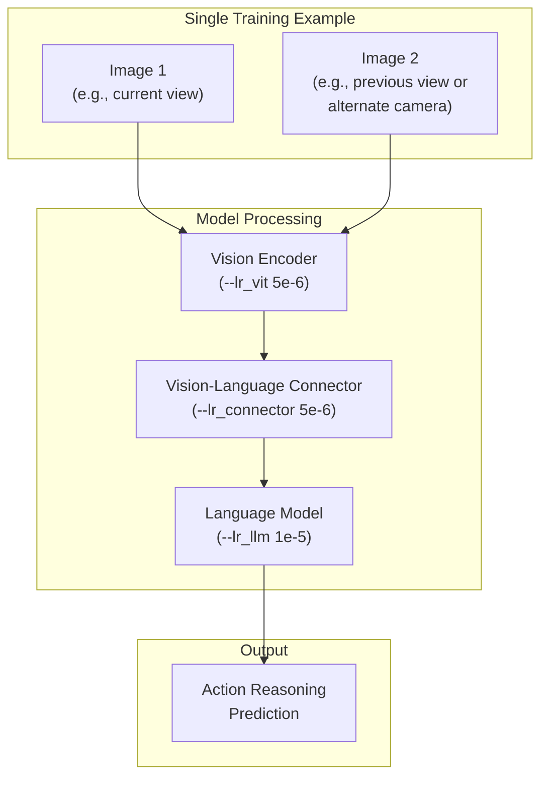

**Sources:** [README.md:242](), [README.md:248]()

---

## Comparison with Pre-training Stage

### Resource and Hyperparameter Differences

| Aspect | Pre-training | Mid-training | Change |
|--------|--------------|--------------|--------|
| **Compute** | | | |
| Nodes | 32 | 16 | 50% reduction |
| Total GPUs | 256 | 128 | 50% reduction |
| **Training Duration** | | | |
| Steps | 100,000 | 50,000 | 50% reduction |
| Global Batch Size | 512 | 256 | 50% reduction |
| **Learning Rates** | | | |
| Connector LR | `1e-5` | `5e-6` | 50% reduction |
| ViT LR | `1e-5` | `5e-6` | 50% reduction |
| LLM LR | `2e-5` | `1e-5` | 50% reduction |
| **Checkpoint Saving** | | | |
| Save Interval | 20,000 | 10,000 | More frequent |
| **Data** | | | |
| Data Mixture | `molmoact-pretrain` | `molmoact-midtrain` | Different mixture |
| Dataset Source | Robot demos + Web data | MolmoAct Dataset only | Specialized |
| Max Images | 1 (default) | 2 | Multi-image support |
| **Base Checkpoint** | | | |
| Starting Point | `MolmoAct-7B-D-Captioner-0812` | `MolmoAct-7B-D-Pretrain-0812` | Output of Stage 1 |

**Sources:** [README.md:174-218](), [README.md:221-249]()

### Strategic Rationale

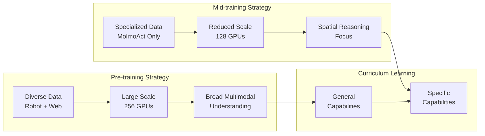

**Sources:** [README.md:60-68](), [README.md:245-249]()

---

## Output Checkpoint

### Checkpoint Identity

| Property | Value |
|----------|-------|
| Checkpoint Name | `MolmoAct-7B-D` |
| HuggingFace Path | `allenai/MolmoAct-7B-D-0812` |
| Use Case | Fine-tuning base for real robots |
| Stage Position | Output of mid-training |

**Sources:** [README.md:82](), [README.md:228]()

### Usage Paths

The `MolmoAct-7B-D` checkpoint serves as the recommended starting point for downstream applications.

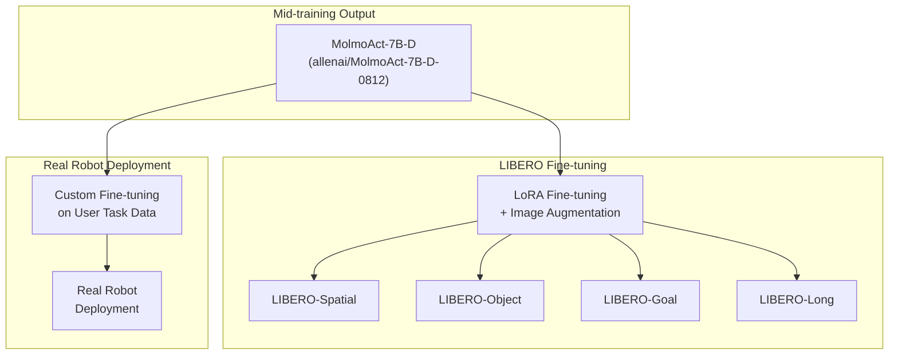

**Sources:** [README.md:82](), [README.md:254-295]()

---

## Environment Configuration

### Required Environment Variables

Mid-training requires the same environment configuration as pre-training:

| Variable | Purpose | Example |
|----------|---------|---------|
| `HF_HOME` | HuggingFace cache location | `/data/molmoact/huggingface` |
| `MOLMOACT_DATA_DIR` | Additional assets directory | `/data/molmoact` |
| `HF_DATASETS_OFFLINE` | Prevent rate limiting (recommended) | `1` |
| `WANDB_API_KEY` | Weights & Biases API key | `<your_key>` |

**Sources:** [README.md:116-123](), [README.md:171](), [README.md:224]()

### Data Download Requirements

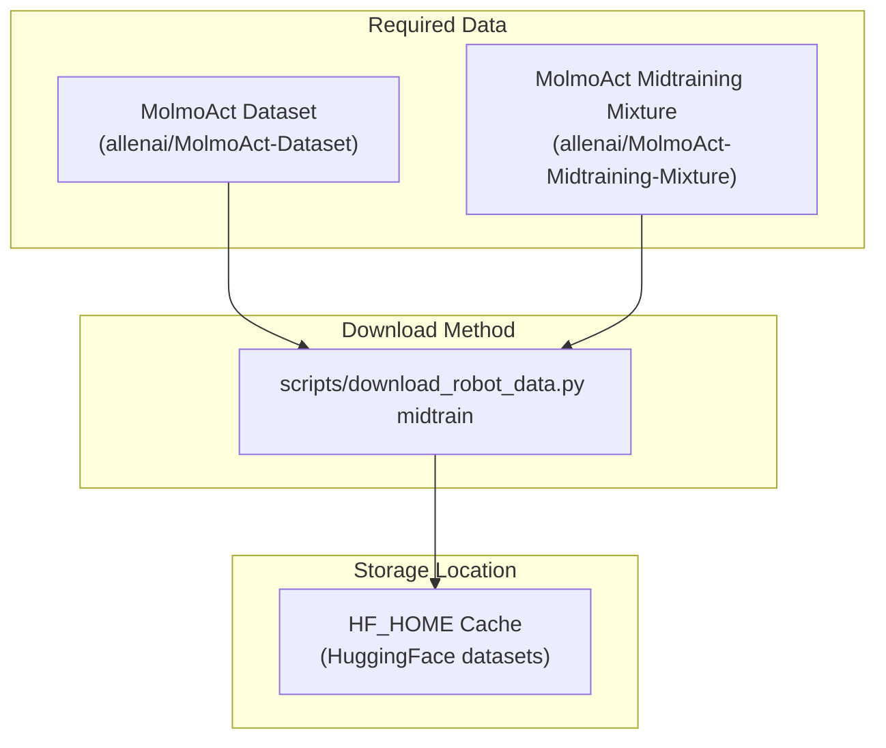

**Sources:** [README.md:127-147](), [README.md:76]()

---

## Distributed Training Setup

### Cluster Launch Variables

The mid-training command requires proper configuration of distributed training environment variables:

| Variable | Purpose | Source |
|----------|---------|--------|
| `${RANK}` | Node rank in cluster | Set by cluster scheduler |
| `${ADDR}` | Master node address | Set by cluster scheduler |
| `${PORT}` | Master communication port | Set by cluster scheduler |

**Sources:** [README.md:226](), [README.md:211-213]()

### Torchrun Configuration

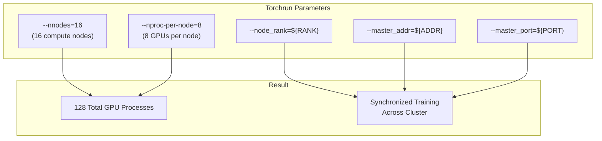

**Sources:** [README.md:225-226]()

---

## Weights & Biases Integration

### Logging Configuration

| Parameter | Purpose | Required |
|-----------|---------|----------|
| `--wandb.name` | Experiment run name | Yes |
| `--wandb.entity` | W&B entity/username | Yes |
| `--wandb.project` | W&B project name | Yes |
| `WANDB_API_KEY` | Authentication key (env var) | Yes |

### Alternative Logging Modes

| Mode | Configuration | Use Case |
|------|---------------|----------|
| **Offline** | `WANDB_MODE=offline` | No internet connectivity |
| **Disabled** | Replace W&B params with `--wandb=null` | No logging needed |

**Sources:** [README.md:229](), [README.md:203-205]()

---

## Checkpoint Format and Storage

### Checkpoint Types

Mid-training produces two types of checkpoints:

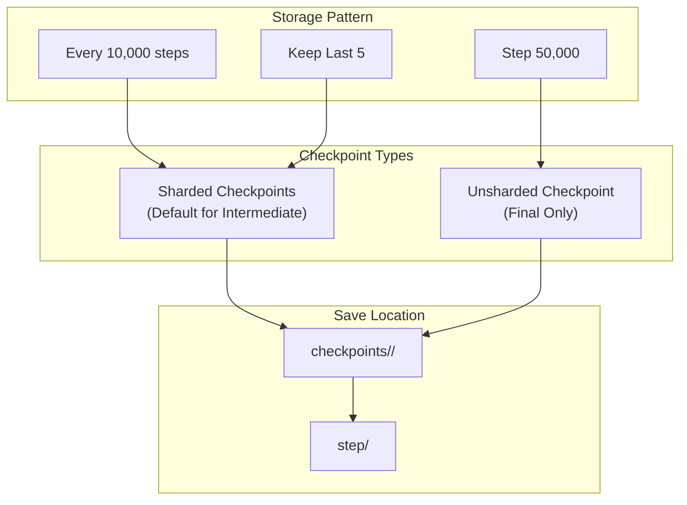

**Sources:** [README.md:207-209](), [README.md:239-241]()

### Optional Unsharded Intermediate Checkpoints

To save unsharded versions of intermediate checkpoints (not just the final one), add:

```bash
--save_intermediate_unsharded_checkpoint
```

**Note:** This increases storage requirements significantly.

**Sources:** [README.md:209]()

---

## Best Practices and Notes

### Memory Management

- **Do not use** `--pin_memory` with large datasets; it can cause out-of-memory errors during data loading.

**Sources:** [README.md:216]()

### Rate Limiting Prevention

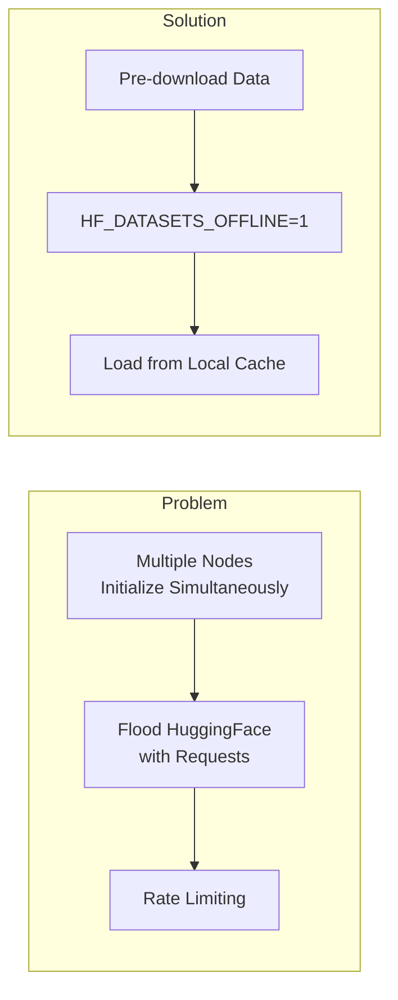

**Sources:** [README.md:171]()

### Checkpoint Selection

For most downstream applications:
- **Use `MolmoAct-7B-D`** (mid-training output) as the base for fine-tuning
- **Use `MolmoAct-7B-D-Pretrain`** only for SimplerEnv zero-shot evaluation or RT-1 fine-tuning

**Sources:** [README.md:82-86]()

---

## Summary Table

| Characteristic | Value |
|----------------|-------|
| **Stage Position** | 2 of 3 (between pre-training and post-training) |
| **Primary Script** | `launch_scripts/train_multitask_model.py` |
| **Data Mixture ID** | `molmoact-midtrain` |
| **Compute Resources** | 16 nodes × 8 GPUs = 128 GPUs |
| **Training Steps** | 50,000 |
| **Global Batch Size** | 256 |
| **Learning Rates** | Connector: 5e-6, ViT: 5e-6, LLM: 1e-5 |
| **Input Configuration** | 2 images per example (`--max_images 2`) |
| **Base Checkpoint** | `allenai/MolmoAct-7B-D-Pretrain-0812` |
| **Output Checkpoint** | `allenai/MolmoAct-7B-D-0812` |
| **Primary Dataset** | MolmoAct Dataset (Action Reasoning format) |
| **Recommended Use** | Base for LIBERO fine-tuning and real robot adaptation |

**Sources:** [README.md:221-249]()

---

