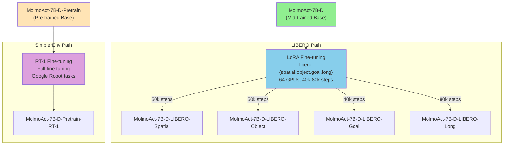
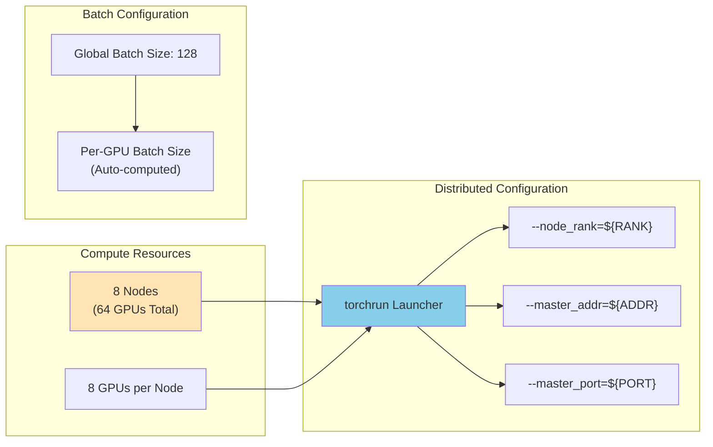
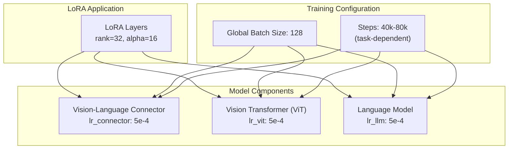
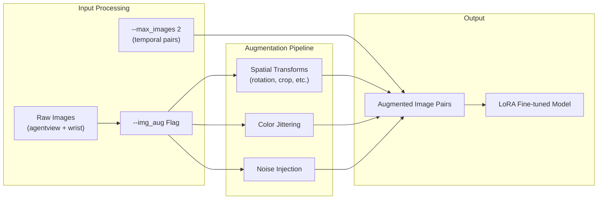
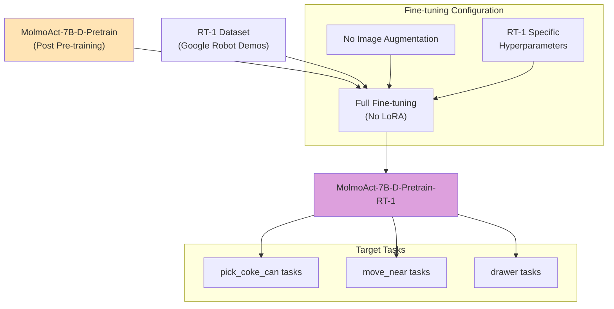
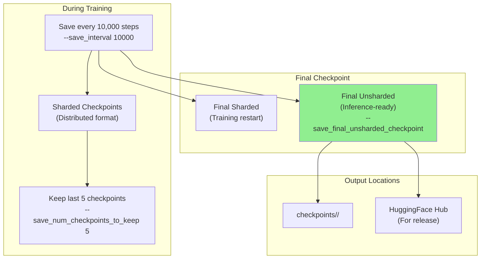
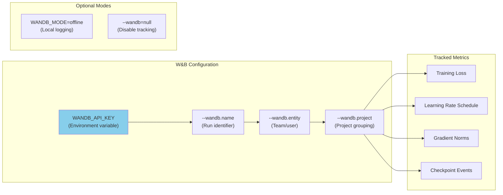
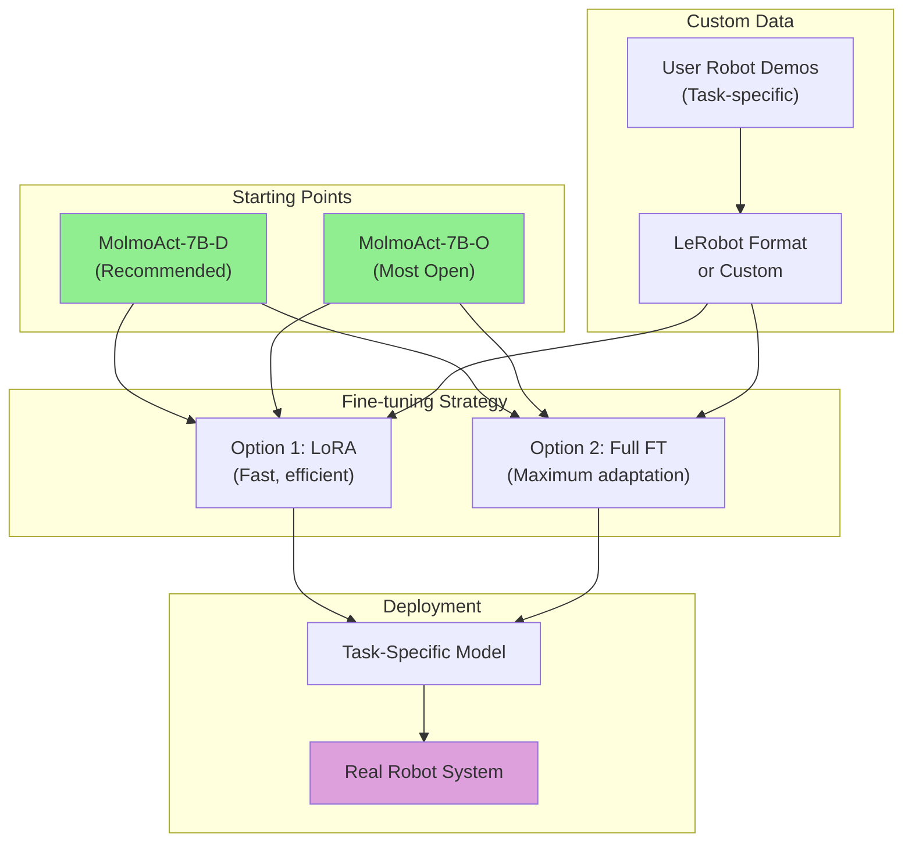

<!-- source: DeepWiki mcp.deepwiki.com · repo allenai/molmoact · page 2.3 Post-training and Task-Specific Fine-tuning · fetched 2026-10-26 -->

# Post-training and Task-Specific Fine-tuning

<details>
<summary>Relevant source files</summary>

The following files were used as context for generating this wiki page:

- [README.md](README.md)

</details>


## Purpose and Scope

This document describes the third and final stage of MolmoAct's training pipeline: post-training and task-specific fine-tuning. This stage adapts the mid-trained MolmoAct-7B-D checkpoint to specific downstream tasks through parameter-efficient LoRA fine-tuning. The process produces specialized models for LIBERO benchmark evaluation and SimplerEnv tasks.

For information about earlier training stages, see [Pre-training Stage](#2.1) and [Mid-training Stage](#2.2). For evaluation procedures using these fine-tuned checkpoints, see [Evaluation Pipelines](#5).

**Sources**: README.md:254-296

---

## Overview of Post-training Paths

Post-training in MolmoAct follows two distinct paths depending on the target evaluation benchmark:



**LIBERO Path**: Uses the mid-trained `MolmoAct-7B-D` checkpoint with LoRA and image augmentation to produce four task-suite-specific models.

**SimplerEnv Path**: Uses the pre-trained `MolmoAct-7B-D-Pretrain` checkpoint with full fine-tuning on RT-1 demonstrations for Google Robot evaluation.

**Sources**: README.md:80-86, README.md:254-296

---

## LIBERO Fine-tuning Configuration

### Base Checkpoint and Task Suites

LIBERO fine-tuning begins from `allenai/MolmoAct-7B-D-0812`, the mid-trained checkpoint that incorporates both robot and web data understanding. The training script [launch_scripts/train_multitask_model.py]() handles four distinct task suite configurations:

| Task Suite | Configuration Name | Training Steps | Description |
|------------|-------------------|----------------|-------------|
| LIBERO-Spatial | `libero-spatial` | 50,000 | Spatial reasoning tasks |
| LIBERO-Object | `libero-object` | 50,000 | Object manipulation tasks |
| LIBERO-Goal | `libero-goal` | 40,000 | Goal-conditioned tasks |
| LIBERO-Long | `libero-long` | 80,000 | Long-horizon tasks (LIBERO-10) |

Each suite requires different training durations based on task complexity and distribution characteristics.

**Sources**: README.md:286-292

### Training Command Structure

The complete training invocation demonstrates the integration of LoRA, image augmentation, and task-specific configurations:

```bash
WANDB_API_KEY=<your_wandb_api_key> torchrun --nnodes=8 --nproc-per-node=8 \
    --node_rank="${RANK}" --master_addr="${ADDR}" --master_port="${PORT}" \
    launch_scripts/train_multitask_model.py \
    libero-<task_suite> allenai/MolmoAct-7B-D-0812 \
    --wandb.name=<name> --wandb.entity=<entity> --wandb.project=<project>  \
    --save_folder=checkpoints/<exp_name> \
    --save_overwrite \
    --duration <steps> \
    --ft_embedding all \
    --depth_tokens \
    --global_batch_size 128 \
    --lr_connector 5e-4 \
    --lr_vit 5e-4 \
    --lr_llm 5e-4 \
    --save_interval 10000 \
    --save_num_checkpoints_to_keep 5 \
    --save_final_unsharded_checkpoint \
    --max_images 2 \
    --lora_enable --lora_rank 32 --lora_alpha 16 --lora_dropout 0.0 \
    --img_aug
```

**Sources**: README.md:257-278

### Hardware and Distributed Training



LIBERO fine-tuning uses 8 nodes with 8 GPUs each (64 GPUs total), a 4× reduction from mid-training's 128 GPUs. The global batch size of 128 is distributed across all GPUs, with `torchrun` handling the distributed launch orchestration.

**Sources**: README.md:258-260

---

## LoRA Parameter-Efficient Fine-tuning

### LoRA Configuration Parameters

Post-training employs Low-Rank Adaptation (LoRA) to efficiently adapt the model while preserving pre-trained knowledge:

| Parameter | Value | Purpose |
|-----------|-------|---------|
| `--lora_enable` | (flag) | Activates LoRA fine-tuning mode |
| `--lora_rank` | 32 | Rank of low-rank decomposition matrices |
| `--lora_alpha` | 16 | Scaling factor (alpha/rank = 0.5) |
| `--lora_dropout` | 0.0 | Dropout rate for LoRA layers (disabled) |

The rank-32 configuration with alpha-16 provides a balanced trade-off between adaptation capacity and parameter efficiency. The scaling factor of 0.5 (16/32) moderates the magnitude of LoRA updates.

**Sources**: README.md:276

### Component-wise Learning Rates

Unlike pre-training and mid-training which use different learning rates for different components, LIBERO fine-tuning employs a uniform learning rate across all model components:



All three components (connector, ViT, and LLM) use `5e-4` learning rate, significantly higher than mid-training rates (5e-6) to enable rapid adaptation to task-specific distributions.

**Sources**: README.md:269-271

### Embedding Fine-tuning

The `--ft_embedding all` flag enables fine-tuning of all embedding layers, including:
- Token embeddings in the language model
- Position embeddings
- Any task-specific embedding layers

This differs from frozen embedding approaches and allows the model to adapt its input representations to LIBERO-specific visual and language patterns.

**Sources**: README.md:266

---

## Image Augmentation Strategy

### Augmentation Configuration



The `--img_aug` flag activates image augmentation during training. Combined with `--max_images 2`, the system processes temporal image pairs (typically consecutive frames) through augmentation, improving robustness to visual variations in LIBERO environments.

**Sources**: README.md:277, README.md:275

### Multi-Image Input Processing

The `--max_images 2` parameter indicates that each training example processes two images:
1. **Temporal context**: Usually consecutive frames providing motion information
2. **Spatial reasoning**: Multiple viewpoints (agentview and wrist camera)

This multi-image configuration is consistent with mid-training but gains additional robustness through augmentation during LIBERO fine-tuning.

**Sources**: README.md:275

---

## RT-1 Fine-tuning for SimplerEnv

### Alternative Fine-tuning Path

The RT-1 fine-tuning path diverges from LIBERO by starting from the pre-trained checkpoint rather than the mid-trained one:



**Key Differences from LIBERO Path**:
- Uses pre-trained checkpoint (before MolmoAct Dataset exposure)
- Full fine-tuning rather than LoRA
- No image augmentation
- Targets Google Robot tasks in SimplerEnv

**Sources**: README.md:84-85, README.md:299-312

### SimplerEnv Target Tasks

The RT-1 fine-tuned checkpoint evaluates on three Google Robot task categories:
1. **pick_coke_can**: Visual matching and variant aggregation
2. **move_near**: Object proximity manipulation
3. **drawer**: Container interaction tasks

Each task category has dedicated evaluation scripts in the SimplerEnv repository.

**Sources**: README.md:306-312

---

## Checkpoint Management and Outputs

### Checkpoint Saving Strategy



The checkpoint strategy balances training resumability with inference deployment needs:
- **Intermediate checkpoints**: Sharded format every 10k steps, keeping only last 5 to save storage
- **Final checkpoint**: Both sharded (for potential continued training) and unsharded (for inference)

**Sources**: README.md:272-274

### Task-Suite-Specific Output Checkpoints

Each LIBERO task suite produces a dedicated fine-tuned checkpoint:

| Output Checkpoint | HuggingFace Path | Task Suite | Training Steps |
|-------------------|------------------|------------|----------------|
| LIBERO-Spatial | `allenai/MolmoAct-7B-D-LIBERO-Spatial-0812` | libero-spatial | 50,000 |
| LIBERO-Object | `allenai/MolmoAct-7B-D-LIBERO-Object-0812` | libero-object | 50,000 |
| LIBERO-Goal | `allenai/MolmoAct-7B-D-LIBERO-Goal-0812` | libero-goal | 40,000 |
| LIBERO-Long | `allenai/MolmoAct-7B-D-LIBERO-Long-0812` | libero-long | 80,000 |

These checkpoints are evaluation-ready and used directly in LIBERO benchmark evaluation scripts. See [LIBERO Benchmark Evaluation](#5.2) for usage details.

**Sources**: README.md:329-332

---

## Training Configuration Comparison

### Cross-Stage Hyperparameter Evolution

The following table illustrates how key hyperparameters evolve from pre-training through post-training:

| Parameter | Pre-training | Mid-training | Post-training (LIBERO) |
|-----------|--------------|--------------|------------------------|
| **Base Checkpoint** | Captioner | Pretrain | Midtrain (MolmoAct-7B-D) |
| **GPUs** | 256 (32 nodes × 8) | 128 (16 nodes × 8) | 64 (8 nodes × 8) |
| **Steps** | 100,000 | 50,000 | 40,000-80,000 |
| **Global Batch Size** | 512 | 256 | 128 |
| **lr_connector** | 1e-5 | 5e-6 | 5e-4 |
| **lr_vit** | 1e-5 | 5e-6 | 5e-4 |
| **lr_llm** | 2e-5 | 1e-5 | 5e-4 |
| **max_images** | 1 | 2 | 2 |
| **LoRA** | Disabled | Disabled | Enabled (rank=32) |
| **Image Aug** | No | No | Yes (--img_aug) |

**Key Observations**:
1. Compute resources progressively decrease (256 → 128 → 64 GPUs)
2. Learning rates increase dramatically for post-training (100× higher) to enable rapid task adaptation
3. LoRA only activates in post-training for parameter efficiency
4. Image augmentation is unique to post-training for robustness

**Sources**: README.md:177-196, README.md:224-243, README.md:257-278

---

## Experiment Tracking and Monitoring

### Weights & Biases Integration



All LIBERO fine-tuning runs integrate with Weights & Biases for experiment tracking. The training script requires W&B credentials unless explicitly disabled with `--wandb=null` or set to offline mode.

**Sources**: README.md:199-205, README.md:262

---

## Data Dependencies for Post-training

### LIBERO Dataset Requirements

Before starting LIBERO fine-tuning, ensure the task suite datasets are downloaded:

```bash
# Download all LIBERO datasets
python3 experiments/LIBERO/benchmark_scripts/download_libero_datasets.py

# Or download specific suite
python3 experiments/LIBERO/benchmark_scripts/download_libero_datasets.py \
    --datasets libero_spatial
```

Available dataset options: `libero_spatial`, `libero_object`, `libero_100`, `libero_goal`

**Note**: The `libero_100` dataset contains both LIBERO-90 (for potential pretraining) and LIBERO-10 (the "long" task suite used in post-training with 80k steps).

**Sources**: experiments/LIBERO/README.md:64-87

### Environment Variable Configuration

Post-training requires the same environment setup as earlier stages:

```bash
export MOLMOACT_DATA_DIR=/data/molmoact
export HF_HOME=/data/molmoact/huggingface
export HF_DATASETS_OFFLINE=1  # Prevent rate limiting during distributed training
```

The `HF_DATASETS_OFFLINE=1` flag is particularly important for multi-node training to prevent simultaneous HuggingFace API requests from all 64 GPUs.

**Sources**: README.md:113-123, README.md:171

---

## Real Robot Adaptation Workflow

### Using Post-training Checkpoints for Custom Tasks



For real robot applications, practitioners should:
1. Start from `MolmoAct-7B-D` (best performance) or `MolmoAct-7B-O` (most permissive licensing)
2. Collect task-specific demonstrations in LeRobot format
3. Use LoRA configuration from LIBERO post-training as a template
4. Adjust hyperparameters based on dataset size and task complexity

The LIBERO fine-tuning configuration serves as a proven template for robot manipulation task adaptation.

**Sources**: README.md:82-83

---

## Summary of Post-training Configurations

### Quick Reference Table

| Configuration Aspect | LIBERO Path | RT-1 Path |
|---------------------|-------------|-----------|
| **Base Checkpoint** | MolmoAct-7B-D (mid-trained) | MolmoAct-7B-D-Pretrain |
| **Training Script** | `launch_scripts/train_multitask_model.py` | (Not publicly released) |
| **Task Configs** | `libero-{spatial,object,goal,long}` | RT-1 tasks |
| **Fine-tuning Method** | LoRA (rank=32, alpha=16) | Full fine-tuning |
| **Image Augmentation** | Yes (`--img_aug`) | No |
| **Learning Rate** | 5e-4 (all components) | (Configuration not shown) |
| **Global Batch Size** | 128 | (Not documented) |
| **Max Images** | 2 | (Not documented) |
| **Hardware** | 64 GPUs (8 nodes) | (Not documented) |
| **Output Checkpoints** | 4 task-suite models | 1 SimplerEnv model |
| **Evaluation** | LIBERO benchmark | SimplerEnv Google Robot |

**Sources**: README.md:254-296, README.md:299-312

---

