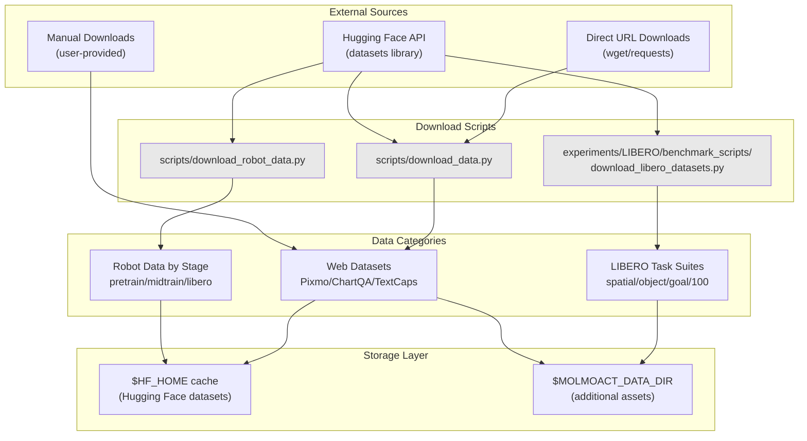
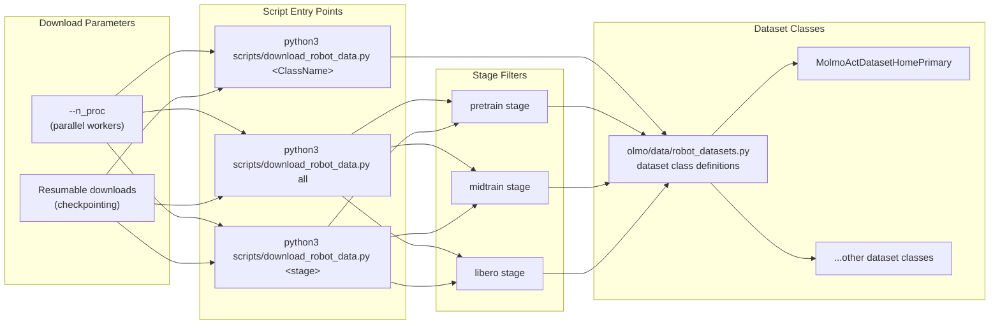
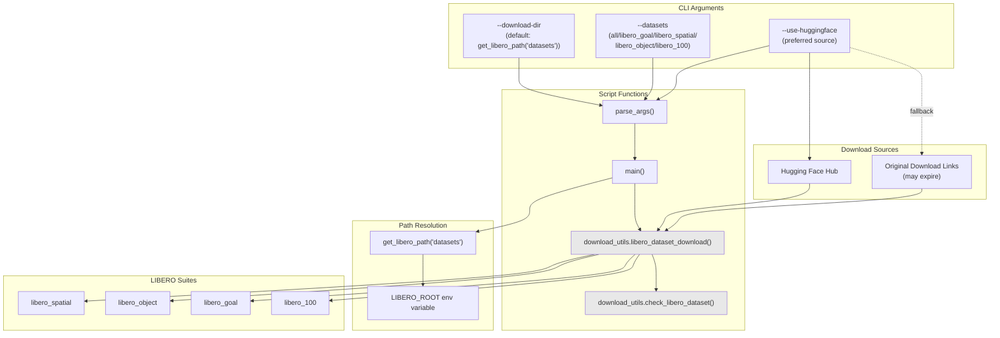
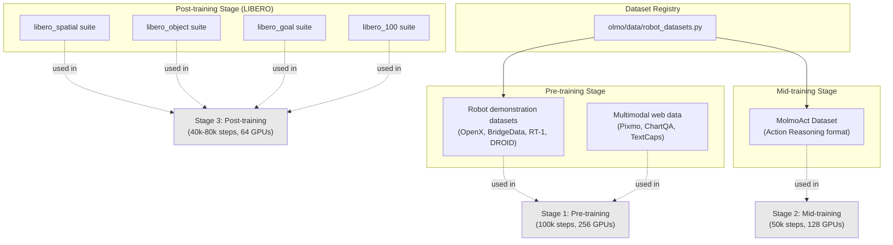
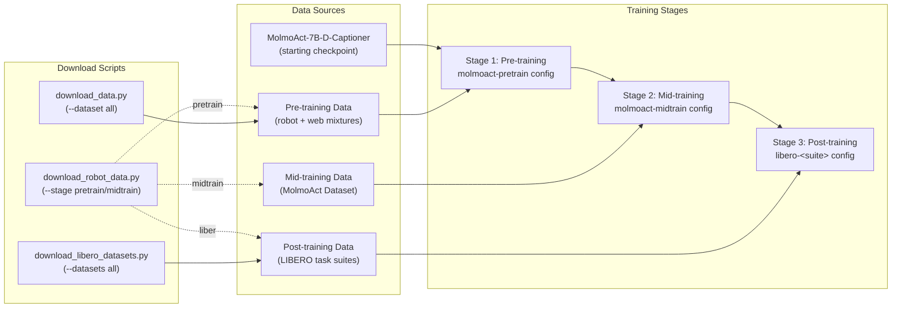

<!-- source: DeepWiki mcp.deepwiki.com · repo allenai/molmoact · page 3 Data Management System · fetched 2026-10-26 -->

# Data Management System

<details>
<summary>Relevant source files</summary>

The following files were used as context for generating this wiki page:

- [README.md](README.md)

</details>


The Data Management System handles the acquisition, storage, and organization of training data for MolmoAct. It provides download infrastructure for three primary data categories: robot demonstration datasets, multimodal web data, and LIBERO task suites. The system emphasizes resumability, parallel processing, and verification to support multi-stage training pipelines across distributed computing environments.

For information about how datasets are used in training stages, see [Training Pipeline](#2). For LIBERO-specific dataset handling and task definitions, see [LIBERO Dataset Management](#3.3).

## Environment Configuration

The data management system relies on three environment variables to control data storage locations and download behavior:

| Environment Variable | Purpose | Example Value | Configuration Location |
|---------------------|---------|---------------|----------------------|
| `HF_HOME` | Hugging Face cache directory for datasets | `/data/molmoact/huggingface` | User shell environment |
| `MOLMOACT_DATA_DIR` | Root directory for additional assets not in HF cache | `/data/molmoact` | User shell environment |
| `HF_DATASETS_OFFLINE` | Prevents online dataset loading during training (rate limiting protection) | `1` | Training launch environment |

The `HF_HOME` variable controls where Hugging Face Datasets library caches downloaded data. This cache is shared across all download scripts and training runs. The `MOLMOACT_DATA_DIR` provides storage for auxiliary assets that don't fit the Hugging Face Datasets model.

```bash
export MOLMOACT_DATA_DIR=/data/molmoact
export HF_HOME=/data/molmoact/huggingface
```

Setting `HF_DATASETS_OFFLINE=1` during distributed training prevents all nodes from simultaneously attempting to download datasets, which can trigger rate limiting from Hugging Face servers. This requires pre-downloading all data before training begins.

**Sources:** [README.md:113-124]()

## Data Sources and Mixtures

MolmoAct training uses three primary data mixtures, each serving a different stage in the curriculum learning pipeline:

| Data Mixture | Training Stage | Contents | Hugging Face Path |
|-------------|----------------|----------|-------------------|
| MolmoAct Pre-training Mixture | Pre-training | Subset of OXE formatted as Action Reasoning data, auxiliary robot data, web data | `allenai/MolmoAct-Pretraining-Mixture` |
| MolmoAct Mid-training Mixture | Mid-training | MolmoAct Dataset formatted as Action Reasoning data | `allenai/MolmoAct-Midtraining-Mixture` |
| MolmoAct Dataset | Mid-training (source) | In-house collected data in LeRobot format | `allenai/MolmoAct-Dataset` |

### Data Source Architecture



**Sources:** [README.md:70-77]()

## Download Infrastructure

### Robot Data Download Script

The `scripts/download_robot_data.py` script provides stage-based filtering for robot demonstration datasets. It supports downloading data for specific training stages or individual dataset classes.



**Usage Examples:**

```bash
# Download all robot datasets with 16 parallel workers
python3 scripts/download_robot_data.py all --n_proc 16

# Download only pre-training stage datasets
python3 scripts/download_robot_data.py pretrain --n_proc 16

# Download specific dataset class
python3 scripts/download_robot_data.py MolmoActDatasetHomePrimary --n_proc 16
```

Valid stage identifiers: `pretrain`, `midtrain`, `libero`

Dataset class names are defined at the end of `olmo/data/robot_datasets.py`. The script uses these classes to determine which datasets belong to each training stage.

**Sources:** [README.md:127-147]()

### Web Data Download Script

The `scripts/download_data.py` script handles multimodal web datasets used during pre-training. Some datasets require URL fetching, which can be time-intensive.

```bash
# Download all web datasets
python3 scripts/download_data.py all --n_proc 16

# Download specific dataset
python3 scripts/download_data.py ChartQa --n_proc 16
```

**Special Cases:**

| Dataset | Special Requirement | Handling |
|---------|-------------------|----------|
| Pixmo datasets | Fetch images from URLs | Automatic but can take up to 24 hours |
| InfoQa | Manual download required | Script raises error if missing |
| Scene-Text | Manual download required | Script raises error if missing |
| Android Control | TFRecord parsing | Requires extra dependencies |

The `--n_proc` parameter controls parallelism. Higher values speed up downloads but increase risk of rate limiting from external sources.

**Sources:** [README.md:150-172]()

### LIBERO Dataset Download Script

The `experiments/LIBERO/benchmark_scripts/download_libero_datasets.py` script manages LIBERO task suite data downloads with Hugging Face integration.



**Script Structure:**

The script uses `libero.libero.get_libero_path("datasets")` to resolve the download directory, which checks for a `LIBERO_ROOT` environment variable or uses a default location. The `--use-huggingface` flag (recommended) switches from original download links to Hugging Face as the data source.

```bash
python3 experiments/LIBERO/benchmark_scripts/download_libero_datasets.py \
    --datasets all \
    --use-huggingface
```

After downloading, the script automatically calls `download_utils.check_libero_dataset()` to verify dataset integrity.

**Sources:** [experiments/LIBERO/benchmark_scripts/download_libero_datasets.py:1-67]()

## Storage and Verification Infrastructure

### Caching Mechanism

All downloads use the Hugging Face Datasets caching system at `$HF_HOME`. The cache stores:
- Downloaded dataset files (raw data)
- Processed dataset builders
- Arrow format tables for fast loading

Cache benefits:
- Shared across multiple training runs
- Supports partial downloads and resumption
- Automatic deduplication of identical data

### Parallel Processing

The `--n_proc` parameter enables parallel downloading across multiple workers:

| Worker Count | Use Case | Rate Limiting Risk |
|-------------|----------|-------------------|
| 1-4 | Conservative, stable | Low |
| 8-16 | Recommended for most cases | Medium |
| 32+ | Fast but risky | High |

Parallel processing is particularly important for large datasets like Pixmo, which fetches thousands of individual images from URLs.

### Resumability

All download scripts support interruption and resumption. If a download is cancelled or fails:
1. Already-downloaded files remain in cache
2. Next run detects existing files
3. Only missing files are downloaded

This is implemented through the Hugging Face Datasets library's built-in caching layer.

### Verification Strategy

Dataset integrity is verified through:

| Verification Method | Datasets | Implementation |
|-------------------|----------|----------------|
| SHA-1 checksums | LIBERO datasets | `experiments/LIBERO/benchmark_scripts/shasum_files.py` |
| Size validation | HF datasets | Automatic via Datasets library |
| Content checks | LIBERO task suites | `download_utils.check_libero_dataset()` |

The LIBERO verification script checks that all expected task demonstration files exist after download.

**Sources:** [README.md:165-172](), [experiments/LIBERO/benchmark_scripts/download_libero_datasets.py:49-63]()

## Dataset Organization

### Stage-Based Organization

Robot datasets are organized by training stage to enable selective downloading:



### Dataset Categories and Locations

| Category | Storage Location | Access Method |
|----------|-----------------|---------------|
| Robot datasets (HF) | `$HF_HOME/datasets/` | Hugging Face Datasets API |
| Web datasets (HF) | `$HF_HOME/datasets/` | Hugging Face Datasets API |
| Additional web assets | `$MOLMOACT_DATA_DIR/` | Direct file access |
| LIBERO demonstrations | `$LIBERO_ROOT/datasets/` or `get_libero_path("datasets")` | LIBERO API |

### Multi-Stage Training Data Flow



The stage-based organization enables:
1. **Incremental downloads**: Download only data needed for current training stage
2. **Storage optimization**: Avoid downloading all datasets upfront
3. **Development iteration**: Test on smaller dataset subsets before full-scale training

**Sources:** [README.md:127-147](), [README.md:174-296]()

## Rate Limiting and Offline Mode

During distributed training, setting `HF_DATASETS_OFFLINE=1` prevents simultaneous dataset loading across compute nodes:

```bash
export HF_DATASETS_OFFLINE=1
```

This is critical when running on 16-256 GPUs across multiple nodes, as each process would otherwise attempt to verify dataset availability via Hugging Face API, triggering rate limits.

**Pre-download workflow:**
1. Download all required datasets on a single machine or with controlled parallelism
2. Verify cache exists at `$HF_HOME`
3. Set `HF_DATASETS_OFFLINE=1` in training environment
4. Launch distributed training

**Sources:** [README.md:171-172]()

---

