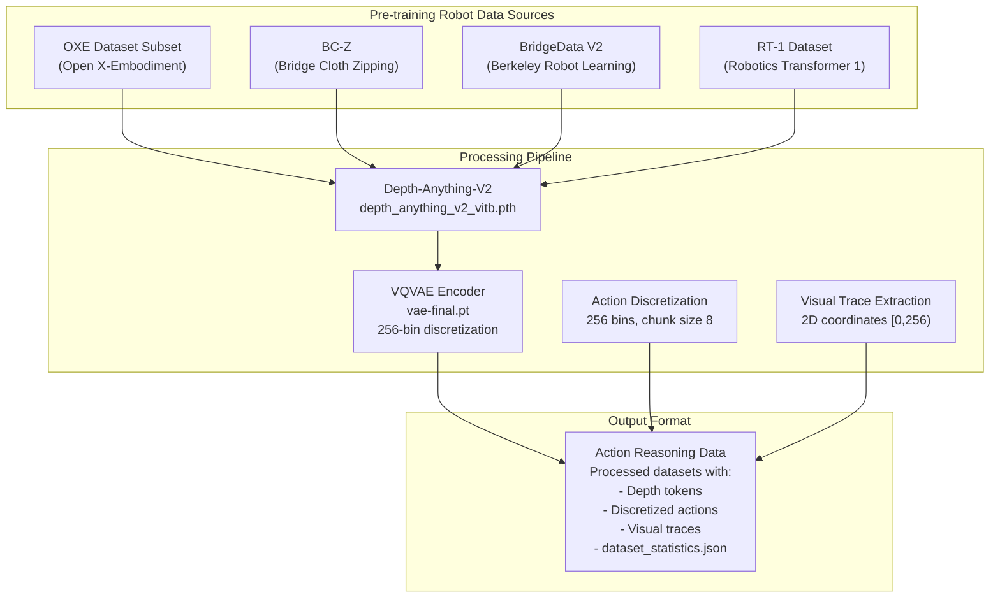
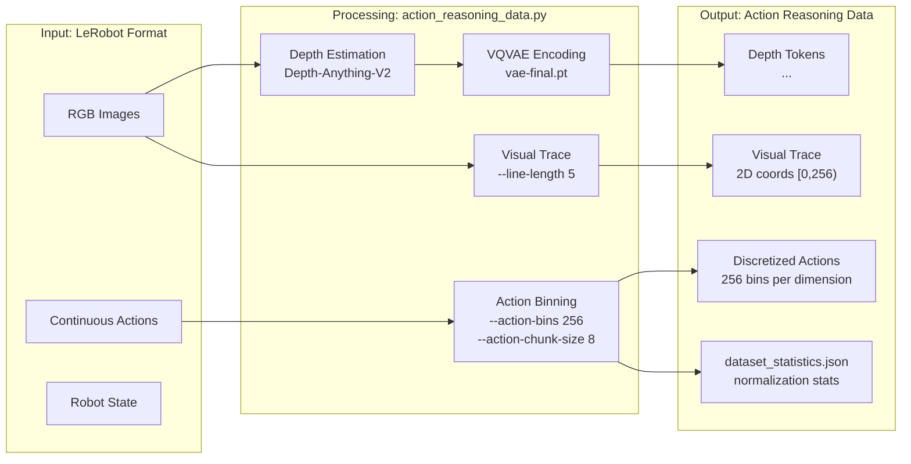
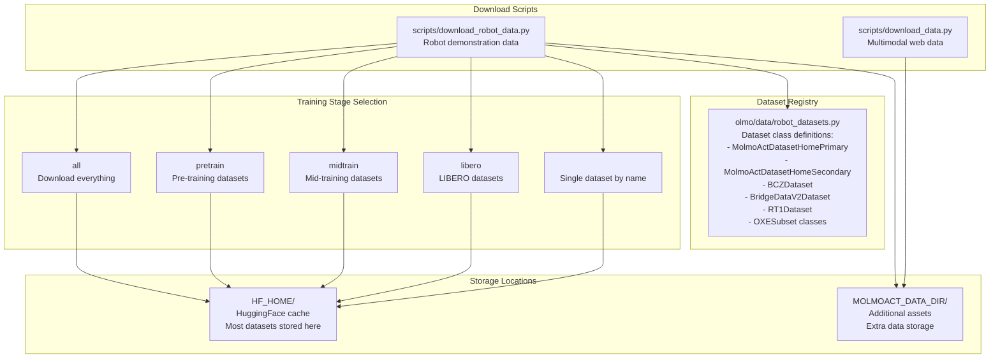
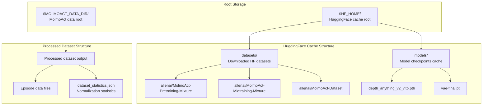

<!-- source: DeepWiki mcp.deepwiki.com · repo allenai/molmoact · page 3.1 Robot Demonstration Datasets · fetched 2026-10-26 -->

# Robot Demonstration Datasets

<details>
<summary>Relevant source files</summary>

The following files were used as context for generating this wiki page:

- [README.md](README.md)

</details>


This page documents the robot demonstration datasets used in MolmoAct training, including dataset sources (OXE, BC-Z, BridgeData V2, RT-1, and in-house MolmoAct Dataset), the Action Reasoning Data preprocessing pipeline, and dataset download procedures. For information about web-based multimodal data used in pre-training, see [Multimodal Web Data](#3.2). For LIBERO-specific dataset management, see [LIBERO Dataset Management](#3.3).

## Dataset Sources Overview

MolmoAct training uses robot demonstration datasets from multiple sources, organized into three primary training mixtures corresponding to the three training stages described in [Training Pipeline](#2).

### Dataset Categories

MolmoAct robot datasets fall into three categories based on their usage in the training pipeline:

| Dataset Category | Usage Stage | Primary Sources | Format |
|-----------------|-------------|-----------------|---------|
| Pre-training Robot Data | Pre-training (100K steps) | OXE subset, BC-Z, BridgeData V2, RT-1 | Action Reasoning Data |
| Mid-training Robot Data | Mid-training (50K steps) | MolmoAct Dataset (in-house) | Action Reasoning Data |
| Post-training Robot Data | Task-specific fine-tuning | LIBERO task suites | Action Reasoning Data |

**Sources:** [README.md:76-82]()

### Pre-training Robot Datasets

The pre-training mixture includes a carefully curated subset of publicly available robot datasets, all converted to the Action Reasoning Data format:



**Sources:** [README.md:81](), [README.md:263]()

### Mid-training MolmoAct Dataset

The MolmoAct Dataset is an in-house collection used exclusively during mid-training. It contains approximately 10,000 robot episodes collected using a Franka setup with custom hardware modifications:

**Key Characteristics:**
- **Format:** LeRobot format, converted to Action Reasoning Data
- **Collection Environment:** Franka robot with custom camera mount and gripper
- **Task Types:** Tabletop manipulation and household tasks
- **Camera Setup:** Fixed exocentric camera for tabletop tasks, varied poses for household tasks
- **Distribution:** Available at `allenai/MolmoAct-Dataset` on HuggingFace

**Sources:** [README.md:80](), [README.md:522-534]()

## Action Reasoning Data Format

Action Reasoning Data is the preprocessed format used for all robot datasets in MolmoAct training. This format augments standard robot demonstration data with additional modalities that enable spatial reasoning.

### Data Structure



**Sources:** [README.md:145-159]()

### Key Processing Components

#### Depth Token Generation

Depth maps are generated using Depth-Anything-V2 and encoded into discrete tokens using a trained VQVAE:

1. **Depth Estimation:** `depth_anything_v2_vitb.pth` checkpoint (ViT-B variant)
2. **VQVAE Encoding:** `vae-final.pt` converts depth maps to discrete token sequences
3. **Token Format:** `<DEPTH_START><DEPTH_1>...<DEPTH_N><DEPTH_END>`

The VQVAE is trained on depth maps generated from BC-Z, BridgeData V2, and RT-1 subsets using:
- Batch size: 64
- Learning rate: 1e-3
- Base architecture from Aurora-perception

**Sources:** [README.md:122-143](), [README.md:263]()

#### Action Discretization

Continuous robot actions are discretized into 256 bins per action dimension:

| Parameter | Value | Description |
|-----------|-------|-------------|
| `--action-bins` | 256 | Number of discrete bins per action dimension |
| `--action-chunk-size` | 8 | Number of action steps predicted in each chunk |
| Normalization | Per-dataset | Statistics stored in `dataset_statistics.json` |

**Sources:** [README.md:157-158]()

#### Visual Trace Processing

Visual traces represent 2D spatial coordinates of relevant points in the image:

| Parameter | Value | Description |
|-----------|-------|-------------|
| `--line-length` | 5 | Number of 2D coordinate pairs in the trace |
| Coordinate Range | [0, 256) | Integer coordinates bounded in this range |
| Scaling | Dynamic | Coordinates scaled to actual image size for visualization |

**Sources:** [README.md:155](), [README.md:254]()

## Dataset Download System

MolmoAct provides automated scripts for downloading robot datasets, with different download strategies for pre-training, mid-training, and post-training data.

### Download Architecture



**Sources:** [README.md:282-302](), [README.md:268-278]()

### Download Commands

#### Environment Setup

Before downloading, configure storage paths:

```bash
export MOLMOACT_DATA_DIR=/data/molmoact
export HF_HOME=/data/molmoact/huggingface
```

These environment variables control where datasets are stored:
- `HF_HOME`: HuggingFace cache location for most datasets
- `MOLMOACT_DATA_DIR`: Additional asset storage

**Sources:** [README.md:271-278]()

#### Download by Training Stage

Download all datasets for a specific training stage:

```bash
# All robot datasets (pre-training + mid-training + post-training)
python3 scripts/download_robot_data.py all --n_proc 16

# Pre-training stage datasets only
python3 scripts/download_robot_data.py pretrain --n_proc 16

# Mid-training stage datasets only
python3 scripts/download_robot_data.py midtrain --n_proc 16

# Post-training (LIBERO) datasets only
python3 scripts/download_robot_data.py libero --n_proc 16
```

**Sources:** [README.md:286-295]()

#### Download Individual Dataset

Download a specific robot dataset by class name:

```bash
python3 scripts/download_robot_data.py MolmoActDatasetHomePrimary --n_proc 16
```

All available dataset class names are defined in [olmo/data/robot_datasets.py]().

**Sources:** [README.md:297-301]()

### Download Parameters and Considerations

| Parameter | Description | Considerations |
|-----------|-------------|----------------|
| `--n_proc` | Number of parallel download processes | Higher values speed up downloads but increase rate limiting risk |
| Resumability | Downloads can be resumed if interrupted | Automatic checkpoint recovery |
| Rate Limiting | HuggingFace may rate limit high-frequency requests | Use `HF_DATASETS_OFFLINE=1` during training initialization |
| Duration | Full download can take extended time | Pixmo datasets fetch from URLs, may take up to a day |

**Key Recommendations:**
1. Use `HF_DATASETS_OFFLINE=1` during multi-node training to prevent all nodes from flooding HuggingFace with requests during initialization
2. Downloads are resumable - safe to cancel and restart
3. Some datasets (InfoQa, Scene-Text) require manual downloads and will raise errors if missing
4. Android control dataset requires extra TFRecord parsing dependencies

**Sources:** [README.md:320-327]()

## Dataset Organization and Storage

### Storage Hierarchy

Robot datasets are organized in a hierarchical structure based on their source and processing stage:



**Sources:** [README.md:268-278](), [README.md:163]()

### Dataset Statistics File

Each processed Action Reasoning Data dataset includes a `dataset_statistics.json` file containing normalization statistics for action un-normalization during inference:

**Location:** `<output_path>/dataset_statistics.json` (where `output_path` is specified in preprocessing command)

**Usage:**
- Referenced during training via `--norm_stats_path` parameter
- Used during inference for action un-normalization
- Can be updated or added to converted HuggingFace checkpoints

**Sources:** [README.md:172](), [README.md:214]()

## Preprocessing Pipeline Implementation

### Command-Line Interface

The primary preprocessing script is [preprocess/action_reasoning_data.py](), which converts standard LeRobot format datasets to Action Reasoning Data:

```bash
export DEPTH_CHECKPOINT_DIR="<path/to/Depth-Anything-V2/checkpoints>"
export VQVAE_MODEL_PATH="<path/to/vqvae.pt>"

python preprocess/action_reasoning_data.py \
    --dataset-path <lerobot/repo_id> \
    --output-path <path/to/processed_dataset> \
    --depth-encoder vitb \
    --line-length 5 \
    --process-actions \
    --action-bins 256 \
    --action-chunk-size 8
```

**Sources:** [README.md:147-159]()

### Preprocessing Parameters

| Parameter | Default | Description |
|-----------|---------|-------------|
| `--dataset-path` | Required | Input dataset in LeRobot format (HF repo ID or local path) |
| `--output-path` | Required | Output directory for processed Action Reasoning Data |
| `--depth-encoder` | `vitb` | Depth-Anything-V2 model variant (vitb, vits, vitl) |
| `--line-length` | 5 | Number of 2D coordinate pairs in visual trace |
| `--process-actions` | Flag | Enable action discretization processing |
| `--action-bins` | 256 | Number of bins for action discretization |
| `--action-chunk-size` | 8 | Number of action steps in each prediction chunk |

**Sources:** [README.md:147-159]()

### Required Checkpoints

Before running preprocessing, download required model checkpoints:

#### Depth-Anything-V2 Checkpoint

```bash
wget https://huggingface.co/allenai/MolmoAct-7B-D-0812/resolve/main/depth_anything_v2_vitb.pth
mv depth_anything_v2_vitb.pth <path/to/Depth-Anything-V2/checkpoints>
```

#### VQVAE Checkpoint

```bash
wget https://huggingface.co/allenai/MolmoAct-7B-D-0812/resolve/main/vae-final.pt
```

**Sources:** [README.md:130-143]()

### Dependencies

Preprocessing requires additional dependencies beyond the core MolmoAct installation:

```bash
git clone https://github.com/DepthAnything/Depth-Anything-V2.git
cd Depth-Anything-V2
pip install -r requirements.txt
pip uninstall -y opencv-python opencv-python-headless opencv-contrib-python
pip install opencv-python-headless --no-cache-dir
pip install lerobot==0.3.3
```

**Sources:** [README.md:120-128]()

## Integration with Training Pipeline

### Pre-training Data Mixture

The pre-training mixture combines processed robot datasets with multimodal web data:

**Composition:**
- OXE subset (Action Reasoning Data format)
- BC-Z, BridgeData V2, RT-1 (Action Reasoning Data format)
- Auxiliary robot data (Action Reasoning Data format)
- Multimodal web data (see [Multimodal Web Data](#3.2))

**HuggingFace Repository:** `allenai/MolmoAct-Pretraining-Mixture`

**Training Configuration:**
- Duration: 100K steps
- Hardware: 32 nodes × 8 GPUs
- Global batch size: 512
- Uses depth tokens: `--depth_tokens`

**Sources:** [README.md:81](), [README.md:332-351]()

### Mid-training Data Mixture

The mid-training mixture uses exclusively the in-house MolmoAct Dataset:

**Composition:**
- MolmoAct Dataset only (Action Reasoning Data format)
- ~10K robot episodes
- Collected with custom Franka setup

**HuggingFace Repository:** `allenai/MolmoAct-Midtraining-Mixture`

**Training Configuration:**
- Duration: 50K steps
- Hardware: 16 nodes × 8 GPUs
- Global batch size: 256
- Max images per example: 2

**Sources:** [README.md:82](), [README.md:378-410]()

### Post-training Task-Specific Data

Post-training uses task-specific datasets, primarily from LIBERO benchmark suites (see [LIBERO Dataset Management](#3.3) for details):

**Training Configuration:**
- LoRA fine-tuning: rank 32, alpha 16
- Image augmentation enabled: `--img_aug`
- Hardware: 8 nodes × 8 GPUs
- Global batch size: 128

**Sources:** [README.md:413-456]()

## Dataset Class Registry

All robot dataset classes are registered in [olmo/data/robot_datasets.py](). This registry enables:

1. **Programmatic Access:** Import and instantiate datasets by class name
2. **Download Management:** The download script uses class names to identify datasets
3. **Training Configuration:** Dataset mixtures reference these classes

**Common Dataset Classes:**
- `MolmoActDatasetHomePrimary`: Primary in-house MolmoAct tabletop data
- `MolmoActDatasetHomeSecondary`: Secondary in-house MolmoAct household data
- `BCZDataset`: Bridge Cloth Zipping dataset
- `BridgeDataV2Dataset`: Berkeley BridgeData V2 dataset
- `RT1Dataset`: Robotics Transformer 1 dataset
- Various OXE subset classes

**Sources:** [README.md:301]()

---

