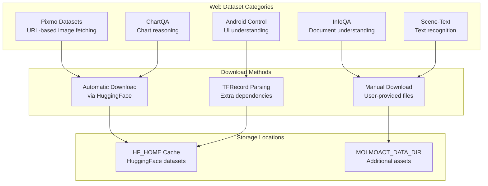
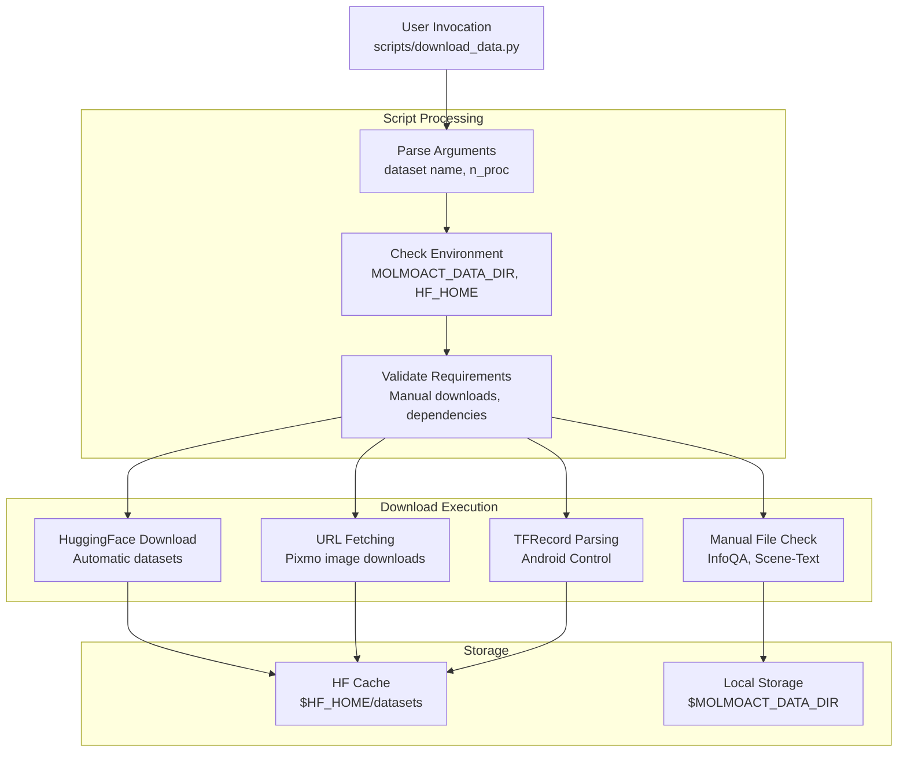
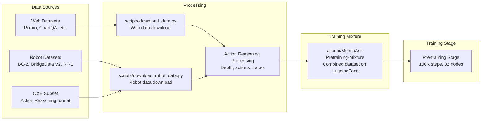
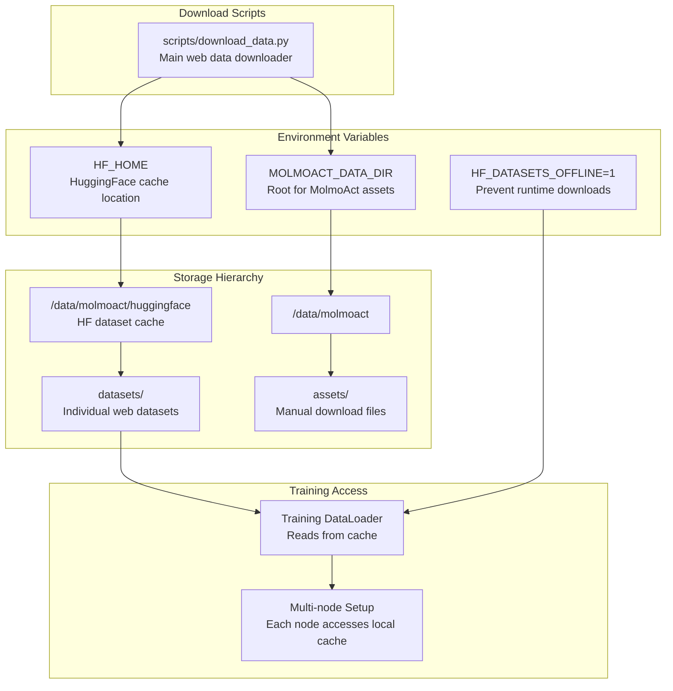

<!-- source: DeepWiki mcp.deepwiki.com · repo allenai/molmoact · page 3.2 Multimodal Web Data · fetched 2026-10-26 -->

# Multimodal Web Data

<details>
<summary>Relevant source files</summary>

The following files were used as context for generating this wiki page:

- [README.md](README.md)

</details>


## Purpose and Scope

This page documents the **multimodal web datasets** used during MolmoAct's pre-training stage. These datasets provide diverse visual and textual data that complement robot demonstration data, enabling the model to develop broader visual understanding capabilities before specializing in robot actions.

For information about robot demonstration datasets, see [3.1 Robot Demonstration Datasets](#3.1). For details on the overall data management system, see [3 Data Management System](#3).

---

## Overview

Multimodal web data forms a critical component of MolmoAct's pre-training mixture, supplementing robot-specific datasets with general-purpose vision-language data. This combination enables the model to:

1. Develop robust visual perception capabilities across diverse domains
2. Learn general visual reasoning patterns before specializing in action reasoning
3. Improve zero-shot generalization to novel visual scenarios

The web data is combined with robot datasets and a subset of OXE data to form the complete pre-training mixture available at `allenai/MolmoAct-Pretraining-Mixture` on HuggingFace.

**Sources:** [README.md:81-82](), [README.md:305-327]()

---

## Dataset Sources

MolmoAct's pre-training incorporates several multimodal web datasets, each serving specific purposes:

### Primary Web Datasets

| Dataset | Description | Special Requirements |
|---------|-------------|---------------------|
| **Pixmo** | Large-scale image datasets fetched from URLs | Long download time (up to 1 day) |
| **ChartQA** | Chart understanding and visual reasoning | Standard download |
| **InfoQA** | Information extraction from visual documents | Manual download required |
| **Scene-Text** | Scene text recognition and understanding | Manual download required |
| **Android Control** | Mobile interface understanding | Extra TFRecord parsing dependencies |

### Dataset Characteristics



**Sources:** [README.md:305-327]()

---

## Download Process

### Environment Configuration

Before downloading web datasets, configure two critical environment variables:

```bash
export MOLMOACT_DATA_DIR=/data/molmoact
export HF_HOME=/data/molmoact/huggingface
```

- **`MOLMOACT_DATA_DIR`**: Root directory for MolmoAct-specific data assets
- **`HF_HOME`**: Controls HuggingFace cache location for dataset storage

**Sources:** [README.md:269-279]()

### Download Script Usage

The [scripts/download_data.py]() script manages all web dataset downloads:

#### Download All Web Datasets

```bash
python3 scripts/download_data.py all --n_proc 16
```

This command downloads all web datasets used in pre-training. The `--n_proc` parameter controls parallelism (16 parallel processes in this example).

#### Download Single Dataset

```bash
python3 scripts/download_data.py ChartQa --n_proc 16
```

Individual datasets can be downloaded by specifying the dataset name as an argument.

**Sources:** [README.md:308-316]()

### Download Workflow



**Sources:** [README.md:305-327]()

---

## Download Considerations

### Performance Characteristics

| Aspect | Consideration | Mitigation |
|--------|---------------|------------|
| **Pixmo download time** | Can take up to 1 day for full download | Plan accordingly, run overnight |
| **Rate limiting** | Higher `--n_proc` increases rate limit risk | Balance parallelism vs. reliability |
| **Resumability** | Downloads can be interrupted | Script supports resume on restart |
| **Offline training** | Multi-node init can flood HF requests | Use `HF_DATASETS_OFFLINE=1` |

### Manual Download Requirements

Two datasets require manual acquisition:

1. **InfoQA**: Files must be manually downloaded and placed in the appropriate directory
2. **Scene-Text**: Similar manual download requirement

The download script will raise an error if these files are missing, providing instructions for manual acquisition.

### Special Dependencies

**Android Control Dataset**: Requires additional dependencies for parsing original TFRecords format. Install these dependencies before attempting to download:

```bash
# Additional packages needed for Android Control dataset
pip install tensorflow-datasets  # or similar TFRecord parsing library
```

**Sources:** [README.md:320-327]()

---

## Integration with Pre-training Pipeline

### Data Mixture Composition



**Sources:** [README.md:81-82](), [README.md:329-351]()

### Pre-training Dataset Access

The complete pre-training mixture, including processed web data, is available on HuggingFace:

```
https://huggingface.co/datasets/allenai/MolmoAct-Pretraining-Mixture
```

This mixture contains:
- Web datasets (Pixmo, ChartQA, InfoQA, Scene-Text, Android Control)
- Robot datasets (BC-Z, BridgeData V2, RT-1) formatted as Action Reasoning data
- OXE subset formatted as Action Reasoning data

**Sources:** [README.md:81-82]()

---

## Training Configuration

### Pre-training Command with Web Data

The pre-training stage that consumes web data is invoked as follows:

```bash
WANDB_API_KEY=<your_wandb_api_key> torchrun \
    --nnodes=32 --nproc-per-node=8 \
    --node_rank="${RANK}" --master_addr="${ADDR}" --master_port="${PORT}" \
    launch_scripts/train_multitask_model.py \
    molmoact-pretrain allenai/MolmoAct-7B-D-Captioner-0812 \
    --wandb.name=<name> --wandb.entity=<entity> --wandb.project=<project> \
    --save_folder=checkpoints/<exp_name> \
    --save_overwrite \
    --duration 100000 \
    --ft_embedding all \
    --depth_tokens \
    --global_batch_size 512 \
    --lr_connector 1e-5 \
    --lr_vit 1e-5 \
    --lr_llm 2e-5 \
    --save_interval 20000 \
    --save_num_checkpoints_to_keep 5 \
    --save_final_unsharded_checkpoint
```

The `molmoact-pretrain` configuration automatically loads the pre-training mixture containing web data.

**Sources:** [README.md:329-351]()

### Offline Training Mode

To prevent rate limiting during multi-node training initialization, use offline mode after downloading:

```bash
export HF_DATASETS_OFFLINE=1
```

This ensures all nodes use cached data without making new requests to HuggingFace servers.

**Sources:** [README.md:326-327]()

---

## Storage Architecture



**Sources:** [README.md:269-279](), [README.md:326-327]()

---

## Data Characteristics

### Multimodal Diversity

Web datasets contribute diverse visual-language patterns:

| Dataset | Visual Modality | Language Modality | Pre-training Role |
|---------|----------------|-------------------|-------------------|
| Pixmo | Natural images, varied scenes | Captions, descriptions | General visual understanding |
| ChartQA | Charts, graphs, plots | Questions, numerical answers | Structured visual reasoning |
| InfoQA | Documents, infographics | Questions, extracted facts | Information extraction |
| Scene-Text | Text-in-image scenes | OCR, recognition | Text perception |
| Android Control | Mobile UI screenshots | Actions, interactions | Interface understanding |

### Complementary to Robot Data

Web datasets provide capabilities that complement robot demonstration data:

1. **Broader visual diversity**: Exposure to scenes beyond robotic manipulation contexts
2. **General visual reasoning**: Pattern recognition applicable to novel situations
3. **Text understanding**: Reading instructions, labels, and environmental text
4. **Structured reasoning**: Charts and documents improve analytical capabilities

**Sources:** [README.md:305-327](), Diagram 5 from high-level architecture

---

## Best Practices

### Download Strategy

1. **Pre-download all data**: Complete downloads before starting training experiments
2. **Use appropriate parallelism**: Balance `--n_proc` between speed and rate limiting
3. **Plan for long downloads**: Pixmo datasets can take up to 24 hours
4. **Verify manual downloads**: Ensure InfoQA and Scene-Text files are in place
5. **Enable offline mode**: Set `HF_DATASETS_OFFLINE=1` during training

### Storage Management

1. **Allocate sufficient space**: Web datasets require substantial storage
2. **Use fast storage**: SSD/NVMe recommended for training performance
3. **Configure HF cache**: Set `HF_HOME` to appropriate high-capacity location
4. **Monitor disk usage**: Track cache growth during downloads

### Multi-node Considerations

1. **Shared filesystem**: All nodes should access the same cached data
2. **Offline mode**: Critical for preventing HuggingFace request floods
3. **Network efficiency**: Local cache access reduces inter-node data transfer

**Sources:** [README.md:320-327]()

---

## Summary

Multimodal web data is an essential component of MolmoAct's pre-training strategy, providing diverse visual-language patterns that complement robot-specific training data. The [scripts/download_data.py]() script manages acquisition of datasets including Pixmo, ChartQA, InfoQA, Scene-Text, and Android Control. Proper configuration of `MOLMOACT_DATA_DIR` and `HF_HOME` environment variables ensures organized storage, while `HF_DATASETS_OFFLINE=1` prevents rate limiting during distributed training. These datasets are combined with robot data in the `allenai/MolmoAct-Pretraining-Mixture` for the 100K-step pre-training stage.

**Sources:** [README.md:81-82](), [README.md:269-327]()

---

