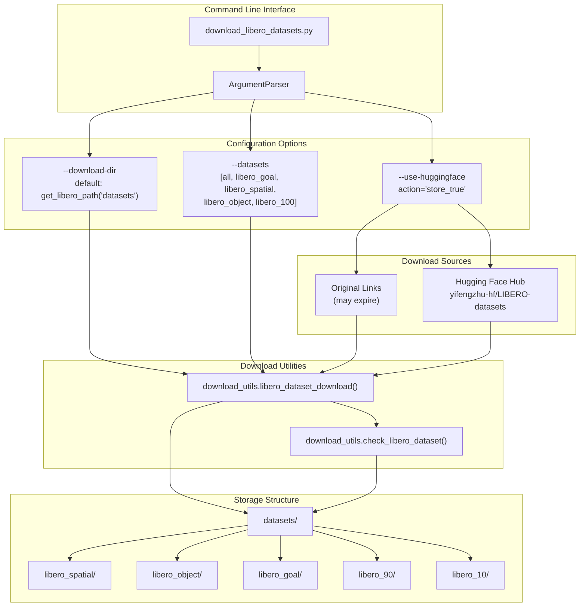
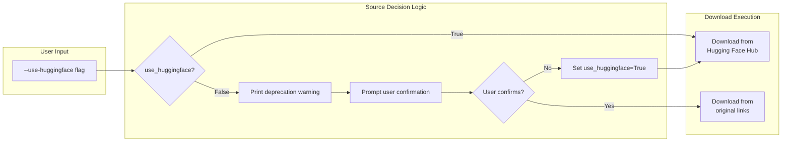
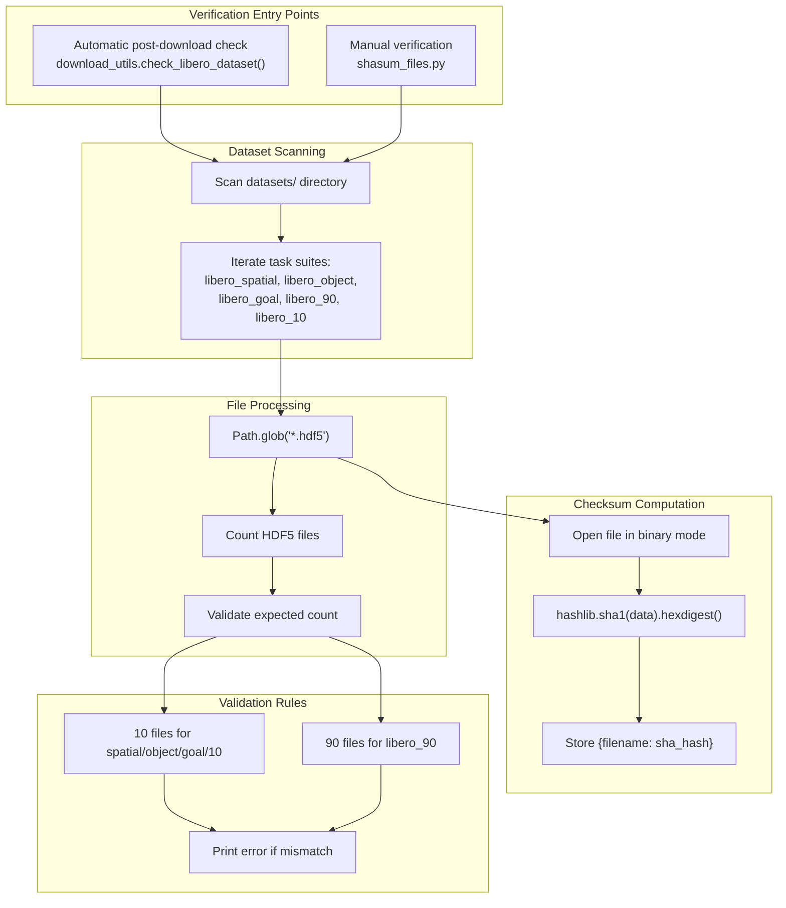
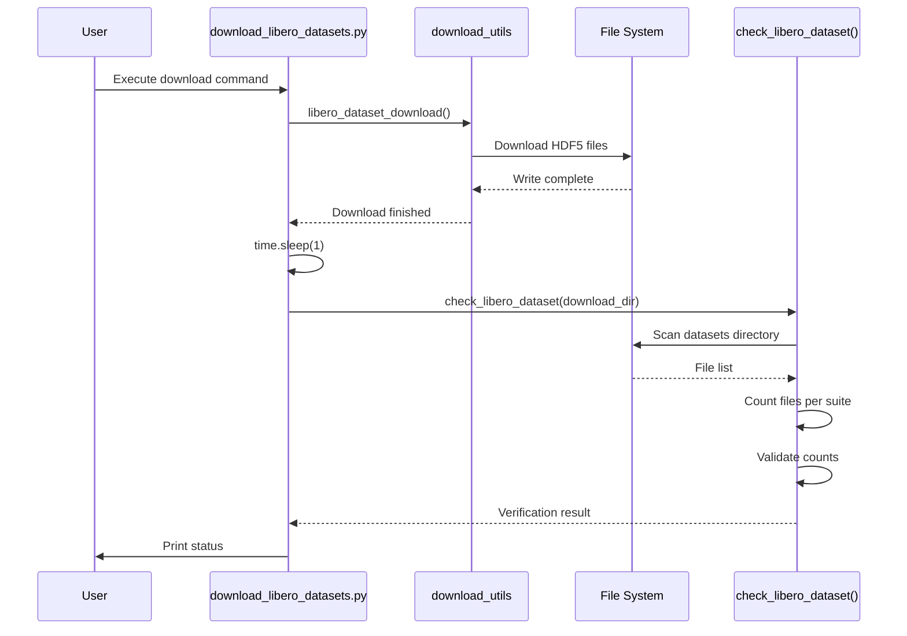

<!-- source: DeepWiki mcp.deepwiki.com · repo allenai/molmoact · page 3.3 LIBERO Dataset Management · fetched 2026-10-26 -->

# LIBERO Dataset Management

<details>
<summary>Relevant source files</summary>

The following files were used as context for generating this wiki page:

- [experiments/LIBERO/README.md](experiments/LIBERO/README.md)
- [experiments/LIBERO/benchmark_scripts/download_libero_datasets.py](experiments/LIBERO/benchmark_scripts/download_libero_datasets.py)

</details>


This document describes the management of LIBERO demonstration datasets, including their structure, download mechanisms, storage organization, and verification procedures. LIBERO provides high-quality human teleoperation demonstrations for 130 manipulation tasks organized into four task suites.

For information about robot demonstration datasets used in pre-training and mid-training (OpenX, BridgeData, RT-1, etc.), see [Robot Demonstration Datasets](#3.1). For multimodal web data management, see [Multimodal Web Data](#3.2). For LIBERO task retrieval and environment interaction, see [Task Retrieval and Environment Interaction](#6.2).

## Dataset Structure and Organization

LIBERO provides demonstration datasets for four task suites, each designed to evaluate different aspects of knowledge transfer in lifelong robot learning:

| Task Suite | Number of Tasks | Purpose | Dataset Name |
|------------|----------------|---------|--------------|
| LIBERO-Spatial | 10 | Transfer spatial relationships | `libero_spatial` |
| LIBERO-Object | 10 | Transfer object knowledge | `libero_object` |
| LIBERO-Goal | 10 | Transfer goal-oriented behavior | `libero_goal` |
| LIBERO-100 | 100 (90+10) | Entangled knowledge transfer | `libero_90` + `libero_10` |

Each task includes multiple human teleoperation demonstrations stored in HDF5 format. The demonstrations contain observation sequences (images, proprioceptive state), action trajectories, and task metadata.

**Sources:** [experiments/LIBERO/README.md:26-29]()

### Dataset File Format

Demonstrations are stored as individual HDF5 files with the following naming convention: `{task_name}_demo.hdf5`. Each file contains:
- Observation data (agentview images, eye-in-hand images, joint positions)
- Action sequences (7-DOF arm actions)
- Task success indicators
- Initial state information for reproducibility

**Sources:** [experiments/LIBERO/README.md:64-88]()

## Download Infrastructure

### Download Script Architecture

The download system provides two alternative data sources and supports selective dataset downloads:


**Diagram: LIBERO Dataset Download Flow**

**Sources:** [experiments/LIBERO/benchmark_scripts/download_libero_datasets.py:1-67]()

### Download Command Usage

Basic download command for all datasets using HuggingFace:
```bash
python benchmark_scripts/download_libero_datasets.py --use-huggingface
```

Download specific task suite:
```bash
python benchmark_scripts/download_libero_datasets.py \
    --datasets libero_spatial \
    --use-huggingface
```

Custom download directory:
```bash
python benchmark_scripts/download_libero_datasets.py \
    --download-dir /path/to/custom/location \
    --datasets libero_100 \
    --use-huggingface
```

**Sources:** [experiments/LIBERO/README.md:65-85](), [experiments/LIBERO/benchmark_scripts/download_libero_datasets.py:10-28]()

### Download Source Selection

The script implements a two-tier download source system with automatic fallback:


**Diagram: Download Source Selection Logic**

The original download links are deprecated and may fail. The script prompts users and recommends switching to HuggingFace if they attempt to use original links.

**Sources:** [experiments/LIBERO/benchmark_scripts/download_libero_datasets.py:40-48]()

## Storage Location and Path Management

### Path Resolution

LIBERO uses the `get_libero_path()` function to resolve dataset storage locations. The default download directory is determined by:

```python
get_libero_path("datasets")
```

This function resolves to the `datasets/` subdirectory within the LIBERO installation path. Users can override this with the `--download-dir` argument.

**Sources:** [experiments/LIBERO/benchmark_scripts/download_libero_datasets.py:14-16]()

### Directory Structure

After download, datasets are organized as follows:

```
datasets/
├── libero_spatial/
│   ├── LIVING_ROOM_SCENE1_put_the_black_bowl_on_top_of_the_cabinet_demo.hdf5
│   ├── LIVING_ROOM_SCENE1_put_the_black_bowl_on_the_left_side_of_the_cabinet_demo.hdf5
│   └── ... (8 more tasks, 10 total)
├── libero_object/
│   ├── KITCHEN_SCENE1_put_the_white_mug_on_the_plate_demo.hdf5
│   ├── KITCHEN_SCENE1_put_the_yellow_bowl_on_the_plate_demo.hdf5
│   └── ... (8 more tasks, 10 total)
├── libero_goal/
│   ├── KITCHEN_SCENE2_turn_on_the_stove_and_put_the_moka_pot_on_it_demo.hdf5
│   └── ... (9 more tasks, 10 total)
├── libero_90/
│   ├── KITCHEN_SCENE1_open_the_bottom_drawer_of_the_cabinet_demo.hdf5
│   └── ... (89 more tasks, 90 total)
└── libero_10/
    ├── KITCHEN_SCENE10_turn_on_the_stove_demo.hdf5
    └── ... (9 more tasks, 10 total)
```

**Sources:** [experiments/LIBERO/benchmark_scripts/download_libero_datasets.py:35-37]()

## Dataset Verification

### SHA-1 Checksum Verification

The verification system ensures dataset integrity through SHA-1 checksumming:


**Diagram: Dataset Verification Process**

**Sources:** [experiments/LIBERO/benchmark_scripts/shasum_files.py:1-50](), [experiments/LIBERO/benchmark_scripts/download_libero_datasets.py:62]()

### Checksum Implementation Details

The SHA-1 computation is implemented in `shasum_file()`:

```python
def shasum_file(file_path):
    if os.path.exists(file_path):
        with open(file_path, "rb") as f:
            data = f.read()
        sha_hash = hashlib.sha1(data).hexdigest()
        file_name = file_path.split("/")[-1]
        return {file_name: sha_hash}
    else:
        return None
```

File count validation ensures each task suite has the correct number of demonstrations:
- `libero_spatial`, `libero_object`, `libero_goal`, `libero_10`: 10 files each
- `libero_90`: 90 files

**Sources:** [experiments/LIBERO/benchmark_scripts/shasum_files.py:6-14](), [experiments/LIBERO/benchmark_scripts/shasum_files.py:17-41]()

## Dataset Access During Training and Evaluation

### Demonstration Loading Pipeline

```mermaid
flowchart LR
    subgraph "Task Retrieval"
        BENCH["benchmark.get_benchmark_dict()"]
        SUITE["task_suite.get_task(task_id)"]
        TASK["Task object"]
    end
    
    subgraph "Demonstration Access"
        GET_DEMO["task_suite.get_task_demonstration(task_id)"]
        HDF5["Load HDF5 file"]
        DATA["Extract obs, actions, states"]
    end
    
    subgraph "Training Data"
        DATASET["PyTorch Dataset"]
        LOADER["DataLoader"]
        BATCH["Training batches"]
    end
    
    BENCH --> SUITE
    SUITE --> TASK
    TASK --> GET_DEMO
    GET_DEMO --> HDF5
    HDF5 --> DATA
    DATA --> DATASET
    DATASET --> LOADER
    LOADER --> BATCH
```


**Diagram: Dataset Access Pipeline**

The training pipeline accesses demonstrations through the task suite API:

1. Retrieve task suite: `benchmark_dict[task_suite_name]()`
2. Get specific task: `task_suite.get_task(task_id)`
3. Load demonstrations: `task_suite.get_task_demonstration(task_id)`
4. Parse HDF5 data into training format

**Sources:** [experiments/LIBERO/README.md:97-132]()

### Initial States for Evaluation

For benchmarking consistency, LIBERO provides fixed initial states for each task:

```python
init_states = task_suite.get_task_init_states(task_id)
init_state_id = 0
env.set_init_state(init_states[init_state_id])
```

This ensures reproducible evaluation across different runs and implementations. The initial states are stored within the demonstration files and retrieved during environment setup.

**Sources:** [experiments/LIBERO/README.md:124-126]()

## Dataset Requirements for Training

### Per-Task Suite Requirements

| Configuration | Dataset Requirements | File Count |
|--------------|---------------------|------------|
| LIBERO-Spatial training | `libero_spatial` | 10 HDF5 files |
| LIBERO-Object training | `libero_object` | 10 HDF5 files |
| LIBERO-Goal training | `libero_goal` | 10 HDF5 files |
| LIBERO-90 pretraining | `libero_90` | 90 HDF5 files |
| LIBERO-10 evaluation | `libero_10` | 10 HDF5 files |
| Full LIBERO-100 benchmark | `libero_90` + `libero_10` | 100 HDF5 files |

Training scripts automatically detect and load the appropriate dataset based on the `benchmark_name` configuration parameter.

**Sources:** [experiments/LIBERO/README.md:137-150]()

## HuggingFace Integration

### Dataset Repository

LIBERO datasets are hosted on HuggingFace at:
```
https://huggingface.co/datasets/yifengzhu-hf/LIBERO-datasets
```

The HuggingFace integration provides:
- Reliable, long-term dataset availability
- Faster download speeds
- Automatic version management
- Integration with HuggingFace datasets library

**Sources:** [experiments/LIBERO/README.md:87](), [experiments/LIBERO/benchmark_scripts/download_libero_datasets.py:24-27]()

### Download Implementation

When `--use-huggingface` is specified, the download script calls:
```python
download_utils.libero_dataset_download(
    download_dir=args.download_dir, 
    datasets=args.datasets,
    use_huggingface=args.use_huggingface
)
```

This function handles authentication, dataset streaming, and local caching through the HuggingFace API.

**Sources:** [experiments/LIBERO/benchmark_scripts/download_libero_datasets.py:50-54]()

## Post-Download Verification Workflow

After downloading datasets, the system performs automatic verification:


**Diagram: Post-Download Verification Sequence**

The verification runs automatically after downloads complete, with a 1-second delay to ensure file system synchronization.

**Sources:** [experiments/LIBERO/benchmark_scripts/download_libero_datasets.py:58-62]()

## Troubleshooting Dataset Issues

### Common Issues and Solutions

| Issue | Cause | Solution |
|-------|-------|----------|
| File count mismatch | Incomplete download | Re-run download script |
| Missing dataset directory | Wrong download path | Verify `--download-dir` argument |
| HuggingFace authentication failure | No HF token | Set `HF_TOKEN` environment variable |
| Original link download failure | Link expiration | Use `--use-huggingface` flag |
| SHA-1 mismatch | Corrupted download | Delete corrupted files, re-download |

### Manual Verification

To manually verify dataset integrity:
```bash
cd experiments/LIBERO/benchmark_scripts
python shasum_files.py
```

This prints SHA-1 checksums for all downloaded datasets, which can be compared against expected values.

**Sources:** [experiments/LIBERO/benchmark_scripts/shasum_files.py:49]()

---

