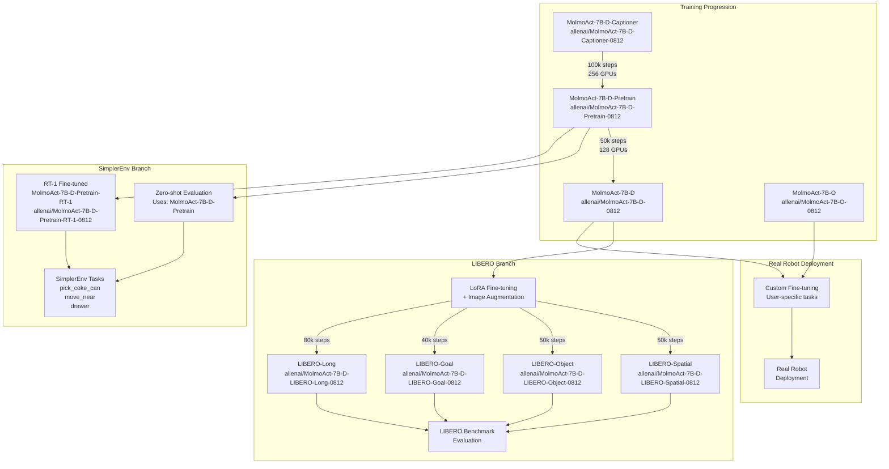
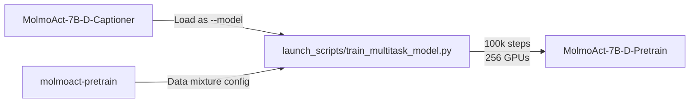
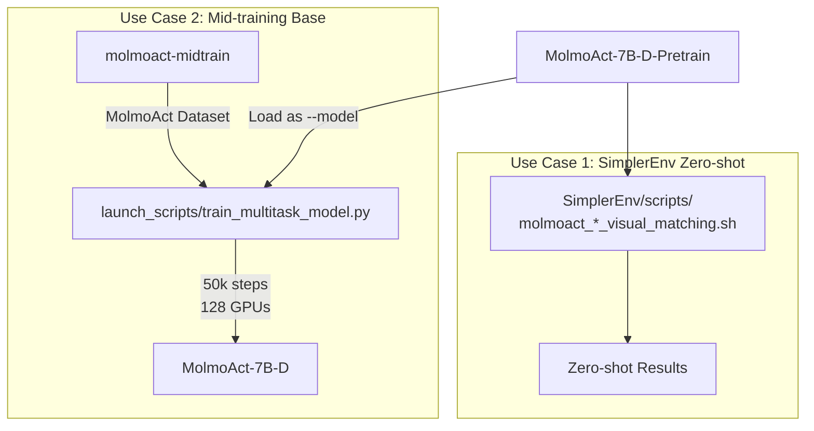
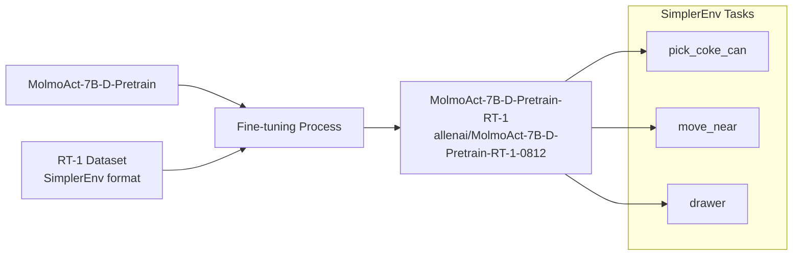
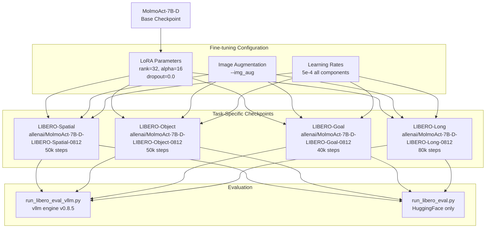
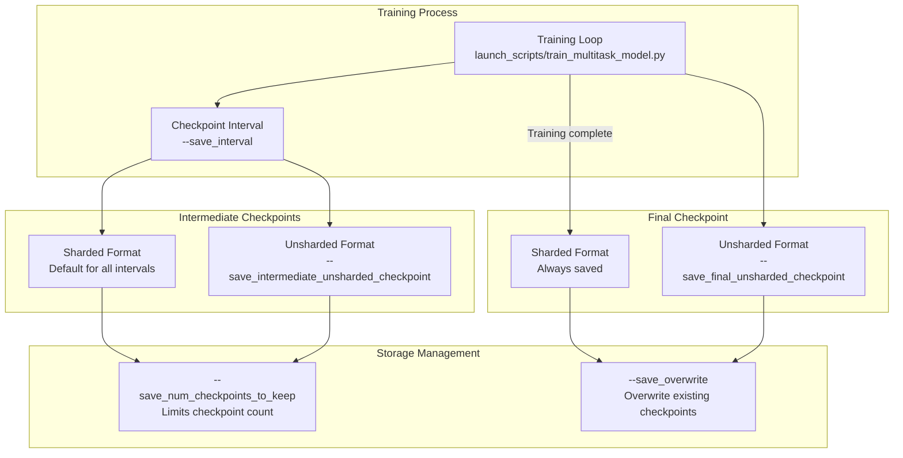
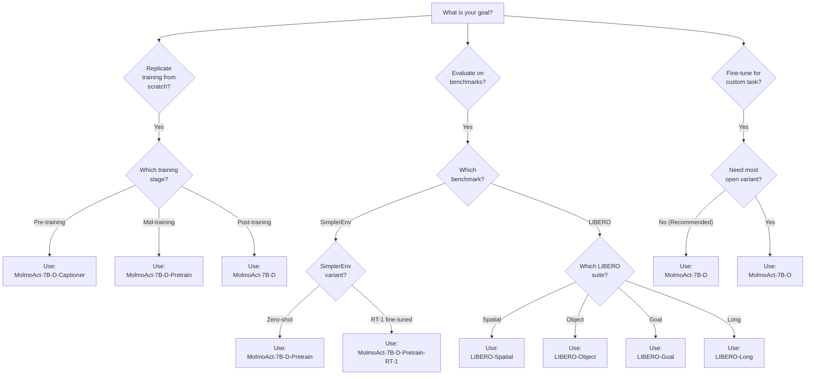

<!-- source: DeepWiki mcp.deepwiki.com · repo allenai/molmoact · page 4 Model Checkpoints and Usage · fetched 2026-10-26 -->

# Model Checkpoints and Usage

<details>
<summary>Relevant source files</summary>

The following files were used as context for generating this wiki page:

- [README.md](README.md)

</details>


This document describes the hierarchy of MolmoAct model checkpoints, their intended use cases, and recommended starting points for different applications. It covers both the training checkpoint progression (from Captioner through Pre-training and Mid-training) and specialized evaluation checkpoints for SimplerEnv and LIBERO benchmarks.

For detailed information on replicating the training process, see [Training Pipeline](#2). For evaluation procedures, see [Evaluation Pipelines](#5).

---

## Overview of Checkpoint Hierarchy

MolmoAct provides multiple model checkpoints organized along two dimensions: **training progression** and **task specialization**. The training progression follows a three-stage curriculum (Pre-training → Mid-training → Post-training), while task specialization produces variants optimized for specific benchmarks or deployment scenarios.

### Checkpoint Progression Flow



**Sources:** [README.md:78-87](), [README.md:174-292]()

---

## Training Checkpoint Hierarchy

The training progression produces four main checkpoints, each building on the previous stage. These checkpoints are designed for different stages of training replication and fine-tuning.

### Checkpoint Comparison Table

| Checkpoint | HuggingFace Path | Training Stage | Use Case | Training Details |
|------------|------------------|----------------|----------|------------------|
| **MolmoAct-7B-D-Captioner** | `allenai/MolmoAct-7B-D-Captioner-0812` | Starting Point | Training replication from scratch | Pre-training initialization |
| **MolmoAct-7B-D-Pretrain** | `allenai/MolmoAct-7B-D-Pretrain-0812` | Post Pre-training | Zero-shot SimplerEnv evaluation, RT-1 fine-tuning base | 100k steps, 256 GPUs, robot+web data |
| **MolmoAct-7B-D** | `allenai/MolmoAct-7B-D-0812` | Post Mid-training | **Recommended** fine-tuning base for real robots, LIBERO base | 50k steps, 128 GPUs, MolmoAct Dataset |
| **MolmoAct-7B-O** | `allenai/MolmoAct-7B-O-0812` | Post Mid-training | Most open variant for fine-tuning | Alternative to MolmoAct-7B-D |

**Sources:** [README.md:78-87](), [README.md:174-249]()

### Training Checkpoint Details

#### MolmoAct-7B-D-Captioner

This checkpoint serves as the **starting point for training replication**. It represents the model state before pre-training begins.



**Usage for Pre-training Replication:**
```bash
torchrun launch_scripts/train_multitask_model.py \
    molmoact-pretrain allenai/MolmoAct-7B-D-Captioner-0812 \
    --duration 100000 --global_batch_size 512 \
    --lr_connector 1e-5 --lr_vit 1e-5 --lr_llm 2e-5
```

**Sources:** [README.md:86-87](), [README.md:174-217]()

#### MolmoAct-7B-D-Pretrain

This checkpoint is the **output of pre-training** and supports two use cases:

1. **Zero-shot evaluation on SimplerEnv** (Google Robot tasks)
2. **Base for mid-training replication**



**Usage for Mid-training Replication:**
```bash
torchrun launch_scripts/train_multitask_model.py \
    molmoact-midtrain allenai/MolmoAct-7B-D-Pretrain-0812 \
    --duration 50000 --global_batch_size 256 \
    --lr_connector 5e-6 --lr_vit 5e-6 --lr_llm 1e-5 \
    --max_images 2
```

**Sources:** [README.md:84-85](), [README.md:221-249]()

#### MolmoAct-7B-D

This is the **recommended checkpoint for fine-tuning** on custom tasks and real robot deployment. It represents the output of mid-training and serves as the base for LIBERO task-specific fine-tuning.

**Key Characteristics:**
- Trained on MolmoAct Dataset with Action Reasoning format
- Supports multi-image inputs (`--max_images 2`)
- Optimal balance between generalization and task-specific adaptation
- Base for all LIBERO task suite models

**Usage for LIBERO Fine-tuning:**
```bash
torchrun launch_scripts/train_multitask_model.py \
    libero-<task_suite> allenai/MolmoAct-7B-D-0812 \
    --duration <steps> --global_batch_size 128 \
    --lr_connector 5e-4 --lr_vit 5e-4 --lr_llm 5e-4 \
    --max_images 2 \
    --lora_enable --lora_rank 32 --lora_alpha 16 --lora_dropout 0.0 \
    --img_aug
```

**Sources:** [README.md:82-83](), [README.md:254-295]()

#### MolmoAct-7B-O

The **most open variant** of MolmoAct, providing an alternative fine-tuning base with potentially broader pre-training data sources.

**Sources:** [README.md:83]()

---

## Specialized Evaluation Checkpoints

MolmoAct provides task-specific checkpoints optimized for benchmark evaluation. These checkpoints are fine-tuned from the base training checkpoints for specific environments and tasks.

### SimplerEnv Checkpoints



**MolmoAct-7B-D-Pretrain-RT-1**

This checkpoint is fine-tuned on RT-1 data for **Google Robot tasks** in SimplerEnv.

| Property | Value |
|----------|-------|
| HuggingFace Path | `allenai/MolmoAct-7B-D-Pretrain-RT-1-0812` |
| Base Checkpoint | `MolmoAct-7B-D-Pretrain` |
| Training Data | RT-1 demonstrations |
| Target Tasks | `pick_coke_can`, `move_near`, `drawer` |
| Evaluation Scripts | `SimplerEnv/scripts/molmoact_*_{visual_matching,variant_agg}.sh` |

**Evaluation Usage:**
```bash
cd SimplerEnv/
bash scripts/molmoact_pick_coke_can_visual_matching.sh
bash scripts/molmoact_pick_coke_can_variant_agg.sh
bash scripts/molmoact_move_near_visual_matching.sh
bash scripts/molmoact_move_near_variant_agg.sh
bash scripts/molmoact_drawer_visual_matching.sh
bash scripts/molmoact_drawer_variant_agg.sh
```

**Sources:** [README.md:85-86](), [README.md:299-312]()

### LIBERO Checkpoints

The LIBERO benchmark uses four task-specific checkpoints, each fine-tuned with LoRA on different task suites.



**LIBERO Task Suite Checkpoints**

| Task Suite | Checkpoint | Training Steps | HuggingFace Path | Evaluation Task Count |
|------------|------------|----------------|------------------|---------------------|
| **Spatial** | LIBERO-Spatial | 50,000 | `allenai/MolmoAct-7B-D-LIBERO-Spatial-0812` | 10 tasks |
| **Object** | LIBERO-Object | 50,000 | `allenai/MolmoAct-7B-D-LIBERO-Object-0812` | 10 tasks |
| **Goal** | LIBERO-Goal | 40,000 | `allenai/MolmoAct-7B-D-LIBERO-Goal-0812` | 10 tasks |
| **Long** | LIBERO-Long | 80,000 | `allenai/MolmoAct-7B-D-LIBERO-Long-0812` | 10 tasks (LIBERO-100) |

**Evaluation Usage (vllm mode):**
```bash
cd experiments/LIBERO
pip install -e .
pip install vllm==0.8.5
export VLLM_WORKER_MULTIPROC_METHOD=spawn

python run_libero_eval_vllm.py --task spatial --checkpoint allenai/MolmoAct-7B-D-LIBERO-Spatial-0812
python run_libero_eval_vllm.py --task object --checkpoint allenai/MolmoAct-7B-D-LIBERO-Object-0812
python run_libero_eval_vllm.py --task goal --checkpoint allenai/MolmoAct-7B-D-LIBERO-Goal-0812
python run_libero_eval_vllm.py --task 10 --checkpoint allenai/MolmoAct-7B-D-LIBERO-Long-0812
```

**Evaluation Usage (HuggingFace-only mode):**
```bash
python run_libero_eval.py --task spatial --checkpoint allenai/MolmoAct-7B-D-LIBERO-Spatial-0812
python run_libero_eval.py --task object --checkpoint allenai/MolmoAct-7B-D-LIBERO-Object-0812
python run_libero_eval.py --task goal --checkpoint allenai/MolmoAct-7B-D-LIBERO-Goal-0812
python run_libero_eval.py --task 10 --checkpoint allenai/MolmoAct-7B-D-LIBERO-Long-0812
```

**Sources:** [README.md:316-339](), [README.md:286-292]()

---

## Checkpoint Format and Storage

MolmoAct checkpoints are stored in two formats: **sharded** and **unsharded**. The format affects loading performance, storage efficiency, and deployment flexibility.

### Sharded vs Unsharded Checkpoints



**Checkpoint Saving Options**

| Flag | Default | Description |
|------|---------|-------------|
| `--save_interval` | Required | Save checkpoint every N steps |
| `--save_num_checkpoints_to_keep` | Required | Limit total checkpoint count (automatic cleanup) |
| `--save_final_unsharded_checkpoint` | Not set | Save unsharded copy of final checkpoint |
| `--save_intermediate_unsharded_checkpoint` | Not set | Save unsharded copies at every interval |
| `--save_overwrite` | Not set | Allow overwriting existing checkpoint directory |

**Storage Implications:**

- **Sharded checkpoints**: Split model parameters across multiple files, faster to save during distributed training
- **Unsharded checkpoints**: Single consolidated model file, easier to deploy and share
- **Final checkpoints only**: Recommended approach to balance disk usage and accessibility (default in training commands)
- **All checkpoints unsharded**: Requires significant additional storage but maximum deployment flexibility

**Example with Checkpoint Management:**
```bash
torchrun launch_scripts/train_multitask_model.py \
    molmoact-pretrain allenai/MolmoAct-7B-D-Captioner-0812 \
    --save_folder=checkpoints/pretrain_exp \
    --save_interval 20000 \
    --save_num_checkpoints_to_keep 5 \
    --save_final_unsharded_checkpoint \
    --save_overwrite
```

This configuration:
- Saves checkpoints every 20,000 steps
- Keeps only the 5 most recent checkpoints (automatic cleanup)
- Creates an unsharded copy of the final checkpoint only
- Allows overwriting the `checkpoints/pretrain_exp` directory

**Sources:** [README.md:207-217](), [README.md:174-295]()

---

## Usage Recommendations

### Decision Matrix: Choosing the Right Checkpoint



### Recommended Checkpoint by Use Case

| Use Case | Recommended Checkpoint | Alternative | Rationale |
|----------|----------------------|-------------|-----------|
| **Real robot deployment** | `MolmoAct-7B-D` | `MolmoAct-7B-O` | Post mid-training, optimal generalization, ready for task-specific fine-tuning |
| **SimplerEnv zero-shot** | `MolmoAct-7B-D-Pretrain` | — | Trained on diverse robot data, direct evaluation without fine-tuning |
| **SimplerEnv with RT-1** | `MolmoAct-7B-D-Pretrain-RT-1` | — | Fine-tuned on RT-1 demonstrations for Google Robot tasks |
| **LIBERO Spatial** | `MolmoAct-7B-D-LIBERO-Spatial-0812` | — | LoRA-tuned for spatial reasoning tasks |
| **LIBERO Object** | `MolmoAct-7B-D-LIBERO-Object-0812` | — | LoRA-tuned for object manipulation tasks |
| **LIBERO Goal** | `MolmoAct-7B-D-LIBERO-Goal-0812` | — | LoRA-tuned for goal-oriented tasks |
| **LIBERO Long** | `MolmoAct-7B-D-LIBERO-Long-0812` | — | LoRA-tuned for long-horizon tasks (LIBERO-100) |
| **Training replication (pre-train)** | `MolmoAct-7B-D-Captioner` | — | Starting point before any robot data training |
| **Training replication (mid-train)** | `MolmoAct-7B-D-Pretrain` | — | Base for mid-training with MolmoAct Dataset |
| **Training replication (post-train)** | `MolmoAct-7B-D` | — | Base for LIBERO task-specific fine-tuning |

**Sources:** [README.md:78-87](), [README.md:174-339]()

---

## Loading Checkpoints in Code

### From HuggingFace Hub

All released checkpoints are available on HuggingFace and can be loaded directly by passing the repository path to the training script:

```bash
# Example: Load pre-trained checkpoint for mid-training
torchrun launch_scripts/train_multitask_model.py \
    molmoact-midtrain allenai/MolmoAct-7B-D-Pretrain-0812 \
    # ... additional arguments
```

The checkpoint path is specified as the second positional argument after the data mixture configuration name.

### From Local Storage

Checkpoints saved during training can be loaded from local directories:

```bash
# Example: Resume training from local checkpoint
torchrun launch_scripts/train_multitask_model.py \
    molmoact-pretrain checkpoints/my_experiment/step_20000 \
    # ... additional arguments
```

**Checkpoint Directory Structure:**

For saved training checkpoints, the `--save_folder` argument defines the base directory. Each checkpoint is saved in a subdirectory named by step count:

```
checkpoints/
└── my_experiment/
    ├── step_20000/
    │   ├── model_state.pt (or sharded files)
    │   ├── optimizer_state.pt
    │   └── trainer_state.json
    ├── step_40000/
    └── step_60000/
```

**Sources:** [README.md:174-295]()

---

## Checkpoint Download and Verification

All MolmoAct checkpoints are hosted on HuggingFace Hub and downloaded automatically when referenced in training or evaluation commands. Manual download is typically not required.

### Automatic Download Behavior

When a HuggingFace checkpoint path (e.g., `allenai/MolmoAct-7B-D-0812`) is specified:

1. The Transformers library checks the local HuggingFace cache (`$HF_HOME`)
2. If not found, downloads the checkpoint automatically
3. Caches the checkpoint for future use

### Cache Location

Set the HuggingFace cache directory before running training or evaluation:

```bash
export HF_HOME=/data/molmoact/huggingface
```

This ensures checkpoints are downloaded to a location with sufficient storage capacity.

**Sources:** [README.md:113-124]()

---

## Summary

MolmoAct provides a comprehensive hierarchy of checkpoints supporting research, evaluation, and deployment:

- **Training progression**: Captioner → Pretrain → Midtrain (with MolmoAct-7B-D as recommended fine-tuning base)
- **SimplerEnv evaluation**: Pretrain (zero-shot) and Pretrain-RT-1 (fine-tuned)
- **LIBERO evaluation**: Four task-specific LoRA-tuned models (Spatial, Object, Goal, Long)
- **Checkpoint formats**: Sharded (default) and unsharded (configurable)
- **Storage**: All checkpoints available on HuggingFace Hub with automatic caching

For detailed training instructions, see [Training Pipeline](#2). For evaluation procedures, see [SimplerEnv Evaluation](#5.1) and [LIBERO Benchmark Evaluation](#5.2). For fine-tuning on custom tasks, see [Post-training and Task-Specific Fine-tuning](#2.3).

**Sources:** [README.md:60-339]()

---

