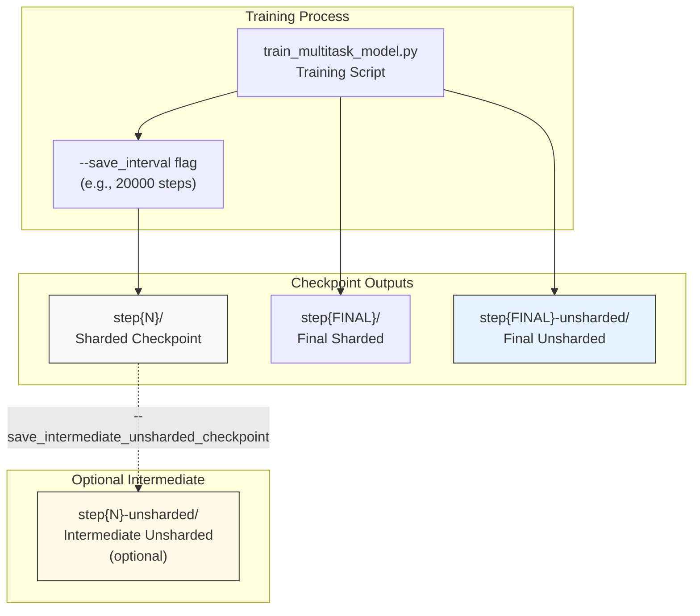
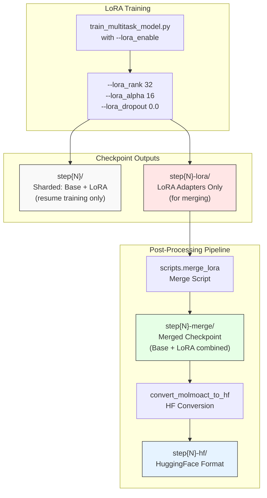
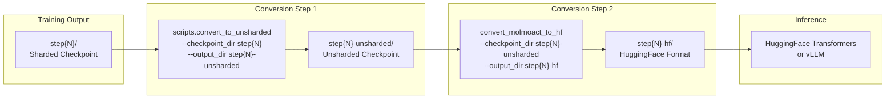
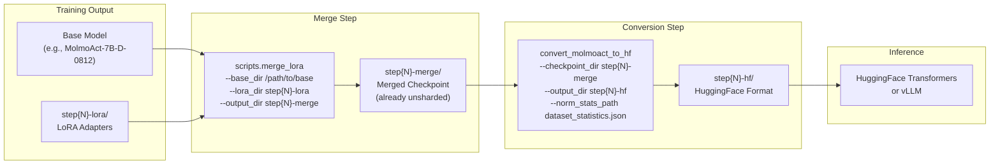
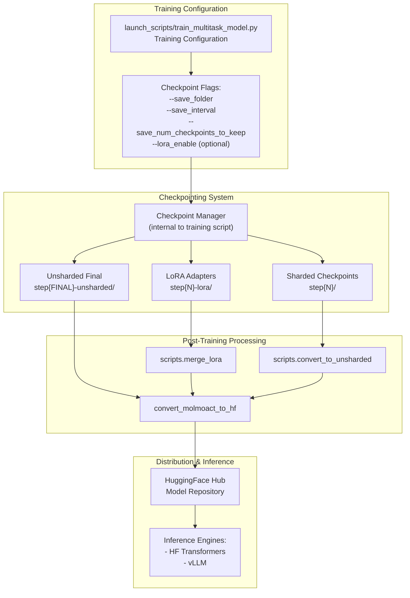

<!-- source: DeepWiki mcp.deepwiki.com · repo allenai/molmoact · page 4.1 Training Checkpoint Hierarchy · fetched 2026-10-26 -->

# Training Checkpoint Hierarchy

<details>
<summary>Relevant source files</summary>

The following files were used as context for generating this wiki page:

- [README.md](README.md)

</details>


## Purpose and Scope

This page documents the checkpoint structure and management system used during MolmoAct training. It covers the different checkpoint formats (sharded vs. unsharded), LoRA adapter organization, naming conventions, and conversion workflows required to move from training checkpoints to inference-ready models.

For information about specialized pre-trained checkpoints for evaluation, see [Specialized Evaluation Checkpoints](#4.2).

---

## Checkpoint Types Overview

MolmoAct's training pipeline produces different checkpoint formats depending on the training stage and configuration. The system distinguishes between:

| Checkpoint Type | Purpose | Storage Format | Usage |
|----------------|---------|----------------|-------|
| **Sharded** | Training resumption, memory efficiency | Distributed across multiple files | Resume training only |
| **Unsharded** | Model conversion and distribution | Single consolidated state | Conversion to HF format |
| **LoRA Adapters** | Fine-tuning parameters | Separate adapter weights | Merge with base model |
| **Merged** | Combined base + LoRA | Consolidated full model | Inference preparation |
| **HF Format** | Inference deployment | HuggingFace Transformers | Production inference |

The checkpoint system is designed to optimize for both training efficiency (sharded checkpoints) and deployment convenience (unsharded/merged checkpoints).

**Sources:** [README.md:193-222](), [README.md:362-364]()

---

## Checkpoint Naming Convention

The training system follows a structured naming pattern for all checkpoint types:

```
checkpoints/<exp_name>/
├── step1000/                    # Sharded checkpoint (training resume)
├── step1000-lora/              # LoRA adapters only (if LoRA enabled)
├── step1000-unsharded/         # Unsharded checkpoint (optional)
├── step1000-merge/             # Merged base + LoRA (after merge)
├── step1000-hf/                # HuggingFace format (after conversion)
├── step2000/
├── step2000-lora/
└── ...
```

### Naming Pattern Details

- **`stepXXX/`**: Default sharded checkpoint saved at intervals defined by `--save_interval`
- **`stepXXX-lora/`**: Contains only the LoRA adapter weights when `--lora_enable` is used
- **`stepXXX-unsharded/`**: Consolidated checkpoint created by conversion script or during training
- **`stepXXX-merge/`**: Result of merging base model with LoRA adapters using `scripts.merge_lora`
- **`stepXXX-hf/`**: HuggingFace Transformers-compatible format created by `convert_molmoact_to_hf`

**Sources:** [README.md:193-199](), [README.md:218-222]()

---

## Full Parameter Training Checkpoints

During full parameter training (pre-training and mid-training stages), the checkpoint system operates as follows:



### Configuration Flags

Training command flags controlling checkpoint behavior:

| Flag | Description | Default Value |
|------|-------------|---------------|
| `--save_folder` | Root directory for checkpoints | `checkpoints/<exp_name>` |
| `--save_interval` | Steps between checkpoint saves | Varies by stage (10K-20K) |
| `--save_num_checkpoints_to_keep` | Maximum checkpoint retention | 5 |
| `--save_overwrite` | Allow overwriting existing folder | Optional |
| `--save_final_unsharded_checkpoint` | Save final checkpoint unsharded | Enabled for replication |
| `--save_intermediate_unsharded_checkpoint` | Save all checkpoints unsharded | Disabled by default |

### Sharded Checkpoint Structure

Sharded checkpoints distribute model parameters across multiple files to enable efficient multi-GPU training and checkpoint saving. Each shard contains a portion of the model's state dictionary.

### Unsharded Checkpoint Structure

Unsharded checkpoints consolidate all model parameters into a single state dictionary. This format is required for:
- Conversion to HuggingFace format
- Model distribution
- Inference deployment

**Sources:** [README.md:329-375](), [README.md:362-364]()

---

## LoRA Training Checkpoints

When training with LoRA adapters (post-training/fine-tuning stage), the checkpoint system produces a dual-output structure:



### LoRA Checkpoint Components

When `--lora_enable` is specified during training, two checkpoint types are created:

1. **Sharded Full Checkpoint (`stepXXX/`)**: Contains both base model parameters and LoRA adapters in sharded format. Used exclusively for resuming training.

2. **LoRA Adapters (`stepXXX-lora/`)**: Contains only the trainable LoRA adapter weights. This lightweight checkpoint is used for merging with the base model.

### LoRA Adapter Specifications

The LoRA configuration used in MolmoAct post-training:

```
--lora_rank 32        # Rank of LoRA decomposition
--lora_alpha 16       # Scaling factor for LoRA
--lora_dropout 0.0    # Dropout rate (disabled)
```

**Sources:** [README.md:161-200](), [README.md:413-456]()

---

## Checkpoint Conversion Workflows

The complete workflow from training checkpoints to inference-ready models involves multiple conversion steps:

### Full Parameter Training Workflow



### LoRA Training Workflow



### Conversion Script Details

**1. Convert Sharded to Unsharded**

```bash
python3 -m scripts.convert_to_unsharded \
    --checkpoint_dir /path/to/checkpoints/exp_name/stepXXX \
    --output_dir /path/to/checkpoints/exp_name/stepXXX-unsharded
```

This script consolidates distributed checkpoint shards into a single state dictionary.

**2. Merge LoRA Adapters**

```bash
python3 -m scripts.merge_lora \
    --base_dir /path/to/base_model \
    --lora_dir /path/to/checkpoints/exp_name/stepXXX-lora \
    --output_dir /path/to/checkpoints/exp_name/stepXXX-merge
```

This script combines base model weights with LoRA adapter weights. The output is automatically unsharded.

**3. Convert to HuggingFace Format**

```bash
python3 -m olmo.hf_model.molmoact.convert_molmoact_to_hf \
    --checkpoint_dir /path/to/checkpoints/exp_name/stepXXX-merge \
    --output_dir /path/to/checkpoints/exp_name/stepXXX-hf \
    --style demo \
    --norm_stats_path /path/to/dataset_statistics.json
```

This script wraps the model in HuggingFace Transformers format for inference. The `--norm_stats_path` parameter embeds dataset statistics for action denormalization.

**Sources:** [README.md:191-222]()

---

## Training Stage Checkpoint Patterns

Different training stages have different checkpoint management patterns:

### Pre-training Stage (100K steps, 32 nodes)

```
Configuration:
--save_interval 20000
--save_num_checkpoints_to_keep 5
--save_final_unsharded_checkpoint

Output Pattern:
checkpoints/exp_name/
├── step20000/          (sharded only)
├── step40000/          (sharded only)
├── step60000/          (sharded only)
├── step80000/          (sharded only)
├── step100000/         (sharded)
└── step100000-unsharded/  (unsharded, for distribution)
```

Only the final checkpoint (step 100000) is saved in both sharded and unsharded formats by default.

### Mid-training Stage (50K steps, 16 nodes)

```
Configuration:
--save_interval 10000
--save_num_checkpoints_to_keep 5
--save_final_unsharded_checkpoint

Output Pattern:
checkpoints/exp_name/
├── step10000/          (sharded only)
├── step20000/          (sharded only)
├── step30000/          (sharded only)
├── step40000/          (sharded only)
├── step50000/          (sharded)
└── step50000-unsharded/  (unsharded, for distribution)
```

### Post-training Stage (LoRA, task-specific)

```
Configuration:
--save_interval 10000
--save_num_checkpoints_to_keep 5
--lora_enable --lora_rank 32

Output Pattern (example for 50K steps):
checkpoints/exp_name/
├── step10000/          (sharded: base + LoRA)
├── step10000-lora/     (LoRA adapters only)
├── step20000/
├── step20000-lora/
├── step30000/
├── step30000-lora/
├── step40000/
├── step40000-lora/
├── step50000/
└── step50000-lora/
```

Post-training checkpoints are not automatically unsharded. Users must manually merge LoRA adapters and convert to HF format for inference.

**Sources:** [README.md:329-456]()

---

## Storage Considerations

### Disk Space Requirements

Checkpoint storage varies significantly by format and training stage:

| Checkpoint Type | Approximate Size (7B model) | Notes |
|----------------|----------------------------|-------|
| Sharded (full) | ~14-16 GB | Distributed across multiple files |
| Unsharded (full) | ~14-16 GB | Single consolidated file |
| LoRA adapters only | ~200-500 MB | Depends on rank and target modules |
| Merged (base + LoRA) | ~14-16 GB | Full model size |
| HF format | ~14-16 GB | Includes config and tokenizer |

### Checkpoint Retention Policy

The `--save_num_checkpoints_to_keep` flag controls automatic cleanup:

- Setting to `5` retains only the 5 most recent checkpoints
- Older checkpoints are automatically deleted to conserve disk space
- Final checkpoints are never automatically deleted
- LoRA adapter checkpoints follow the same retention policy

### Recommended Practices

1. **For training resumption**: Keep sharded checkpoints only
2. **For distribution**: Save final unsharded checkpoint
3. **For development**: Use `--save_intermediate_unsharded_checkpoint` sparingly due to storage overhead
4. **For production inference**: Convert to HF format after training completes
5. **For LoRA training**: Only the `-lora` directories are needed for merging; sharded checkpoints can be deleted after training completes

**Sources:** [README.md:362-364](), [README.md:182-183]()

---

## Checkpoint Validation

### Verifying Checkpoint Integrity

Checkpoints can be validated by loading them for inference:

**For unsharded/merged checkpoints:**
```bash
python3 olmo/hf_model/molmoact/test_molmoact.py \
    --checkpoint_dir /path/to/checkpoint-hf \
    --images /path/to/test_image.jpg \
    --instruction "test instruction"
```

**For training resumption:**
Specify the sharded checkpoint directory when restarting training with the same configuration.

### Common Issues

| Issue | Cause | Solution |
|-------|-------|----------|
| "Checkpoint must be unsharded" | Using sharded checkpoint for HF conversion | Run `scripts.convert_to_unsharded` first |
| "LoRA adapters not found" | Attempting to merge non-existent `-lora` directory | Verify LoRA was enabled during training |
| "Mismatched checkpoint format" | Using merged checkpoint for training resume | Use original sharded checkpoint (`stepXXX/`) |
| "Missing dataset statistics" | Inference without normalization info | Add `--norm_stats_path` to conversion command |

**Sources:** [README.md:203-249]()

---

## Integration with Training Pipeline

The checkpoint system integrates with the broader training infrastructure:



The checkpoint system is designed to support:
- **Efficient training**: Sharded checkpoints for distributed training
- **Flexible fine-tuning**: LoRA adapter isolation and merging
- **Easy deployment**: HuggingFace format conversion for inference
- **Model distribution**: Unsharded checkpoints for sharing via HuggingFace Hub

**Sources:** [README.md:110-456]()

---

