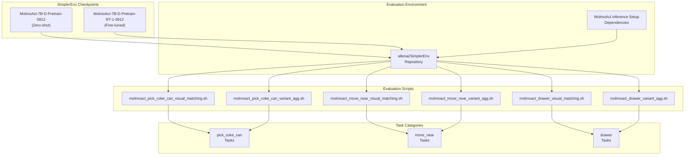
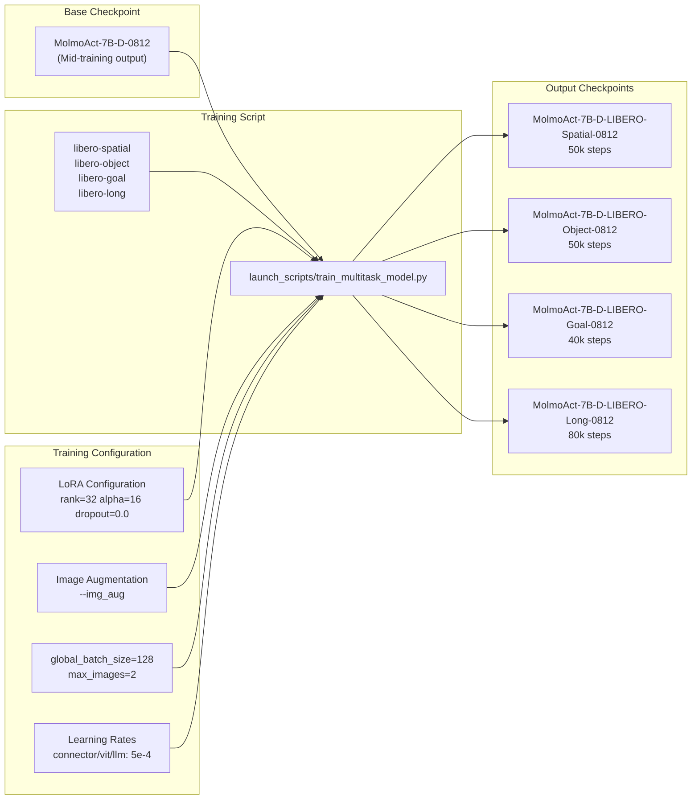
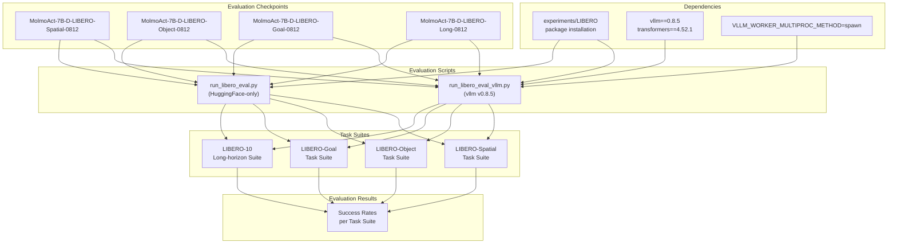
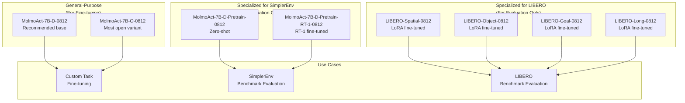

<!-- source: DeepWiki mcp.deepwiki.com · repo allenai/molmoact · page 4.2 Specialized Evaluation Checkpoints · fetched 2026-10-26 -->

# Specialized Evaluation Checkpoints

<details>
<summary>Relevant source files</summary>

The following files were used as context for generating this wiki page:

- [README.md](README.md)

</details>


## Purpose and Scope

This document describes task-specific model checkpoints designed for evaluation on specific robotic benchmarks. These checkpoints are fine-tuned variants optimized for either **SimplerEnv** (Google Robot simulation) or **LIBERO** (lifelong learning benchmark) tasks. Unlike the general-purpose training checkpoints described in [Training Checkpoint Hierarchy](#4.1), these specialized checkpoints are intended for benchmark evaluation and research comparison rather than as fine-tuning bases for custom tasks.

For information about general-purpose checkpoints suitable for fine-tuning on custom robot tasks, see [Training Checkpoint Hierarchy](#4.1).

---

## SimplerEnv Evaluation Checkpoints

SimplerEnv evaluation uses two checkpoint variants from the pre-training stage: a zero-shot checkpoint and an RT-1 fine-tuned checkpoint. Both are derived from `MolmoAct-7B-D-Pretrain-0812` (the checkpoint after 100k pre-training steps).

### Zero-Shot Checkpoint

**Checkpoint**: `allenai/MolmoAct-7B-D-Pretrain-0812`

This checkpoint represents the model after the pre-training stage and is used for **zero-shot evaluation** on SimplerEnv tasks without any task-specific fine-tuning. It demonstrates the model's generalization capabilities from pre-training on diverse robot and web data.

**Evaluation Tasks**:
- `pick_coke_can` (visual matching and variant aggregation)
- `move_near` (visual matching and variant aggregation)
- `drawer` (visual matching and variant aggregation)

**Usage**: This checkpoint is evaluated directly on SimplerEnv using the evaluation scripts at [allenai/SimplerEnv](https://github.com/allenai/SimplerEnv).

Sources: [README.md:84-85](), [README.md:299-312]()

### RT-1 Fine-Tuned Checkpoint

**Checkpoint**: `allenai/MolmoAct-7B-D-Pretrain-RT-1-0812`

This checkpoint is fine-tuned from `MolmoAct-7B-D-Pretrain-0812` specifically on **RT-1 robot demonstration data** to evaluate performance on SimplerEnv tasks with task-specific adaptation. This represents an alternative post-training path specialized for Google Robot tasks.

**Training Configuration**: The RT-1 fine-tuning process uses the pre-trained checkpoint as the base and trains on RT-1 demonstrations, but specific hyperparameters for this fine-tuning are not detailed in the public documentation.

**Evaluation**: Uses the same SimplerEnv evaluation scripts as the zero-shot checkpoint, allowing direct comparison of zero-shot vs. fine-tuned performance.

Sources: [README.md:85-86](), [README.md:299-312]()

### SimplerEnv Evaluation Workflow



**SimplerEnv Evaluation Architecture**: The SimplerEnv evaluation workflow requires installing dependencies from the separate allenai/SimplerEnv repository. Both zero-shot and RT-1 fine-tuned checkpoints are evaluated using six scripts that test three task categories with two evaluation modes each (visual matching and variant aggregation).

Sources: [README.md:299-312]()

---

## LIBERO Evaluation Checkpoints

LIBERO evaluation uses four task-specific checkpoints, each fine-tuned from `MolmoAct-7B-D-0812` (the mid-training checkpoint) using **LoRA** and **image augmentation** for efficient adaptation.

### Task-Specific Checkpoint Overview

| Checkpoint | Task Suite | Training Steps | Description |
|------------|------------|----------------|-------------|
| `allenai/MolmoAct-7B-D-LIBERO-Spatial-0812` | spatial | 50,000 | Spatial reasoning tasks |
| `allenai/MolmoAct-7B-D-LIBERO-Object-0812` | object | 50,000 | Object manipulation tasks |
| `allenai/MolmoAct-7B-D-LIBERO-Goal-0812` | goal | 40,000 | Goal-oriented tasks |
| `allenai/MolmoAct-7B-D-LIBERO-Long-0812` | 10 (long) | 80,000 | Long-horizon tasks (LIBERO-10) |

Sources: [README.md:329-338](), [README.md:286-292]()

### Training Configuration

All LIBERO checkpoints share a common training configuration with task-suite-specific training durations:

**Hyperparameters**:
- **Base checkpoint**: `allenai/MolmoAct-7B-D-0812` (mid-training output)
- **Global batch size**: 128
- **Learning rates**: 
  - `--lr_connector 5e-4`
  - `--lr_vit 5e-4`
  - `--lr_llm 5e-4`
- **LoRA configuration**:
  - `--lora_enable`
  - `--lora_rank 32`
  - `--lora_alpha 16`
  - `--lora_dropout 0.0`
- **Image handling**: `--max_images 2` (two-image inputs)
- **Data augmentation**: `--img_aug` enabled

**Training Command Template**:
```bash
torchrun --nnodes=8 --nproc-per-node=8 \
    launch_scripts/train_multitask_model.py \
    libero-<task_suite> allenai/MolmoAct-7B-D-0812 \
    --duration <steps> \
    --global_batch_size 128 \
    --lr_connector 5e-4 --lr_vit 5e-4 --lr_llm 5e-4 \
    --lora_enable --lora_rank 32 --lora_alpha 16 --lora_dropout 0.0 \
    --img_aug --max_images 2
```

Sources: [README.md:256-278](), [README.md:286-292]()

### LIBERO Training Workflow



**LIBERO Training Pipeline**: All LIBERO checkpoints follow the same training pipeline with task-suite-specific configurations. The training script accepts a task suite identifier (spatial, object, goal, long) and applies LoRA fine-tuning with image augmentation to the mid-training base checkpoint. Training durations vary by task complexity: 40k-80k steps across 64 GPUs (8 nodes × 8 GPUs).

Sources: [README.md:256-278](), [README.md:286-292]()

### Evaluation Setup and Execution

LIBERO evaluation supports two modes: **vllm-based** (recommended for performance) and **HuggingFace-only** (for compatibility).

**Installation Requirements**:
```bash
cd experiments/LIBERO
pip install -e .
pip install einops torchvision accelerate
pip install transformers==4.52.1
pip install vllm==0.8.5
export VLLM_WORKER_MULTIPROC_METHOD=spawn
cd ../libero
```

**Evaluation Scripts**:

The evaluation scripts are located in `experiments/libero/` directory:
- `run_libero_eval_vllm.py` - vllm-based evaluation (uses vllm v0.8.5 engine)
- `run_libero_eval.py` - HuggingFace-only evaluation

**vllm Evaluation Commands**:
```bash
python run_libero_eval_vllm.py --task spatial --checkpoint allenai/MolmoAct-7B-D-LIBERO-Spatial-0812
python run_libero_eval_vllm.py --task object --checkpoint allenai/MolmoAct-7B-D-LIBERO-Object-0812
python run_libero_eval_vllm.py --task goal --checkpoint allenai/MolmoAct-7B-D-LIBERO-Goal-0812
python run_libero_eval_vllm.py --task 10 --checkpoint allenai/MolmoAct-7B-D-LIBERO-Long-0812
```

**HuggingFace-only Evaluation Commands**:
```bash
python run_libero_eval.py --task spatial --checkpoint allenai/MolmoAct-7B-D-LIBERO-Spatial-0812
python run_libero_eval.py --task object --checkpoint allenai/MolmoAct-7B-D-LIBERO-Object-0812
python run_libero_eval.py --task goal --checkpoint allenai/MolmoAct-7B-D-LIBERO-Goal-0812
python run_libero_eval.py --task 10 --checkpoint allenai/MolmoAct-7B-D-LIBERO-Long-0812
```

Sources: [README.md:316-339]()

### LIBERO Evaluation Architecture



**LIBERO Evaluation Workflow**: The evaluation system requires installation of the LIBERO package from `experiments/LIBERO/` and supports two execution modes. The vllm mode requires vllm v0.8.5, transformers v4.52.1, and the VLLM_WORKER_MULTIPROC_METHOD environment variable. Both modes evaluate task-specific checkpoints against their corresponding task suites and report success rate metrics.

Sources: [README.md:316-339]()

---

## Checkpoint Usage Comparison

| Checkpoint | Base Model | Purpose | Training Method | Evaluation Target |
|------------|------------|---------|-----------------|-------------------|
| `MolmoAct-7B-D-Pretrain-0812` | Captioner + 100k pretrain | Zero-shot SimplerEnv | Full fine-tuning | Google Robot tasks |
| `MolmoAct-7B-D-Pretrain-RT-1-0812` | Pretrain + RT-1 fine-tuning | Fine-tuned SimplerEnv | Full fine-tuning | Google Robot tasks |
| `MolmoAct-7B-D-LIBERO-Spatial-0812` | Midtrain + 50k LoRA | LIBERO Spatial benchmark | LoRA + augmentation | Spatial reasoning |
| `MolmoAct-7B-D-LIBERO-Object-0812` | Midtrain + 50k LoRA | LIBERO Object benchmark | LoRA + augmentation | Object manipulation |
| `MolmoAct-7B-D-LIBERO-Goal-0812` | Midtrain + 40k LoRA | LIBERO Goal benchmark | LoRA + augmentation | Goal-oriented tasks |
| `MolmoAct-7B-D-LIBERO-Long-0812` | Midtrain + 80k LoRA | LIBERO Long benchmark | LoRA + augmentation | Long-horizon tasks |

**Key Distinctions**:
- **SimplerEnv checkpoints** branch from the pre-training stage and use full model fine-tuning
- **LIBERO checkpoints** branch from the mid-training stage and use parameter-efficient LoRA fine-tuning
- **SimplerEnv evaluation** requires separate repository setup at [allenai/SimplerEnv](https://github.com/allenai/SimplerEnv)
- **LIBERO evaluation** uses scripts in `experiments/libero/` with two execution modes (vllm and HuggingFace-only)

Sources: [README.md:78-87](), [README.md:254-339]()

---

## Specialized vs. General-Purpose Checkpoints



**Checkpoint Selection Guide**: General-purpose checkpoints (MolmoAct-7B-D and MolmoAct-7B-O) serve as fine-tuning bases for custom robot tasks. Specialized checkpoints are optimized for specific benchmarks and should be used only for evaluation and comparison purposes. SimplerEnv checkpoints enable zero-shot and fine-tuned comparison on Google Robot tasks, while LIBERO checkpoints provide task-suite-specific evaluation on lifelong learning benchmarks.

Sources: [README.md:78-87](), [README.md:254-339]()

---

