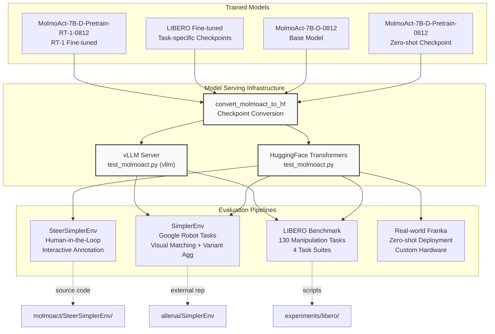
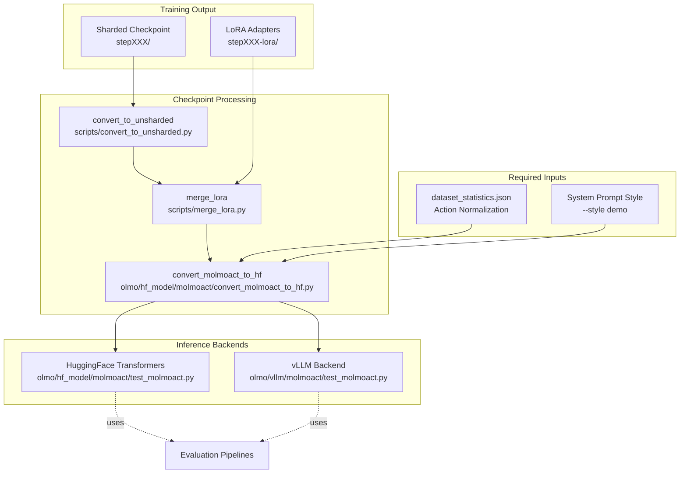
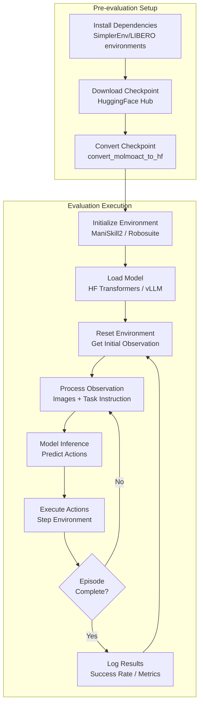

<!-- source: DeepWiki mcp.deepwiki.com · repo allenai/molmoact · page 5 Evaluation Pipelines · fetched 2026-10-26 -->

# Evaluation Pipelines

<details>
<summary>Relevant source files</summary>

The following files were used as context for generating this wiki page:

- [README.md](README.md)

</details>


## Purpose and Scope

This document provides an overview of the evaluation infrastructure available for MolmoAct models. It describes the four primary evaluation pipelines—SimplerEnv, SteerSimplerEnv, LIBERO, and real-world robot evaluation—and explains how trained model checkpoints are converted and deployed for testing across simulated and physical environments.

For detailed setup and usage of each evaluation system, see the child pages:
- SimplerEnv evaluation procedures: [5.1](#5.1)
- Interactive human-in-the-loop evaluation: [5.2](#5.2)
- LIBERO benchmark evaluation: [5.3](#5.3)
- Real-world robot deployment: [5.4](#5.4)

For information about training and producing model checkpoints, see [Training Pipeline](#2). For checkpoint conversion and model serving, see [Model Checkpoints and Usage](#4).

---

## Evaluation System Overview

MolmoAct supports four distinct evaluation pipelines, each serving different testing scenarios and research objectives:



**Sources:** [README.md:458-540]()

---

## Evaluation Pipeline Characteristics

Each evaluation pipeline has distinct characteristics, hardware requirements, and use cases:

| Pipeline | Environment | Primary Use Case | Hardware Requirements | Execution Location | Key Scripts |
|----------|-------------|------------------|----------------------|-------------------|-------------|
| **SimplerEnv** | Google Robot simulation (ManiSkill2) | Zero-shot evaluation, RT-1 comparison | GPU (inference) | External: `allenai/SimplerEnv` | `molmoact_pick_coke_can_visual_matching.sh`<br/>`molmoact_move_near_variant_agg.sh` |
| **SteerSimplerEnv** | Google Robot simulation + Remote UI | Human-guided trajectory correction | GPU + ngrok tunnel | `molmoact/SteerSimplerEnv/` | `main_inference.py`<br/>`maniskill2_evaluator_steer.py`<br/>`molmoact_test.sh` |
| **LIBERO** | Robosuite simulation (MuJoCo) | Task-specific fine-tuning validation | GPU (inference) | `experiments/libero/` | `run_libero_eval_vllm.py`<br/>`run_libero_eval.py` |
| **Real-world** | Physical Franka robot | Deployment validation | GPU + Franka hardware + cameras | User-provided setup | Custom deployment scripts |

**Sources:** [README.md:458-540]()

---

## Checkpoint Conversion and Model Serving

Before evaluation, trained checkpoints must be converted to HuggingFace-compatible format. The evaluation pipelines support two inference backends:



**Sources:** [README.md:191-248]()

### Conversion Commands

**Unsharding checkpoints** (if only sharded available):
```bash
python3 -m scripts.convert_to_unsharded \
    --checkpoint_dir /path/to/checkpoints/exp_name/stepXXX \
    --output_dir /path/to/checkpoints/exp_name/stepXXX-unsharded
```

**Merging LoRA adapters** (for LoRA fine-tuning):
```bash
python3 -m scripts.merge_lora \
    --base_dir /path/to/base_model \
    --lora_dir /path/to/checkpoints/exp_name/stepXXX-lora \
    --output_dir /path/to/checkpoints/exp_name/stepXXX-merge
```

**Converting to HuggingFace format**:
```bash
python3 -m olmo.hf_model.molmoact.convert_molmoact_to_hf \
    --checkpoint_dir /path/to/checkpoints/exp_name/stepXXX-merge \
    --output_dir /path/to/checkpoints/exp_name/stepXXX-hf \
    --style demo \
    --norm_stats_path /path/to/dataset_statistics.json
```

**Sources:** [README.md:191-222]()

---

## Model Inference Interfaces

### HuggingFace Transformers Inference

The standard inference path uses HuggingFace Transformers for model loading and execution:

**Command:**
```bash
python3 olmo/hf_model/molmoact/test_molmoact.py \
    --checkpoint_dir /path/to/checkpoints/exp_name/stepXXX-hf \
    --images /path/to/img1 /path/to/img2 \
    --instruction "task instruction" \
    --unnorm_key unnorm_key
```

**Dependencies:**
```bash
pip install einops torchvision accelerate transformers==4.52
```

**Sources:** [README.md:224-250]()

### vLLM Optimized Inference

For faster inference during large-scale evaluation, vLLM provides optimized serving:

**Command:**
```bash
python3 -m olmo.vllm.molmoact.test_molmoact \
    --checkpoint_dir /path/to/checkpoints/exp_name/stepXXX-hf \
    --images /path/to/img1 /path/to/img2 \
    --instruction "task instruction" \
    --unnorm_key unnorm_key
```

**Dependencies:**
```bash
pip install vllm==0.8.5
export VLLM_WORKER_MULTIPROC_METHOD=spawn
```

**Sources:** [README.md:234-242](), [README.md:486]()

---

## Common Evaluation Patterns

### Observation Processing

All evaluation pipelines follow a common pattern for processing observations before inference:

1. **Image Input**: Multi-view RGB images (typically 2 views: agent + eye-in-hand)
2. **Depth Estimation**: Depth-Anything-V2 generates depth maps
3. **Depth Tokenization**: VQVAE encoder converts depth maps to discrete tokens
4. **Action Format**: Robot actions are discretized into 256 bins with chunk size 8

### Output Interpretation

MolmoAct inference produces three types of outputs:

| Output Type | Format | Usage |
|------------|--------|-------|
| **Robot Actions** | 7-DOF end-effector deltas + gripper | Direct robot control |
| **Depth Tokens** | Discrete tokens `<DEPTH_1>...<DEPTH_N>` | Visualization via VQVAE decoder |
| **Visual Trace** | 2D coordinates [0, 256) | Action trajectory visualization |

**Depth Reconstruction:**
```bash
python3 scripts/reconstruct_from_tokens.py \
    --ckpt_path /path/to/vae-final.pt \
    --depth_tokens "<DEPTH_START><DEPTH_1>...<DEPTH_END>" \
    --output_path /path/to/depth.png
```

**Sources:** [README.md:253-262]()

---

## Evaluation Pipeline Execution Flow



**Sources:** [README.md:458-540]()

---

## File Structure for Evaluation

The evaluation code is distributed across multiple locations in the repository:

```
molmoact/
├── olmo/
│   ├── hf_model/molmoact/
│   │   ├── test_molmoact.py                    # HF Transformers inference
│   │   └── convert_molmoact_to_hf.py           # Checkpoint conversion
│   └── vllm/molmoact/
│       └── test_molmoact.py                     # vLLM inference
├── scripts/
│   ├── merge_lora.py                            # LoRA adapter merging
│   ├── convert_to_unsharded.py                 # Checkpoint unsharding
│   └── reconstruct_from_tokens.py              # Depth visualization
├── molmoact/SteerSimplerEnv/
│   ├── main_inference.py                        # SteerSimplerEnv orchestrator
│   ├── maniskill2_evaluator_steer.py           # Interactive evaluation
│   ├── remote_traj_server.py                    # Trajectory annotation server
│   └── changes.sh                               # Deployment script
└── experiments/
    └── libero/
        ├── run_libero_eval_vllm.py             # LIBERO eval with vLLM
        └── run_libero_eval.py                  # LIBERO eval with HF
```

**Sources:** [README.md:191-540]()

---

## Evaluation Checkpoints

MolmoAct provides pre-trained checkpoints optimized for different evaluation scenarios:

| Checkpoint | Purpose | HuggingFace Path | Evaluation Use |
|-----------|---------|------------------|----------------|
| MolmoAct-7B-D-Pretrain-0812 | Zero-shot SimplerEnv | `allenai/MolmoAct-7B-D-Pretrain-0812` | Out-of-box Google Robot tasks |
| MolmoAct-7B-D-Pretrain-RT-1-0812 | RT-1 fine-tuned | `allenai/MolmoAct-7B-D-Pretrain-RT-1-0812` | RT-1 comparison baseline |
| MolmoAct-7B-D-0812 | Base for fine-tuning | `allenai/MolmoAct-7B-D-0812` | Zero-shot real-world deployment |
| MolmoAct-7B-D-LIBERO-Spatial-0812 | LIBERO Spatial suite | `allenai/MolmoAct-7B-D-LIBERO-Spatial-0812` | Spatial knowledge transfer |
| MolmoAct-7B-D-LIBERO-Object-0812 | LIBERO Object suite | `allenai/MolmoAct-7B-D-LIBERO-Object-0812` | Object knowledge transfer |
| MolmoAct-7B-D-LIBERO-Goal-0812 | LIBERO Goal suite | `allenai/MolmoAct-7B-D-LIBERO-Goal-0812` | Goal knowledge transfer |
| MolmoAct-7B-D-LIBERO-Long-0812 | LIBERO-10 suite | `allenai/MolmoAct-7B-D-LIBERO-Long-0812` | Long-horizon tasks |

**Sources:** [README.md:84-92](), [README.md:490-499]()

---

## Environment Variables and Configuration

### Required Environment Variables

```bash
# Data storage (for dataset statistics and assets)
export MOLMOACT_DATA_DIR=/data/molmoact

# HuggingFace cache location
export HF_HOME=/data/molmoact/huggingface

# vLLM multiprocessing method
export VLLM_WORKER_MULTIPROC_METHOD=spawn
```

**Sources:** [README.md:268-278](), [README.md:486]()

### Minimal Inference Dependencies

For standalone inference without full training environment:

```bash
pip install einops torchvision accelerate vllm==0.8.5 transformers==4.52
```

**Sources:** [README.md:244-248]()

---

## Integration with External Repositories

### SimplerEnv Integration

SimplerEnv evaluation is maintained in a separate repository:

- **Repository:** `allenai/SimplerEnv`
- **Installation:** Follow SimplerEnv setup + MolmoAct inference setup
- **Evaluation Scripts:** Located in `SimplerEnv/scripts/`
  - `molmoact_pick_coke_can_visual_matching.sh`
  - `molmoact_pick_coke_can_variant_agg.sh`
  - `molmoact_move_near_visual_matching.sh`
  - `molmoact_move_near_variant_agg.sh`
  - `molmoact_drawer_visual_matching.sh`
  - `molmoact_drawer_variant_agg.sh`

**Sources:** [README.md:460-473]()

### LIBERO Benchmark Integration

LIBERO evaluation scripts are located within the MolmoAct repository:

- **Location:** `experiments/libero/`
- **Installation:** Requires LIBERO framework installation from `experiments/LIBERO/`
- **Evaluation Modes:**
  - vLLM: `run_libero_eval_vllm.py` (faster inference)
  - HuggingFace: `run_libero_eval.py` (standard inference)

**Sources:** [README.md:477-500]()

---

## Summary

The MolmoAct evaluation infrastructure provides four complementary pipelines for validating model performance across simulated and real-world scenarios. All pipelines share common preprocessing steps (depth estimation, tokenization, action discretization) and support both HuggingFace Transformers and vLLM inference backends. Proper checkpoint conversion via `convert_molmoact_to_hf` is required before evaluation, and task-specific normalization statistics must be provided via `dataset_statistics.json`.

For detailed setup and usage instructions for each evaluation system, refer to the child pages [5.1](#5.1), [5.2](#5.2), [5.3](#5.3), and [5.4](#5.4).

---

