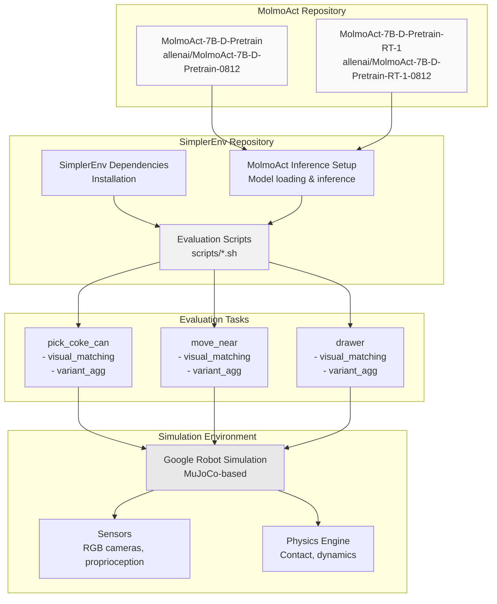
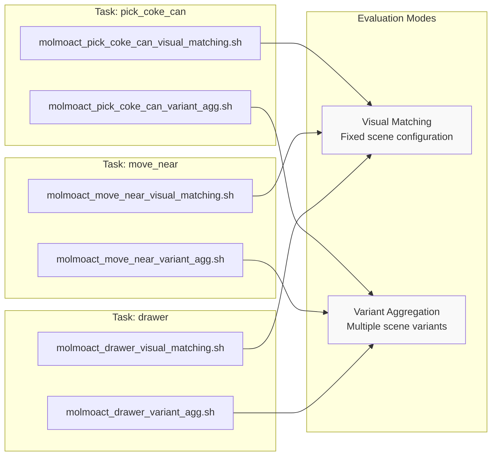
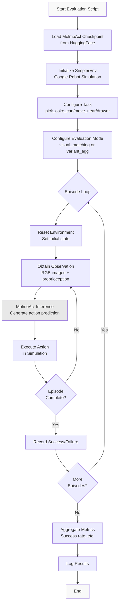
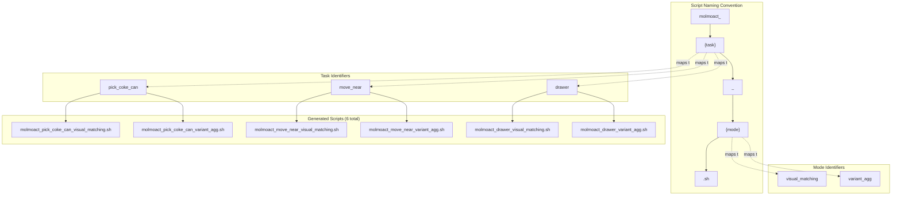

<!-- source: DeepWiki mcp.deepwiki.com · repo allenai/molmoact · page 5.1 SimplerEnv Evaluation · fetched 2026-10-26 -->

# SimplerEnv Evaluation

<details>
<summary>Relevant source files</summary>

The following files were used as context for generating this wiki page:

- [README.md](README.md)

</details>


## Purpose and Scope

This document describes the SimplerEnv evaluation pipeline for MolmoAct models on Google Robot manipulation tasks. SimplerEnv is an external benchmark environment for evaluating robotic manipulation policies in simulated environments that replicate real-world Google Robot tasks.

**Scope**: This page covers SimplerEnv setup, available evaluation scripts, checkpoint selection, and task execution. For LIBERO benchmark evaluation, see [LIBERO Benchmark Evaluation](#5.2). For training the checkpoints used in these evaluations, see [Pre-training Stage](#2.1) and [Post-training and Task-Specific Fine-tuning](#2.3).

---

## Overview

SimplerEnv evaluation is conducted in a separate repository ([allenai/SimplerEnv](https://github.com/allenai/SimplerEnv)) that provides the simulation environment and evaluation infrastructure. MolmoAct models are evaluated on three primary Google Robot manipulation tasks, each with two evaluation modes: visual matching and variant aggregation.

The evaluation pipeline uses specialized checkpoints from the pre-training stage, with both zero-shot and RT-1 fine-tuned variants available for comparison.

**Sources**: [README.md:28-29](), [README.md:84-85](), [README.md:299-312]()

---

## SimplerEnv Integration Architecture



**Diagram**: SimplerEnv integration architecture showing the flow from MolmoAct checkpoints through the SimplerEnv repository to evaluation tasks and the underlying Google Robot simulation environment.

**Sources**: [README.md:299-312](), [README.md:80-86]()

---

## Installation and Setup

### Prerequisites

SimplerEnv evaluation requires two separate installation steps in the SimplerEnv repository:

1. **SimplerEnv Dependencies**: Core simulation environment, robot models, and task definitions
2. **MolmoAct Inference Setup**: Model loading, inference engine, and integration components

### Installation Steps

```bash
# Clone the SimplerEnv repository
git clone https://github.com/allenai/SimplerEnv.git
cd SimplerEnv

# Install SimplerEnv dependencies
# (Follow instructions in allenai/SimplerEnv README)

# Install MolmoAct inference dependencies
# (Follow MolmoAct Inference Setup section in allenai/SimplerEnv README)
```

The SimplerEnv repository contains all evaluation scripts in the `scripts/` directory. No evaluation code resides in the main MolmoAct repository.

**Sources**: [README.md:301-302]()

---

## Evaluation Checkpoints

Two specialized checkpoints are available for SimplerEnv evaluation, both derived from the pre-training stage:

| Checkpoint | HuggingFace Path | Use Case | Training Base |
|------------|------------------|----------|---------------|
| `MolmoAct-7B-D-Pretrain` | `allenai/MolmoAct-7B-D-Pretrain-0812` | Zero-shot evaluation | Pre-training only (100k steps) |
| `MolmoAct-7B-D-Pretrain-RT-1` | `allenai/MolmoAct-7B-D-Pretrain-RT-1-0812` | RT-1 fine-tuned evaluation | Pre-training + RT-1 fine-tuning |

### Checkpoint Selection

- **Zero-shot evaluation**: Use `MolmoAct-7B-D-Pretrain` to replicate results without task-specific fine-tuning
- **Fine-tuned evaluation**: Use `MolmoAct-7B-D-Pretrain-RT-1` to replicate results with RT-1 dataset fine-tuning on SimplerEnv tasks

Both checkpoints are loaded through the SimplerEnv repository's MolmoAct inference setup, which handles model initialization and action prediction.

**Sources**: [README.md:84-85]()

---

## Evaluation Tasks and Scripts

SimplerEnv evaluation covers three manipulation tasks, each with two evaluation modes:

### Task Overview



**Diagram**: Task structure showing the three manipulation tasks and their two evaluation modes (visual matching and variant aggregation).

**Sources**: [README.md:304-312]()

### Task Descriptions

| Task | Description | Evaluation Scripts |
|------|-------------|-------------------|
| **pick_coke_can** | Grasp and pick up a coke can from a table | `molmoact_pick_coke_can_visual_matching.sh`<br/>`molmoact_pick_coke_can_variant_agg.sh` |
| **move_near** | Move an object near a target location | `molmoact_move_near_visual_matching.sh`<br/>`molmoact_move_near_variant_agg.sh` |
| **drawer** | Open or close a drawer | `molmoact_drawer_visual_matching.sh`<br/>`molmoact_drawer_variant_agg.sh` |

### Evaluation Modes

- **Visual Matching**: Evaluates performance on scenes with fixed configurations matching training data distribution
- **Variant Aggregation**: Tests generalization across multiple scene variants (different object positions, lighting, backgrounds, etc.)

**Sources**: [README.md:304-312]()

---

## Evaluation Execution

### Running Evaluations

All evaluation scripts must be executed from the SimplerEnv project directory:

```bash
# Navigate to SimplerEnv repository
cd SimplerEnv/

# Pick Coke Can task
bash scripts/molmoact_pick_coke_can_visual_matching.sh
bash scripts/molmoact_pick_coke_can_variant_agg.sh

# Move Near task
bash scripts/molmoact_move_near_visual_matching.sh
bash scripts/molmoact_move_near_variant_agg.sh

# Drawer task
bash scripts/molmoact_drawer_visual_matching.sh
bash scripts/molmoact_drawer_variant_agg.sh
```

Each script handles:
- Loading the appropriate MolmoAct checkpoint
- Initializing the SimplerEnv simulation environment
- Running episodes with the policy
- Collecting success metrics and logging results

**Sources**: [README.md:304-312]()

---

## Evaluation Pipeline Flow



**Diagram**: Evaluation pipeline flow showing the sequence from script initialization through episode execution to results aggregation.

**Sources**: [README.md:299-312]()

---

## Script Organization and Naming Convention

The evaluation scripts in SimplerEnv follow a consistent naming pattern that maps directly to tasks and evaluation modes:

| Script Pattern | Components | Example |
|----------------|-----------|---------|
| `molmoact_{task}_{mode}.sh` | `{task}`: Task identifier<br/>`{mode}`: Evaluation mode | `molmoact_pick_coke_can_visual_matching.sh` |

### Complete Script Mapping



**Diagram**: Script naming convention breakdown showing how task and mode identifiers combine to generate the six evaluation scripts.

**Sources**: [README.md:304-312]()

---

## Checkpoint to Task Compatibility

Both MolmoAct checkpoints can be used with all SimplerEnv tasks, but they produce different performance characteristics:

| Checkpoint | pick_coke_can | move_near | drawer | Notes |
|------------|---------------|-----------|--------|-------|
| `MolmoAct-7B-D-Pretrain` | ✓ | ✓ | ✓ | Zero-shot performance |
| `MolmoAct-7B-D-Pretrain-RT-1` | ✓ | ✓ | ✓ | Fine-tuned on RT-1 data |

The RT-1 fine-tuned checkpoint is expected to show improved performance due to task-specific training on Google Robot demonstrations, while the pre-train-only checkpoint demonstrates the model's zero-shot spatial reasoning capabilities.

**Sources**: [README.md:84-85]()

---

## Key Differences from LIBERO Evaluation

SimplerEnv evaluation differs from LIBERO evaluation in several important ways:

| Aspect | SimplerEnv | LIBERO |
|--------|-----------|--------|
| **Repository** | External: `allenai/SimplerEnv` | Integrated: `experiments/LIBERO/` |
| **Task Domain** | Google Robot manipulation | Generic object manipulation |
| **Evaluation Scripts** | Shell scripts in SimplerEnv repo | Python scripts with vllm support |
| **Checkpoint Stage** | Pre-training stage outputs | Post-training stage outputs (LoRA) |
| **Task Count** | 3 tasks × 2 modes = 6 scripts | 4 task suites with 130 total tasks |
| **Fine-tuning** | Optional (RT-1 variant) | Required (LoRA on task suites) |

For LIBERO evaluation details, see [LIBERO Benchmark Evaluation](#5.2).

**Sources**: [README.md:299-339]()

---

## Environment Variables

SimplerEnv evaluation scripts may use environment variables for configuration. While specific variables are defined in the SimplerEnv repository, common patterns include:

- Model checkpoint paths (overriding default HuggingFace paths)
- Number of evaluation episodes
- Random seeds for reproducibility
- GPU device selection
- Logging and output directories

Refer to the SimplerEnv repository documentation for complete environment variable specifications.

**Sources**: [README.md:301]()

---

## Results and Metrics

SimplerEnv evaluation produces success rate metrics for each task and evaluation mode. The variant aggregation mode typically provides a more challenging test of generalization than visual matching.

### Metric Collection

Each evaluation run produces:
- **Success rate**: Percentage of successfully completed episodes
- **Per-episode results**: Individual success/failure for each test case
- **Aggregate statistics**: Mean, standard deviation across multiple runs

### Reproducibility

To ensure reproducible results:
1. Use the exact checkpoint versions specified (with `-0812` suffix indicating August 2025 release)
2. Follow the SimplerEnv setup instructions precisely
3. Use consistent random seeds if specified in evaluation scripts
4. Run multiple evaluation trials and report aggregate statistics

**Sources**: [README.md:84-85](), [README.md:299-312]()

---

## Summary

SimplerEnv evaluation provides a standardized benchmark for assessing MolmoAct's spatial reasoning and manipulation capabilities on Google Robot tasks. The external repository structure keeps simulation dependencies isolated while allowing flexible evaluation of different MolmoAct checkpoints. The six evaluation scripts (3 tasks × 2 modes) provide comprehensive coverage of both visual matching and generalization scenarios.

**Sources**: [README.md:28-29](), [README.md:299-312]()

---

