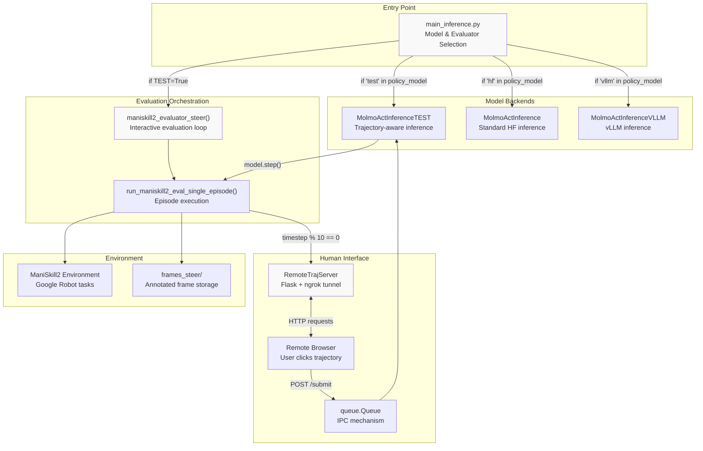
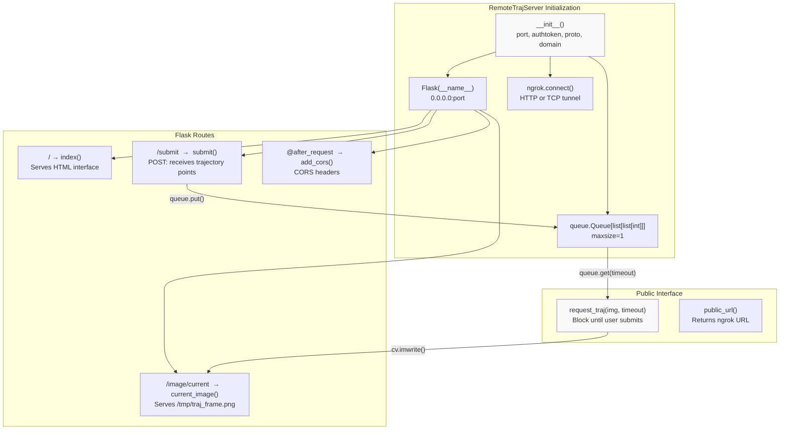
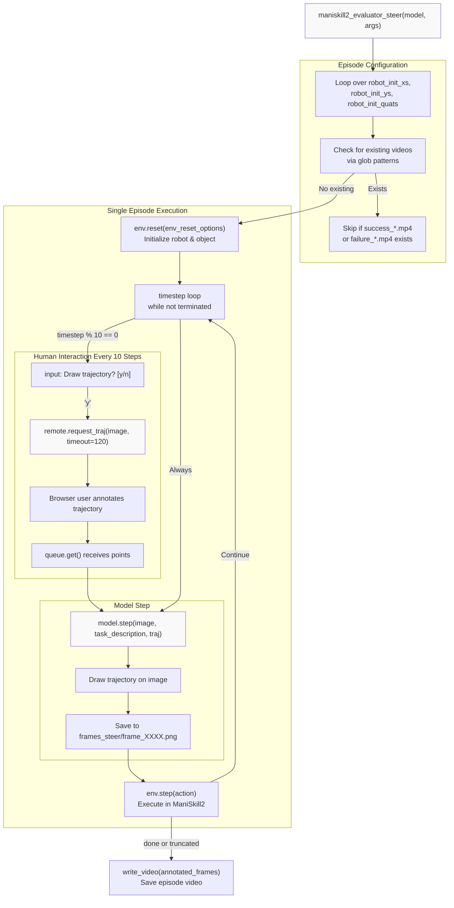
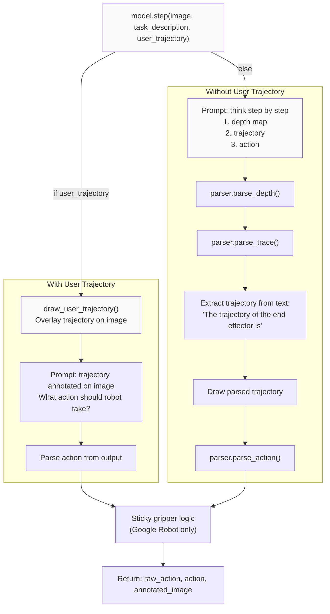
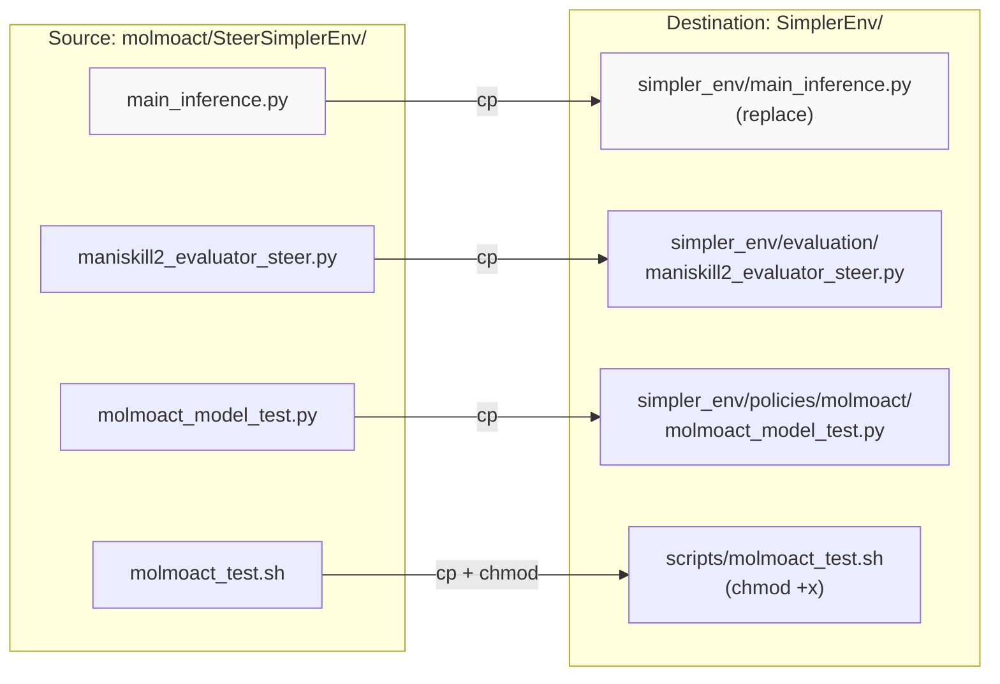
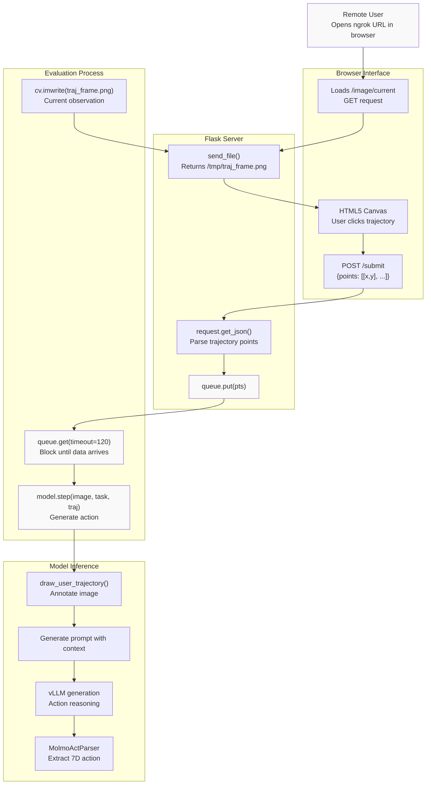

<!-- source: DeepWiki mcp.deepwiki.com · repo allenai/molmoact · page 5.2 SteerSimplerEnv Interactive Evaluation · fetched 2026-10-26 -->

# SteerSimplerEnv Interactive Evaluation

<details>
<summary>Relevant source files</summary>

The following files were used as context for generating this wiki page:

- [SteerSimplerEnv/changes.sh](SteerSimplerEnv/changes.sh)
- [SteerSimplerEnv/main_inference.py](SteerSimplerEnv/main_inference.py)
- [SteerSimplerEnv/maniskill2_evaluator_steer.py](SteerSimplerEnv/maniskill2_evaluator_steer.py)
- [SteerSimplerEnv/molmoact_model_test.py](SteerSimplerEnv/molmoact_model_test.py)
- [SteerSimplerEnv/molmoact_test.sh](SteerSimplerEnv/molmoact_test.sh)
- [SteerSimplerEnv/traj_interface.py](SteerSimplerEnv/traj_interface.py)

</details>


## Overview

SteerSimplerEnv is an extension system that adds human-in-the-loop capabilities to SimplerEnv evaluation. It enables remote users to annotate robot end-effector trajectories directly on observation images via a browser interface, allowing human guidance during policy evaluation. This interactive evaluation mode complements standard automated evaluation by enabling:

- Real-time trajectory annotation during episode execution
- Remote browser-based annotation via ngrok tunneling
- Comparison between autonomous model reasoning and human-steered behavior
- Visual debugging through annotated frame capture

For standard SimplerEnv evaluation without human interaction, see [SimplerEnv Evaluation](#5.1). For the core MolmoAct model training and architecture, see [Training Pipeline](#2).

## System Architecture



**Sources:** [SteerSimplerEnv/main_inference.py](), [SteerSimplerEnv/maniskill2_evaluator_steer.py](), [SteerSimplerEnv/traj_interface.py](), [SteerSimplerEnv/molmoact_model_test.py]()

## Core Components

### 5.2.1 Remote Trajectory Server

The `RemoteTrajServer` class provides a web-based interface for trajectory annotation using Flask and ngrok tunneling.

#### Architecture



**Key Implementation Details:**

| Component | Implementation | Purpose |
|-----------|---------------|---------|
| Queue | `queue.Queue[list[list[int]]]` with `maxsize=1` | Single-slot IPC for trajectory data |
| Frame Storage | `/tmp/traj_frame.png` | Temporary storage for current observation |
| Tunnel Protocol | HTTP with reserved domain or TCP with reserved address | Ngrok Pay-as-you-go requirement |
| Threading | `daemon=True` Flask thread | Non-blocking server operation |

The server is initialized once in the main process:

[SteerSimplerEnv/maniskill2_evaluator_steer.py:17-22]()

```python
import multiprocessing as mp
from simpler_env.utils.traj_interface import RemoteTrajServer
if mp.current_process().name == "MainProcess":
    remote = RemoteTrajServer(port=5002)
else:
    remote = None
```

**Ngrok Configuration:**

The server supports two tunnel modes:

1. **HTTP Mode** (default): Requires a reserved domain from ngrok dashboard
   - Set via `NGROK_DOMAIN` environment variable
   - Example: `my-simpler.ngrok.app`

2. **TCP Mode**: Requires a reserved TCP address
   - Set via `NGROK_REMOTE_ADDR` environment variable
   - Example: `2.tcp.ngrok.io:12345`

Authentication token must be set via `NGROK_AUTHTOKEN` environment variable or passed explicitly.

**Sources:** [SteerSimplerEnv/traj_interface.py:36-153]()

### 5.2.2 Interactive Evaluation Loop

The `maniskill2_evaluator_steer` function orchestrates interactive evaluation with human steering capabilities.

#### Evaluation Flow



**Trajectory Request Logic:**

Every 10 timesteps, the system prompts for trajectory annotation:

[SteerSimplerEnv/maniskill2_evaluator_steer.py:148-169]()

```python
while not (predicted_terminated or truncated):
    if timestep % 10 == 0 and remote is not None:
        try:
            ans = input(f"[t={timestep}] Draw trajectory remotely? [y/n] ").strip().lower()
        except EOFError:  # non-interactive run
            ans = "n"

        if ans == "y":
            if traj:
                ans_2 = input(f"[t={timestep}] Reuse previous trajectory? [y/n] ").strip().lower()
            
            if not traj or ans_2 == "n":
                # blocks until browser posts points or timeout hits
                traj = remote.request_traj(image, timeout=120)
                print("Received traj:", traj)
        else:
            traj = None
```

**Frame Storage:**

Annotated frames are saved with metadata overlays:

[SteerSimplerEnv/maniskill2_evaluator_steer.py:204-243]()

- Directory: `./frames_steer/` (cleared at episode start)
- Format: `frame_XXXX.png` with 4-digit zero-padded timestep
- Annotation: Text overlay indicating "model reasoning" or "human steering"

**Video Generation:**

Episode videos are saved with structured naming:

```
{ckpt_path}/{scene_name}/{control_mode}/{env_name}/
  rob_{x}_{y}_rot_{r}_{p}_{y}_rgb_overlay_{overlay}/
    {success|failure}_obj_{x}_{y}_*.mp4
```

**Sources:** [SteerSimplerEnv/maniskill2_evaluator_steer.py:34-328](), [SteerSimplerEnv/maniskill2_evaluator_steer.py:332-477]()

### 5.2.3 Test Model Interface

The `MolmoActInferenceTEST` class extends standard MolmoAct inference to support trajectory-aware action reasoning.

#### Model Configuration

| Parameter | Default | Purpose |
|-----------|---------|---------|
| `saved_model_path` | Required | HuggingFace model checkpoint path |
| `policy_setup` | `"google_robot"` | Robot-specific configuration |
| `image_size` | `[256, 256]` | Input image dimensions |
| `unnorm_key` | `"fractal20220817_data"` | Dataset statistics key for action denormalization |

#### Dual Inference Modes

The model operates in two distinct modes based on trajectory availability:



**Trajectory Scaling:**

Trajectories are provided in a normalized 0-255 coordinate space and must be scaled to image dimensions:

[SteerSimplerEnv/molmoact_model_test.py:114-131]()

```python
def scale_pt(self, pt, w, h):
    """Convert point from 0-255 space to image pixel space (0..w-1, 0..h-1)."""
    x, y = pt
    return (int(round(x / 255.0 * (w - 1))),
            int(round(y / 255.0 * (h - 1))))

def scale_pt2(self, pt, orig_w, orig_h, new_w, new_h):
    """Scale point from original image space to resized image space."""
    x, y = pt
    return (int(round(x / orig_w * (new_w - 1))),
            int(round(y / orig_h * (new_h - 1))))
```

**Prompt Engineering:**

Two distinct prompts are used:

1. **Human-Steered Mode** [SteerSimplerEnv/molmoact_model_test.py:179-183]():
   ```
   The task is {task_description}. Notice that the trajectory of the end 
   effector is annotated on the image. Based on the trajectory annotated 
   on the image, what is the action that the robot should take?
   ```

2. **Autonomous Mode** [SteerSimplerEnv/molmoact_model_test.py:185-194]():
   ```
   The task is {task_description}. What is the action that the robot should 
   take. To figure out the action... let's think through it step by step.
   First, what is the depth map for this image?
   Second, what is the trajectory of the end effector?
   Based on the depth map... and trajectory, what is the action?
   ```

**Action Processing:**

The model outputs are processed through several steps:

1. **Parse Action**: [SteerSimplerEnv/molmoact_model_test.py:230]()
   - Uses `MolmoActParser.parse_action()` to extract 7D action vector

2. **Construct Raw Action**: [SteerSimplerEnv/molmoact_model_test.py:275-279]()
   ```python
   raw_action = {
       "world_vector": unnormalized_action[:3],      # xyz translation
       "rotation_delta": unnormalized_action[3:6],   # roll, pitch, yaw
       "open_gripper": unnormalized_action[6:7],     # gripper state
   }
   ```

3. **Apply Sticky Gripper**: [SteerSimplerEnv/molmoact_model_test.py:289-314]()
   - Google Robot policy repeats gripper actions for 15 timesteps
   - Relative gripper changes trigger sticky mode
   - Prevents oscillation during grasp/release

**Sources:** [SteerSimplerEnv/molmoact_model_test.py:22-367]()

### 5.2.4 Deployment System

The `changes.sh` script automates deployment by copying SteerSimplerEnv files into an existing SimplerEnv installation.

#### Deployment Mapping



**Usage:**

```bash
cd /path/to/molmoact
./SteerSimplerEnv/changes.sh
```

The script performs validation checks before copying:

[SteerSimplerEnv/changes.sh:12-14]()

```bash
if [ ! -f "$SRC_MAIN" ]; then
    echo "ERROR: Source file not found: $SRC_MAIN"
    exit 1
fi
```

**Prerequisites:**

- SimplerEnv must be installed at `./SimplerEnv/` relative to script location
- All source files must exist in `molmoact/SteerSimplerEnv/`
- Write permissions in SimplerEnv installation directory

**Sources:** [SteerSimplerEnv/changes.sh:1-80]()

## Data Flow Architecture



**Coordinate System Transformations:**

Trajectory points undergo multiple coordinate transformations:

1. **Browser Space**: User clicks in HTML5 canvas coordinates
2. **Normalized Space**: Points stored as `[x, y]` in 0-255 range
3. **Model Input Space**: Scaled to 256×256 image dimensions
4. **Display Space**: Scaled to original observation dimensions

[SteerSimplerEnv/molmoact_model_test.py:133-147]()

**Sources:** [SteerSimplerEnv/traj_interface.py:103-115](), [SteerSimplerEnv/maniskill2_evaluator_steer.py:164](), [SteerSimplerEnv/molmoact_model_test.py:149-174]()

## Usage and Configuration

### Running Interactive Evaluation

**Step 1: Deploy SteerSimplerEnv**

```bash
cd /path/to/molmoact
./SteerSimplerEnv/changes.sh
```

**Step 2: Set Environment Variables**

```bash
export NGROK_AUTHTOKEN="your_ngrok_authtoken"
export NGROK_DOMAIN="your-reserved-domain.ngrok.app"  # Or NGROK_REMOTE_ADDR for TCP
```

**Step 3: Execute Test Script**

```bash
cd SimplerEnv
./scripts/molmoact_test.sh <checkpoint_path> <policy_model>
```

Example:

```bash
./scripts/molmoact_test.sh \
  allenai/MolmoAct-7B-D \
  molmoact-test
```

**Configuration Parameters:**

The test script [SteerSimplerEnv/molmoact_test.sh]() specifies:

| Parameter | Example Value | Purpose |
|-----------|---------------|---------|
| `--policy-model` | `molmoact-test` | Activates trajectory-aware inference |
| `--env-name` | `PlayWithCubesCustomInScene-v1` | ManiSkill2 environment |
| `--scene-name` | `google_pick_coke_can_1_v4` | Scene configuration |
| `--robot` | `google_robot_static` | Robot type |
| `--control-freq` | `3` | Control frequency (Hz) |
| `--sim-freq` | `513` | Simulation frequency (Hz) |
| `--max-episode-steps` | `10000` | Maximum timesteps per episode |

### Model Selection Logic

The `main_inference.py` orchestrator selects the appropriate model based on the `policy_model` argument:

[SteerSimplerEnv/main_inference.py:80-96]()

```python
elif "molmoact" in args.policy_model:
    if "test" in args.policy_model:
        model = MolmoActInferenceTEST(
            saved_model_path = args.ckpt_path,
            policy_setup = args.policy_setup,
        )
    elif "hf" in args.policy_model or "vllm" not in args.policy_model:
        model = MolmoActInference(
            saved_model_path = args.ckpt_path,
            policy_setup = args.policy_setup,
        )
    elif "vllm" in args.policy_model:
        model = MolmoActInferenceVLLM(
            saved_model_path = args.ckpt_path,
            policy_setup = args.policy_setup,
        )
```

**Model Variants:**

- `molmoact-test`: Trajectory-aware inference with human steering support
- `molmoact-hf`: Standard HuggingFace Transformers inference
- `molmoact-vllm`: Optimized vLLM inference backend

### Interactive Session Workflow

1. **Evaluation Start**: Episode begins with autonomous model reasoning
2. **Periodic Prompt** (every 10 timesteps): Console asks "Draw trajectory remotely? [y/n]"
3. **User Response**: 
   - `y`: Opens ngrok URL for trajectory annotation
   - `n`: Continues with autonomous reasoning
4. **Trajectory Annotation**: User clicks on browser canvas to define trajectory
5. **Action Generation**: Model generates action based on annotated trajectory
6. **Frame Capture**: Annotated frames saved to `./frames_steer/`
7. **Episode Completion**: Video generated with success/failure indication

**Non-Interactive Mode:**

For automated runs without user input, the system handles `EOFError` gracefully:

[SteerSimplerEnv/maniskill2_evaluator_steer.py:151-153]()

```python
try:
    ans = input(f"[t={timestep}] Draw trajectory remotely? [y/n] ").strip().lower()
except EOFError:  # non-interactive run
    ans = "n"
```

### Debugging and Visualization

**Frame-by-Frame Inspection:**

Annotated frames are saved with timestep information:

```bash
./frames_steer/
  frame_0000.png
  frame_0001.png
  ...
```

Each frame includes:
- Visual trajectory overlay (if provided)
- Text annotation: "model reasoning" or "human steering"
- BGR format for direct cv2 compatibility

**Action Trajectory Visualization:**

At episode completion, the system generates action trajectory plots:

[SteerSimplerEnv/maniskill2_evaluator_steer.py:292-297]()

```python
action_path = video_path.replace(".mp4", ".png")
action_root = os.path.dirname(action_path) + "/actions/"
os.makedirs(action_root, exist_ok=True)
action_path = action_root + os.path.basename(action_path)
model.visualize_epoch(predicted_actions, images, save_path=action_path)
```

The visualization includes 7 subplots for each action dimension (x, y, z, roll, pitch, yaw, grasp).

**Sources:** [SteerSimplerEnv/main_inference.py:28-107](), [SteerSimplerEnv/maniskill2_evaluator_steer.py:138-262](), [SteerSimplerEnv/molmoact_test.sh:1-33](), [SteerSimplerEnv/molmoact_model_test.py:325-355]()

## Key Design Decisions

### Single-Slot Queue

The trajectory queue uses `maxsize=1` to ensure only the most recent trajectory is stored:

[SteerSimplerEnv/traj_interface.py:57]()

This prevents accumulation of stale trajectory data and ensures real-time responsiveness.

### Trajectory Reuse

The system allows reusing previously annotated trajectories across multiple timesteps:

[SteerSimplerEnv/maniskill2_evaluator_steer.py:156-162]()

This reduces annotation burden when the desired trajectory remains consistent.

### Fail-Safe Action Handling

If `model.step()` raises an exception, the system provides safe default actions:

[SteerSimplerEnv/maniskill2_evaluator_steer.py:172-190]()

Default action: zero velocity, zero rotation, open gripper, no termination.

### Video Deduplication

The evaluator checks for existing videos before running episodes:

[SteerSimplerEnv/maniskill2_evaluator_steer.py:379-395]()

This enables incremental evaluation and prevents redundant computation.

**Sources:** [SteerSimplerEnv/traj_interface.py:57](), [SteerSimplerEnv/maniskill2_evaluator_steer.py:156-162](), [SteerSimplerEnv/maniskill2_evaluator_steer.py:172-190](), [SteerSimplerEnv/maniskill2_evaluator_steer.py:379-395]()

---

