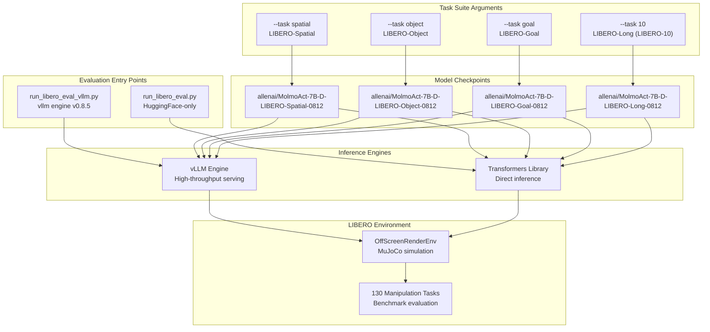
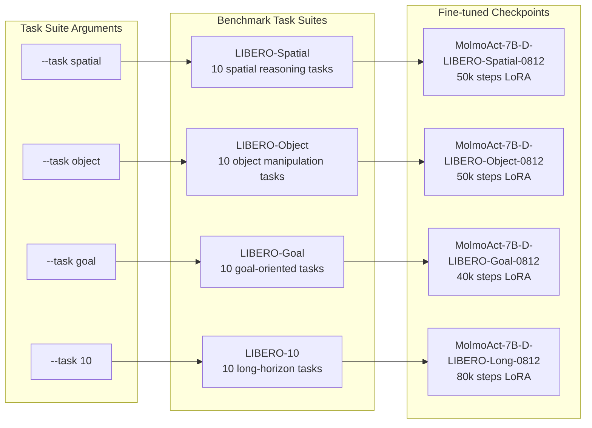
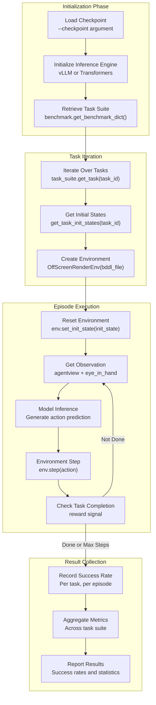

<!-- source: DeepWiki mcp.deepwiki.com · repo allenai/molmoact · page 5.3 LIBERO Benchmark Evaluation · fetched 2026-10-26 -->

# LIBERO Benchmark Evaluation

<details>
<summary>Relevant source files</summary>

The following files were used as context for generating this wiki page:

- [README.md](README.md)
- [experiments/LIBERO/README.md](experiments/LIBERO/README.md)

</details>


This document describes the evaluation infrastructure for testing MolmoAct models on the LIBERO benchmark suite. LIBERO evaluation supports two execution modes: a vllm-based engine (v0.8.5) for high-throughput inference and a HuggingFace-only mode for broader compatibility. The evaluation system tests models across four task suites (Spatial, Object, Goal, Long) with 130 total manipulation tasks.

For information about the LIBERO benchmark framework itself, including task definitions and training procedures, see [LIBERO Benchmark Framework](#6). For SimplerEnv evaluation procedures, see [SimplerEnv Evaluation](#5.1).

## Evaluation Modes Overview

LIBERO evaluation in MolmoAct supports two distinct execution modes, each with different performance characteristics and infrastructure requirements:



**Sources**: [README.md:316-339]()

## Setup and Installation

LIBERO evaluation requires installation within the `experiments/LIBERO` directory with specific dependency versions:

```bash
# Navigate to LIBERO experiments directory
cd experiments/LIBERO

# Install LIBERO package
pip install -e .

# Install core dependencies
pip install einops torchvision accelerate

# Install specific versions for compatibility
pip install transformers==4.52.1
pip install vllm==0.8.5

# Configure vllm multiprocessing method
export VLLM_WORKER_MULTIPROC_METHOD=spawn

# Return to evaluation script location
cd ../libero
```

The installation process creates the following dependency structure:

| Component | Version | Purpose |
|-----------|---------|---------|
| `transformers` | 4.52.1 | Model loading and inference |
| `vllm` | 0.8.5 | High-throughput LLM serving |
| `einops` | latest | Tensor operations |
| `torchvision` | latest | Image preprocessing |
| `accelerate` | latest | Multi-device inference |
| `LIBERO` package | local | Benchmark environment |

**Sources**: [README.md:318-326]()

## Task Suite and Checkpoint Mapping

MolmoAct provides four task-specific fine-tuned checkpoints corresponding to LIBERO's task suites:



**Task Suite Characteristics**:

| Task Suite | Argument | Checkpoint | Training Steps | Focus Area |
|------------|----------|-----------|----------------|------------|
| LIBERO-Spatial | `spatial` | `allenai/MolmoAct-7B-D-LIBERO-Spatial-0812` | 50,000 | Spatial reasoning and relationships |
| LIBERO-Object | `object` | `allenai/MolmoAct-7B-D-LIBERO-Object-0812` | 50,000 | Object-specific manipulation |
| LIBERO-Goal | `goal` | `allenai/MolmoAct-7B-D-LIBERO-Goal-0812` | 40,000 | Goal-oriented task completion |
| LIBERO-Long (LIBERO-10) | `10` | `allenai/MolmoAct-7B-D-LIBERO-Long-0812` | 80,000 | Long-horizon sequential tasks |

**Sources**: [README.md:329-338](), [README.md:286-292]()

## vLLM-Based Evaluation

The vLLM evaluation mode (`run_libero_eval_vllm.py`) provides high-throughput inference using the vLLM serving engine version 0.8.5:

```bash
# Spatial task suite evaluation
python run_libero_eval_vllm.py \
    --task spatial \
    --checkpoint allenai/MolmoAct-7B-D-LIBERO-Spatial-0812

# Object task suite evaluation
python run_libero_eval_vllm.py \
    --task object \
    --checkpoint allenai/MolmoAct-7B-D-LIBERO-Object-0812

# Goal task suite evaluation
python run_libero_eval_vllm.py \
    --task goal \
    --checkpoint allenai/MolmoAct-7B-D-LIBERO-Goal-0812

# Long-horizon task suite evaluation
python run_libero_eval_vllm.py \
    --task 10 \
    --checkpoint allenai/MolmoAct-7B-D-LIBERO-Long-0812
```

**vLLM Mode Characteristics**:
- **Engine**: vLLM v0.8.5 with optimized attention mechanisms
- **Multiprocessing**: Requires `VLLM_WORKER_MULTIPROC_METHOD=spawn`
- **Performance**: Higher throughput for batch inference
- **Memory**: More efficient GPU memory utilization
- **Script Location**: `experiments/libero/run_libero_eval_vllm.py`

**Sources**: [README.md:328-332]()

## HuggingFace-Only Evaluation

The HuggingFace-only mode (`run_libero_eval.py`) provides broader compatibility using the transformers library directly:

```bash
# Spatial task suite evaluation
python run_libero_eval.py \
    --task spatial \
    --checkpoint allenai/MolmoAct-7B-D-LIBERO-Spatial-0812

# Object task suite evaluation
python run_libero_eval.py \
    --task object \
    --checkpoint allenai/MolmoAct-7B-D-LIBERO-Object-0812

# Goal task suite evaluation
python run_libero_eval.py \
    --task goal \
    --checkpoint allenai/MolmoAct-7B-D-LIBERO-Goal-0812

# Long-horizon task suite evaluation
python run_libero_eval.py \
    --task 10 \
    --checkpoint allenai/MolmoAct-7B-D-LIBERO-Long-0812
```

**HuggingFace Mode Characteristics**:
- **Engine**: transformers 4.52.1 with standard inference
- **Compatibility**: Works without vLLM dependencies
- **Setup**: Simpler environment requirements
- **Performance**: Lower throughput than vLLM mode
- **Script Location**: `experiments/libero/run_libero_eval.py`

**Sources**: [README.md:334-338]()

## Evaluation Configuration

LIBERO evaluation uses Hydra-based configuration with parameters defined in `experiments/LIBERO/libero/configs/eval/default.yaml`:


**Configuration Parameters**:

| Parameter | Default | Description |
|-----------|---------|-------------|
| `load_path` | `""` | Path to pretrained model checkpoint |
| `eval` | `true` | Enable evaluation mode |
| `batch_size` | `64` | Batch size for model inference |
| `num_workers` | `4` | Number of data loading workers |
| `n_eval` | `20` | Number of evaluation episodes per task |
| `eval_every` | `5` | Frequency of evaluation during training |
| `max_steps` | `600` | Maximum environment steps per episode |
| `use_mp` | `true` | Enable multiprocessing for parallel evaluation |
| `num_procs` | `20` | Number of parallel processes |
| `save_sim_states` | `false` | Whether to save simulation states |

**Sources**: [experiments/LIBERO/libero/configs/eval/default.yaml:1-11]()

## Evaluation Workflow

The evaluation process follows a multi-stage workflow integrating model inference with environment simulation:



**Evaluation Workflow Steps**:

1. **Initialization**: Load model checkpoint and initialize inference engine (vLLM or transformers)
2. **Task Retrieval**: Access task suite via `benchmark.get_benchmark_dict()` and retrieve individual tasks
3. **Environment Setup**: Create `OffScreenRenderEnv` instance with task-specific BDDL file
4. **Episode Execution**: Run `n_eval` episodes per task (default: 20)
   - Reset environment with fixed initial state
   - Obtain observations (agentview camera + eye-in-hand camera)
   - Generate action predictions via model inference
   - Execute actions in simulation via `env.step()`
   - Check task completion (sparse reward: +1 on success)
5. **Result Collection**: Aggregate success rates across tasks and episodes

**Sources**: [experiments/LIBERO/README.md:94-132](), [experiments/LIBERO/libero/configs/eval/default.yaml:1-11]()

## Alternative Evaluation Script

LIBERO also provides a standalone evaluation script `libero/lifelong/evaluate.py` for separately evaluating pretrained models with more granular control:

```bash
python libero/lifelong/evaluate.py \
    --benchmark BENCHMARK_NAME \
    --task_id TASK_ID \
    --algo ALGO_NAME \
    --policy POLICY_NAME \
    --seed SEED \
    --ep EPOCH \
    --load_task LOAD_TASK \
    --device_id CUDA_ID
```

**Alternative Script Parameters**:

| Parameter | Description |
|-----------|-------------|
| `--benchmark` | Task suite: `LIBERO_SPATIAL`, `LIBERO_OBJECT`, `LIBERO_GOAL`, `LIBERO_90`, `LIBERO_10` |
| `--task_id` | Specific task index within suite |
| `--algo` | Algorithm: `base`, `er`, `ewc`, `packnet`, `multitask` |
| `--policy` | Policy architecture: `bc_rnn_policy`, `bc_transformer_policy`, `bc_vilt_policy` |
| `--seed` | Random seed for reproducibility |
| `--ep` | Epoch/checkpoint to load |
| `--load_task` | Task index to load checkpoint from |
| `--device_id` | CUDA device ID |

This script is useful for:
- Evaluating specific tasks individually
- Testing different policy architectures
- Comparing lifelong learning algorithms
- Running evaluations on limited GPU resources

**Sources**: [experiments/LIBERO/README.md:153-166]()

## Multiprocessing Configuration

LIBERO evaluation supports multiprocessing for parallel episode execution:

**Multiprocessing Parameters**:
- `use_mp: true` enables parallel evaluation across multiple processes
- `num_procs: 20` spawns 20 parallel worker processes
- Each process runs independent episode rollouts
- Results are aggregated across all processes

**vLLM-specific Multiprocessing**:
- Requires `export VLLM_WORKER_MULTIPROC_METHOD=spawn`
- Spawn method ensures proper initialization of CUDA contexts
- Prevents conflicts with fork-based multiprocessing

**Performance Considerations**:
- Multiprocessing significantly reduces total evaluation time
- GPU memory is shared across processes
- Number of processes should not exceed available CPU cores
- vLLM engine handles concurrent inference requests efficiently

**Sources**: [README.md:325](), [experiments/LIBERO/libero/configs/eval/default.yaml:8-9]()

## Success Metrics

LIBERO evaluation uses sparse reward signals with binary success metrics:

**Reward Structure**:
- Reward = `+1` when task is successfully completed
- Reward = `0` otherwise (sparse reward)
- Task completion is determined by BDDL condition satisfaction

**Evaluation Metrics**:
- **Success Rate**: Percentage of episodes with reward = +1
- **Per-Task Success**: Individual success rates for each of the 10 tasks in a suite
- **Average Success**: Mean success rate across all tasks in suite
- **Episode Length**: Number of steps to completion (max: 600)

**Statistical Collection**:
- `n_eval: 20` episodes per task provides statistical confidence
- Results aggregated across multiple seeds for robustness
- Standard deviation computed across episodes

**Sources**: [experiments/LIBERO/README.md:133](), [experiments/LIBERO/libero/configs/eval/default.yaml:5-7]()

---

