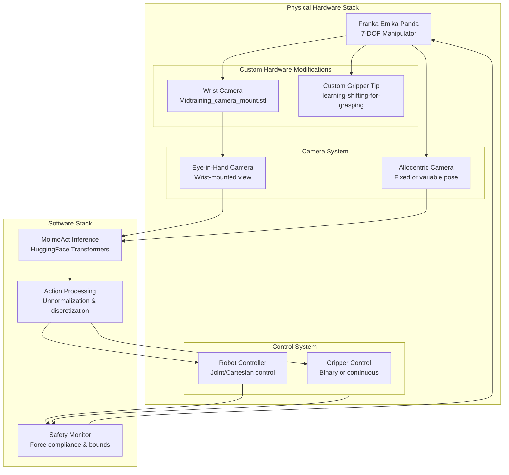
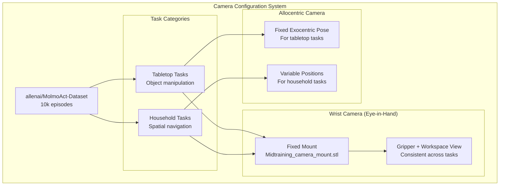
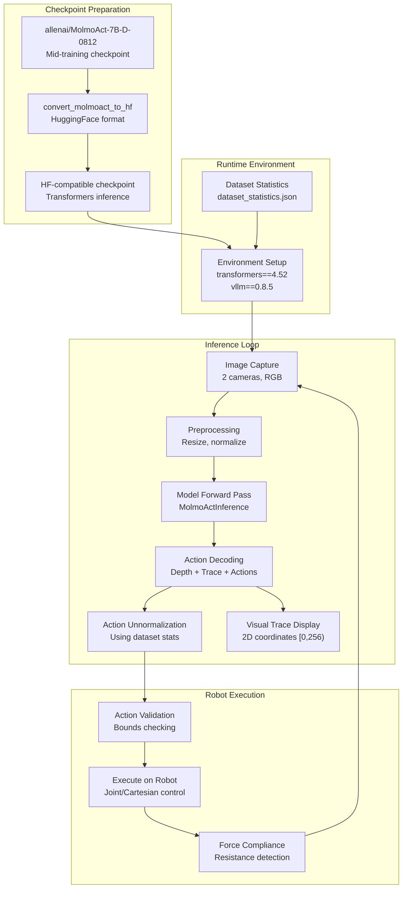
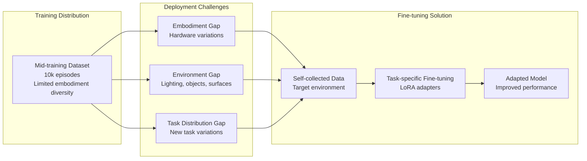

<!-- source: DeepWiki mcp.deepwiki.com · repo allenai/molmoact · page 5.4 Real-world Robot Evaluation · fetched 2026-10-26 -->

# Real-world Robot Evaluation

<details>
<summary>Relevant source files</summary>

The following files were used as context for generating this wiki page:

- [Midtraining_camera_mount.stl](Midtraining_camera_mount.stl)
- [README.md](README.md)

</details>


## Purpose and Scope

This document describes the procedures, hardware requirements, and best practices for evaluating MolmoAct models on physical robot systems. Real-world evaluation involves deploying trained MolmoAct checkpoints on actual robotic hardware to assess performance in uncontrolled physical environments.

For simulated evaluation environments, see [SimplerEnv Evaluation](#5.1), [SteerSimplerEnv Interactive Evaluation](#5.2), and [LIBERO Benchmark Evaluation](#5.3). For information about training checkpoints suitable for deployment, see [Specialized Evaluation Checkpoints](#4.2).

**Sources:** [README.md:520-538]()

---

## Hardware Configuration

Real-world deployment of MolmoAct requires a specific hardware configuration that closely matches the setup used during the mid-training phase. This alignment ensures that the robot's physical embodiment, sensor placement, and camera viewpoints match the training distribution.

### Franka Robot Platform

The recommended platform is a **Franka Emika Panda** robot configured similarly to the DROID setup, with two key modifications that reflect the mid-training data collection setup:

1. **Custom wrist-mounted camera**: A 3D-printable camera mount design
2. **Custom gripper tip**: Modified gripper fingers for improved grasping



**Sources:** [README.md:522-534]()

---

## Custom Hardware Components

### Wrist Camera Mount

The mid-training dataset uses a custom-designed wrist camera mount that positions the camera to capture the gripper and workspace from a specific viewpoint. This mount design is provided as a 3D-printable STL file.

| Component | Specification | Location |
|-----------|---------------|----------|
| Design file | `Midtraining_camera_mount.stl` | Repository root |
| Purpose | Eye-in-hand camera mounting | Wrist attachment |
| Material | 3D-printable (PLA/ABS) | N/A |

The mount design ensures consistent camera positioning across data collection and deployment, which is critical for zero-shot generalization.

### Custom Gripper Tip

The gripper modification uses a design from the "learning-shifting-for-grasping" project. This modification affects the contact geometry and grasping characteristics.

| Component | Specification | Source |
|-----------|---------------|--------|
| Design file | `gripper.stl` | pantor/learning-shifting-for-grasping |
| Purpose | Modified grasping surface | Finger replacement |
| Compatibility | Franka Hand gripper | Standard mounting |

**Sources:** [README.md:526-533]()

---

## Camera Configuration and Pose Guidelines

The mid-training dataset (`allenai/MolmoAct-Dataset`) uses a two-camera setup with task-dependent camera positioning strategies. Replicating this configuration is essential for zero-shot evaluation performance.



### Camera Pose Recommendations

1. **Tabletop Tasks**: 
   - Allocentric camera uses a **fixed exocentric pose**
   - Camera positioned to capture entire workspace
   - Consistent viewpoint across episodes

2. **Household Tasks**:
   - Allocentric camera position **varies by task**
   - Captures wider range of viewpoints
   - Positioned to maximize scene coverage

**Sources:** [README.md:534]()

---

## Zero-shot Evaluation Workflow

The zero-shot evaluation process involves deploying the `allenai/MolmoAct-7B-D-0812` checkpoint without task-specific fine-tuning. This workflow outlines the deployment steps from checkpoint loading to action execution.



**Sources:** [README.md:522-538](), [README.md:204-248]()

---

## Model Deployment Process

### Checkpoint Conversion

Before deployment, training checkpoints must be converted to HuggingFace-compatible format for inference. The conversion process is documented in the training pipeline sections but is essential for real-world deployment.

**Conversion command:**
```bash
python3 -m olmo.hf_model.molmoact.convert_molmoact_to_hf \
    --checkpoint_dir /path/to/checkpoint \
    --output_dir /path/to/hf_checkpoint \
    --style demo \
    --norm_stats_path /path/to/dataset_statistics.json
```

| Parameter | Purpose | Value for Zero-shot |
|-----------|---------|---------------------|
| `--checkpoint_dir` | Source checkpoint path | Unsharded checkpoint |
| `--output_dir` | HF format output | Deployment directory |
| `--style` | System prompt configuration | `demo` |
| `--norm_stats_path` | Action normalization statistics | From training dataset |

### Inference Execution

The inference script [olmo/hf_model/molmoact/test_molmoact.py]() provides a reference implementation for running MolmoAct inference with HuggingFace Transformers:

```bash
python3 olmo/hf_model/molmoact/test_molmoact.py \
    --checkpoint_dir /path/to/hf_checkpoint \
    --images /path/to/img1 /path/to/img2 \
    --instruction "task instruction" \
    --unnorm_key unnorm_key
```

**Key parameters:**
- `--images`: Paths to allocentric and wrist camera images (2 images expected)
- `--instruction`: Natural language task description
- `--unnorm_key`: Dataset key for action unnormalization (must match training data)

For optimized inference with vLLM, use [olmo/vllm/molmoact/test_molmoact.py]():

```bash
python3 -m olmo.vllm.molmoact.test_molmoact \
    --checkpoint_dir /path/to/hf_checkpoint \
    --images /path/to/img1 /path/to/img2 \
    --instruction "task instruction" \
    --unnorm_key unnorm_key
```

**Sources:** [README.md:206-248]()

---

## Output Interpretation and Visualization

MolmoAct produces three types of outputs during inference: **robot actions**, **depth tokens**, and **visual traces**. Understanding and visualizing these outputs is critical for debugging and safety monitoring.

### Output Types

| Output Type | Format | Range/Structure | Purpose |
|-------------|--------|-----------------|---------|
| Robot Actions | Continuous or discretized | 256 bins (default) | Joint/Cartesian commands |
| Depth Tokens | Discrete tokens | VQVAE vocabulary | Depth map reconstruction |
| Visual Trace | 2D coordinates | Integers [0, 256) | Action trajectory visualization |

### Visual Trace Processing

Visual traces consist of 2D coordinates where all values are integers bounded in [0, 256). For visualization on actual images, these coordinates must be **scaled to the image dimensions**:

```
scaled_x = (trace_x / 256.0) * image_width
scaled_y = (trace_y / 256.0) * image_height
```

### Depth Token Visualization

Depth tokens can be decoded using the VQVAE decoder to reconstruct depth maps. The reconstruction script [scripts/reconstruct_from_tokens.py]() provides this functionality:

```bash
python3 scripts/reconstruct_from_tokens.py \
    --ckpt_path /path/to/vae-final.pt \
    --depth_tokens "<DEPTH_START><DEPTH_1>...<DEPTH_END>" \
    --output_path /path/to/depth.png
```

The VQVAE checkpoint (`vae-final.pt`) is available from the HuggingFace model repository:
```bash
wget https://huggingface.co/allenai/MolmoAct-7B-D-0812/resolve/main/vae-final.pt
```

**Sources:** [README.md:252-263]()

---

## Task-Specific Fine-tuning for Real-World Deployment

While zero-shot evaluation provides a baseline for assessing MolmoAct's generalization capabilities, the mid-training dataset contains only **10,000 robot episodes**. For reliable real-world deployment, **task-specific fine-tuning is strongly recommended**.

### Fine-tuning Rationale



### Data Collection Requirements

For effective fine-tuning, collect demonstration data in your target deployment environment:

1. **Match hardware configuration**: Use the same Franka setup, camera mounts, and gripper tips
2. **Collect diverse examples**: Vary object positions, lighting conditions, and initial states
3. **Use consistent format**: Process data into Action Reasoning Data format (see [Robot Demonstration Datasets](#3.1))
4. **Maintain statistics**: Generate `dataset_statistics.json` for action normalization

### Fine-tuning Procedure

The fine-tuning process is documented in [Post-training and Task-Specific Fine-tuning](#2.3). For real-world deployment, follow the procedure in [README.md:161-187]():

**Key steps:**
1. Process collected data using [preprocess/action_reasoning_data.py]()
2. Fine-tune with LoRA adapters using [launch_scripts/train_multitask_model.py]()
3. Merge LoRA weights using [scripts/merge_lora]()
4. Convert to HuggingFace format for deployment

**Recommended hyperparameters for real-world fine-tuning:**
- Base checkpoint: `allenai/MolmoAct-7B-D-0812`
- LoRA rank: 32, alpha: 16, dropout: 0.0
- Learning rates: 5e-4 (connector, ViT, LLM)
- Global batch size: 16 (adjustable based on GPU availability)
- Image augmentation: enabled (`--img_aug`)

**Sources:** [README.md:536-538](), [README.md:161-187]()

---

## Safety Considerations

Real-world robot operation requires careful attention to safety protocols and built-in model safeguards.

### Visual Reasoning Trace

MolmoAct provides a **visual reasoning trace** before action execution, showing the intended trajectory as 2D coordinates overlaid on camera images. This feature enables:

- **Proactive auditing**: Inspect intended actions before execution
- **Trajectory validation**: Verify spatial reasoning aligns with task goals
- **Intervention opportunity**: Stop execution if trace appears unsafe or incorrect

### Force Compliance

The model's action space is bounded within the training data distribution, and **force compliance is built-in** to detect excessive resistance:

- Actions are limited to the range observed during training
- Resistance detection triggers action termination
- Compliance ensures safe interaction with objects and environment

### Operational Guidelines

1. **Follow manufacturer guidelines**: Adhere to Franka Emika safety specifications
2. **Configure workspace**: Establish clear boundaries and remove hazards
3. **Emergency stop accessibility**: Ensure physical e-stop is always accessible
4. **Supervised operation**: Monitor robot during evaluation, especially in early deployment
5. **Gradual deployment**: Start with simple tasks before attempting complex manipulation

**Sources:** [README.md:548-550]()

---

## Dependencies and Environment Setup

Real-world deployment requires specific software dependencies beyond the training environment.

### Minimal Inference Dependencies

```bash
pip install einops torchvision accelerate vllm==0.8.5 transformers==4.52
```

These packages provide the core inference capabilities without the full training stack.

### Additional Requirements

| Component | Package | Purpose |
|-----------|---------|---------|
| Depth reconstruction | Custom VQVAE decoder | Visualizing depth tokens |
| Robot control | Platform-specific SDK | Franka control interface |
| Camera drivers | Platform-specific | Image capture from cameras |
| Action normalization | numpy, scipy | Statistics-based unnormalization |

### Environment Variables

Configure data paths for model and checkpoint loading:

```bash
export MOLMOACT_DATA_DIR=/data/molmoact
export HF_HOME=/data/molmoact/huggingface
```

**Sources:** [README.md:244-250](), [README.md:272-278]()

---

## Deployment Checklist

Before attempting real-world evaluation, verify the following:

**Hardware:**
- ✓ Franka Emika Panda robot properly calibrated
- ✓ Custom wrist camera mount installed (`Midtraining_camera_mount.stl`)
- ✓ Custom gripper tip installed (learning-shifting-for-grasping design)
- ✓ Two cameras operational (wrist-mounted + allocentric)
- ✓ Camera poses match training distribution (tabletop: fixed; household: variable)

**Software:**
- ✓ MolmoAct checkpoint converted to HuggingFace format
- ✓ `dataset_statistics.json` available for action unnormalization
- ✓ Inference dependencies installed (transformers, vLLM, etc.)
- ✓ Robot control interface configured
- ✓ Visual trace visualization tool tested

**Safety:**
- ✓ Workspace boundaries established
- ✓ Emergency stop tested
- ✓ Force compliance limits configured
- ✓ Supervision plan in place

**Data (if fine-tuning):**
- ✓ Self-collected dataset processed into Action Reasoning format
- ✓ Dataset statistics computed
- ✓ Fine-tuning completed and merged
- ✓ Checkpoint validated in simulation (if available)

**Sources:** [README.md:520-538](), [README.md:548-550]()

---

