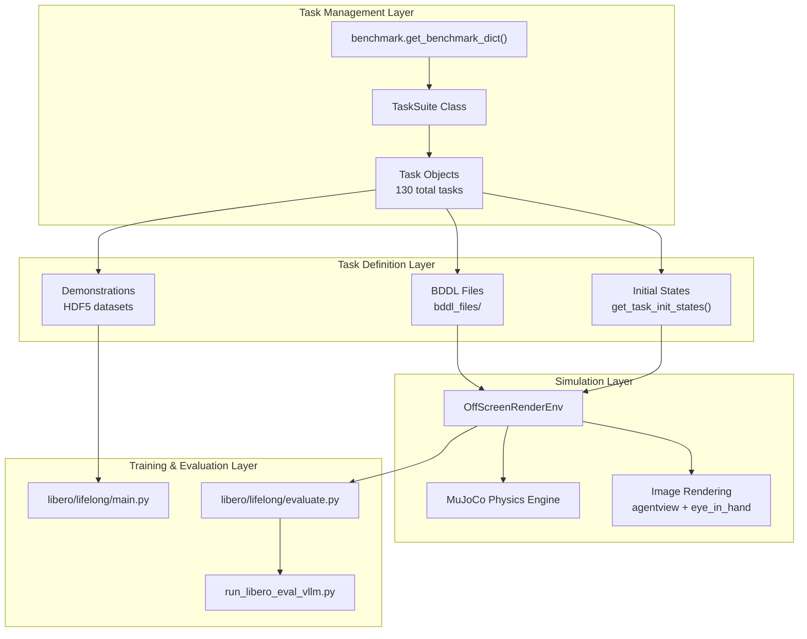
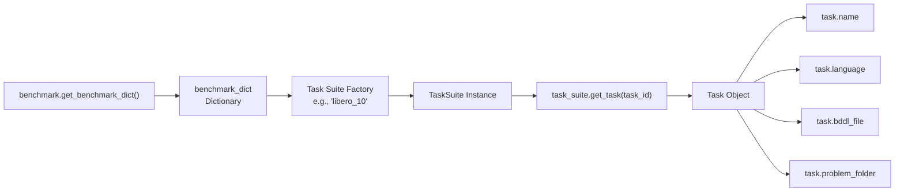
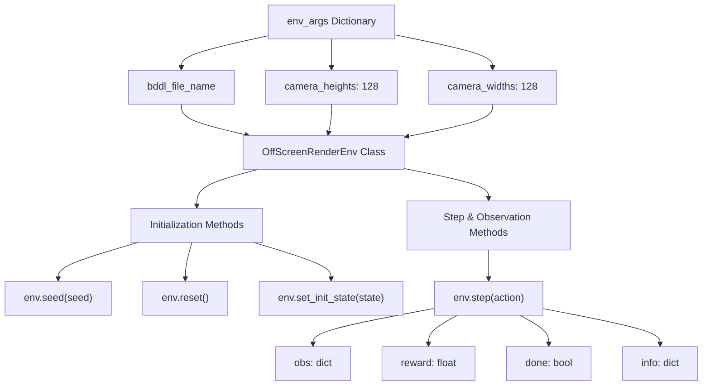
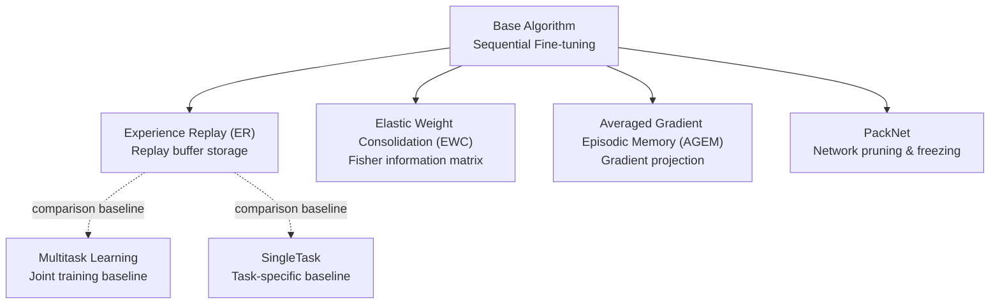
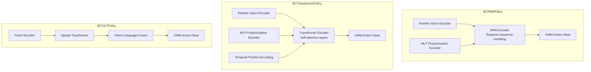
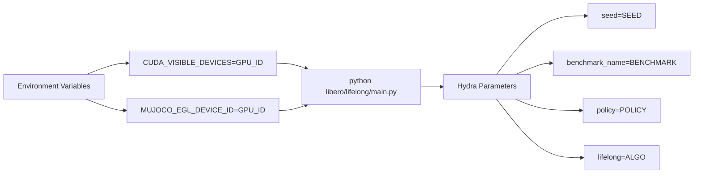
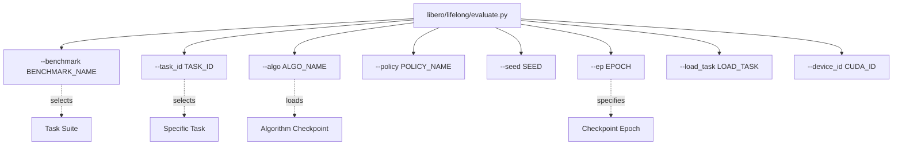
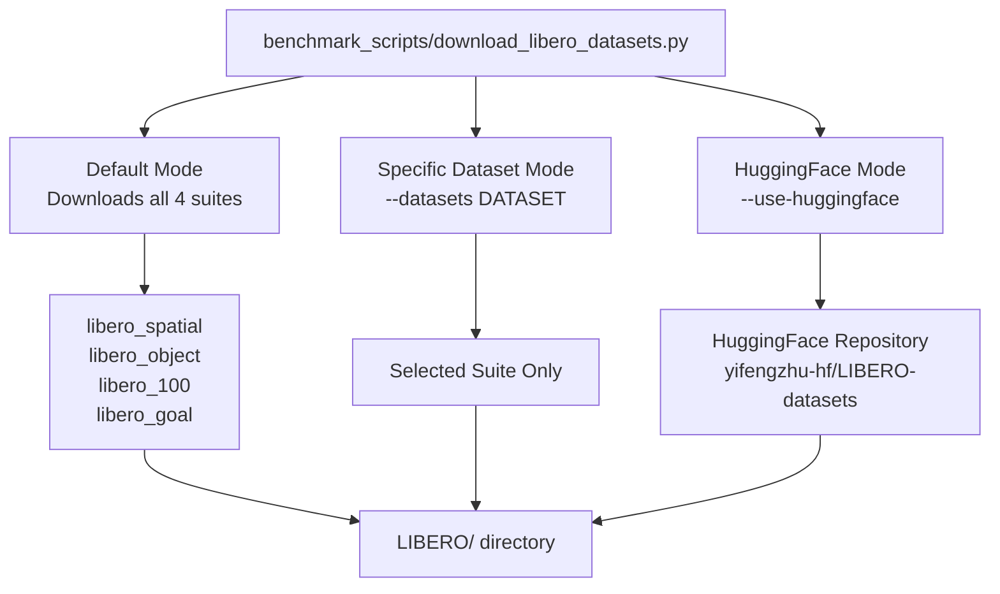
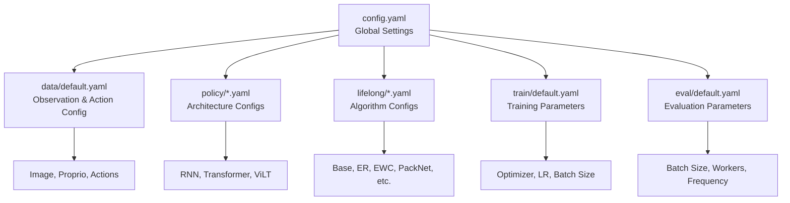

<!-- source: DeepWiki mcp.deepwiki.com · repo allenai/molmoact · page 6 LIBERO Benchmark Framework · fetched 2026-10-26 -->

# LIBERO Benchmark Framework

<details>
<summary>Relevant source files</summary>

The following files were used as context for generating this wiki page:

- [experiments/LIBERO/LICENSE](experiments/LIBERO/LICENSE)
- [experiments/LIBERO/README.md](experiments/LIBERO/README.md)
- [experiments/LIBERO/images/libero_logo.png](experiments/LIBERO/images/libero_logo.png)

</details>


This document provides a comprehensive overview of the LIBERO (Lifelong roBOt lEaRning) benchmark framework integrated within the MolmoAct repository. LIBERO is a standardized evaluation suite for testing knowledge transfer in multitask and lifelong robot learning problems through 130 manipulation tasks organized into four task suites.

LIBERO serves as both a training environment and evaluation benchmark for the MolmoAct system. For information about using LIBERO for evaluation workflows, see [LIBERO Benchmark Evaluation](#5.2). For details about the configuration system underlying LIBERO experiments, see [Configuration System](#7).

**Sources:** [experiments/LIBERO/README.md:15-32]()

## Architecture Overview

LIBERO consists of four primary subsystems that work together to provide a complete benchmarking environment:



**Sources:** [experiments/LIBERO/README.md:26-32](), [experiments/LIBERO/README.md:94-132]()

## Task Suite Organization

LIBERO organizes its 130 tasks into four distinct task suites, each designed to test specific types of knowledge transfer:

| Task Suite | Number of Tasks | Purpose | Distribution Shift Type |
|------------|----------------|---------|------------------------|
| **LIBERO-Spatial** | 10 | Test spatial reasoning knowledge transfer | Controlled spatial distribution shift |
| **LIBERO-Object** | 10 | Test object manipulation knowledge transfer | Controlled object distribution shift |
| **LIBERO-Goal** | 10 | Test goal-conditioned task knowledge transfer | Controlled goal distribution shift |
| **LIBERO-100** | 100 (90+10) | Test entangled knowledge transfer | Complex multi-dimensional shifts |

### LIBERO-100 Split

LIBERO-100 is uniquely structured for lifelong learning evaluation:
- **LIBERO-90**: 90 tasks for pretraining policies
- **LIBERO-10**: 10 tasks for testing downstream lifelong learning performance

This split enables researchers to evaluate how well agents can transfer knowledge from a diverse pretraining set to novel downstream tasks.

**Sources:** [experiments/LIBERO/README.md:26-29](), [experiments/LIBERO/README.md:137]()

## Task Retrieval and Access

### Programmatic Task Access



### Task Object Properties

Tasks retrieved through the API expose the following properties:

| Property | Type | Description |
|----------|------|-------------|
| `name` | `str` | Unique identifier for the task |
| `language` | `str` | Natural language instruction describing the task |
| `bddl_file` | `str` | Filename of the BDDL specification |
| `problem_folder` | `str` | Directory containing task-specific files |

### Code Example

The following code pattern demonstrates task retrieval:

```python
from libero.libero import benchmark

benchmark_dict = benchmark.get_benchmark_dict()
task_suite_name = "libero_10"  # Options: libero_spatial, libero_object, libero_goal, libero_10
task_suite = benchmark_dict[task_suite_name]()

task_id = 0
task = task_suite.get_task(task_id)
```

**Sources:** [experiments/LIBERO/README.md:94-114]()

## Environment Interaction

### OffScreenRenderEnv Configuration



### Environment Setup Pattern

Typical environment initialization follows this sequence:

1. **Retrieve task BDDL file path:**
   ```python
   task_bddl_file = os.path.join(
       get_libero_path("bddl_files"),
       task.problem_folder,
       task.bddl_file
   )
   ```

2. **Configure environment:**
   ```python
   env_args = {
       "bddl_file_name": task_bddl_file,
       "camera_heights": 128,
       "camera_widths": 128
   }
   ```

3. **Initialize and set initial state:**
   ```python
   env = OffScreenRenderEnv(**env_args)
   env.seed(0)
   env.reset()
   init_states = task_suite.get_task_init_states(task_id)
   env.set_init_state(init_states[0])
   ```

4. **Execute environment step:**
   ```python
   action = [0.] * 7  # 7-DOF action space
   obs, reward, done, info = env.step(action)
   ```

### Reward Structure

LIBERO currently supports sparse reward functions: the agent receives `+1` when the task is successfully completed, `0` otherwise. This sparse-reward structure makes reinforcement learning extremely challenging, focusing the benchmark primarily on imitation learning approaches.

**Sources:** [experiments/LIBERO/README.md:116-133]()

## Lifelong Learning Algorithms

LIBERO supports multiple lifelong learning algorithms to enable continual learning research:



### Algorithm Descriptions

| Algorithm | Key Mechanism | Configuration Flag |
|-----------|--------------|-------------------|
| **Sequential (base)** | Simple sequential fine-tuning without replay | `lifelong=base` |
| **Experience Replay (ER)** | Maintains replay buffer of past experiences | `lifelong=er` |
| **Elastic Weight Consolidation (EWC)** | Penalizes changes to important weights using Fisher information | `lifelong=ewc` |
| **AGEM** | Projects gradients to avoid forgetting via episodic memory | `lifelong=agem` |
| **PackNet** | Prunes and freezes network subsets per task | `lifelong=packnet` |
| **Multitask** | Trains jointly on all tasks (upper bound baseline) | `lifelong=multitask` |
| **SingleTask** | Trains separately on each task (task-specific baseline) | Not explicitly listed in base options |

**Sources:** [experiments/LIBERO/README.md:31](), [experiments/LIBERO/README.md:136-150]()

## Policy Architectures

LIBERO provides three visuomotor policy architectures:



### Policy Selection

Policies are selected via the `policy` configuration parameter:

- `policy=bc_rnn_policy` - RNN-based behavioral cloning policy
- `policy=bc_transformer_policy` - Transformer-based behavioral cloning policy  
- `policy=bc_vilt_policy` - Vision-Language Transformer policy

Each policy architecture is detailed in dedicated configuration files under [experiments/LIBERO/libero/configs/policy/]().

**Sources:** [experiments/LIBERO/README.md:30](), [experiments/LIBERO/README.md:138]()

## Training Workflow

### Training Command Structure



### Training Configuration Options

| Parameter | Valid Options | Description |
|-----------|--------------|-------------|
| `BENCHMARK` | `LIBERO_SPATIAL`, `LIBERO_OBJECT`, `LIBERO_GOAL`, `LIBERO_90`, `LIBERO_10` | Task suite selection |
| `POLICY` | `bc_rnn_policy`, `bc_transformer_policy`, `bc_vilt_policy` | Policy architecture |
| `ALGO` | `base`, `er`, `ewc`, `packnet`, `multitask` | Lifelong learning algorithm |
| `SEED` | Any integer | Random seed for reproducibility |

### Example Training Command

```bash
export CUDA_VISIBLE_DEVICES=0 && \
export MUJOCO_EGL_DEVICE_ID=0 && \
python libero/lifelong/main.py seed=42 \
                               benchmark_name=LIBERO_SPATIAL \
                               policy=bc_transformer_policy \
                               lifelong=er
```

**Sources:** [experiments/LIBERO/README.md:135-151]()

## Evaluation Workflow

### Evaluation Script Options

LIBERO provides a separate evaluation script for resource-constrained scenarios:



### Evaluation Command Structure

```bash
python libero/lifelong/evaluate.py \
    --benchmark BENCHMARK_NAME \
    --task_id TASK_ID \
    --algo ALGO_NAME \
    --policy POLICY_NAME \
    --seed SEED \
    --ep EPOCH \
    --load_task LOAD_TASK \
    --device_id CUDA_ID
```

### On-the-Fly Evaluation

By default, policies are evaluated automatically during training. The separate evaluation script is provided for scenarios with limited GPU resources, enabling training and evaluation to run independently.

**Sources:** [experiments/LIBERO/README.md:153-166]()

## Dataset Management

### Dataset Download

LIBERO provides high-quality human teleoperation demonstrations for all task suites:



### Download Commands

**Download all datasets (default):**
```bash
python benchmark_scripts/download_libero_datasets.py
```

**Download specific dataset:**
```bash
python benchmark_scripts/download_libero_datasets.py --datasets libero_spatial
```

**Download from HuggingFace:**
```bash
python benchmark_scripts/download_libero_datasets.py --use-huggingface
```

**Download specific dataset from HuggingFace:**
```bash
python benchmark_scripts/download_libero_datasets.py --datasets libero_object --use-huggingface
```

### Dataset Options

Valid `DATASET` values:
- `libero_spatial`
- `libero_object`
- `libero_100`
- `libero_goal`

**Sources:** [experiments/LIBERO/README.md:64-88]()

## Utility Scripts

LIBERO includes several utility scripts for benchmarking and validation:

| Script | Purpose | Location |
|--------|---------|----------|
| `check_task_suites.py` | Validate task suite integrity and accessibility | [experiments/LIBERO/benchmark_scripts/]() |
| `render_single_task.py` | Visualize individual task execution | [experiments/LIBERO/benchmark_scripts/]() |
| `download_libero_datasets.py` | Download demonstration datasets | [experiments/LIBERO/benchmark_scripts/]() |
| `shasum_files.py` | Verify dataset integrity via checksums | [experiments/LIBERO/benchmark_scripts/]() |
| `run_libero_eval_vllm.py` | Run evaluation using vllm engine v0.8.5 | [experiments/LIBERO/]() |

### Task Validation

The `check_task_suites.py` script iterates through all tasks in a suite to verify:
- Task objects can be retrieved successfully
- BDDL files exist and are parseable
- Initial states are available
- Demonstrations can be loaded

### Task Rendering

The `render_single_task.py` script provides visualization capabilities:
- Renders task execution with visual observations
- Supports multiple camera views (`agentview`, `eye_in_hand`)
- Useful for debugging task definitions and policies

**Sources:** Based on Diagram 4 architecture overview

## Configuration System Integration

LIBERO uses Hydra for hierarchical configuration management. The configuration system consists of six layers:



All configuration files are located under [experiments/LIBERO/libero/configs/](). For detailed documentation of each configuration layer, see [Configuration System](#7).

**Sources:** Based on Diagram 4 and Section 7 references

## License

The LIBERO codebase is released under the MIT License:

```
MIT License

Copyright (c) 2023 Lifelong Robot Learning
```

The LIBERO datasets are released under Creative Commons Attribution 4.0 International (CC BY 4.0).

**Sources:** [experiments/LIBERO/LICENSE:1-21](), [experiments/LIBERO/README.md:180-185]()

## Citation

If using LIBERO in research, cite the original paper:

```bibtex
@article{liu2023libero,
  title={LIBERO: Benchmarking Knowledge Transfer for Lifelong Robot Learning},
  author={Liu, Bo and Zhu, Yifeng and Gao, Chongkai and Feng, Yihao and Liu, Qiang and Zhu, Yuke and Stone, Peter},
  journal={arXiv preprint arXiv:2306.03310},
  year={2023}
}
```

**Sources:** [experiments/LIBERO/README.md:168-178]()

---

