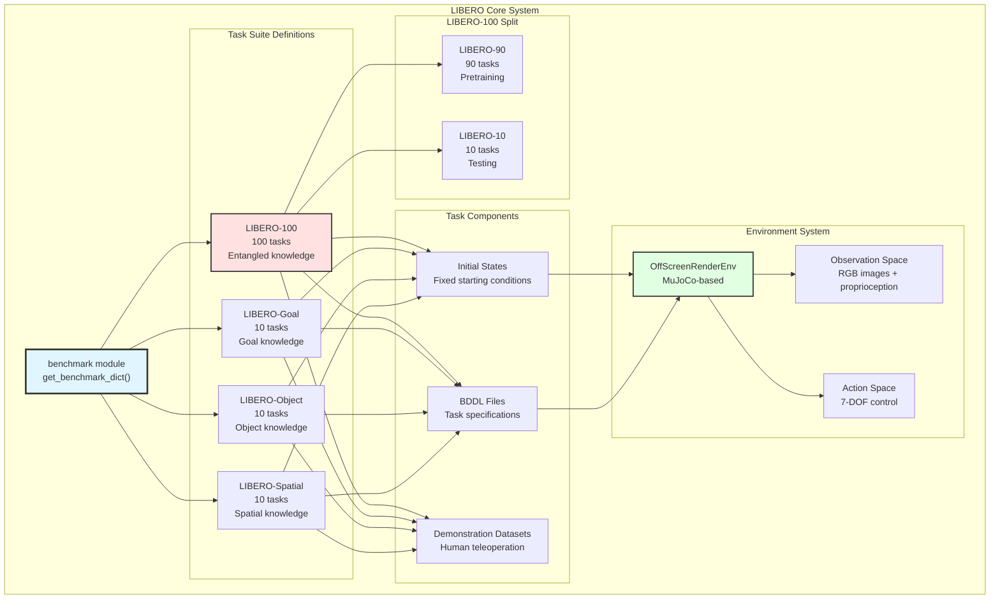
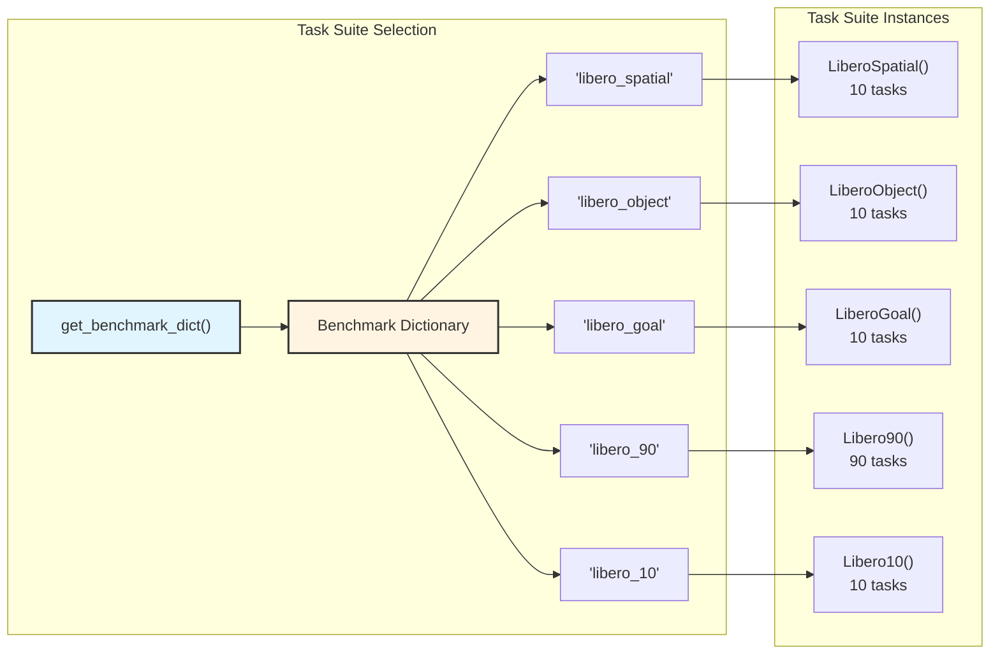
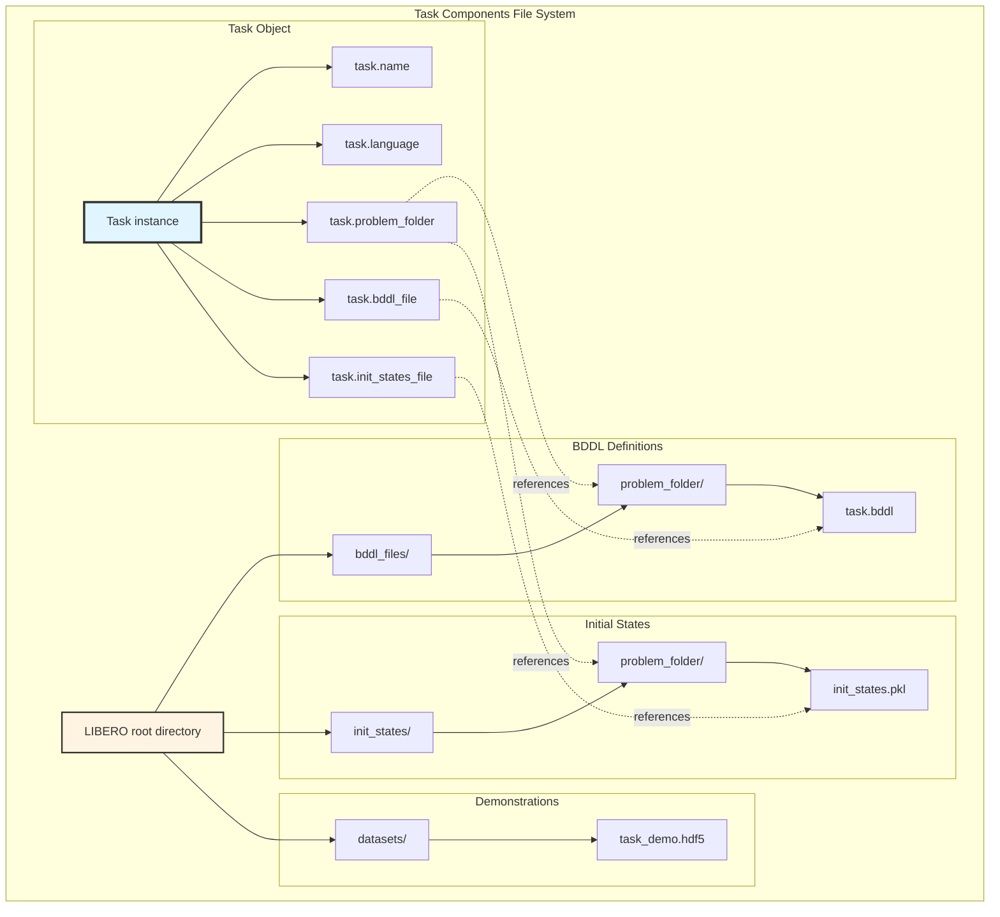
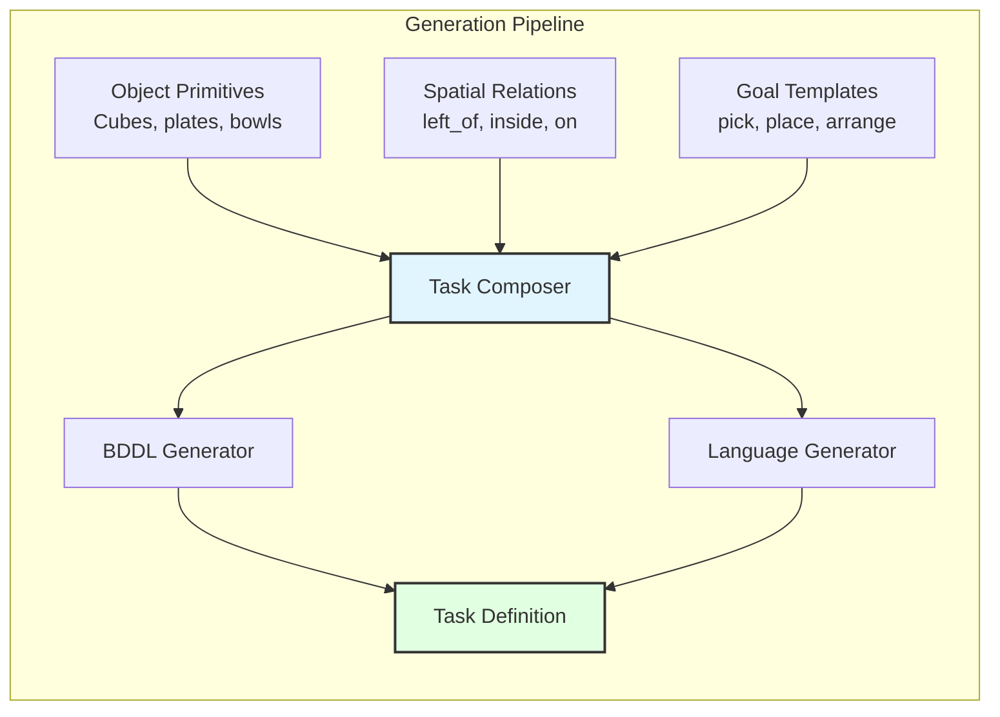
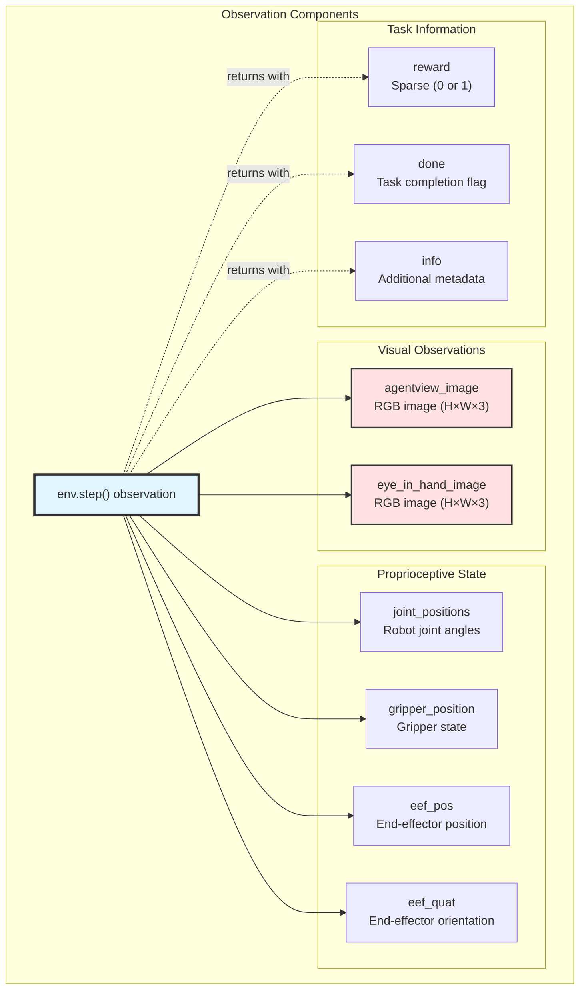
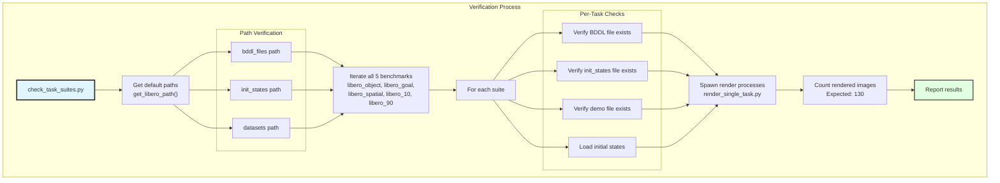
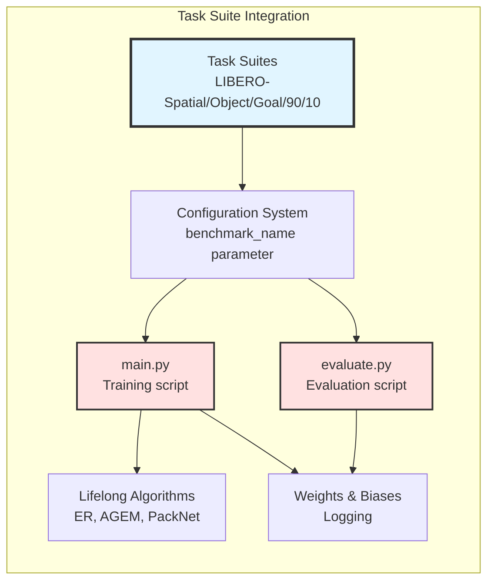

<!-- source: DeepWiki mcp.deepwiki.com · repo allenai/molmoact · page 6.1 LIBERO Architecture and Task Suites · fetched 2026-10-26 -->

# LIBERO Architecture and Task Suites

Relevant source files

The following files were used as context for generating this wiki page:

- [experiments/LIBERO/README.md](experiments/LIBERO/README.md)
- [experiments/LIBERO/benchmark_scripts/check_task_suites.py](experiments/LIBERO/benchmark_scripts/check_task_suites.py)
- [experiments/LIBERO/images/fig1.png](experiments/LIBERO/images/fig1.png)

## Purpose and Scope

This document explains the architecture of the LIBERO benchmark framework, focusing on its 130 manipulation tasks organized into four task suites and the procedural generation pipeline that enables creating new tasks. LIBERO (Lifelong roBOt learning) is a standalone benchmark system designed to study knowledge transfer in multitask and lifelong robot learning scenarios.

For training and evaluation workflows within LIBERO, see [6.4](#6.4). For lifelong learning algorithm implementations, see [6.3](#6.3). For evaluation-only integration with MolmoAct models, see [5.3](#5.3).

## System Overview

LIBERO provides a complete benchmark infrastructure for evaluating lifelong robot learning algorithms. The system is built around controlled distribution shifts that isolate specific types of knowledge transfer.

**LIBERO Task Suite System Architecture**

The system consists of 130 total tasks distributed across four suites. Each task is defined by a BDDL (Behavior Domain Definition Language) file, has fixed initial states for reproducible benchmarking, and includes human teleoperation demonstrations for imitation learning.

**Sources:** [experiments/LIBERO/README.md:26-31]()

## Task Suite Organization

LIBERO organizes its 130 tasks into four distinct suites, each designed to evaluate different aspects of knowledge transfer:

| Task Suite | Number of Tasks | Knowledge Transfer Type | Purpose |
|------------|----------------|------------------------|---------|
| **LIBERO-Spatial** | 10 | Spatial relationships | Tests transfer of spatial reasoning (e.g., "left of", "inside") |
| **LIBERO-Object** | 10 | Object manipulation | Tests transfer across different object types |
| **LIBERO-Goal** | 10 | Goal specifications | Tests transfer of manipulation skills to different goals |
| **LIBERO-100** | 100 | Entangled knowledge | Tests transfer of multiple knowledge types simultaneously |

### LIBERO-100 Split

The LIBERO-100 suite uses a unique train-test split design:

- **LIBERO-90**: 90 tasks used for pretraining policies in lifelong learning scenarios
- **LIBERO-10**: 10 held-out tasks used for testing downstream adaptation and continual learning

This split allows researchers to pretrain on a diverse task distribution and evaluate generalization to new tasks.

**Task Suite Retrieval System**

The benchmark module provides a dictionary-based interface for accessing task suites. Each key maps to a constructor function that returns a task suite instance.

**Sources:** [experiments/LIBERO/README.md:52-73](), [experiments/LIBERO/benchmark_scripts/check_task_suites.py:52-62]()

## Task Definition System

Each task in LIBERO is defined by three core components:

### BDDL Files

BDDL (Behavior Domain Definition Language) files specify task semantics including:
- Object types and quantities required
- Initial object placement constraints
- Goal conditions that define task completion
- Spatial relationships between objects

BDDL files are stored in a hierarchical structure under `bddl_files/` directory, organized by problem folder.

### Initial States

To ensure reproducible benchmarking, LIBERO provides fixed initial states for each task. These are stored as serialized environment states that can be loaded to initialize the simulation to a known configuration.

Initial states are stored in the `init_states/` directory, mirroring the structure of the BDDL files.

### Demonstration Datasets

Each task includes human teleoperation demonstrations stored in HDF5 format. These demonstrations provide:
- State trajectories
- Action sequences
- Observation sequences (images and proprioception)
- Success labels

**Task Component File Organization**

Task objects contain references to their BDDL file, initial states file, and demonstration data. The file system mirrors the task hierarchy with consistent naming across directories.

**Sources:** [experiments/LIBERO/README.md:96-132](), [experiments/LIBERO/benchmark_scripts/check_task_suites.py:70-87]()

## Procedural Generation Pipeline

LIBERO's procedural generation system enables creating an infinite number of manipulation tasks by composing:

1. **Object primitives**: Different object types (cubes, plates, bowls, etc.)
2. **Spatial relations**: Positional constraints (left_of, inside, on_top_of, etc.)
3. **Goal specifications**: Task objectives (pick, place, open, close, etc.)
4. **Language descriptions**: Natural language instructions generated from task specifications

The generation pipeline:

**Procedural Task Generation System**

The generation system combines primitives, relations, and goals to create task definitions with corresponding BDDL specifications and natural language instructions.

**Sources:** [experiments/LIBERO/README.md:26-28]()

## Task Retrieval and Environment Initialization

### Retrieving Tasks

The standard workflow for retrieving and initializing a task:

```mermaid
graph TB
    subgraph "Task Retrieval Flow"
        START["Start"]
        
        GET_DICT["benchmark.get_benchmark_dict()"]
        SELECT["Select suite name<br/>'libero_spatial', etc."]
        INSTANTIATE["Instantiate suite<br/>suite = benchmark_dict[name]()"]
        
        GET_TASK["suite.get_task(task_id)"]
        TASK_OBJ["Task object"]
        
        subgraph "Task Properties"
            LANG["task.language<br/>Natural language instruction"]
            BDDL["task.bddl_file<br/>BDDL filename"]
            PROBLEM["task.problem_folder<br/>Problem directory"]
        end
        
        BUILD_PATH["Construct full paths"]
        BDDL_PATH["bddl_file_path"]
        INIT_PATH["init_states_path"]
        
        CREATE_ENV["Create OffScreenRenderEnv"]
        LOAD_INIT["Load initial states<br/>suite.get_task_init_states()"]
        SET_STATE["env.set_init_state()"]
        
        READY["Environment ready"]
    end
    
    START --> GET_DICT
    GET_DICT --> SELECT
    SELECT --> INSTANTIATE
    INSTANTIATE --> GET_TASK
    GET_TASK --> TASK_OBJ
    
    TASK_OBJ --> LANG
    TASK_OBJ --> BDDL
    TASK_OBJ --> PROBLEM
    
    LANG --> BUILD_PATH
    BDDL --> BUILD_PATH
    PROBLEM --> BUILD_PATH
    
    BUILD_PATH --> BDDL_PATH
    BUILD_PATH --> INIT_PATH
    
    BDDL_PATH --> CREATE_ENV
    INIT_PATH --> LOAD_INIT
    
    CREATE_ENV --> SET_STATE
    LOAD_INIT --> SET_STATE
    
    SET_STATE --> READY
    
    style START fill:#e1f5ff,stroke:#333,stroke-width:2px
    style TASK_OBJ fill:#fff4e1,stroke:#333,stroke-width:2px
    style READY fill:#e1ffe1,stroke:#333,stroke-width:2px
```

**Task Retrieval and Environment Setup Workflow**

This diagram shows the complete flow from selecting a benchmark to having a ready-to-use environment with a loaded task.

### Code Example Structure

The typical code pattern follows this structure (as shown in [experiments/LIBERO/README.md:97-132]()):

1. Import `benchmark` module and `OffScreenRenderEnv`
2. Call `benchmark.get_benchmark_dict()` to get suite dictionary
3. Select suite by name (e.g., `"libero_10"`)
4. Instantiate suite: `task_suite = benchmark_dict[task_suite_name]()`
5. Get specific task: `task = task_suite.get_task(task_id)`
6. Access task properties: `task.name`, `task.language`, `task.problem_folder`, `task.bddl_file`
7. Construct full paths using `get_libero_path()`
8. Create environment with `OffScreenRenderEnv(bddl_file_name=...)`
9. Load initial states: `init_states = task_suite.get_task_init_states(task_id)`
10. Set environment state: `env.set_init_state(init_states[init_state_id])`

**Sources:** [experiments/LIBERO/README.md:96-132]()

## Environment and Observation Space

### OffScreenRenderEnv

The `OffScreenRenderEnv` class provides the simulation environment for LIBERO tasks:

- **Physics engine**: MuJoCo-based simulation
- **Rendering**: Off-screen rendering for headless servers
- **Camera configuration**: Configurable image dimensions (default 128x128)
- **Action space**: 7-DOF continuous control (position + gripper)
- **Reward function**: Sparse rewards (+1 on task completion)

### Observation Structure

**Environment Observation Structure**

The environment returns multi-modal observations including RGB images from multiple camera views and proprioceptive robot state information.

**Sources:** [experiments/LIBERO/README.md:115-131]()

## Task Suite Verification System

LIBERO provides infrastructure scripts for verifying that all task suites are correctly installed and functioning.

### check_task_suites.py

The verification script ([experiments/LIBERO/benchmark_scripts/check_task_suites.py]()) performs comprehensive checks:

**Task Suite Verification Workflow**

The verification script systematically checks that all 130 tasks have their required files and can be rendered successfully.

The script performs the following checks for each of the 130 tasks:

1. **File existence checks** ([experiments/LIBERO/benchmark_scripts/check_task_suites.py:70-84]()):
   - BDDL file at `bddl_files/{problem_folder}/{bddl_file}`
   - Initial states at `init_states/{problem_folder}/{init_states_file}`
   - Demonstration data at `datasets/{demo_file}`

2. **Task loading verification** ([experiments/LIBERO/benchmark_scripts/check_task_suites.py:85-87]()):
   - Successfully retrieves initial states via `benchmark_instance.get_task_init_states(task_id)`

3. **Rendering verification** ([experiments/LIBERO/benchmark_scripts/check_task_suites.py:94-101]()):
   - Spawns parallel rendering processes (10 at a time)
   - Renders initial and final states for each task
   - Saves visualization images to `benchmark_tasks/` directory

4. **Result counting** ([experiments/LIBERO/benchmark_scripts/check_task_suites.py:103-113]()):
   - Expects exactly 130 rendered task images
   - Reports any missing tasks

**Sources:** [experiments/LIBERO/benchmark_scripts/check_task_suites.py:42-117]()

## Integration with LIBERO Training System

The task suites integrate with the broader LIBERO training infrastructure:

**Task Suite Integration with Training Pipeline**

Task suites are selected via configuration parameters and used by both training and evaluation scripts.

The `benchmark_name` parameter accepts values: `LIBERO_SPATIAL`, `LIBERO_OBJECT`, `LIBERO_GOAL`, `LIBERO_90`, or `LIBERO_10` to select which task suite to use for experiments.

**Sources:** [experiments/LIBERO/README.md:136-150]()

## Summary

LIBERO provides a comprehensive benchmark architecture with:

- **130 manipulation tasks** organized into 4 task suites with controlled distribution shifts
- **Procedural generation capability** for creating new tasks
- **Three-component task definition**: BDDL files, initial states, and demonstration datasets
- **MuJoCo-based simulation** with configurable observation spaces
- **Verification infrastructure** to ensure correct installation
- **Integration hooks** for training and evaluation scripts

The modular design allows researchers to focus on specific knowledge transfer problems (spatial, object, or goal) or tackle the full complexity of entangled knowledge transfer with LIBERO-100. The train-test split in LIBERO-100 (90 pretraining, 10 testing) enables evaluating continual learning and adaptation to new tasks.

---

