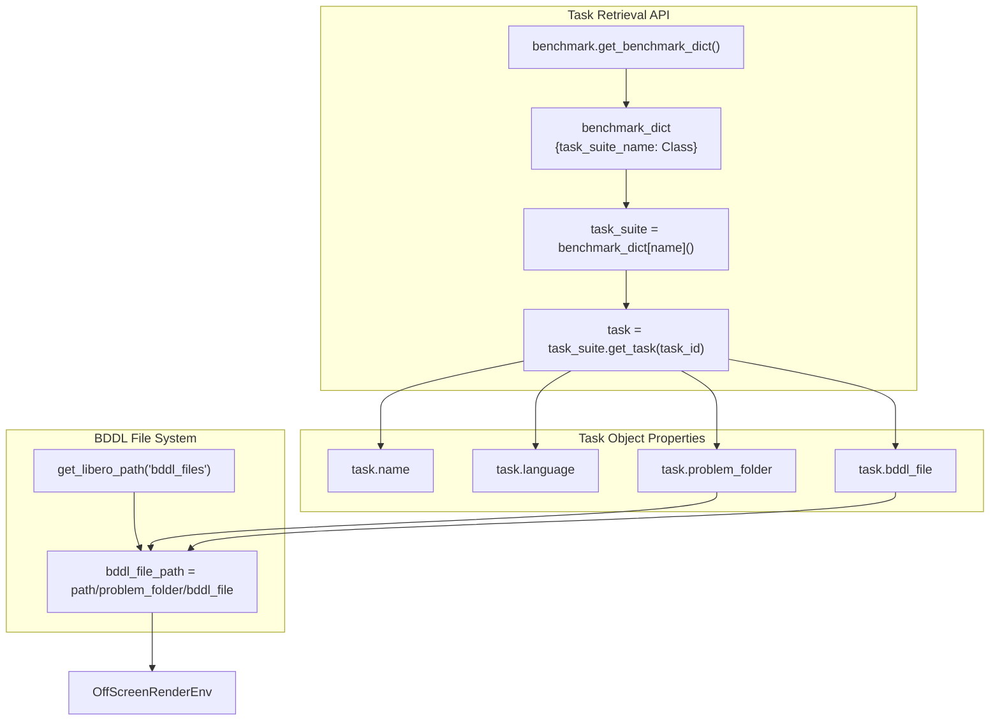
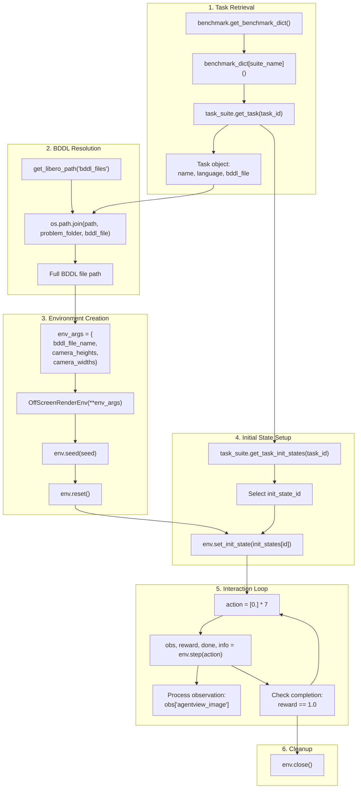

<!-- source: DeepWiki mcp.deepwiki.com · repo allenai/molmoact · page 6.2 Task Definition and Environment Setup · fetched 2026-10-26 -->

# Task Definition and Environment Setup

<details>
<summary>Relevant source files</summary>

The following files were used as context for generating this wiki page:

- [experiments/LIBERO/README.md](experiments/LIBERO/README.md)
- [experiments/LIBERO/benchmark_scripts/render_single_task.py](experiments/LIBERO/benchmark_scripts/render_single_task.py)

</details>


This page documents how to retrieve tasks from LIBERO task suites, initialize simulation environments, and interact with BDDL-defined task specifications. This covers the core workflow for working with individual LIBERO tasks, from accessing task metadata to stepping through the environment.

For information about the overall LIBERO architecture and task suite organization, see [LIBERO Architecture and Task Suites](#6.1). For training and evaluation workflows, see [LIBERO Training and Evaluation Scripts](#6.4).

---

## Task Retrieval System

LIBERO provides a centralized benchmark system for accessing tasks organized into different task suites. The retrieval process follows a hierarchical structure: benchmark dictionary → task suite → individual task.

### Benchmark Dictionary

The entry point for accessing LIBERO tasks is the `get_benchmark_dict()` function, which returns a dictionary mapping task suite names to their corresponding classes:

```python
from libero.libero import benchmark

benchmark_dict = benchmark.get_benchmark_dict()
```

**Available Task Suite Names:**
| Suite Name | Description |
|------------|-------------|
| `libero_spatial` | Spatial knowledge transfer tasks |
| `libero_object` | Object knowledge transfer tasks |
| `libero_goal` | Goal knowledge transfer tasks |
| `libero_10` | 10 test tasks from LIBERO-100 |
| `libero_90` | 90 pre-training tasks from LIBERO-100 |

### Task Suite Instantiation

Once you have the benchmark dictionary, instantiate a specific task suite by calling the class:

```python
task_suite_name = "libero_10"
task_suite = benchmark_dict[task_suite_name]()
```

### Task Objects

Individual tasks are retrieved from a task suite using the `get_task()` method with a zero-indexed task ID:

```python
task_id = 0
task = task_suite.get_task(task_id)
```

**Task Object Properties:**

| Property | Type | Description |
|----------|------|-------------|
| `task.name` | `str` | Unique task identifier |
| `task.language` | `str` | Natural language task description |
| `task.problem_folder` | `str` | Directory containing task definition |
| `task.bddl_file` | `str` | BDDL specification filename |

Sources: [experiments/LIBERO/README.md:94-113]()

---

### Task Retrieval Flow Diagram



Sources: [experiments/LIBERO/README.md:98-113]()

---

## BDDL Task Specifications

LIBERO uses BDDL (Behavior Domain Definition Language) files to define task specifications. Each task has a corresponding BDDL file that specifies the task's initial conditions, goal conditions, and object requirements.

### BDDL File Location

The full path to a BDDL file is constructed from the task's properties:

```python
from libero.libero import get_libero_path
import os

task_bddl_file = os.path.join(
    get_libero_path("bddl_files"),
    task.problem_folder,
    task.bddl_file
)
```

The `get_libero_path("bddl_files")` function returns the root directory where all BDDL specification files are stored.

### Task Description Components

Each task provides two complementary descriptions:

1. **Natural Language Description** (`task.language`): Human-readable instruction (e.g., "put the black bowl on top of the plate")
2. **BDDL File** (`task.bddl_file`): Formal specification of initial conditions and success criteria

The BDDL file is used by the environment to determine when a task is completed and to validate task configurations.

Sources: [experiments/LIBERO/README.md:109-113]()

---

## Environment Initialization

LIBERO uses the `OffScreenRenderEnv` class for headless rendering, suitable for training and evaluation without a display.

### OffScreenRenderEnv Configuration

The environment requires a BDDL file and camera configuration parameters:

```python
from libero.libero.envs import OffScreenRenderEnv

env_args = {
    "bddl_file_name": task_bddl_file,
    "camera_heights": 128,
    "camera_widths": 128
}

env = OffScreenRenderEnv(**env_args)
```

**Environment Arguments:**

| Parameter | Type | Description | Default |
|-----------|------|-------------|---------|
| `bddl_file_name` | `str` | Path to BDDL task specification | Required |
| `camera_heights` | `int` | Height of rendered images in pixels | 128 |
| `camera_widths` | `int` | Width of rendered images in pixels | 128 |

### Environment Reset

After creating the environment, initialize it with a seed and reset:

```python
env.seed(0)
env.reset()
```

The `seed()` method ensures reproducibility, while `reset()` initializes the environment to a default state.

Sources: [experiments/LIBERO/README.md:116-123](), [experiments/LIBERO/benchmark_scripts/render_single_task.py:13-20]()

---

## Initial State Management

For benchmarking purposes, LIBERO provides fixed sets of initial states for each task. This ensures consistent evaluation across different runs and algorithms.

### Retrieving Initial States

Each task suite provides a method to retrieve the initial states for a specific task:

```python
init_states = task_suite.get_task_init_states(task_id)
```

This returns a list of initial states, each representing a different starting configuration for the task.

### Setting Initial States

To set a specific initial state, use the `set_init_state()` method:

```python
init_state_id = 0
env.set_init_state(init_states[init_state_id])
```

The method accepts a state vector and configures the environment to match that state exactly. This is essential for:
- Consistent benchmarking across different algorithms
- Reproducible evaluation results
- Fair comparison of different approaches

**Important:** The `set_init_state()` method bypasses the random initialization that would normally occur during `env.reset()`.

Sources: [experiments/LIBERO/README.md:124-126]()

---

## Environment Interaction

The environment follows the standard Gym-style API for stepping through episodes.

### Action Space

LIBERO uses a 7-dimensional continuous action space:

```python
dummy_action = [0.] * 7
```

The 7 dimensions typically correspond to:
- 3D end-effector position delta (x, y, z)
- 3D end-effector orientation delta (roll, pitch, yaw)
- 1D gripper action (open/close)

### Stepping Through the Environment

The `step()` method advances the simulation by one timestep:

```python
for step in range(10):
    obs, reward, done, info = env.step(dummy_action)
```

**Return Values:**

| Value | Type | Description |
|-------|------|-------------|
| `obs` | `dict` | Observation dictionary containing image and state data |
| `reward` | `float` | Reward signal (sparse: 0 or +1) |
| `done` | `bool` | Whether the episode has terminated |
| `info` | `dict` | Additional diagnostic information |

### Observation Structure

The observation dictionary includes multiple modalities. A typical observation contains:

```python
obs["agentview_image"]  # RGB image from agent's viewpoint
```

The exact keys in the observation dictionary depend on the configuration specified in the data configuration files.

### Reward Structure

LIBERO currently only supports **sparse reward functions**:
- **+1** when the task is successfully completed (as defined by BDDL)
- **0** otherwise

This sparse reward structure makes reinforcement learning extremely challenging, which is why LIBERO primarily focuses on imitation learning approaches.

### Environment Cleanup

Always close the environment when done:

```python
env.close()
```

Sources: [experiments/LIBERO/README.md:128-133](), [experiments/LIBERO/benchmark_scripts/render_single_task.py:22-24]()

---

## Complete Task Setup Workflow



Sources: [experiments/LIBERO/README.md:94-132](), [experiments/LIBERO/benchmark_scripts/render_single_task.py:12-78]()

---

## Code Example: Complete Task Setup

The following example demonstrates the complete workflow from task retrieval to environment interaction:

```python
from libero.libero import benchmark, get_libero_path
from libero.libero.envs import OffScreenRenderEnv
import os

# 1. Retrieve task
benchmark_dict = benchmark.get_benchmark_dict()
task_suite = benchmark_dict["libero_10"]()
task = task_suite.get_task(0)

# 2. Resolve BDDL file
task_bddl_file = os.path.join(
    get_libero_path("bddl_files"),
    task.problem_folder,
    task.bddl_file
)

# 3. Create environment
env_args = {
    "bddl_file_name": task_bddl_file,
    "camera_heights": 128,
    "camera_widths": 128
}
env = OffScreenRenderEnv(**env_args)

# 4. Initialize with fixed state
env.seed(0)
env.reset()
init_states = task_suite.get_task_init_states(0)
env.set_init_state(init_states[0])

# 5. Interaction loop
for step in range(10):
    action = [0.] * 7
    obs, reward, done, info = env.step(action)
    if done:
        break

# 6. Cleanup
env.close()
```

Sources: [experiments/LIBERO/README.md:97-132]()

---

## Key Classes and Methods Reference

| Component | Location | Description |
|-----------|----------|-------------|
| `benchmark.get_benchmark_dict()` | `libero.libero.benchmark` | Returns dictionary of task suites |
| `OffScreenRenderEnv` | `libero.libero.envs` | Headless rendering environment |
| `get_libero_path()` | `libero.libero` | Resolves paths to LIBERO resources |
| `task_suite.get_task()` | Task suite instance | Retrieves task by ID |
| `task_suite.get_task_init_states()` | Task suite instance | Returns fixed initial states |
| `env.set_init_state()` | Environment instance | Sets specific initial state |
| `env.step()` | Environment instance | Advances simulation by one timestep |

Sources: [experiments/LIBERO/README.md:94-132](), [experiments/LIBERO/benchmark_scripts/render_single_task.py:1-83]()

---

