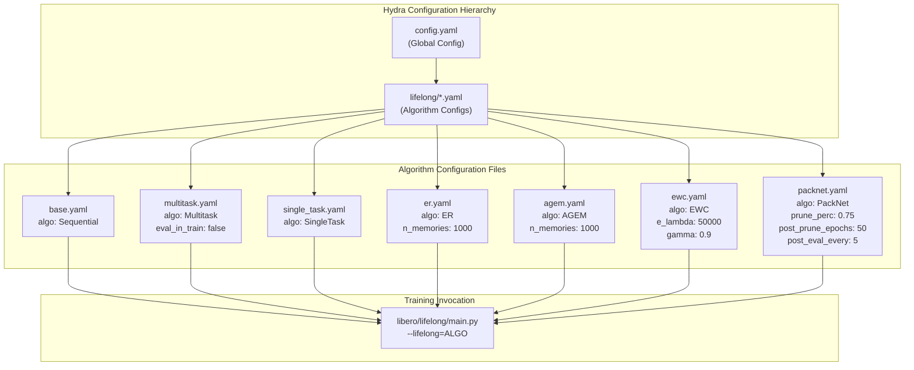
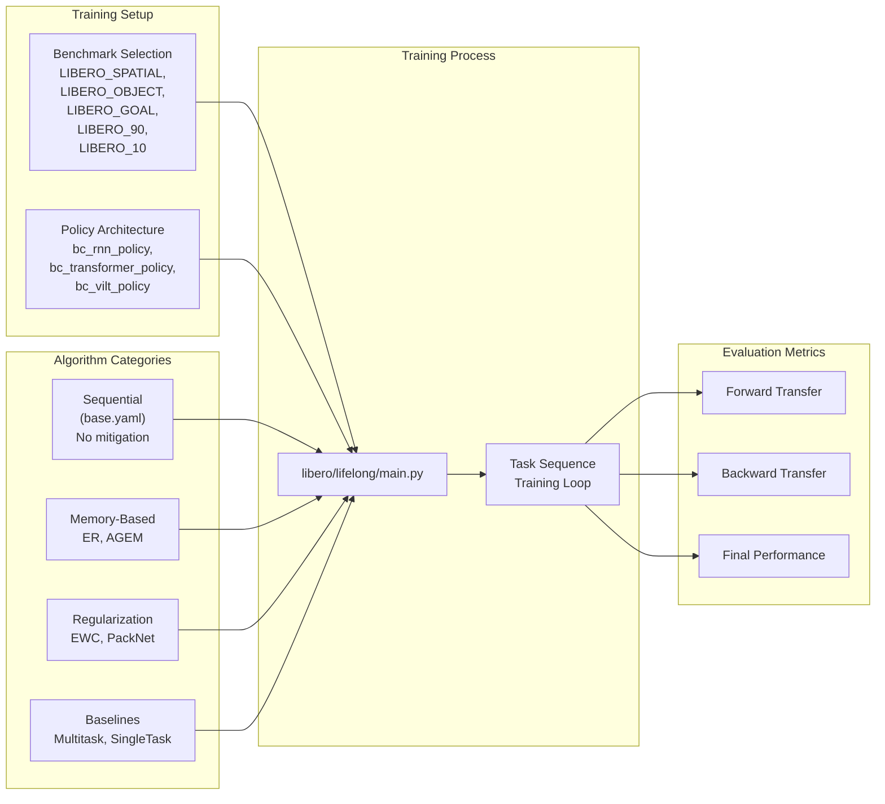
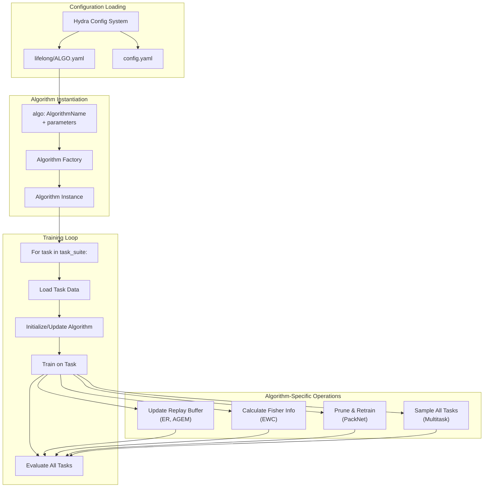

<!-- source: DeepWiki mcp.deepwiki.com · repo allenai/molmoact · page 6.3 Lifelong Learning Algorithms · fetched 2026-10-26 -->

# Lifelong Learning Algorithms

<details>
<summary>Relevant source files</summary>

The following files were used as context for generating this wiki page:

- [experiments/LIBERO/README.md](experiments/LIBERO/README.md)
- [experiments/LIBERO/libero/configs/lifelong/agem.yaml](experiments/LIBERO/libero/configs/lifelong/agem.yaml)
- [experiments/LIBERO/libero/configs/lifelong/base.yaml](experiments/LIBERO/libero/configs/lifelong/base.yaml)
- [experiments/LIBERO/libero/configs/lifelong/er.yaml](experiments/LIBERO/libero/configs/lifelong/er.yaml)

</details>


This document describes the lifelong learning algorithms supported by the LIBERO benchmark framework within MolmoAct. These algorithms enable continual learning across sequential tasks while addressing catastrophic forgetting. The page covers algorithm categories, configuration parameters, and selection mechanisms during training.

For information about the broader LIBERO framework architecture, see [LIBERO Architecture and Task Suites](#6.1). For training execution details, see [LIBERO Training and Evaluation Scripts](#6.4). For configuration system details, see [Configuration System](#7).

---

## Supported Algorithms Overview

LIBERO supports seven algorithm variants organized into three categories: sequential baselines, memory-based methods, and regularization-based methods. The following table summarizes all available algorithms:

| Algorithm | Config File | Category | Key Parameters | Primary Use Case |
|-----------|------------|----------|----------------|------------------|
| Sequential | `base.yaml` | Baseline | None | Sequential fine-tuning without forgetting mitigation |
| Multitask | `multitask.yaml` | Baseline | `eval_in_train: false` | Joint training on all tasks simultaneously |
| SingleTask | `single_task.yaml` | Baseline | None | Independent training per task (upper bound) |
| ER | `er.yaml` | Memory-Based | `n_memories: 1000` | Experience replay buffer with reservoir sampling |
| AGEM | `agem.yaml` | Memory-Based | `n_memories: 1000` | Averaged Gradient Episodic Memory |
| EWC | `ewc.yaml` | Regularization | `e_lambda: 50000`, `gamma: 0.9` | Elastic Weight Consolidation with Fisher information |
| PackNet | `packnet.yaml` | Regularization | `prune_perc: 0.75`, `post_prune_epochs: 50` | Network pruning for task isolation |

**Sources:** [experiments/LIBERO/libero/configs/lifelong/](), [experiments/LIBERO/README.md:136-149]()

---

## Algorithm Configuration Architecture

The following diagram maps algorithm names to their configuration files and shows the hierarchical relationship within the Hydra configuration system:



**Sources:** [experiments/LIBERO/libero/configs/lifelong/](), [experiments/LIBERO/README.md:143-149]()

---

## Sequential Baseline (base)

The Sequential algorithm provides a baseline for lifelong learning by performing standard fine-tuning without any forgetting mitigation strategy. The model is trained sequentially on each task, where training on Task N+1 occurs after completing training on Task N.

### Configuration

```yaml
algo: Sequential
```

**File:** [experiments/LIBERO/libero/configs/lifelong/base.yaml]()

### Characteristics

- **No Forgetting Mitigation:** The model parameters are updated freely without constraints from previous tasks
- **Catastrophic Forgetting:** Performance on earlier tasks degrades as new tasks are learned
- **Baseline Comparison:** Establishes the lower bound for lifelong learning performance
- **Computational Efficiency:** No additional memory or computation overhead

This algorithm serves as the primary baseline to measure the effectiveness of forgetting mitigation techniques in other algorithms.

**Sources:** [experiments/LIBERO/libero/configs/lifelong/base.yaml](), [experiments/LIBERO/README.md:139]()

---

## Memory-Based Algorithms

Memory-based algorithms maintain a replay buffer of experiences from previous tasks to mitigate catastrophic forgetting. During training on new tasks, the model interleaves new data with replayed memories from the buffer.

### Experience Replay (ER)

Experience Replay maintains a fixed-size buffer of past experiences using reservoir sampling. During training, each batch combines new task data with randomly sampled experiences from the replay buffer.

#### Configuration

```yaml
algo: ER
n_memories: 1000
```

**File:** [experiments/LIBERO/libero/configs/lifelong/er.yaml]()

#### Parameters

| Parameter | Value | Description |
|-----------|-------|-------------|
| `n_memories` | 1000 | Maximum number of experiences stored in replay buffer |

#### Mechanism

1. **Buffer Population:** As the agent trains on Task T, experiences are added to the replay buffer using reservoir sampling to maintain uniform distribution across all observed tasks
2. **Mixed Batch Training:** During training on Task N, each mini-batch contains both new experiences from Task N and sampled experiences from tasks 1 through N-1
3. **Uniform Sampling:** Old experiences are sampled uniformly from the buffer to provide gradient signals that prevent forgetting

**Sources:** [experiments/LIBERO/libero/configs/lifelong/er.yaml]()

### Averaged Gradient Episodic Memory (AGEM)

AGEM constrains gradient updates to ensure they do not increase loss on previous tasks. It maintains a memory buffer similar to ER but uses it differently during optimization.

#### Configuration

```yaml
algo: AGEM
n_memories: 1000
```

**File:** [experiments/LIBERO/libero/configs/lifelong/agem.yaml]()

#### Parameters

| Parameter | Value | Description |
|-----------|-------|-------------|
| `n_memories` | 1000 | Maximum number of experiences stored in memory buffer |

#### Mechanism

1. **Gradient Computation:** Compute gradient g on current task batch
2. **Reference Gradient:** Compute reference gradient g_ref on memory buffer samples
3. **Gradient Projection:** If g · g_ref < 0 (gradients conflict), project g onto the direction perpendicular to g_ref
4. **Parameter Update:** Update parameters using the potentially modified gradient

This ensures that updates on new tasks do not increase loss on the reference set of previous task experiences.

**Sources:** [experiments/LIBERO/libero/configs/lifelong/agem.yaml]()

---

## Regularization-Based Algorithms

Regularization-based algorithms add constraints to the optimization objective that preserve performance on previous tasks without storing explicit experience buffers.

### Elastic Weight Consolidation (EWC)

EWC uses the Fisher information matrix to identify important parameters for previous tasks and penalizes changes to these parameters during new task training.

#### Configuration

```yaml
algo: EWC
e_lambda: 50000
gamma: 0.9
```

**File:** [experiments/LIBERO/libero/configs/lifelong/ewc.yaml]()

#### Parameters

| Parameter | Value | Description |
|-----------|-------|-------------|
| `e_lambda` | 50000 | Regularization strength controlling penalty on important parameters |
| `gamma` | 0.9 | Discount factor for combining Fisher information across tasks |

#### Mechanism

1. **Fisher Calculation:** After training Task T, compute Fisher information matrix F_T approximating parameter importance
2. **Parameter Recording:** Store optimal parameters θ*_T for Task T
3. **Regularized Loss:** During Task T+1 training, add penalty term:
   ```
   L_total = L_current + (λ/2) * Σ F_i * (θ - θ*_i)²
   ```
4. **Fisher Accumulation:** Combine Fisher matrices across tasks using discount factor γ

The high `e_lambda` value (50000) applies strong regularization to preserve previous task performance.

**Sources:** [experiments/LIBERO/libero/configs/lifelong/ewc.yaml]()

### PackNet

PackNet allocates separate network capacity for each task through iterative pruning and retraining. Each task uses a dedicated subset of the network parameters.

#### Configuration

```yaml
algo: PackNet
prune_perc: 0.75
post_prune_epochs: 50
post_eval_every: 5
```

**File:** [experiments/LIBERO/libero/configs/lifelong/packnet.yaml]()

#### Parameters

| Parameter | Value | Description |
|-----------|-------|-------------|
| `prune_perc` | 0.75 | Percentage of parameters to prune (75% of remaining capacity) |
| `post_prune_epochs` | 50 | Number of epochs to retrain after pruning |
| `post_eval_every` | 5 | Evaluation frequency during post-pruning retraining |

#### Mechanism

1. **Initial Training:** Train network on Task T until convergence
2. **Pruning:** Remove the smallest 75% of weights by magnitude, marking them as used by Task T
3. **Retraining:** Retrain for 50 epochs on Task T with pruned parameters frozen
4. **Parameter Allocation:** Only remaining unpruned parameters are available for Task T+1
5. **Zero Forgetting:** Previous task parameters remain frozen, guaranteeing no performance degradation

PackNet provides strong forgetting prevention at the cost of network capacity exhaustion after multiple tasks.

**Sources:** [experiments/LIBERO/libero/configs/lifelong/packnet.yaml]()

---

## Baseline Algorithms

### Multitask Learning

Multitask learning trains a single policy jointly on all tasks simultaneously, representing an upper bound for lifelong learning when all task data is available concurrently.

#### Configuration

```yaml
algo: Multitask
eval_in_train: false
```

**File:** [experiments/LIBERO/libero/configs/lifelong/multitask.yaml]()

#### Parameters

| Parameter | Value | Description |
|-----------|-------|-------------|
| `eval_in_train` | false | Disables evaluation during training (performed separately) |

#### Characteristics

- **Joint Training:** All task datasets are combined and sampled uniformly during training
- **Upper Bound:** Represents the best achievable performance when task sequence doesn't matter
- **No Forgetting:** Since all tasks are trained together, there is no sequential forgetting issue
- **Comparison Baseline:** Shows performance gap between lifelong and joint training approaches

**Sources:** [experiments/LIBERO/libero/configs/lifelong/multitask.yaml]()

### Single Task Learning

Single Task learning trains independent policies for each task, providing the theoretical upper bound for task-specific performance.

#### Configuration

```yaml
algo: SingleTask
```

**File:** [experiments/LIBERO/libero/configs/lifelong/single_task.yaml]()

#### Characteristics

- **Independent Training:** Each task receives a dedicated policy trained only on its data
- **No Interference:** No positive or negative transfer between tasks
- **Performance Ceiling:** Represents maximum achievable per-task performance
- **Resource Intensive:** Requires separate models for each task (N models for N tasks)

**Sources:** [experiments/LIBERO/libero/configs/lifelong/single_task.yaml]()

---

## Algorithm Selection and Usage

### Command-Line Selection

Algorithms are selected using the Hydra configuration override system when launching training:

```bash
export CUDA_VISIBLE_DEVICES=GPU_ID && \
export MUJOCO_EGL_DEVICE_ID=GPU_ID && \
python libero/lifelong/main.py seed=SEED \
                               benchmark_name=BENCHMARK \
                               policy=POLICY \
                               lifelong=ALGO
```

The `lifelong=ALGO` parameter maps to configuration filenames:

- `lifelong=base` → loads `base.yaml` → Sequential algorithm
- `lifelong=er` → loads `er.yaml` → Experience Replay
- `lifelong=ewc` → loads `ewc.yaml` → Elastic Weight Consolidation
- `lifelong=packnet` → loads `packnet.yaml` → PackNet
- `lifelong=multitask` → loads `multitask.yaml` → Multitask learning
- `lifelong=agem` → loads `agem.yaml` → AGEM
- `lifelong=single_task` → loads `single_task.yaml` → Single Task

**Sources:** [experiments/LIBERO/README.md:143-149]()

### Algorithm Comparison Flow



**Sources:** [experiments/LIBERO/README.md:136-165]()

---

## Algorithm Characteristics Summary

The following table compares key characteristics across all algorithms:

| Algorithm | Memory Overhead | Computation Overhead | Forgetting Prevention | Transfer Learning | Scalability |
|-----------|----------------|---------------------|---------------------|-------------------|-------------|
| Sequential | None | None | None | Negative | Excellent |
| ER | O(n_memories) | Low | Moderate | Positive | Good |
| AGEM | O(n_memories) | Medium | Moderate-High | Positive | Good |
| EWC | O(parameters) | Low | Moderate | Mixed | Good |
| PackNet | None | High (retraining) | Perfect | None | Poor |
| Multitask | O(all data) | High | N/A | Positive | Fair |
| SingleTask | None | None | Perfect | None | Poor |

### Memory Overhead
- **Sequential, PackNet, SingleTask:** No additional memory beyond model parameters
- **ER, AGEM:** Fixed buffer size of `n_memories` experiences (default: 1000)
- **EWC:** Store Fisher information matrix and optimal parameters per task
- **Multitask:** Requires access to all task datasets simultaneously

### Computation Overhead
- **Low:** Sequential, ER, EWC (simple additional loss terms)
- **Medium:** AGEM (gradient projection operations)
- **High:** PackNet (post-pruning retraining), Multitask (larger effective dataset)

### Forgetting Prevention
- **None:** Sequential (catastrophic forgetting)
- **Moderate:** ER, EWC (partial mitigation)
- **Moderate-High:** AGEM (gradient-level protection)
- **Perfect:** PackNet, SingleTask (parameter isolation)
- **N/A:** Multitask (no sequential training)

**Sources:** [experiments/LIBERO/libero/configs/lifelong/](), [experiments/LIBERO/README.md]()

---

## Integration with Training Pipeline

The selected lifelong learning algorithm integrates with the main training loop through the configuration system:



**Sources:** [experiments/LIBERO/README.md:143-165](), [experiments/LIBERO/libero/configs/]()

---

## Parameter Tuning Guidelines

### Memory-Based Algorithms (ER, AGEM)

**`n_memories`:** Controls replay buffer size
- Default: 1000 experiences
- **Increase** for longer task sequences or higher-dimensional observation spaces
- **Decrease** if memory is constrained
- Trade-off: Larger buffers provide better task coverage but increase memory usage

### Regularization Algorithms (EWC)

**`e_lambda`:** Regularization strength
- Default: 50000 (strong regularization)
- **Increase** if tasks are similar and forgetting is severe
- **Decrease** if tasks are diverse and transfer learning is more important
- Trade-off: Higher values preserve old tasks but limit adaptation to new tasks

**`gamma`:** Fisher information discount
- Default: 0.9
- **Increase** (closer to 1.0) to weight all tasks equally
- **Decrease** to prioritize more recent tasks
- Trade-off: Affects relative importance of task sequence ordering

### PackNet

**`prune_perc`:** Pruning percentage
- Default: 0.75 (aggressive pruning)
- **Increase** for more task capacity
- **Decrease** for better per-task performance
- Trade-off: Higher pruning allows more tasks but may reduce individual task accuracy

**`post_prune_epochs`:** Retraining duration
- Default: 50 epochs
- **Increase** if post-pruning performance is poor
- **Decrease** for faster training
- Trade-off: Computation time vs. final performance

**Sources:** [experiments/LIBERO/libero/configs/lifelong/]()

---

